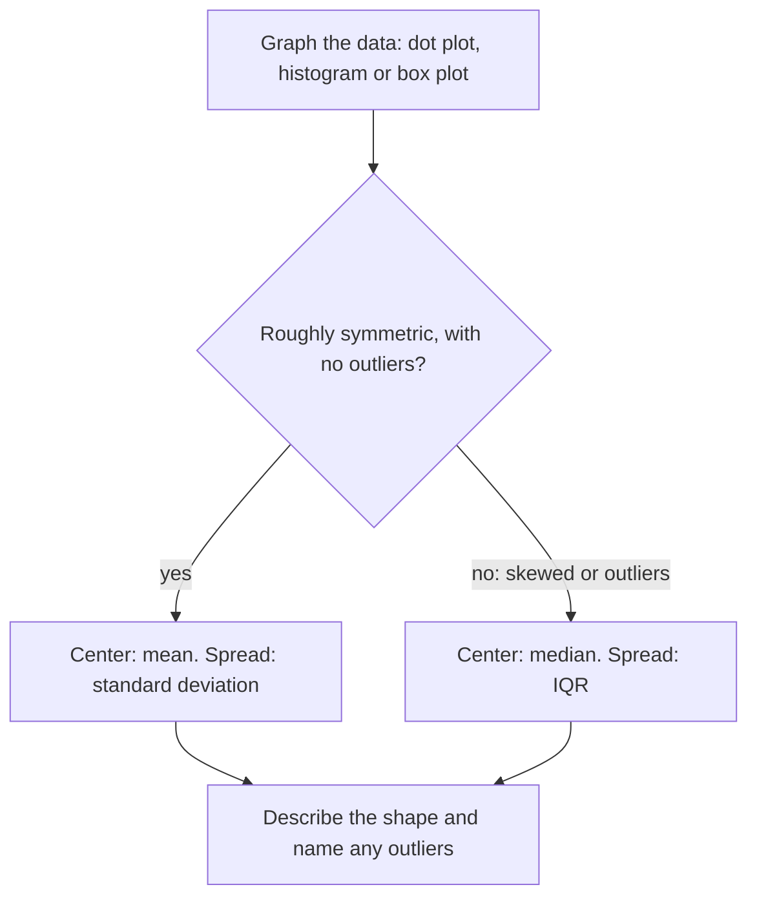

So far this course has used functions to describe exact relationships. Real measurements are messier: 30 students' commute times don't follow a formula, but they still have a typical value, a spread and a shape. This lesson, which opens the statistics module, shows how to picture a list of numbers (one variable) and how to summarize it with a center and a spread. You'll learn which summaries to trust when the data are lopsided or include an unusual value.

## Pictures of one-variable data

A **dot plot** puts one dot above a number line for each data value, stacking repeated values. It shows every value, so it suits small data sets.

```plot
{"x": [-1, 10], "y": [0, 6], "points": [[0, 1], [0, 2], [1, 1], [1, 2], [1, 3], [1, 4], [2, 1], [2, 2], [2, 3], [2, 4], [2, 5], [3, 1], [3, 2], [3, 3], [4, 1], [4, 2], [6, 1], [9, 1]], "xLabel": "books read", "yLabel": "students", "caption": "Dot plot: one dot per student; the long tail to the right makes the data skewed right"}
```

A **histogram** groups the values into equal-width intervals called bins and draws a bar for each bin whose height is the number of values in it (its frequency). The bars touch, because the bins cover the number line with no gaps. A value on a boundary, such as a score of exactly 70, goes in the bin that starts there (70–80).

```plot
{"x": [45, 105], "y": [0, 10], "bars": [{"x": 55, "height": 2, "width": 10}, {"x": 65, "height": 5, "width": 10}, {"x": 75, "height": 9, "width": 10}, {"x": 85, "height": 7, "width": 10}, {"x": 95, "height": 3, "width": 10}], "xLabel": "score", "yLabel": "students", "caption": "Histogram of 26 test scores in bins of width 10 (50–60, 60–70, …)"}
```

A histogram hides individual values (you can't tell whether the two lowest scores were 51 and 52 or 58 and 59) but shows the overall pattern of a large data set well.

The pattern is called the shape of the distribution:

- **symmetric**: the left and right sides are roughly mirror images (the histogram above is close to symmetric);
- **skewed right**: a long tail stretches to the right, toward large values (the dot plot above: most students read 0–4 books, a few read many more);
- **skewed left**: a long tail stretches to the left, toward small values (for example, scores on an easy test).

The direction of skew is the direction of the tail, not of the big clump.


## Center: mean and median

The **mean** is the ordinary average: add the values and divide by how many there are. It's written $\bar x$ ("x-bar"):

$$\bar x = \frac{x_1 + x_2 + \dots + x_n}{n}.$$

The **median** is the middle value once the data are sorted. With an odd number of values it's the single middle one; with an even number, it's the mean of the two middle ones.

For the books data above (18 students), the total is 46, so $\bar x = \tfrac{46}{18} \approx 2.56$ books. Sorted, the 9th and 10th values are both 2, so the median is 2. The mean is larger than the median because the few big values in the right tail (6 and 9) pull the total up, while the median only cares about the order of the values. That's the general pattern:

| Shape | Mean vs median |
|---|---|
| symmetric | about equal |
| skewed right | mean > median |
| skewed left | mean < median |

## Spread: range, quartiles and IQR

Two classes can have the same average with very different consistency, so a center alone is not enough. The simplest measure of spread is the range, max − min, but it depends on only the two most extreme values.

The **quartiles** split the sorted data into four parts with about the same number of values in each. In this course:

- $Q_2$ is the median;
- $Q_1$ (the first quartile) is the median of the lower half of the data;
- $Q_3$ (the third quartile) is the median of the upper half.

When $n$ is odd, leave the median itself out of both halves. (Calculators and software sometimes use slightly different rules, so their quartiles can differ a little.)

The **interquartile range** is $\text{IQR} = Q_3 - Q_1$, the width of the middle half of the data. Because it ignores the top and bottom quarters, extreme values barely affect it.

The **five-number summary** is min, $Q_1$, median, $Q_3$, max, and a **box plot** draws it: a box from $Q_1$ to $Q_3$ with a line at the median, and whiskers out to the smallest and largest values.

An **outlier** is a value far from the rest. A standard rule flags any value more than $1.5 \times \text{IQR}$ beyond the quartiles:

$$\text{outlier if } x < Q_1 - 1.5\,\text{IQR} \quad\text{or}\quad x > Q_3 + 1.5\,\text{IQR}.$$

On a box plot, outliers are drawn as separate dots and the whisker stops at the most extreme value that is not an outlier.

### Example 1

Eleven students' commute times, in minutes: 5, 8, 10, 12, 12, 15, 18, 20, 22, 25, 60. Find the five-number summary and IQR, check for outliers, and compare the mean and median with and without any outlier.

1. The data are already sorted and $n = 11$. The median is the 6th value, 15.
2. Lower half (first five values): 5, 8, 10, 12, 12, so $Q_1 = 10$. Upper half (last five): 18, 20, 22, 25, 60, so $Q_3 = 22$.
3. Five-number summary: 5, 10, 15, 22, 60. $\text{IQR} = 22 - 10 = 12$.
4. Fences: $Q_1 - 1.5(12) = 10 - 18 = -8$ and $Q_3 + 1.5(12) = 22 + 18 = 40$. The value 60 is above 40, so it is an outlier. Nothing is below $-8$.
5. Mean with 60: $\tfrac{207}{11} \approx 18.8$. Mean without it: $\tfrac{147}{10} = 14.7$. The one value moved the mean by about 4 minutes.
6. Median without 60: the 10 values have middle pair 12 and 15, so the median is 13.5. It moved only 1.5 minutes.

```shape
{"type": "shape", "x": [-2.1, 72.1], "y": [-8.4, 25.2], "segments": [{"from": [0, 0], "to": [70, 0]}, {"from": [0, 0], "to": [0, -1.68]}, {"from": [10, 0], "to": [10, -1.68]}, {"from": [20, 0], "to": [20, -1.68]}, {"from": [30, 0], "to": [30, -1.68]}, {"from": [40, 0], "to": [40, -1.68]}, {"from": [50, 0], "to": [50, -1.68]}, {"from": [60, 0], "to": [60, -1.68]}, {"from": [70, 0], "to": [70, -1.68]}, {"from": [15, 8.4], "to": [15, 19.6]}, {"from": [5, 14.0], "to": [10, 14.0]}, {"from": [22, 14.0], "to": [25, 14.0]}, {"from": [5, 11.2], "to": [5, 16.8]}, {"from": [25, 11.2], "to": [25, 16.8]}], "polygons": [{"points": [[10, 8.4], [22, 8.4], [22, 19.6], [10, 19.6]]}], "labels": [{"at": [0, -5.04], "text": "0"}, {"at": [10, -5.04], "text": "10"}, {"at": [20, -5.04], "text": "20"}, {"at": [30, -5.04], "text": "30"}, {"at": [40, -5.04], "text": "40"}, {"at": [50, -5.04], "text": "50"}, {"at": [60, -5.04], "text": "60"}, {"at": [70, -5.04], "text": "70"}], "points": [{"at": [60, 14.0], "open": true}], "caption": "Commute times (minutes): box from Q1 = 10 to Q3 = 22, median 15; the whisker stops at 25 and the outlier 60 is a separate dot"}
```

The same box plot again, with every part named, including the upper fence at 40 that decides which values count as outliers:


The lesson: the median and IQR are **resistant**, meaning a few extreme values hardly change them. The mean (and the standard deviation, below) are not.

## Standard deviation

The **standard deviation** measures how far values typically are from the mean. A small standard deviation means the values cluster tightly around $\bar x$; a large one means they're spread out. To compute it for a data set of $n$ values:

1. Find the mean $\bar x$.
2. Find each value's deviation $x - \bar x$. (These always add to 0, which is why you can't just average them.)
3. Square each deviation, which makes them all positive.
4. Average the squares: add them and divide by $n$.
5. Take the square root, to get back to the original units.

$$\sigma = \sqrt{\frac{\sum (x - \bar x)^2}{n}}$$

The symbol $\sum$ means "add up," and $\sigma$ (sigma) is the population standard deviation. When the data are a sample from a larger group, statisticians divide by $n - 1$ instead and call the result $s$, the sample standard deviation; calculators usually show both. This course uses $\sigma$ unless a problem says otherwise.

### Example 2

Find the standard deviation of 4, 6, 7, 9, 14.

1. Mean: $\tfrac{4 + 6 + 7 + 9 + 14}{5} = \tfrac{40}{5} = 8$.
2. Deviations: $-4, -2, -1, 1, 6$ (they sum to 0).
3. Squares: $16, 4, 1, 1, 36$, with sum 58.
4. Average: $\tfrac{58}{5} = 11.6$.
5. $\sigma = \sqrt{11.6} \approx 3.41$.

So these values are typically about 3.4 away from the mean of 8. (The sample version is $s = \sqrt{58/4} \approx 3.81$.) Notice that the single value 14 contributed 36 of the 58: squaring makes far-out values count a lot, which is why outliers inflate the standard deviation. On the other hand, adding the same number to every value shifts the mean by that number but leaves every deviation, and so $\sigma$, unchanged: the data move without spreading out.

## Choosing summaries and comparing groups

- Roughly symmetric, no outliers: report the mean and standard deviation.
- Skewed, or with outliers: report the median and IQR.

Whichever pair you report, describe the shape too and name any outliers:



### Example 3

Two classes took the same test. Class A: 55, 68, 75, 82, 95 (min, $Q_1$, median, $Q_3$, max). Class B: 62, 70, 74, 78, 88. Compare them.

```shape
{"type": "shape", "x": [48.5, 101.5], "y": [-6.0, 36.0], "segments": [{"from": [50, 0], "to": [100, 0]}, {"from": [50, 0], "to": [50, -1.2]}, {"from": [60, 0], "to": [60, -1.2]}, {"from": [70, 0], "to": [70, -1.2]}, {"from": [80, 0], "to": [80, -1.2]}, {"from": [90, 0], "to": [90, -1.2]}, {"from": [100, 0], "to": [100, -1.2]}, {"from": [75, 6.0], "to": [75, 14.0]}, {"from": [55, 10.0], "to": [68, 10.0]}, {"from": [82, 10.0], "to": [95, 10.0]}, {"from": [55, 8.0], "to": [55, 12.0]}, {"from": [95, 8.0], "to": [95, 12.0]}, {"from": [74, 24.0], "to": [74, 32.0]}, {"from": [62, 28.0], "to": [70, 28.0]}, {"from": [78, 28.0], "to": [88, 28.0]}, {"from": [62, 26.0], "to": [62, 30.0]}, {"from": [88, 26.0], "to": [88, 30.0]}], "polygons": [{"points": [[68, 6.0], [82, 6.0], [82, 14.0], [68, 14.0]]}, {"points": [[70, 24.0], [78, 24.0], [78, 32.0], [70, 32.0]]}], "labels": [{"at": [50, -3.6], "text": "50"}, {"at": [60, -3.6], "text": "60"}, {"at": [70, -3.6], "text": "70"}, {"at": [80, -3.6], "text": "80"}, {"at": [90, -3.6], "text": "90"}, {"at": [100, -3.6], "text": "100"}, {"at": [50.0, 16.4], "text": "Class A"}, {"at": [50.0, 34.4], "text": "Class B"}], "caption": "Similar medians, but Class A's scores are much more spread out"}
```

1. Center: the medians are 75 and 74, nearly the same.
2. Spread: Class A's IQR is $82 - 68 = 14$; Class B's is $78 - 70 = 8$. Class A's range is 40 versus 26 for B.
3. Conclusion: the classes did about equally well in the middle, but Class A's results were much more variable, with both the lowest and the highest scores.

## Common mistakes

- Finding the median without sorting the data first.
- Calling data skewed toward the side where most values are. Skew is named for the tail.
- Including the median in both halves when finding quartiles of an odd-size data set (in this course's method).
- Using $1.5 \times \text{IQR}$ measured from the median instead of from $Q_1$ and $Q_3$.
- Forgetting the square root at the end of a standard deviation calculation; $\tfrac{58}{5} = 11.6$ is the variance, not $\sigma$.
- Leaving gaps between histogram bars, or reading a bar's height as a data value.

## Key points

- Dot plots show every value; histograms show the shape of larger data sets; box plots show the five-number summary.
- Mean $\bar x$ = sum ÷ $n$; median = middle of the sorted data. Skew pulls the mean toward the tail.
- $\text{IQR} = Q_3 - Q_1$; outliers lie beyond $1.5 \times \text{IQR}$ from the quartiles.
- Standard deviation: square the deviations, average them, take the square root.
- Median and IQR resist outliers; mean and standard deviation do not.
