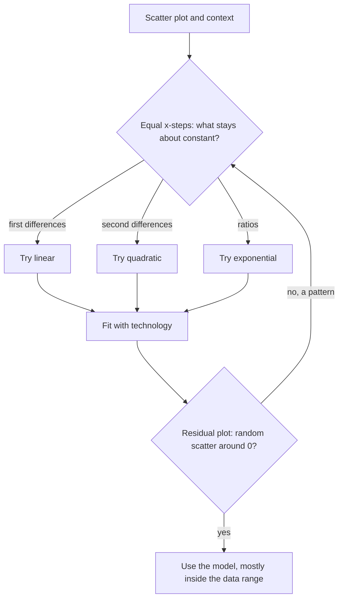

The last lesson fitted lines to data and ended with a warning: a set of points with $r \approx 0.98$ had U-shaped residuals, so a line was the wrong model even though the correlation was high. This lesson, the last in the course, fits the curves you met earlier, quadratics (Module 6) and exponentials (Module 7), to real data with technology. You'll learn what the fitted numbers mean, how to use the model, and how to choose between a line, a parabola and an exponential.

## Regression with technology

**Regression** is the process of finding the function of a chosen type that fits a set of data best. You've already seen linear regression: the line of best fit makes the sum of squared residuals as small as possible. The same idea works for curves:

- **quadratic regression** finds the best $\hat y = ax^2 + bx + c$;
- **exponential regression** finds the best $\hat y = a \cdot b^x$.

The arithmetic is long, so you let a tool do it. On a graphing calculator, enter the $x$-values and $y$-values in two lists and choose the quadratic or exponential regression command; in a spreadsheet, add a trendline of the matching type; in a graphing app, type a model such as $y_1 \sim a x_1^2 + b x_1 + c$. Different tools use slightly different methods for exponentials (many calculators fit a line to the logarithms of the $y$-values), so their last digits can disagree a little. That doesn't change any conclusion here.

Your job is everything around the computation: choosing the type of model, reading its parameters, and judging whether it fits.

## Interpreting a quadratic model

### Example 1

A model rocket's height (meters) is recorded every half second after launch.

| $t$ (s) | 0 | 0.5 | 1 | 1.5 | 2 | 2.5 | 3 | 3.5 | 4 |
|---|---|---|---|---|---|---|---|---|---|
| $h$ (m) | 1.5 | 10.1 | 17.8 | 21.5 | 24.0 | 22.6 | 20.3 | 15.1 | 6.5 |

Quadratic regression gives $\hat h = -4.91t^2 + 21.01t + 1.29$. Interpret it and use it.

1. *Shape.* The heights rise and then fall, and $a = -4.91 < 0$ means the parabola opens downward.
2. *Parameters.* In Lesson 26 a projectile in meters followed $h = -4.9t^2 + v_0t + h_0$. The fitted $a \approx -4.9$ matches gravity, $b \approx 21$ estimates the launch speed (21 m/s), and $c \approx 1.3$ estimates the launch height (1.3 m), close to the measured 1.5.
3. *Maximum.* The vertex is at $t = -\tfrac{b}{2a} = -\tfrac{21.01}{2(-4.91)} \approx 2.14$ s, with $\hat h(2.14) \approx 23.8$ m. That fits the table, which peaks between 2 and 2.5 s.
4. *Landing.* Solving $-4.91t^2 + 21.01t + 1.29 = 0$ with the quadratic formula gives $t \approx 4.34$ s (the other root is negative). This is a short extrapolation past the last reading at 4 s, so treat it as an estimate.
5. *Residuals.* At $t = 3$, $\hat h = -4.91(9) + 21.01(3) + 1.29 = 20.13$, so the residual is $20.3 - 20.13 = 0.17$ m. All nine residuals are under 0.6 m and show no pattern.

Before trusting a quadratic, you can also test the data. For equally spaced $x$-values, a linear function has constant first differences. A quadratic has constant **second differences**, the differences of the differences. Here is why: with steps of 1, $f(x + 1) - f(x) = a(2x + 1) + b$ for $f(x) = ax^2 + bx + c$, which grows by exactly $2a$ at each step. For example, $y = 2x^2 + x + 2$ at $x = 0, 1, 2, 3, 4$ gives $2, 5, 12, 23, 38$; the first differences are $3, 7, 11, 15$, and the second differences are all $4 = 2a$. Real data only come close to this, because of measurement noise, which is exactly why regression is useful.

## Interpreting an exponential model

### Example 2

A car's resale value is tracked by age.

| Age $x$ (yr) | 0 | 1 | 2 | 3 | 4 | 5 | 6 | 7 | 8 |
|---|---|---|---|---|---|---|---|---|---|
| Value $y$ (dollars) | 31,000 | 26,100 | 23,600 | 19,500 | 17,300 | 14,100 | 12,700 | 11,100 | 9,100 |

Exponential regression gives $\hat y = 30{,}980(0.86)^x$. Interpret the parameters and predict the value at age 10.

1. *Check the form.* Successive ratios $\tfrac{26{,}100}{31{,}000} \approx 0.84$, $\tfrac{23{,}600}{26{,}100} \approx 0.90$, … all hover around 0.86. Roughly constant ratios suggest an exponential.
2. *$a$:* the model's value at $x = 0$, about \$30,980 when new (the actual price was \$31,000).
3. *$b$:* each year the value is multiplied by about 0.86, so the car loses about $1 - 0.86 = 0.14$, or 14%, of its value per year.
4. *Prediction:* $\hat y(10) = 30{,}980(0.86)^{10} \approx 6{,}856$ dollars. Age 10 is beyond the data, so this is a mild extrapolation.

## Choosing a model with residuals

Several model types can look plausible for the same scatter plot. Use three checks together:

1. *Context.* Is the change a fixed amount per step (linear), a fixed percent per step (exponential), or something that rises and then falls, or falls and then rises (quadratic)?
2. *The data.* With equal $x$-steps: constant differences suggest linear, constant second differences suggest quadratic, constant ratios suggest exponential.
3. *Residual plots.* Fit each candidate and plot its residuals. Prefer the model whose residuals look like random scatter around 0 and are small. A curved pattern means the model misses the shape.

Here are the three checks as one procedure:



A high $|r|$ is not enough. $r$ only measures how close the points are to a *line*, so a strongly curved data set can still have $|r|$ near 1. Tools often report a similar number, $R^2$, for curve fits; a value near 1 is encouraging, but it doesn't tell you the curve has the right shape. The residual plot does.

### Example 3

For the car data, linear regression gives $\hat y = -2663x + 28{,}931$ with $r \approx -0.986$. Compare the residuals of the two models.

```plot
{"x": [-0.5, 11], "y": [-2000, 34000], "points": [[0, 31000], [1, 26100], [2, 23600], [3, 19500], [4, 17300], [5, 14100], [6, 12700], [7, 11100], [8, 9100]], "functions": [{"f": "30980*0.86^x"}, {"f": "-2663x + 28931", "dashed": true}], "xLabel": "age (years)", "yLabel": "value ($)", "caption": "The car data with both models: the exponential curve (solid) bends with the data; the line (dashed) runs below the points at both ends and above them in the middle, and it drops below zero after about 11 years"}
```

| Age | 0 | 1 | 2 | 3 | 4 | 5 | 6 | 7 | 8 |
|---|---|---|---|---|---|---|---|---|---|
| Linear residual | 2069 | $-168$ | $-5$ | $-1442$ | $-979$ | $-1516$ | $-253$ | 810 | 1473 |
| Exponential residual | 20 | $-543$ | 687 | $-205$ | 354 | $-474$ | 167 | 321 | $-170$ |

```plot
{"x": [-0.5, 8.5], "y": [-2000, 2500], "points": [[0, 2069], [1, -168], [2, -5], [3, -1442], [4, -979], [5, -1516], [6, -253], [7, 810], [8, 1473], {"at": [0, 20], "open": true}, {"at": [1, -543], "open": true}, {"at": [2, 687], "open": true}, {"at": [3, -205], "open": true}, {"at": [4, 354], "open": true}, {"at": [5, -474], "open": true}, {"at": [6, 167], "open": true}, {"at": [7, 321], "open": true}, {"at": [8, -170], "open": true}], "functions": [{"f": "0", "dashed": true}], "xLabel": "age (years)", "yLabel": "residual ($)", "caption": "Solid dots: linear residuals form a U. Open dots: exponential residuals scatter randomly"}
```

1. The linear residuals are positive at both ends and negative in the middle: a U shape. The data bend, and the line misses the bend.
2. The exponential residuals switch sign with no pattern and are much smaller, all within about \$700.
3. Context agrees: cars lose a percent of their value each year, not a fixed dollar amount. Choose the exponential model.
4. The two models also disagree sharply when extrapolated. The line predicts $-2663(10) + 28{,}931 \approx 2{,}300$ dollars at age 10 and a negative value by age 11, which is impossible; the exponential stays positive.

## Common mistakes

- Choosing a model only because its $r$ or $R^2$ is high, without looking at the residual plot.
- Reading the exponential $b$ as the rate: $b = 0.86$ means a 14% loss per step, not 86%.
- Treating $c$ in a quadratic model, or $a$ in an exponential one, as meaningful when $x = 0$ is far outside the data.
- Extrapolating a quadratic far beyond the data. A parabola eventually turns around, and the real data may not.
- Copying rounded parameters and expecting exact agreement with the table. Models describe the trend; residuals are expected.

## Key points

- Quadratic regression fits $\hat y = ax^2 + bx + c$; exponential regression fits $\hat y = a \cdot b^x$. Technology does the arithmetic.
- Quadratic: the sign of $a$ gives the direction, the vertex gives the maximum or minimum, and $c$ is the prediction at $x = 0$.
- Exponential: $a$ is the prediction at $x = 0$; $b$ is the factor per unit of $x$, so $b - 1$ (or $1 - b$) is the percent rate.
- Equal steps: constant differences, linear; constant second differences, quadratic; constant ratios, exponential.
- Choose the model whose residual plot is patternless and whose form fits the context.
