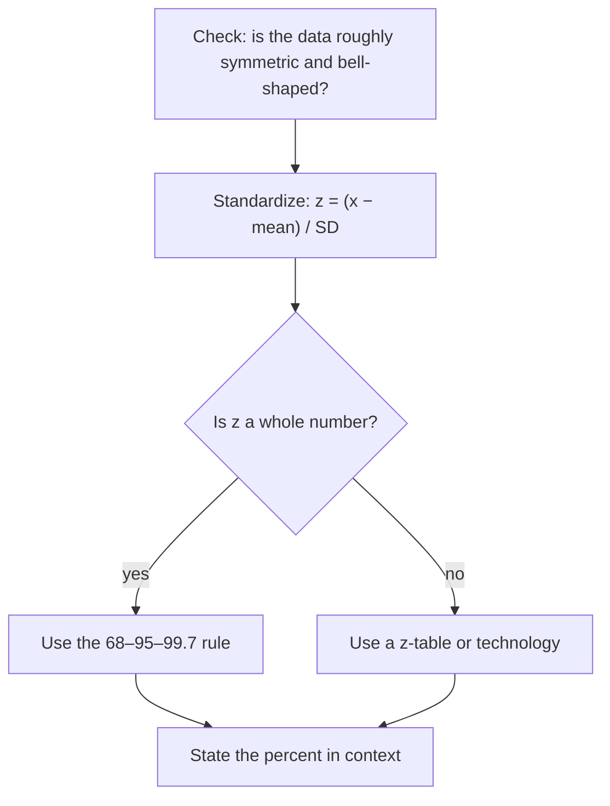

Lesson 33 measured spread with the standard deviation: the typical distance of the values from their mean. This lesson puts that number to work. Measuring distances *in standard deviations* lets you compare values from completely different data sets, and for one very common shape of data, the bell-shaped normal distribution, it tells you what percent of the values lie in any interval. This is the step from describing data to making predictions about it, and it is where most statistics courses begin.

## Measuring in standard deviations: z-scores

Suppose Maya scored 84 on a history test and 74 on a math test. Which was the better performance? The raw scores can't say, because the tests may have been different in difficulty and spread. What matters is how far each score is above its own class's mean, measured in that class's standard deviations.

The **z-score** of a value $x$ in a data set with mean $\mu$ and standard deviation $\sigma$ is

$$z = \frac{x - \mu}{\sigma}.$$

(Statisticians write $\mu$, "mew," for the mean of a whole population and keep $\bar x$ for the mean of a sample; the formula works the same way with either.) The numerator is the distance from the mean, and dividing by $\sigma$ converts it into standard-deviation units. A positive $z$ is above the mean, a negative $z$ is below it, and $z = 0$ is exactly at the mean. Turning values into z-scores is called *standardizing*.

The formula can be solved for $x$, which lets you go back from a z-score to a value:

$$x = \mu + z\sigma.$$

### Example 1

Maya's history class had mean 72 and standard deviation 8; her math class had mean 65 and standard deviation 5. Which score was relatively better?

1. History: $z = \dfrac{84 - 72}{8} = \dfrac{12}{8} = 1.5$.
2. Math: $z = \dfrac{74 - 65}{5} = \dfrac{9}{5} = 1.8$.
3. Her math score is 1.8 standard deviations above its class mean, farther than the history score's 1.5, so relative to her classmates the math test was the better performance, even though 74 is a lower number than 84.
4. Going backward: a math score with $z = -1$ would be $x = 65 + (-1)(5) = 60$.

Two facts make z-scores useful. First, if you standardize every value in a data set, the z-scores always have mean 0 and standard deviation 1: subtracting $\mu$ moves the center to 0 (Lesson 33 showed that shifting doesn't change spread), and dividing by $\sigma$ shrinks the spread to 1. Second, a z-score has no units. Heights in inches and the same heights in centimeters give exactly the same z-scores, because converting units changes the value, the mean and the standard deviation by the same factor, which cancels in the fraction.

## The normal distribution

Many measurements, such as the heights of adult women in a large population, the weights of bags filled by a machine, or repeated measurements of the same quantity, have histograms that look like a symmetric bell: a single peak in the middle, falling off evenly on both sides. A smooth curve with that exact bell shape is called a **normal distribution**, or normal curve.

A normal distribution is completely described by two numbers: its mean $\mu$, which sits at the peak and the center of symmetry, and its standard deviation $\sigma$, which sets how wide the bell is. You can even see $\sigma$ in the picture: one standard deviation from the mean on each side is exactly where the curve changes from bending downward to bending upward. The total area under the curve is 1 (that is, 100% of the data), and the area over any interval is the fraction of the values in that interval. (The curve has an equation, $y = \frac{1}{\sigma\sqrt{2\pi}}e^{-(x-\mu)^2/(2\sigma^2)}$, but you won't need it here.)

Mathematicians found this curve long before it was used for data. Abraham de Moivre derived it in 1733 as an approximation for the number of heads in many coin tosses, and Carl Friedrich Gauss used it in 1809 to describe errors in astronomical measurements, which is why it is also called the Gaussian distribution.

Real data are never *exactly* normal. A normal distribution is a model: an idealized curve that fits many data sets closely enough to be useful.

## The 68–95–99.7 rule

Because every normal curve has the same shape, the same percent of values always lies within a given number of standard deviations of the mean. The **empirical rule** (also called the 68–95–99.7 rule) gives the three most useful ones:

- about 68% of the values lie within 1 standard deviation of the mean, between $\mu - \sigma$ and $\mu + \sigma$;
- about 95% lie within 2 standard deviations;
- about 99.7% lie within 3 standard deviations.

These are rounded; the exact values are 68.27%, 95.45% and 99.73%. Splitting them using the symmetry of the curve gives the percent in each band:


The middle 68% splits into 34% on each side of the mean. The band from $\sigma$ to $2\sigma$ holds half of $95\% - 68\% = 27\%$, which is 13.5%. The band from $2\sigma$ to $3\sigma$ holds half of $99.7\% - 95\% = 4.7\%$, which is 2.35%. That leaves $0.3\%$ outside $3\sigma$, so 0.15% in each tail. Each half of the curve holds 50%: $34 + 13.5 + 2.35 + 0.15 = 50$.

### Example 2

A machine fills bags of rice. The weights are approximately normal with mean 1,000 g and standard deviation 6 g. What percent of bags weigh (a) between 988 g and 1,012 g, (b) more than 1,006 g, (c) between 994 g and 1,012 g, (d) less than 982 g?

1. Convert each boundary to a z-score: 988 is $z = -2$; 994 is $z = -1$; 1,006 is $z = 1$; 1,012 is $z = 2$; 982 is $z = -3$.
2. (a) Within 2 standard deviations: about 95%.
3. (b) Above $z = 1$: the half above the mean is 50%, and 34% of it is between the mean and $z = 1$, so $50\% - 34\% =$ 16%. (Equivalently, $\tfrac{100\% - 68\%}{2} = 16\%$.)
4. (c) From $z = -1$ to $z = 2$: $34\% + 34\% + 13.5\% =$ 81.5%.
5. (d) Below $z = -3$: only the tail, about 0.15%. A 982 g bag would be very unusual, a sign that the machine needs checking.

## Between the whole numbers: z-tables and percentiles

The empirical rule only works when the boundaries are a whole number of standard deviations from the mean. For other values, use a table of areas under the **standard normal distribution**, the normal curve with mean 0 and standard deviation 1. Standardizing turns any normal distribution into this one, so a single table serves them all. Each entry is the area to the *left* of $z$, the fraction of values below it:

| $z$ | $-2$ | $-1.5$ | $-1$ | $-0.5$ | $0$ | $0.5$ | $1$ | $1.28$ | $1.5$ | $2$ |
|---|---|---|---|---|---|---|---|---|---|---|
| area to the left | 0.0228 | 0.0668 | 0.1587 | 0.3085 | 0.5000 | 0.6915 | 0.8413 | 0.8997 | 0.9332 | 0.9772 |

Full tables list every $z$ to two decimal places, and graphing calculators and spreadsheets compute the same areas directly (look for a command such as normalcdf or NORM.DIST).

A value's **percentile** is the percent of the data at or below it. In a normal distribution, the area to the left of a value's z-score is its percentile: $z = 1$ is about the 84th percentile, since $0.8413 \approx 84\%$.

```plot
{"x": [-3.5, 3.5], "y": [0, 0.45], "functions": [{"f": "exp(-x^2/2)/sqrt(2*pi)"}], "shade": [{"f": "exp(-x^2/2)/sqrt(2*pi)", "from": -3.5, "to": 1.28}], "points": [{"at": [1.28, 0], "label": "z = 1.28"}], "xLabel": "z", "yLabel": "height of the curve", "caption": "The area to the left of z = 1.28 is about 0.90, so z = 1.28 is the 90th percentile"}
```

### Example 3

Reaction times on a computer test are approximately normal with mean 250 milliseconds (ms) and standard deviation 30 ms. (a) What percent of people react in under 205 ms? (b) What percent react in 235 to 280 ms? (c) What time marks the 90th percentile?

1. (a) $z = \dfrac{205 - 250}{30} = -1.5$. The table gives 0.0668, so about 6.7%.
2. (b) $z = \dfrac{235 - 250}{30} = -0.5$ and $z = \dfrac{280 - 250}{30} = 1$. The area between is the larger left area minus the smaller one: $0.8413 - 0.3085 = 0.5328$, about 53.3%.
3. (c) Work backward. The area to the left must be 0.90, and the table shows $z \approx 1.28$. Then $x = \mu + z\sigma = 250 + 1.28(30) = 288.4$, so about 288 ms. Nine out of ten people react faster than that.

## When the normal model does not fit

Everything above assumes the data really are close to normal. Always look at a graph first. The model is a poor choice when the data are clearly skewed, have more than one peak, or have outliers.

### Example 4

The 18 "books read" values from Lesson 33 (0, 0, 1, 1, 1, 1, 2, 2, 2, 2, 2, 3, 3, 3, 4, 4, 6, 9) have mean about 2.56 and standard deviation $\sigma \approx 2.14$. Would a normal model work?

1. Within 1 standard deviation (about 0.42 to 4.70): the values 1 through 4, which is 14 of 18, or 78%. A normal model predicts about 68%.
2. Within 2 standard deviations (about $-1.72$ to 6.84): every value except 9, so 17 of 18, or 94%.
3. A normal model would put 2.5% of students below $\mu - 2\sigma \approx -1.72$ books, which is impossible.
4. The dot plot in Lesson 33 is clearly skewed right, and the counts don't match the 68–95–99.7 pattern. The normal model is a poor fit, and percents computed from it would be misleading.



## Common mistakes

- Subtracting in the wrong order. $z = \frac{x - \mu}{\sigma}$; a value below the mean must give a negative $z$.
- Dividing by the variance instead of the standard deviation.
- Reading a z-table's area as the area to the *right*. The table here gives the area to the left; the area to the right is 1 minus it.
- Using 68% for "above $\mu + \sigma$." 68% is the middle; above $\mu + \sigma$ is 16%.
- Applying the 68–95–99.7 rule to skewed data. The rule is a property of normal curves only.
- Treating a percentile as a percent correct. The 90th percentile means scoring at or above 90% of the group, not getting 90% of the questions right.

## Key points

- $z = \dfrac{x - \mu}{\sigma}$ measures how many standard deviations a value is from the mean; $x = \mu + z\sigma$ goes back.
- z-scores compare values from different distributions; they have no units, and a whole data set's z-scores have mean 0 and standard deviation 1.
- A normal distribution is a symmetric bell curve described by $\mu$ and $\sigma$; areas under it are percents of the data.
- 68–95–99.7: within 1, 2, 3 standard deviations. Bands: 34%, 13.5%, 2.35%, 0.15% on each side.
- For other z-values, use a table or technology (area to the left = percentile), and check that the data are roughly normal first.
