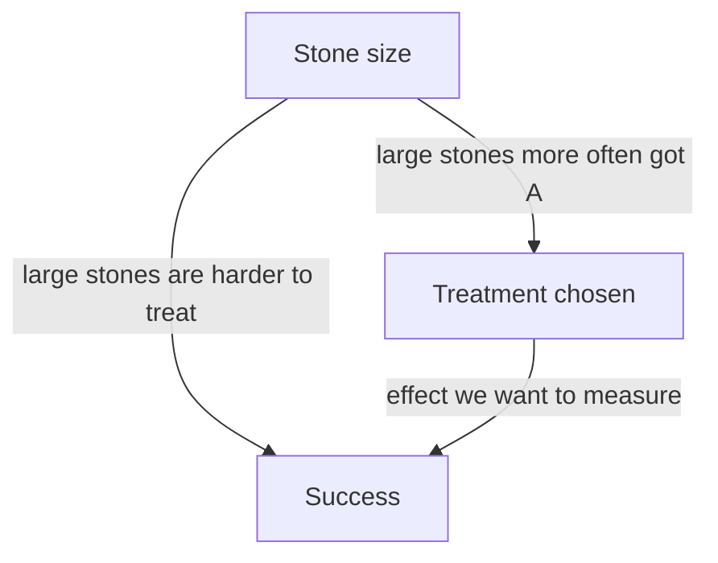

Lesson 34 compared groups with conditional relative frequencies and warned that an association is not proof of cause and effect. This lesson shows how far that warning goes. A third variable that the table leaves out can make an association look stronger, weaker, or even reverse its direction, and the reason turns out to be a piece of algebra you already know: a weighted average. The second half of the lesson asks the opposite question: if two variables had *no* association at all, what would the table look like?

## When combining groups reverses the result

### Example 1

Two hospitals each treated 400 patients for the same illness. Hospital A's survival rate was $\tfrac{335}{400} = 83.75\%$; Hospital B's was $\tfrac{340}{400} = 85\%$. Hospital B looks better. Now split the patients by how sick they were on arrival:

| | Hospital A survived | A total | A rate | Hospital B survived | B total | B rate |
|---|---|---|---|---|---|---|
| Mild cases | 95 | 100 | 95% | 270 | 300 | 90% |
| Severe cases | 240 | 300 | 80% | 70 | 100 | 70% |
| All patients | 335 | 400 | 83.75% | 340 | 400 | 85% |

1. Mild cases: A saves 95%, B saves 90%. A is better.
2. Severe cases: A saves 80%, B saves 70%. A is better again.
3. All patients together: A 83.75%, B 85%. B is better.

Both statements come from the same counts, and the arithmetic is correct. Hospital A does better with every kind of patient, yet worse overall. The key is in the totals column: three quarters of A's patients were severe cases, while three quarters of B's were mild. Severe cases die more often wherever they are treated, so A's overall rate is dragged down by its harder caseload, not by worse care.

This reversal is called **Simpson's paradox**: an association that holds within every group reverses (or disappears) when the groups are combined. It is named after the statistician Edward H. Simpson, who wrote about it in 1951, although Karl Pearson and Udny Yule had noticed versions of it around 1900. It is not really a contradiction, just a surprise; the next section shows exactly why it happens.

## Why it happens: overall rates are weighted averages

A **weighted average** combines several values, giving each a weight that says how much it counts: multiply each value by its weight, add, and divide by the total weight (as in the Module 1 honors lesson "Rates that combine"). When the weights are fractions of a whole that add to 1, as here, dividing by the total weight changes nothing, so that step drops out. Hospital A's overall survival rate is a weighted average of its two group rates, weighted by the share of its patients in each group:

$$\frac{335}{400} = \frac{100}{400}(95\%) + \frac{300}{400}(80\%) = 0.25(95\%) + 0.75(80\%) = 83.75\%.$$

Hospital B's is $0.75(90\%) + 0.25(70\%) = 85\%$. In general, if a fraction $w$ of the patients are in the mild group,

$$\text{overall rate} = w \cdot p_{\text{mild}} + (1 - w)\, p_{\text{severe}} = p_{\text{severe}} + w\,(p_{\text{mild}} - p_{\text{severe}}).$$

The second form shows that the overall rate always lies *between* the two group rates, and the weight $w$ decides where: with $w = 0$ it equals the severe rate, with $w = 1$ the mild rate, and it moves along the gap in a straight line as $w$ grows. Hospital A's 83.75% sits only a quarter of the way up from 80% to 95%, while B's 85% sits three quarters of the way up from 70% to 90%. A's higher group rates lose to B's better mix.

So Simpson's paradox needs two ingredients at once:

- the third variable strongly affects the outcome (mild cases survive much more often than severe ones), and
- the groups being compared have very different mixes of that variable (A got mostly severe cases, B mostly mild).

A variable like severity, which is related both to which group someone is in and to the outcome, is a lurking variable (Lesson 35). In medicine it is often called a confounding variable.

## Two real cases

### Example 2

A study published in the *British Medical Journal* in 1986 by Clive Charig and colleagues compared two treatments for kidney stones: open surgery (treatment A) and percutaneous nephrolithotomy, a less invasive "keyhole" procedure (treatment B). Each was used on 350 patients. In 1994 the statisticians Steven Julious and Mark Mullee pointed out that the data show Simpson's paradox.

| | A successes | A patients | A rate | B successes | B patients | B rate |
|---|---|---|---|---|---|---|
| Small stones | 81 | 87 | 93% | 234 | 270 | 87% |
| Large stones | 192 | 263 | 73% | 55 | 80 | 69% |
| All patients | 273 | 350 | 78% | 289 | 350 | 83% |

(Rates are rounded to the nearest percent.)

1. Within each stone size, A has the higher success rate.
2. Overall, B has the higher rate, 83% to 78%.
3. The mix explains it: 263 of A's 350 patients (75%) had large stones, which are harder to treat, but only 80 of B's 350 (23%) did.
4. Check with weights: A's overall rate is $\tfrac{87}{350}(93.1\%) + \tfrac{263}{350}(73.0\%) \approx 78\%$, and B's is $\tfrac{270}{350}(86.7\%) + \tfrac{80}{350}(68.8\%) \approx 83\%$.

The number lines show the weighted averages: each overall rate is pulled toward the group that holds most of that treatment's patients. The diagram below shows the lurking variable at work.

Because stone size is known *before* a treatment is chosen, the fair comparison is the one within each size, which favors A. (This is a simplified reading of one study; real treatment choices weigh other things too, such as recovery time and risk.)

*A famous admissions case.* In fall 1973, the University of California, Berkeley admitted about 44% of the 8,442 men and 35% of the 4,321 women who applied to its graduate programs. In 1975 Peter Bickel, Eugene Hammel and J. W. O'Connell looked department by department and found no pattern of bias against women within departments. Women had more often applied to departments that admitted a small share of *all* their applicants, and that mix, not the departments' decisions, produced most of the overall gap.

## Guarding against lurking variables

- *Split the data* by any variable that could affect the outcome, and compare within the groups. If the within-group comparisons agree with each other but not with the combined data, suspect Simpson's paradox.
- *Prefer experiments.* Data like the hospital and kidney stone numbers come from an **observational study**, in which researchers record what happens without deciding who gets which treatment. In a **randomized experiment**, chance (such as a coin flip or a random number generator) decides which treatment each subject gets. Random assignment tends to give every treatment a similar mix of mild and severe cases, and of every other lurking variable, including ones nobody thought to measure, so a difference in outcomes can be credited to the treatment.

## What "no association" looks like: expected counts

Lesson 34 said two categorical variables are not associated when the conditional percents are the same in every group. That idea gives a formula for the table you would *expect* if there were no association.

Look at the 200 students from Lesson 34. Overall, 84 of 200 students, or 42%, prefer online classes. With no association, each grade would also have 42% preferring online. There are 120 ninth graders, so we would expect $120 \times \tfrac{84}{200} = 50.4$ of them to prefer online. In general, the **expected count** for a cell is

$$\text{expected count} = \frac{(\text{row total}) \times (\text{column total})}{\text{grand total}}.$$

Expected counts don't have to be whole numbers; they are averages, not people.

### Example 3

Find the expected counts for the online/in-person table and compare them with the observed counts.

| | Online | In person | Total |
|---|---|---|---|
| 9th grade | 36 (expected 50.4) | 84 (expected 69.6) | 120 |
| 12th grade | 48 (expected 33.6) | 32 (expected 46.4) | 80 |
| Total | 84 | 116 | 200 |

1. 9th and online: $\tfrac{120 \times 84}{200} = 50.4$. 9th and in person: $\tfrac{120 \times 116}{200} = 69.6$.
2. 12th and online: $\tfrac{80 \times 84}{200} = 33.6$. 12th and in person: $\tfrac{80 \times 116}{200} = 46.4$.
3. Check: the expected counts have the same row and column totals as the real table ($50.4 + 69.6 = 120$, $50.4 + 33.6 = 84$, and so on).
4. Observed minus expected: $36 - 50.4 = -14.4$, $84 - 69.6 = 14.4$, $48 - 33.6 = 14.4$, $32 - 46.4 = -14.4$. Far fewer ninth graders and far more twelfth graders prefer online than "no association" would predict. The gaps are large compared with the counts, which agrees with the 30% versus 60% found in Lesson 34.

In a table with two rows and two columns, the four gaps always have the same size with alternating signs, because the rows and columns must still add to the same totals.

### Example 4

In Lesson 34's handedness table, 20 of 150 students are left-handed and 45 play an instrument. The expected count for "left-handed and plays" is $\tfrac{20 \times 45}{150} = 6$, and the observed count is exactly 6. Observed equals expected, which is another way of saying there is no association in those data.

How big a gap is "big enough" to rule out chance is a question for a later statistics course, where the chi-square test turns the gaps between observed and expected counts into a single number.

## Common mistakes

- Trusting a combined percentage without asking whether the groups have different mixes of a variable that affects the outcome.
- Averaging two percents equally ($\tfrac{95\% + 80\%}{2}$) when the groups have different sizes. Combined rates are weighted by group size.
- Thinking Simpson's paradox means the arithmetic is wrong. Both the combined and the split tables are correct; they answer different questions.
- Computing expected counts as row total ÷ grand total. You need row total × column total ÷ grand total.
- Rounding expected counts to whole numbers before comparing.
- Believing that splitting by one variable removes every lurking variable. Only randomization protects against the ones you didn't measure.

## Key points

- Simpson's paradox: an association within every group reverses or vanishes when the groups are combined.
- A combined rate is a weighted average of the group rates, so it lies between them and is pulled toward the largest group.
- The paradox needs a lurking variable that affects the outcome and is unevenly mixed across the groups being compared.
- Compare within groups of a lurking variable; randomized experiments balance lurking variables, even unmeasured ones.
- With no association, expected count = row total × column total ÷ grand total; large gaps between observed and expected counts indicate an association.
