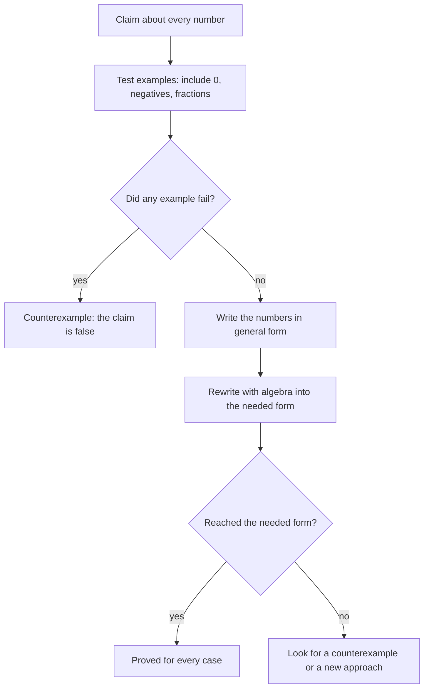

In Lesson 1 you met the properties of real numbers and read that every algebra step is one of them applied to a letter. In Lesson 5 you wrote consecutive integers as $n$, $n + 1$, $n + 2$. This lesson puts those two ideas together for a new purpose. Instead of using algebra to *find* a number, you'll use it to show that a statement is true for *every* number at once. That is what mathematicians mean by a proof, and it's the habit of mind behind everything else in this honors module.

## Examples are not a proof

Try the expression $n^2 + n + 41$ with $n = 0, 1, 2, 3$: you get 41, 43, 47, 53, all prime numbers. Keep going and you'll find primes for every $n$ from 0 to 39. It's tempting to say "it always gives a prime." But at $n = 40$:

$$40^2 + 40 + 41 = 1600 + 40 + 41 = 1681 = 41^2,$$

which is not prime. (Leonhard Euler wrote about this expression in the 1700s.) Forty examples in a row did not make the statement true.

A statement that seems true from examples but hasn't been shown true for every case is a **conjecture**. A single case where it fails is a **counterexample**, and one counterexample is enough to show a "for every number" statement is false. A **proof** is an argument, built from definitions and properties already accepted, that shows the statement holds in every case. Checking examples is still useful: it's how you form a conjecture and how you hunt for counterexamples. It just can't finish the job when there are infinitely many cases.

## Writing numbers in general form

To prove something about *every* even number, you need a way to write an even number without picking a particular one. The definitions do this:

| Kind of number | General form | Why |
|---|---|---|
| **even number** | $2k$, $k$ an integer | it is 2 times an integer |
| **odd number** | $2k + 1$, $k$ an integer | it is 1 more than an even number |
| multiple of 3 | $3k$ | 3 times an integer |
| consecutive integers | $n$, $n + 1$, $n + 2$ | each is 1 more than the last |
| two-digit number with digits $a$, $b$ | $10a + b$ | $a$ tens and $b$ ones |

Saying an integer is **divisible** by 3 means it equals 3 times some integer. So the goal of many proofs is to rewrite an expression as "3 times an integer," "2 times an integer," or "2 times an integer plus 1." The tools are the ones you already know: the distributive property, combining like terms, and factoring out a common factor.

A proof that starts from what you know and works step by step to what you want is a **direct proof**. The examples below are all direct proofs.

### Example 1: Odd plus odd

Prove that the sum of any two odd numbers is even.

1. Let the two odd numbers be $2j + 1$ and $2k + 1$, where $j$ and $k$ are integers. Two *different* letters are needed: writing both as $2k + 1$ would prove the fact only for an odd number added to itself.
2. Add: $(2j + 1) + (2k + 1) = 2j + 2k + 2$.
3. Factor out 2: $2j + 2k + 2 = 2(j + k + 1)$.
4. Since $j + k + 1$ is an integer, the sum is 2 times an integer, so it is even. ∎

The symbol ∎ (or the letters QED) marks the end of a proof.

### Example 2: Three consecutive integers

Prove that the sum of any three consecutive integers is divisible by 3, and find what the quotient is.

1. Let the integers be $n$, $n + 1$ and $n + 2$.
2. Sum: $n + (n + 1) + (n + 2) = 3n + 3$.
3. Factor: $3n + 3 = 3(n + 1)$.
4. $n + 1$ is an integer, so the sum is divisible by 3. The quotient $n + 1$ is the middle number: $14 + 15 + 16 = 45 = 3 \times 15$. ∎

The proof gave more than was asked: it showed *why* the fact is true (the sum is three copies of the middle number) and what the quotient is.

## Number tricks are proofs in disguise

"Think of a two-digit number. Reverse its digits. Subtract the smaller from the larger. The answer is always divisible by 9." Try 72: $72 - 27 = 45 = 9 \times 5$.

### Example 3: The digit-reversal trick

1. Write the number as $10a + b$, where $a$ and $b$ are its digits. Its reversal is $10b + a$.
2. Difference: $(10a + b) - (10b + a) = 9a - 9b$.
3. Factor: $9a - 9b = 9(a - b)$. That is 9 times an integer, so it is divisible by 9. ∎

The proof also predicts the quotient: it's the difference of the digits. For 72, $a - b = 7 - 2 = 5$, and $45 = 9 \times 5$. ✓

## Identities and pictures

Some proofs show that two expressions are always equal: an **identity**, as in Lesson 3. The special products of Lesson 19 give many. For instance,

$$(n + 1)^2 - n^2 = n^2 + 2n + 1 - n^2 = 2n + 1.$$

So the gaps between consecutive perfect squares, $1, 4, 9, 16, 25, \dots$, are the odd numbers $3, 5, 7, 9, \dots$. The picture below shows the same identity: to grow an $n$-by-$n$ square of dots into an $(n + 1)$-by-$(n + 1)$ square, you add a column of $n$ dots, a row of $n$ dots and one corner dot, which is $2n + 1$ dots.

A picture like this explains the identity and makes it memorable, but the algebra is what covers every $n$, including ones too large to draw.

### Example 4: Odd squares

Prove that the square of any odd number is odd, and then that it is always 1 more than a multiple of 8.

1. Let the odd number be $2k + 1$. Square it: $(2k + 1)^2 = 4k^2 + 4k + 1$.
2. Rewrite: $4k^2 + 4k + 1 = 2(2k^2 + 2k) + 1$, which is 2 times an integer plus 1. So it is odd.
3. For the second part, factor differently: $4k^2 + 4k + 1 = 4k(k + 1) + 1$.
4. $k$ and $k + 1$ are consecutive integers, so one of them is even, and their product $k(k + 1)$ is even: $k(k + 1) = 2m$ for some integer $m$.
5. Then $4k(k + 1) + 1 = 4(2m) + 1 = 8m + 1$. ∎

Check: $3^2 = 9 = 8 + 1$, $5^2 = 25 = 24 + 1$, $7^2 = 49 = 48 + 1$. Step 4 used a smaller fact inside a bigger proof; that's how longer proofs are built.

## Disproving: one counterexample is enough

"For every real number $x$, $x^2 > x$." Test $x = 3$: $9 > 3$, fine. Test $x = \tfrac12$: $\tfrac14 > \tfrac12$ is false. So the statement is false, and $x = \tfrac12$ is a counterexample (so are $x = 0$ and $x = 1$). Good places to look for counterexamples are 0, 1, negative numbers and fractions between 0 and 1, because they behave differently from the whole numbers people tend to try first.

The same idea catches algebra mistakes. Is $(a + b)^2 = a^2 + b^2$ an identity? With $a = b = 1$: the left side is 4 and the right side is 2. One counterexample proves it is not.

Notice the asymmetry: to prove "always," you need a general argument; to disprove it, one example is enough. But a statement that says "there is a number such that…" is proved by a single example: "some odd square is a multiple of 9" is proved by $9 = 3^2$.

## Proof by contradiction

A second kind of proof assumes the statement is *false* and shows that this leads to something impossible. This is **proof by contradiction**. If correct reasoning from an assumption produces an impossibility, the assumption must have been wrong.

### Example 5: A rational plus an irrational

Lesson 28 stated that $\sqrt2$ is irrational. (That fact can itself be proved by contradiction.) Use it to prove that $3 + \sqrt2$ is irrational.

1. Suppose the opposite: $3 + \sqrt2$ is rational, say $3 + \sqrt2 = \tfrac{a}{b}$ with integers $a$ and $b$, $b \neq 0$.
2. Subtract 3: $\sqrt2 = \tfrac{a}{b} - 3 = \tfrac{a - 3b}{b}$.
3. $a - 3b$ and $b$ are integers and $b \neq 0$, so $\sqrt2$ would be rational. But $\sqrt2$ is irrational. Contradiction.
4. So $3 + \sqrt2$ is irrational. ∎

Nothing in the argument depended on the 3 or on $\sqrt2$ in particular: the same steps show that a rational number plus an irrational number is always irrational.

### Example 6: An equation with no whole-number solutions

Postage stamps come in 6-cent and 9-cent values. Can you make exactly 100 cents? In algebra: are there integers $x$ and $y$ with $6x + 9y = 100$?

1. Suppose there were.
2. Factor the left side: $6x + 9y = 3(2x + 3y)$, and $2x + 3y$ is an integer, so the left side is a multiple of 3.
3. But $100 = 3 \cdot 33 + 1$ is not a multiple of 3. A number can't be both. Contradiction.
4. So no integers work, and 100 cents can't be made. ∎

The *line* $6x + 9y = 100$ has infinitely many points with real coordinates, such as $(0, \tfrac{100}{9})$. The proof shows that none of them has two integer coordinates, something no amount of graphing could settle for certain.

## Spotting a broken proof

A "proof" can look convincing and still contain an illegal step. Here's a famous one. Let $a = b$, with $a \neq 0$.

1. Multiply by $a$: $a^2 = ab$.
2. Subtract $b^2$: $a^2 - b^2 = ab - b^2$.
3. Factor: $(a + b)(a - b) = b(a - b)$.
4. Divide by $a - b$: $a + b = b$.
5. Since $a = b$: $2b = b$, so $2 = 1$.

Step 4 is the error. Because $a = b$, the quantity $a - b$ is 0, and dividing by 0 is undefined (Lesson 1). Steps 1–3 are all true statements; the false conclusion enters only at step 4. Dividing by an expression that might be zero is also the main way solutions get lost when solving equations, which is the subject of the next lesson.

## Common mistakes

- *Treating examples as a proof.* "It works for 1, 2, 3 and 10" shows nothing about 11. Use examples to form a conjecture, then prove it.
- *Using the same letter for different numbers.* Writing two odd numbers as $2k + 1$ and $2k + 1$ makes them equal.
- *Assuming what you're trying to prove.* Starting from "$2j + 2k + 2$ is even, so…" when evenness is the goal is circular.
- *Stopping one step early.* $3n + 3$ isn't obviously a multiple of 3 until you write it as $3(n + 1)$ and say $n + 1$ is an integer.
- *Dismissing a counterexample.* One failure is enough to show "always" is false, even if thousands of cases work.
- *Dividing by an expression that could be zero*, as in the $2 = 1$ "proof."

## Key points

- A conjecture is a guess from examples; a proof shows it holds in every case; one counterexample disproves an "always" statement.
- Write general numbers with letters: even $2k$, odd $2k + 1$, consecutive $n, n + 1, n + 2$, two-digit $10a + b$. Use different letters for numbers that can differ.
- Direct proof: rewrite the expression into the form you need, such as $2(\text{integer})$ or $3(\text{integer})$, by factoring.
- Proof by contradiction: assume the opposite and reach an impossibility. It shows, for example, that a rational plus an irrational is irrational.
- Every step of a proof must be legal for every value of the letters; dividing by something that could be 0 is the classic broken step.
