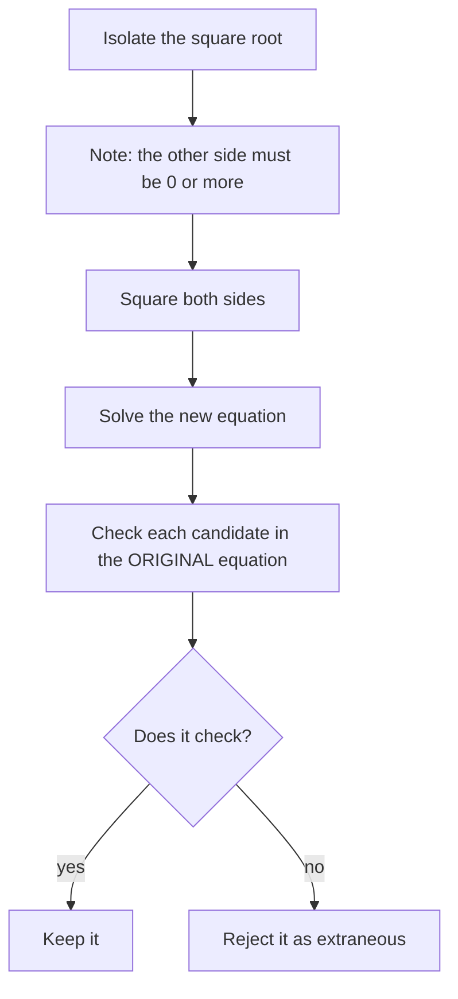

Lesson 3 described solving as a chain of **equivalent equations**: each step produces a simpler equation with exactly the same solutions, until the answer can be read off. The previous lesson ended with a "proof" that $2 = 1$, broken by a step that divided by zero. This lesson asks a question the two ideas share: which steps keep an equation equivalent, and what happens when a step doesn't? The answer explains why some methods quietly lose solutions, why others produce fake ones, and why checking an answer is sometimes a required part of the solution and not just a good habit. Along the way you'll solve a new kind of equation, one with the variable under a square root.

## Steps that can be undone

A step keeps the solution set the same when it can be undone by another legal step. Such a step is a **reversible step**.

- Adding or subtracting the same number or expression on both sides is reversible: subtract it again to undo it.
- Multiplying or dividing both sides by the same *nonzero number* is reversible: divide or multiply by that number to undo it.
- Rewriting one side (distributing, combining like terms, factoring) changes how the side looks, not its value, so it's reversible too.

If every step in a solution is reversible, then any number that satisfies the last equation also satisfies the first, and nothing can be gained or lost. That's why linear equations solved in the usual way never need a check for correctness (though a check still catches arithmetic slips).

Two kinds of steps are *not* reversible in general:

| Step | Danger | Example |
|---|---|---|
| Dividing both sides by an expression that can be 0 | loses solutions | $x^2 = 5x$ becomes $x = 5$; the solution $0$ is gone |
| Taking the square root of both sides without $\pm$ | loses solutions | $x^2 = 9$ becomes $x = 3$; the solution $-3$ is gone |
| Squaring both sides | can add solutions | $x = 3$ becomes $x^2 = 9$, which also has $-3$ |
| Multiplying both sides by an expression that can be 0 | can add solutions | see the last section |

## Steps that lose solutions

### Example 1: Don't divide by the variable

Solve $x^2 = 5x$.

The tempting move is to divide both sides by $x$ and get $x = 5$. But that step assumes $x \neq 0$, and $x = 0$ is a solution: $0^2 = 5 \cdot 0$. Lesson 4 warned about dividing by a letter that might be zero; here's the cost.

The reversible method moves everything to one side and factors:

1. $x^2 - 5x = 0$.
2. $x(x - 5) = 0$.
3. Zero product property: $x = 0$ or $x = 5$.

Both check. If you really want to divide by an expression, split into cases: the expression is 0 (test that value directly) or it isn't (then dividing is allowed).

## Steps that add solutions: squaring both sides

An equation with the variable inside a square root, such as $\sqrt{x + 6} = x$, is a **radical equation**. The natural way to remove a square root is to square it, since $(\sqrt a)^2 = a$ when $a \ge 0$. But squaring is not reversible: $a = b$ and $a = -b$ both become $a^2 = b^2$. So squaring an equation can bring in numbers that solve a different equation, the one with the opposite sign. A number that the solving process produces but that does not satisfy the original equation is an **extraneous solution**.

### Example 2: Square, solve, check

Solve $\sqrt{x + 6} = x$.

1. Square both sides: $x + 6 = x^2$.
2. Rearrange: $x^2 - x - 6 = 0$, so $(x - 3)(x + 2) = 0$.
3. Candidates: $x = 3$ or $x = -2$.
4. Check in the *original* equation.
   - $x = 3$: $\sqrt{9} = 3$, and the right side is 3. ✓
   - $x = -2$: $\sqrt{4} = 2$, but the right side is $-2$. ✗
5. The only solution is $x = 3$; $x = -2$ is extraneous.

Where did $-2$ come from? It solves the "partner" equation $\sqrt{x + 6} = -x$: $\sqrt 4 = 2 = -(-2)$. Squaring could not tell the two equations apart. The graph shows it: the curve $y = \sqrt{x + 6}$ meets the line $y = x$ once, at $x = 3$. It meets the line $y = -x$ at $x = -2$.

```plot
{"x": [-7, 6], "y": [-4, 6], "equal": true, "functions": [{"f": "sqrt(x + 6)", "label": "y = √(x + 6)"}, {"f": "x", "label": "y = x"}, {"f": "-x", "label": "y = −x", "dashed": true}], "points": [{"at": [3, 3], "label": "(3, 3): real solution"}, {"at": [-2, 2], "label": "(−2, 2): solves √(x + 6) = −x"}], "caption": "Squaring √(x + 6) = x also catches the crossing with y = −x, which gives the extraneous −2"}
```

A quick test catches most extraneous solutions before the full check: a principal square root is never negative (Lesson 28), so the side equal to it must be $\ge 0$. In Example 2 the right side is $x$, so any candidate with $x < 0$ fails at once.

### Example 3: Isolate the root first

Solve $\sqrt{x - 3} + 5 = x$.

Squaring with the $+5$ still attached would give $(\sqrt{x - 3} + 5)^2$, which expands to a messier expression that still contains a root. So isolate the root first.

1. Subtract 5: $\sqrt{x - 3} = x - 5$. (So a solution needs $x - 5 \ge 0$, that is, $x \ge 5$.)
2. Square: $x - 3 = (x - 5)^2 = x^2 - 10x + 25$.
3. Rearrange: $x^2 - 11x + 28 = 0$, so $(x - 4)(x - 7) = 0$.
4. Candidates: $x = 4$ or $x = 7$.
5. Check in the original equation:
   - $x = 4$: $\sqrt{1} + 5 = 6 \neq 4$. ✗ (Also $4 < 5$, so it fails the sign test.)
   - $x = 7$: $\sqrt{4} + 5 = 7$. ✓
6. Solution: $x = 7$.

A common slip in step 2 is to square the right side term by term, writing $x^2 + 25$. Squaring a binomial needs the middle term: $(x - 5)^2 = x^2 - 10x + 25$ (Lesson 19).

Here is the whole procedure as a chart.



It's possible for every candidate to be extraneous. For $\sqrt{x} = -2$, squaring gives $x = 4$, but $\sqrt 4 = 2$, not $-2$. There is no solution, which you could have seen immediately: a principal square root can't be negative.

## Absolute value and hidden conditions

Lesson 7 solved $|A| = B$ by splitting into $A = B$ or $A = -B$. That split is only reversible when $B \ge 0$, because an absolute value is never negative. When $B$ contains the variable, the condition has to be checked.

### Example 4

Solve $|2x - 1| = x - 5$.

1. Split: $2x - 1 = x - 5$ gives $x = -4$; and $2x - 1 = -(x - 5)$ gives $3x = 6$, so $x = 2$.
2. Check: $x = -4$ gives $|-9| = 9$ on the left and $-9$ on the right. ✗ And $x = 2$ gives $|3| = 3$ on the left and $-3$ on the right. ✗
3. Neither candidate works, so there is no solution.

The condition $x - 5 \ge 0$, or $x \ge 5$, rules out both candidates at once. Graphically, the V-shaped graph of $y = |2x - 1|$ stays above the line $y = x - 5$ everywhere.

## Multiplying by an expression

Multiplying both sides by an expression that contains the variable can add solutions in the same way squaring does. Consider

$$\frac{x}{x - 2} = \frac{2}{x - 2}.$$

Multiplying both sides by $x - 2$ gives $x = 2$. But at $x = 2$ both denominators are 0, so the original equation isn't even defined there. The step "multiply by $x - 2$" was only reversible if $x - 2 \neq 0$, and the one candidate is exactly the excluded value. The equation has no solution. In Algebra 2 you'll meet many equations like this, called rational equations, and the rule will be the same: note the values that make a denominator zero before you start, and reject them at the end.

## Common mistakes

- *Dividing by the variable*, as in $x^2 = 5x \to x = 5$. Factor instead.
- *Forgetting $\pm$* when taking a square root: $x^2 = 9$ has two solutions.
- *Skipping the check after squaring.* After a non-reversible step, the check is part of the solution, not an extra.
- *Checking in the squared equation.* Every candidate satisfies the squared equation; only the original can expose an extraneous one.
- *Squaring before isolating the root*, which leaves a root in the new equation.
- *Squaring a binomial term by term*: $(x - 5)^2 \neq x^2 + 25$.

## Key points

- Equivalent equations have the same solutions. Reversible steps keep equations equivalent: adding the same expression, multiplying by a nonzero number, rewriting a side.
- Dividing by an expression that can be 0, or taking a square root without $\pm$, can lose solutions.
- Squaring both sides, or multiplying by an expression that can be 0, can add extraneous solutions.
- For a radical equation: isolate the root, square, solve, and check every candidate in the original equation. The side equal to a square root must be $\ge 0$.
- $|A| = B$ needs $B \ge 0$; check candidates when $B$ contains the variable.
