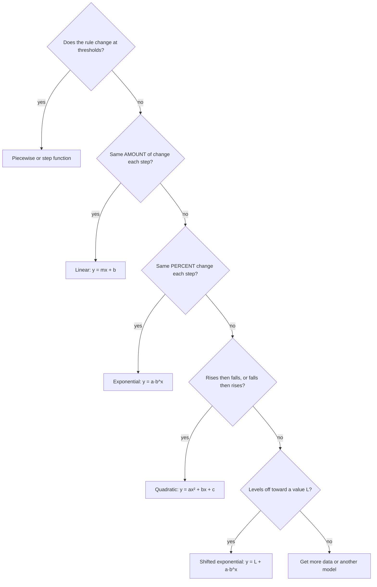

This course has built many models: cost lines in Lesson 12, projectile parabolas in Lesson 26, growth and decay in Lesson 30, step functions in Lesson 13, and fitted curves in Lesson 36. In each lesson, though, the hard decisions were already made for you: the lesson told you which kind of function to use. In real problems nobody does. This lesson steps back and looks at modeling as a process with its own steps, the way engineers, scientists and economists use it. It also adds one new family of functions, the kind that levels off toward a value other than zero.

## What a model is, and the cycle

A **mathematical model** is a description of a real situation in mathematical terms (an equation, a function, a table or a graph) that is simple enough to work with and accurate enough to answer a question. Every model leaves things out. A model is judged by whether it answers its question well enough, not by whether it's perfectly true.

Building a model is rarely a straight line from question to answer. It's a loop, often called the **modeling cycle**:


1. *Problem.* Decide exactly what question you're answering and what counts as a good answer (a rough estimate? a number to the nearest cent?).
2. *Formulate.* Choose the variables and their units, state your **assumptions** (the simplifications you're accepting), and pick a type of function or equation.
3. *Compute.* Do the math: solve, evaluate, graph, fit.
4. *Interpret.* Translate the math answer back into the situation, with units: "$t = 7.5$" becomes "about 7.5 minutes after pouring."
5. *Validate.* Ask whether the answer makes sense. Compare it with data, check the units and the domain, and test the extremes. If the model fails, go back and revise it.
6. *Report.* Give the answer, the assumptions it depends on, and how far to trust it.

## Units keep you honest

Units are the cheapest validation tool there is. Two rules do most of the work:

- You can only add, subtract or set equal quantities with the same units. A formula like "distance = speed + time" is wrong before you plug anything in.
- Units multiply and divide like variables. (miles/hour) × hours = miles, because hours cancel.

Using units this way to set up or check a calculation is **dimensional analysis**. To change units, multiply by a **conversion factor**: a fraction equal to 1, such as $\tfrac{5280 \text{ ft}}{1 \text{ mi}}$, arranged so the unwanted unit cancels.

### Example 1: How far does a car go while you react?

A driver going 60 miles per hour takes 1.5 seconds to react before braking. How far does the car travel in that time, in feet?

1. Convert the speed so its units match the time (seconds) and the answer (feet):
$$60\,\frac{\text{mi}}{\text{h}} \times \frac{5280 \text{ ft}}{1 \text{ mi}} \times \frac{1 \text{ h}}{3600 \text{ s}} = \frac{60 \times 5280}{3600}\,\frac{\text{ft}}{\text{s}} = 88\,\frac{\text{ft}}{\text{s}}.$$
   Miles cancel against miles and hours against hours, leaving ft/s.
2. Distance = rate × time: $88\,\tfrac{\text{ft}}{\text{s}} \times 1.5 \text{ s} = 132$ ft.
3. Interpret and validate: before braking even starts, the car covers 132 ft, longer than a basketball court (94 ft). That's a big number, and it matches the reaction distances that driver handbooks commonly list, so the answer passes the sense check.

If the conversion factors had been flipped, the units would come out as $\text{mi}^2/\text{h}^2$ or similar nonsense, and the mistake would show before any arithmetic.

## Estimating with stated assumptions

Some questions can't be answered exactly, but a careful estimate is still valuable. An estimate built from a chain of reasonable assumptions, each one stated, is called a **Fermi estimate**, after the physicist Enrico Fermi, who was known for making them. The point isn't the exact number; it's getting the right size and knowing which assumptions matter most.

### Example 2: Shower water

About how many gallons of water does a household of 3 people use for showers in a year?

1. *Formulate.* Assumptions: each person showers once a day for 8 minutes, and the showerhead delivers 2 gallons per minute. (In the US, new showerheads are limited by law to 2.5 gallons per minute, and many use less.)
2. *Compute*, with units in the chain:
$$3 \text{ people} \times \frac{1 \text{ shower}}{\text{person} \cdot \text{day}} \times \frac{8 \text{ min}}{\text{shower}} \times \frac{2 \text{ gal}}{\text{min}} \times \frac{365 \text{ days}}{\text{yr}} = 17{,}520 \ \frac{\text{gal}}{\text{yr}}.$$
3. *Validate* by testing the assumptions. If showers last 10 minutes, the total rises by a factor of $\tfrac{10}{8} = 1.25$, to 21,900 gallons. A 2.5 gal/min head has the same effect. A 1.5 gal/min head gives 13,140. So reasonable assumptions give roughly 13,000 to 22,000 gallons.
4. *Report.* "Roughly 15,000 to 20,000 gallons a year, assuming daily 8-minute showers." Giving 17,520 as if it were exact would claim more accuracy than the assumptions allow.

Because the model is a product, a 25% change in any one factor changes the answer by 25%. That tells you which numbers are worth measuring more carefully: the uncertain ones.

## Choosing the type of function

Formulating a model usually means choosing a family of functions. The chart summarizes how the families in this course differ. It's a guide, not a rule: real data are messy, and the reasons behind a pattern matter as much as its shape.



The last family is new. Many quantities settle toward a level that isn't zero: a hot drink cools toward room temperature, a cold one warms toward it, and a new skill's test score climbs toward a ceiling. In these cases it's the *distance from the level* that shrinks by the same percent each step. If $L$ is the level, then $y - L = a \cdot b^x$, so

$$y = L + a \cdot b^x, \qquad 0 < b < 1.$$

The graph is an exponential decay curve moved up by $L$. Its horizontal asymptote is $y = L$ instead of $y = 0$ (Lesson 30).

### Example 3: Coffee, one full cycle

A cup of coffee is poured at 90 °C in a room at 20 °C. Measurements:

| Time (min) | 0 | 5 | 10 | 15 | 20 |
|---|---|---|---|---|---|
| Temperature (°C) | 90 | 70 | 55 | 45 | 37 |

The question: what will the temperature be after 30 minutes?

1. *First formulation.* The temperature drops by a smaller amount each time, which looks like exponential decay. Using the points at 0 and 10 minutes, the factor over 10 minutes is $\tfrac{55}{90} \approx 0.611$, so $T = 90(0.611)^{t/10}$.
2. *Compute.* At $t = 30$: $90(0.611)^3 \approx 20.5$ °C.
3. *Validate.* At $t = 20$ the model gives $90(0.611)^2 \approx 33.6$, but the coffee measured 37: the model is already cooling too fast. Worse, look at the extremes: as $t$ grows, this model goes toward 0 °C. Coffee in a 20 °C room can't cool below 20 °C. The model fails, so revise it.
4. *Revised formulation.* Assume (this is a version of **Newton's law of cooling**) that the *difference* between the coffee and the room shrinks by the same factor in equal times. The difference starts at $90 - 20 = 70$ and is $55 - 20 = 35$ at 10 minutes: it halves every 10 minutes. So
$$T = 20 + 70\left(\tfrac12\right)^{t/10}.$$
5. *Validate again.* At $t = 5$: $20 + 70(0.5)^{0.5} \approx 69.5$ (measured 70). At $t = 15$: $\approx 44.7$ (measured 45). At $t = 20$: $37.5$ (measured 37). As $t$ grows, $T$ approaches 20 °C, as it should.
6. *Compute and report.* At $t = 30$: $20 + 70\left(\tfrac12\right)^{3} = 20 + 8.75 = 28.75$, so "about 29 °C after half an hour, assuming the room stays at 20 °C." Real cooling also depends on the cup, stirring and evaporation, so treat the model as an approximation.

```plot
{"x": [0, 60], "y": [0, 100], "xLabel": "time t (min)", "yLabel": "temperature T (°C)", "functions": [{"f": "20 + 70*0.5^(x/10)", "label": "revised: T = 20 + 70(1/2)^(t/10)"}, {"f": "90*(55/90)^(x/10)", "label": "first try: T = 90(0.611)^(t/10)", "dashed": true}, {"f": "20", "label": "room temperature 20 °C", "dashed": true}], "points": [[0, 90], [5, 70], [10, 55], [15, 45], [20, 37]], "caption": "The first model drops toward 0 °C; the revised model levels off at room temperature and fits the data"}
```

## Common mistakes

- *Skipping validation.* A model that fits the data you used can still predict nonsense, like coffee colder than the room. Test the extremes and the domain.
- *Reporting false precision.* An estimate built on rough assumptions should be rounded and stated as a range.
- *Hiding assumptions.* A reader can't judge a model whose assumptions aren't written down.
- *Mixing units*, such as miles per hour with seconds, or adding quantities with different units.
- *Choosing a family by habit.* Use what the situation does (constant amount, constant percent, a level it approaches) and what the data show.
- *Forgetting the shift.* For a quantity that levels off at $L$, it's $y - L$, not $y$, that decays exponentially.

## Key points

- A model is a simplified mathematical description built to answer a question.
- The modeling cycle: problem, formulate, compute, interpret, validate, and either revise or report.
- Dimensional analysis: only like units add or are set equal; units cancel like variables; conversion factors are fractions equal to 1.
- A Fermi estimate chains stated assumptions; report it as a range and note which assumption matters most.
- A quantity that levels off at $L$ often fits $y = L + a \cdot b^x$ with $0 < b < 1$.
