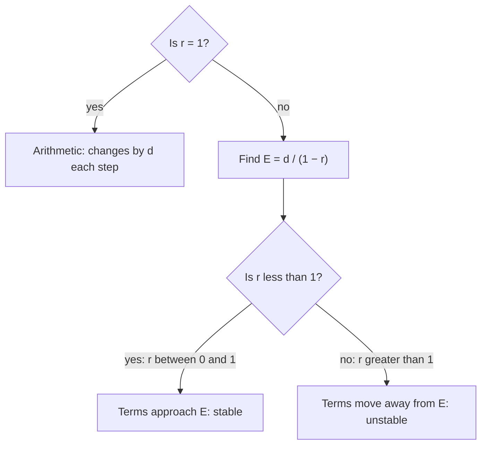

In Lesson 32 you met two kinds of recursive rules. An arithmetic sequence adds the same amount each step, $a_n = a_{n-1} + d$, and a geometric sequence multiplies by the same factor, $a_n = r\,a_{n-1}$. Many real systems do both at once. A savings account earns interest (multiply) and receives a deposit (add) every month. A patient's body clears part of a medicine (multiply by the fraction left) and then the next dose arrives (add). A fish pond's population grows (multiply) and then some fish are caught (subtract). This lesson studies the rule that combines them. It uses the modeling cycle from the previous lesson and the proof habits from the first lesson of this module, and it shows where these quantities head in the long run, often without computing a single term past the first few.

## The rule

A **recursive model** of this kind gives a starting value and the rule

$$a_n = r\,a_{n-1} + d,$$

where $r$ is the factor applied to the previous value and $d$ is the amount added each step ($d < 0$ for an amount removed). With $d = 0$ it's geometric; with $r = 1$ it's arithmetic. This lesson keeps $r > 0$.

The picture shows the idea for a medicine taken at regular intervals: each dose adds a fixed amount, and between doses the body removes a fixed fraction of whatever is there.


Order matters. "Multiply, then add" ($a_n = r\,a_{n-1} + d$) is not the same as "add, then multiply" ($a_n = r(a_{n-1} + d) = r\,a_{n-1} + rd$). Read the situation carefully to see which happens first.

### Example 1: Repeated doses

A patient takes 200 mg of a medicine every 8 hours. Between doses the body removes 60% of the medicine present, so 40% remains. (This is a simplified model: real drug levels rise and fall continuously, and the model only tracks the amount just after each dose.) Let $a_n$ be the amount just after the $n$th dose.

1. $a_1 = 200$, and the rule is $a_n = 0.4\,a_{n-1} + 200$.
2. Walk through the rule:

| $n$ | 1 | 2 | 3 | 4 | 5 | 6 | 7 |
|---|---|---|---|---|---|---|---|
| $a_n$ (mg) | 200 | 280 | 312 | 324.8 | 329.92 | 331.97 | 332.79 |

For example, $a_2 = 0.4(200) + 200 = 280$ and $a_3 = 0.4(280) + 200 = 312$.

3. The amount rises quickly at first and then levels off a little above 330 mg.

```plot
{"x": [0, 11], "y": [0, 380], "xLabel": "dose number n", "yLabel": "amount after dose (mg)", "functions": [{"f": "1000/3", "dashed": true, "label": "equilibrium 333.3 mg"}], "points": [[1, 200], [2, 280], [3, 312], [4, 324.8], [5, 329.92], [6, 331.97], [7, 332.79], [8, 333.12], [9, 333.25], [10, 333.3]], "caption": "aₙ = 0.4aₙ₋₁ + 200: the amount climbs toward 333.3 mg and levels off"}
```

## Equilibrium: the value that stays put

Where does the amount level off? Look for a value $E$ that the rule leaves unchanged: if $a_{n-1} = E$, then $a_n = E$ too. That gives the equation

$$E = rE + d.$$

Solve it like any linear equation: $E - rE = d$, so $E(1 - r) = d$, and

$$E = \frac{d}{1 - r} \qquad (r \neq 1).$$

This value is the **equilibrium** of the model. For the medicine, $E = \dfrac{200}{1 - 0.4} = \dfrac{200}{0.6} \approx 333.3$ mg. Check: $0.4(333.\overline{3}) + 200 = 133.\overline{3} + 200 = 333.\overline{3}$. ✓ At equilibrium, the 200 mg added by each dose exactly replaces the 60% removed: $0.6 \times 333.\overline{3} = 200$.

## Why it levels off: a short proof

The proof style from the first lesson of this module explains *how* the sequence approaches $E$. Subtract the equilibrium equation $E = rE + d$ from the rule $a_n = r\,a_{n-1} + d$:

$$a_n - E = r\,a_{n-1} - rE = r\,(a_{n-1} - E).$$

The $d$'s cancel. So the distance from equilibrium, $a_n - E$, is multiplied by $r$ at every step: it's a geometric sequence. Using the geometric formula from Lesson 32,

$$a_n - E = (a_1 - E)\,r^{\,n-1}, \qquad\text{so}\qquad a_n = E + (a_1 - E)\,r^{\,n-1}.$$

This explicit formula gives any term directly. It's the same shape as the shifted exponential $y = L + a \cdot b^x$ from the previous lesson: the coffee and the medicine level off for the same reason.

### Example 2: Using the explicit formula

For the medicine model, find $a_{10}$, and find the first dose after which the amount is within 1 mg of equilibrium.

1. $E = \tfrac{1000}{3} \approx 333.33$ and $a_1 - E = 200 - 333.33 = -133.33$.
2. $a_n = 333.33 - 133.33\,(0.4)^{n-1}$.
3. $a_{10} = 333.33 - 133.33\,(0.4)^9 \approx 333.33 - 0.035 = 333.30$ mg.
4. Within 1 mg means $133.33\,(0.4)^{n-1} < 1$. Try values: $(0.4)^5 \approx 0.0102$ gives $1.37$, too big; $(0.4)^6 \approx 0.0041$ gives $0.55$, small enough. So $n - 1 = 6$, and $n = 7$: after the 7th dose, given 48 hours after the first, the amount is within 1 mg of 333.3 mg. The table agrees: $a_7 \approx 332.79$.

## When the equilibrium repels: $r > 1$

When $0 < r < 1$, the distance from $E$ shrinks every step, so the sequence approaches $E$ from any start. That's a **stable equilibrium**. When $r > 1$, the distance *grows* every step, so any start other than $E$ moves away from it. That's an **unstable equilibrium**.

A pond's fish population grows 20% a year, and then 300 fish are caught: $P_n = 1.2\,P_{n-1} - 300$. The equilibrium is $E = \dfrac{-300}{1 - 1.2} = \dfrac{-300}{-0.2} = 1500$. Starting at exactly 1500, the population stays at 1500. Starting at 1600, the distance $+100$ is multiplied by 1.2 each year: 1620, 1644, 1672.8, … and the population grows without limit (in the model). Starting at 1400, the distance $-100$ grows the same way: 1380, 1356, 1327.2, … and the population collapses. A manager who sets the catch at exactly the equilibrium level is balancing on a knife's edge. (Real populations can't grow forever, so a better model would include crowding. That revision is a topic for later courses.)

```plot
{"x": [0, 10], "y": [800, 2200], "xLabel": "year n", "yLabel": "fish population", "functions": [{"f": "1500", "dashed": true, "label": "equilibrium 1500"}, {"f": "1500 + 100*1.2^x", "label": "start 1600", "dashed": true}, {"f": "1500 - 100*1.2^x", "label": "start 1400", "dashed": true}], "points": [[0, 1600], [1, 1620], [2, 1644], [3, 1672.8], [4, 1707.4], [5, 1748.8], [6, 1798.6], [7, 1858.3], [8, 1930.0], [9, 2016.0], [10, 2119.2], [0, 1400], [1, 1380], [2, 1356], [3, 1327.2], [4, 1292.6], [5, 1251.2], [6, 1201.4], [7, 1141.7], [8, 1070.0], [9, 984.0], [10, 880.8]], "caption": "Pₙ = 1.2Pₙ₋₁ − 300: populations that start near 1500 move away from it"}
```

The chart sums up what $r$ and $d$ decide.



### Example 3: Saving every month

You open an account with \$0 and deposit \$100 at the end of every month. The account earns 0.5% interest per month, added before each deposit. How much is in it after 2 years?

1. Rule: $B_n = 1.005\,B_{n-1} + 100$ with $B_0 = 0$ (multiply by 1.005 for interest, then add the deposit). Here the sequence starts at $n = 0$, so the explicit formula uses $r^n$ instead of $r^{n-1}$.
2. Equilibrium: $E = \dfrac{100}{1 - 1.005} = \dfrac{100}{-0.005} = -20{,}000$. A negative balance has no meaning for this account, but the algebra still works: $r > 1$, so the balance moves away from $-20{,}000$, which is exactly what growing savings should do.
3. Explicit formula: $B_n = E + (B_0 - E)(1.005)^n = -20{,}000 + 20{,}000(1.005)^n = 20{,}000\left[(1.005)^n - 1\right]$.
4. After 24 months: $20{,}000\left[(1.005)^{24} - 1\right] \approx 20{,}000(0.12716) \approx \$2{,}543.20$.
5. Interpret: you deposited $24 \times \$100 = \$2{,}400$, so about \$143 is interest. A spreadsheet that applies the rule 24 times gives the same balance, which is a good validation.

## Common mistakes

- *Mixing up the order*: "add, then multiply" and "multiply, then add" give different rules.
- *Using the percent removed as $r$.* If 60% is removed, $r = 0.4$, the fraction that remains.
- *Forgetting the starting value.* The rule alone doesn't determine the sequence (Lesson 32).
- *Sign errors in $E = \frac{d}{1 - r}$*, especially when $r > 1$ or $d < 0$. Check by putting $E$ back into the rule.
- *Assuming every equilibrium attracts.* With $r > 1$, the sequence moves away from $E$.
- *Off-by-one exponents.* Starting at $a_1$ gives $r^{n-1}$; starting at $a_0$ gives $r^n$.

## Key points

- The rule $a_n = r\,a_{n-1} + d$ combines geometric change (factor $r$) with a steady input $d$.
- The equilibrium solves $E = rE + d$: $E = \dfrac{d}{1 - r}$ for $r \neq 1$.
- The distance from equilibrium is geometric: $a_n = E + (a_1 - E)\,r^{\,n-1}$.
- For $0 < r < 1$ the sequence approaches $E$ (stable); for $r > 1$ it moves away (unstable).
- Validate a recursive model by computing a few terms directly and comparing with the explicit formula.
