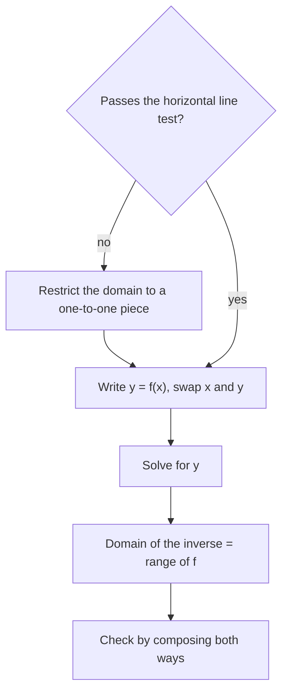

A function turns inputs into outputs. Often you want to go backward: given a temperature in Fahrenheit, what was it in Celsius? Given the balance in an account, how long has it been growing? An inverse function runs a function in reverse. This lesson explains when an inverse exists, how to find one, what its graph looks like, and how to use composition from the last lesson to check that you have the right one. Inverses come back in Module 6, where the logarithm is defined as the inverse of an exponential function.

## Undoing a function

If $f$ sends $a$ to $b$, its inverse sends $b$ back to $a$:

$$f(a) = b \quad\Longleftrightarrow\quad f^{-1}(b) = a.$$

The notation $f^{-1}$ is read "$f$ inverse." The $-1$ is not an exponent here: $f^{-1}(x)$ does not mean $\dfrac{1}{f(x)}$.

Because inputs and outputs trade places, every point $(a, b)$ on $f$ becomes the point $(b, a)$ on $f^{-1}$, and the domain and range swap: the domain of $f^{-1}$ is the range of $f$, and the range of $f^{-1}$ is the domain of $f$. With a table, you can find the inverse by swapping the columns:

| $x$ | 0 | 1 | 2 | 3 |
|---|---|---|---|---|
| $f(x)$ | 5 | 7 | 9 | 11 |

So $f^{-1}(9) = 2$ and $f^{-1}(5) = 0$.

## When does an inverse exist?

Running a function backward only works if each output came from just one input. A function is **one-to-one** if different inputs always give different outputs: $f(a) = f(b)$ only when $a = b$.

The squaring function is not one-to-one, since $f(3) = f(-3) = 9$. Asked "which input gave 9?", there's no single answer, so $y = x^2$ has no inverse function on all the real numbers.

The **horizontal line test** checks this with a graph: a function is one-to-one exactly when no horizontal line crosses its graph more than once. (A horizontal line at height $b$ meets the graph at every input whose output is $b$.) Compare the vertical line test from Algebra 1, which decides whether a graph is a function at all.

When a function fails the test, you can often **restrict the domain** to a part where it passes. Keeping only $x \ge 0$ makes $y = x^2$ one-to-one, and its inverse on that piece is $y = \sqrt{x}$. That's exactly why $\sqrt x$ means the nonnegative root.

A function with an inverse is called **invertible**, and its inverse is the **inverse function**: the function $f^{-1}$ with $f^{-1}(f(x)) = x$ for every $x$ in the domain of $f$ and $f(f^{-1}(x)) = x$ for every $x$ in the domain of $f^{-1}$.

## Finding an inverse algebraically

1. Replace $f(x)$ with $y$.
2. Swap $x$ and $y$. (This is the "trade inputs and outputs" step.)
3. Solve the new equation for $y$.
4. Replace $y$ with $f^{-1}(x)$, and state its domain (the range of $f$) if it's restricted.

The whole process, including the check at the end, fits in one chart:



### Example 1

Find the inverse of $f(x) = 3x - 5$ and verify it by composition.

1. $y = 3x - 5$.
2. Swap: $x = 3y - 5$.
3. Solve: $x + 5 = 3y$, so $y = \dfrac{x + 5}{3}$.
4. $f^{-1}(x) = \dfrac{x + 5}{3}$.

This makes sense as a reversal: $f$ multiplies by 3 and then subtracts 5, and $f^{-1}$ undoes those steps in reverse order, adding 5 and then dividing by 3.

Verify: $f(f^{-1}(x)) = 3\left(\dfrac{x + 5}{3}\right) - 5 = x + 5 - 5 = x$, and $f^{-1}(f(x)) = \dfrac{(3x - 5) + 5}{3} = \dfrac{3x}{3} = x$. Both compositions give $x$, so the inverse is correct.

### Example 2

Find the inverse of $f(x) = \sqrt{x - 2}$, then graph both.

1. The domain of $f$ is $x \ge 2$ and its range is $y \ge 0$. It passes the horizontal line test, since it always increases.
2. $y = \sqrt{x - 2}$. Swap: $x = \sqrt{y - 2}$.
3. Square both sides: $x^2 = y - 2$, so $y = x^2 + 2$.
4. The domain of $f^{-1}$ is the range of $f$, so $f^{-1}(x) = x^2 + 2$ **for $x \ge 0$** only. Without that restriction, $x^2 + 2$ would be a whole parabola, which isn't one-to-one.

Check one point: $f(6) = \sqrt4 = 2$, and $f^{-1}(2) = 4 + 2 = 6$. ✓

## The graph of an inverse

Since $(a, b)$ on $f$ becomes $(b, a)$ on $f^{-1}$, and swapping coordinates is the same as reflecting across the line $y = x$, the graph of $f^{-1}$ is the mirror image of the graph of $f$ across $y = x$.

```plot
{"x": [-1, 8], "y": [-1, 8], "equal": true, "functions": [{"f": "sqrt(x - 2)", "from": 2, "to": 8, "label": "f(x) = √(x − 2)"}, {"f": "x^2 + 2", "from": 0, "to": 2.45, "dashed": true, "label": "f⁻¹(x) = x² + 2, x ≥ 0"}, {"f": "x", "from": -1, "to": 8, "color": "gray", "label": "y = x"}], "points": [{"at": [6, 2], "label": "(6, 2)"}, {"at": [2, 6], "label": "(2, 6)"}, {"at": [2, 0]}, {"at": [0, 2]}], "caption": "A function and its inverse are reflections of each other across y = x"}
```

The picture below shows the reflection in detail. The dashed segment joining $(6, 2)$ and $(2, 6)$ crosses $y = x$ at a right angle, at its midpoint $(4, 4)$: that is what reflecting across a line means. The endpoint $(2, 0)$ of $f$ becomes the endpoint $(0, 2)$ of $f^{-1}$.


You can use this to sketch an inverse without a formula: reflect a few key points and connect them.

### Example 3

Find the inverse of $f(x) = \dfrac{2x + 1}{x - 3}$.

1. $y = \dfrac{2x + 1}{x - 3}$. Swap: $x = \dfrac{2y + 1}{y - 3}$.
2. Clear the fraction: $x(y - 3) = 2y + 1$, so $xy - 3x = 2y + 1$.
3. Collect the $y$ terms on one side and factor out $y$: $xy - 2y = 3x + 1$, so $y(x - 2) = 3x + 1$.
4. $f^{-1}(x) = \dfrac{3x + 1}{x - 2}$.

The domain of $f$ excludes 3, and the domain of $f^{-1}$ excludes 2. That fits: $f$ never outputs 2 (its horizontal asymptote, which Module 5 explains), so 2 is not in the range of $f$. Check: $f(4) = \dfrac{9}{1} = 9$ and $f^{-1}(9) = \dfrac{28}{7} = 4$. ✓

### Example 4

Is $g(x) = x^2 - 4x$ one-to-one? If not, restrict its domain to $x \ge 2$ and find the inverse there.

1. $g(0) = 0$ and $g(4) = 16 - 16 = 0$: two inputs, same output. Not one-to-one.
2. Complete the square: $g(x) = (x - 2)^2 - 4$. It's a parabola with vertex $(2, -4)$, so on $x \ge 2$ it rises and passes the horizontal line test. Its range there is $y \ge -4$.
3. Swap: $x = (y - 2)^2 - 4$. Then $x + 4 = (y - 2)^2$.
4. Take the square root. On this piece $y \ge 2$, so $y - 2 \ge 0$ and we take the positive root: $y - 2 = \sqrt{x + 4}$.
5. $g^{-1}(x) = 2 + \sqrt{x + 4}$, with domain $x \ge -4$. Check: $g(5) = 25 - 20 = 5$, and $g^{-1}(5) = 2 + \sqrt9 = 5$. ✓

## Common mistakes

- Reading $f^{-1}(x)$ as $\dfrac{1}{f(x)}$. The inverse undoes $f$; the reciprocal divides 1 by it.
- Undoing the steps in the original order. Undo the last step first: the inverse of "times 3, then minus 5" is "plus 5, then divide by 3," not "divide by 3, then plus 5."
- Forgetting to restrict the domain of the inverse to the range of $f$, as in $f^{-1}(x) = x^2 + 2$ for $x \ge 0$.
- Claiming an inverse for a function that isn't one-to-one, such as $y = x^2$ on all real numbers.
- Checking only one composition. For a full check, $f(f^{-1}(x))$ and $f^{-1}(f(x))$ should both simplify to $x$.

## Key points

- $f(a) = b$ means $f^{-1}(b) = a$; points $(a, b)$ become $(b, a)$, and the domain and range swap.
- An inverse function exists exactly when $f$ is one-to-one (passes the horizontal line test). Restrict the domain if necessary.
- To find $f^{-1}$: write $y = f(x)$, swap $x$ and $y$, solve for $y$.
- The graph of $f^{-1}$ is the reflection of the graph of $f$ across $y = x$.
- Verify with composition: $f(f^{-1}(x)) = x$ and $f^{-1}(f(x)) = x$.
