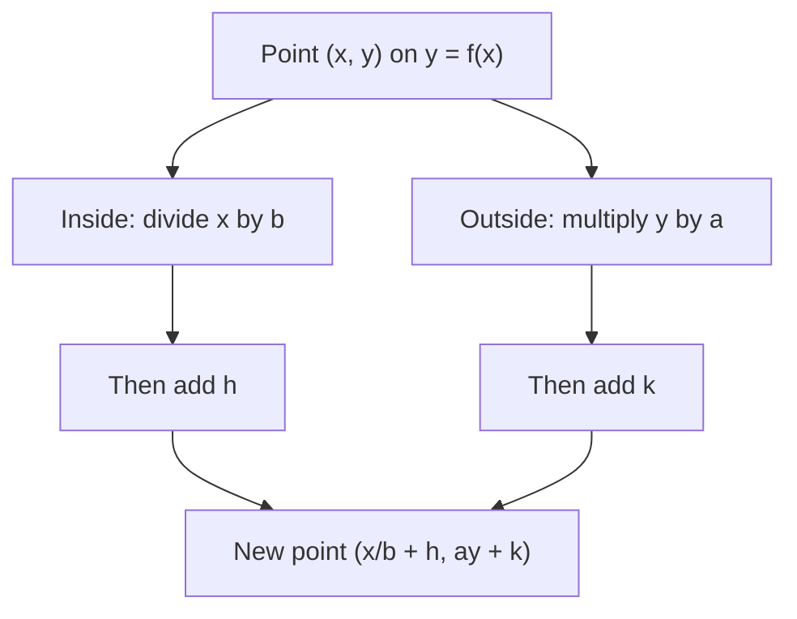

The transformations lesson used the form $y = a f(x - h) + k$, and it only touched on what happens when the input is multiplied as well as shifted. This lesson finishes the job in two ways. First, it looks at the two kinds of symmetry a graph can have about the axes, which you can test with algebra instead of eyeballing a picture. Second, it handles the general form $y = a f(b(x - h)) + k$, including formulas like $f(2x - 6)$ where the shift is easy to misread. The two ideas meet at the end: a transformed graph keeps the symmetry of its parent, moved to a new place.

## Even and odd functions

Look at $y = x^2$. The outputs at $3$ and $-3$ are the same, and so are the outputs at any pair of opposite inputs. Its graph is its own mirror image across the $y$-axis. Now look at $y = x^3$: the outputs at $3$ and $-3$ are $27$ and $-27$, opposites. Its graph is unchanged by a half turn (a $180^\circ$ rotation) about the origin.

These two patterns get names.

- A function is an **even function** if $f(-x) = f(x)$ for every $x$ in its domain. Its graph is symmetric about the $y$-axis: whenever $(a, b)$ is on the graph, so is $(-a, b)$.
- A function is an **odd function** if $f(-x) = -f(x)$ for every $x$ in its domain. Its graph is **symmetric about the origin**: whenever $(a, b)$ is on the graph, so is $(-a, -b)$.


The definitions say "the domain" deliberately. Both tests compare $x$ with $-x$, so the domain itself must be symmetric: if $x$ is allowed, $-x$ must be too. The function $\sqrt{x}$ has domain $x \ge 0$, so it can't be even or odd.

The names come from powers. If $n$ is even, $(-x)^n = x^n$; if $n$ is odd, $(-x)^n = -x^n$. So $x^2$, $x^4$, $x^6$ are even functions and $x$, $x^3$, $x^5$ are odd ones. A polynomial whose terms all have even exponents (a constant counts, since $c = cx^0$) is even, and one whose terms all have odd exponents is odd. Mix the two kinds and the polynomial is usually neither.

Two consequences are worth knowing:

- If an odd function is defined at $0$, then $f(0) = 0$, because $f(0) = f(-0) = -f(0)$ forces $f(0) = 0$. So $x^3 + 1$ can't be odd: its value at $0$ is $1$.
- Most functions are neither even nor odd. The only function that is both (on a symmetric domain) is the zero function, since $f(x) = f(-x) = -f(x)$ means $f(x) = 0$.

### Example 1

Classify each function as even, odd or neither: (a) $p(x) = x^4 - 3x^2 + 2$; (b) $q(x) = \dfrac{x}{x^2 + 1}$; (c) $r(x) = x^3 + x^2$; (d) $s(x) = \lvert x \rvert - x^2$.

The method: compute $f(-x)$, simplify, and compare it with $f(x)$ and with $-f(x)$.

1. (a) $p(-x) = (-x)^4 - 3(-x)^2 + 2 = x^4 - 3x^2 + 2 = p(x)$. Even.
2. (b) $q(-x) = \dfrac{-x}{(-x)^2 + 1} = -\dfrac{x}{x^2 + 1} = -q(x)$. Odd.
3. (c) $r(-x) = -x^3 + x^2$. That is neither $r(x) = x^3 + x^2$ nor $-r(x) = -x^3 - x^2$. To be sure, find one input that breaks each rule: $r(1) = 2$ and $r(-1) = 0$, so $r(-1) \ne r(1)$ and $r(-1) \ne -r(1)$. Neither.
4. (d) $s(-x) = \lvert -x \rvert - (-x)^2 = \lvert x \rvert - x^2 = s(x)$. Even, even though it isn't a polynomial.

Notice the asymmetry in the logic: one failing input is enough to show a function is *not* even, but no number of checked inputs proves that it *is*. For that you need the algebra with a general $x$.

## Combining even and odd functions

Parity (being even or odd) behaves like the sign rules for multiplying, or like adding exponents:

| Product | Result | Reason |
|---|---|---|
| even × even | even | $f(-x)g(-x) = f(x)g(x)$ |
| odd × odd | even | $(-f(x))(-g(x)) = f(x)g(x)$ |
| even × odd | odd | $f(x)(-g(x)) = -f(x)g(x)$ |

For example, $x^3 \cdot \dfrac{1}{x}$ is odd times odd, and indeed it equals $x^2$ (for $x \ne 0$), which is even. Sums are simpler: even plus even is even and odd plus odd is odd, but even plus odd is usually neither, as $r(x) = x^3 + x^2$ showed.

## Every function is even plus odd

Here's a surprising fact. Any function $f$ with a symmetric domain can be split into an even piece and an odd piece:

$$f(x) = \underbrace{\frac{f(x) + f(-x)}{2}}_{E(x)} + \underbrace{\frac{f(x) - f(-x)}{2}}_{O(x)}.$$

$E$ is called the **even part** of $f$ and $O$ the **odd part**. Adding them gives back $f(x)$, since the $f(-x)$ terms cancel. To see that $E$ is even, replace $x$ with $-x$: $E(-x) = \tfrac12\big(f(-x) + f(x)\big) = E(x)$. Similarly $O(-x) = \tfrac12\big(f(-x) - f(x)\big) = -O(x)$, so $O$ is odd. The split is also the only one possible: if $f = E + O$, then $f(-x) = E(x) - O(x)$, and adding or subtracting the two equations gives the formulas above.

### Example 2

Split $f(x) = (x + 1)^3$ into its even and odd parts.

1. Expand: $f(x) = x^3 + 3x^2 + 3x + 1$. Then $f(-x) = -x^3 + 3x^2 - 3x + 1$.
2. Even part: $E(x) = \tfrac12\big(f(x) + f(-x)\big) = \tfrac12(6x^2 + 2) = 3x^2 + 1$.
3. Odd part: $O(x) = \tfrac12\big(f(x) - f(-x)\big) = \tfrac12(2x^3 + 6x) = x^3 + 3x$.
4. Check: $(3x^2 + 1) + (x^3 + 3x) = x^3 + 3x^2 + 3x + 1$. ✓

For a polynomial this just sorts the terms by the parity of their exponents. The formulas earn their keep for functions that aren't polynomials. For $f(x) = 2^x$, the even part is $\tfrac12(2^x + 2^{-x})$ and the odd part is $\tfrac12(2^x - 2^{-x})$; at $x = 1$ these are $1.25$ and $0.75$, which add to $2^1 = 2$. With base $e$ in place of 2, these two parts are the hyperbolic cosine and hyperbolic sine, which you'll meet in calculus.

## The general form $y = a f(b(x - h)) + k$

Now for the transformations. The full form has four numbers: $a$ and $k$ act on outputs, $b$ and $h$ act on inputs. A point $(x, y)$ on $y = f(x)$ moves to

$$\left(\frac{x}{b} + h,\; ay + k\right).$$

Here's why. The new graph reaches the height $f$ had at $x$ when the inside equals $x$: $b(X - h) = x$, so $X = \dfrac{x}{b} + h$. The outputs are multiplied by $a$ and then $k$ is added, as before. A negative $b$ includes a reflection across the $y$-axis, just as a negative $a$ includes one across the $x$-axis.



**Factor out $b$ first.** Formulas usually arrive as $f(bx - c)$, not $f(b(x - h))$. Factor: $f(2x - 6) = f(2(x - 3))$, so $h = 3$, not $6$. The graph of $y = f(2x - 6)$ is the graph of $f$ compressed horizontally by a factor of $\tfrac12$ and then shifted right 3.

**Order matters.** The same change can be described in two orders, with different amounts:

- compress by $\tfrac12$, *then* shift right 3: $f(2x) \to f(2(x - 3)) = f(2x - 6)$;
- shift right 6, *then* compress by $\tfrac12$: $f(x - 6) \to f(2x - 6)$, because compressing replaces every $x$ with $2x$, including the one inside the shift.

Both descriptions are correct. What's wrong is mixing them: "compress, then shift right 6" gives $f(2(x - 6)) = f(2x - 12)$, a different graph. The same thing happens vertically: $2f(x) + 6$ is "stretch by 2, then up 6" or "up 3, then stretch by 2." The point rule above always uses the first order (scale, then shift), which is why it's the safe one to use.

### Example 3

Describe the graph of $g(x) = 3\sqrt{8 - 2x} - 1$, find where the endpoint of $y = \sqrt{x}$ and the point $(4, 2)$ go, and state the domain and range.

1. Factor the inside: $8 - 2x = -2(x - 4)$. So $g(x) = 3\sqrt{-2(x - 4)} - 1$ with $a = 3$, $b = -2$, $h = 4$, $k = -1$.
2. Describe: reflect across the $y$-axis and compress horizontally by $\tfrac12$ (from $b = -2$), stretch vertically by 3, then shift right 4 and down 1.
3. Endpoint $(0, 0) \to \left(\tfrac{0}{-2} + 4,\; 3 \cdot 0 - 1\right) = (4, -1)$.
4. $(4, 2) \to \left(\tfrac{4}{-2} + 4,\; 3 \cdot 2 - 1\right) = (2, 5)$. Check: $g(2) = 3\sqrt{8 - 4} - 1 = 3 \cdot 2 - 1 = 5$. ✓
5. The radicand needs $8 - 2x \ge 0$, so the domain is $x \le 4$: the reflection makes the graph run to the left from its endpoint. The outputs start at $-1$ and grow, so the range is $y \ge -1$.

```plot
{"x": [-5, 6], "y": [-2, 9], "functions": [{"f": "sqrt(x)", "from": 0, "to": 6, "dashed": true, "label": "y = √x"}, {"f": "3*sqrt(8 - 2*x) - 1", "from": -5, "to": 4, "label": "g(x) = 3√(8 − 2x) − 1"}], "points": [{"at": [4, -1], "label": "(4, −1)"}, {"at": [2, 5], "label": "(2, 5)"}, {"at": [4, 2], "label": "(4, 2)"}], "caption": "The endpoint moves from (0, 0) to (4, −1), and (4, 2) moves to (2, 5); the graph now runs to the left"}
```

## Symmetry survives transformation

Shifts move a symmetry, and stretches keep it. If $f$ is even, its mirror line is the $y$-axis ($x = 0$); in $y = a f(x - h) + k$, that line moves to $x = h$. This is the axis of symmetry of a parabola $y = a(x - h)^2 + k$, and the vertical line through the corner of $y = a\lvert x - h \rvert + k$. If $f$ is odd, its center of symmetry is the origin; it moves to the point $(h, k)$. That's the center of a transformed cubic, and the center of a transformed reciprocal graph.

### Example 4

Show that the graph of $g(x) = \dfrac{2}{x + 1} - 3$ is symmetric about the point $(-1, -3)$.

1. $g$ is $y = \dfrac1x$ (odd) stretched by 2 and shifted left 1 and down 3, so its center of symmetry should be $(-1, -3)$.
2. Symmetry about $(h, k)$ means: the points at inputs $h + t$ and $h - t$ have heights that average to $k$. Here $g(-1 + t) = \dfrac{2}{t} - 3$ and $g(-1 - t) = -\dfrac{2}{t} - 3$. Their average is $\dfrac{-6}{2} = -3$. ✓
3. With numbers: $g(0) = -1$ and $g(-2) = -5$. The midpoint of $(0, -1)$ and $(-2, -5)$ is $(-1, -3)$.

```plot
{"x": [-7, 5], "y": [-10, 4], "functions": [{"f": "2/(x + 1) - 3", "label": "g(x) = 2/(x + 1) − 3"}], "segments": [{"from": [0, -1], "to": [-2, -5], "dashed": true}], "points": [{"at": [-1, -3], "open": true, "label": "center (−1, −3)"}, {"at": [0, -1], "label": "(0, −1)"}, {"at": [-2, -5], "label": "(−2, −5)"}], "caption": "Every chord through (−1, −3) between two points of the graph is cut in half there"}
```

## Common mistakes

- Calling a function odd because it is a polynomial of odd degree. $x^3 + 1$ has degree 3 but is neither: odd functions need every exponent odd (and $f(0) = 0$).
- Testing parity at one input and declaring the function even or odd. One input can disprove parity, never prove it.
- Forgetting that the domain must be symmetric. $\sqrt{x}$ is neither even nor odd.
- Reading $f(2x - 6)$ as "shift right 6." Factor first: $f(2(x - 3))$ is shifted right 3 after the compression.
- Mixing two orders of description, such as "compress by $\tfrac12$, then shift right 6," which describes $f(2x - 12)$.

## Key points

- Even: $f(-x) = f(x)$, symmetric about the $y$-axis. Odd: $f(-x) = -f(x)$, symmetric about the origin. Most functions are neither.
- Products follow the sign rule: even·even and odd·odd are even; even·odd is odd.
- Every function on a symmetric domain is $E + O$ with $E(x) = \tfrac12\big(f(x) + f(-x)\big)$ and $O(x) = \tfrac12\big(f(x) - f(-x)\big)$.
- In $y = a f(b(x - h)) + k$, points move $(x, y) \to \left(\tfrac{x}{b} + h,\; ay + k\right)$. Factor $b$ out of $f(bx - c)$ before reading the shift.
- A transformed even function is symmetric about $x = h$; a transformed odd function is symmetric about the point $(h, k)$.
