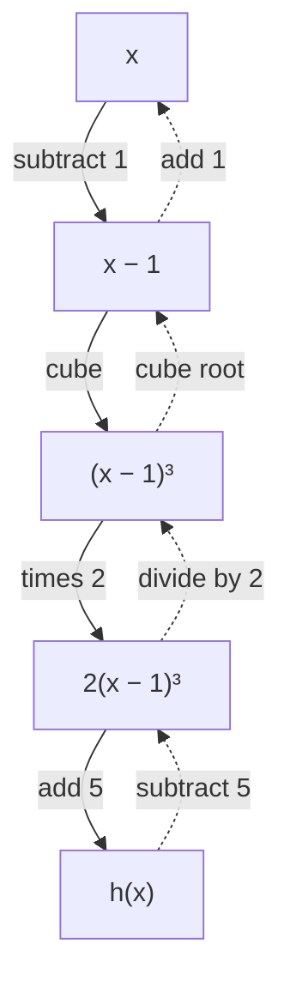

The inverse functions lesson gave one method: write $y = f(x)$, swap $x$ and $y$, and solve. That works whenever you can solve the equation. This lesson looks at the structure behind inverses, which lets you handle cases where the swap-and-solve method gets messy or fails outright: functions built by composition, functions you can show are one-to-one without a formula for the inverse, piecewise functions, functions that are their own inverse, and the question of where a graph meets the graph of its inverse.

## Undoing a composition

Getting dressed, you put on socks and then shoes. Undressing, you take off the shoes first. Inverses of compositions work the same way:

$$(f \circ g)^{-1} = g^{-1} \circ f^{-1}.$$

The function $f \circ g$ applies $g$ first, so its inverse must undo $f$ first. To check the rule, compose: $(g^{-1} \circ f^{-1}) \circ (f \circ g)$ sends $x$ to $g^{-1}\big(f^{-1}(f(g(x)))\big) = g^{-1}(g(x)) = x$. The middle pair cancels first, then the outer pair. Composing in the other order also gives $x$, by the same cancellation. This needs both $f$ and $g$ to be invertible; a composition of one-to-one functions is one-to-one.

The practical version: break a formula into the steps it applies to $x$, then undo the steps in reverse order.

### Example 1

Find the inverse of $h(x) = 2(x - 1)^3 + 5$.

1. List the steps $h$ applies: subtract 1, cube, multiply by 2, add 5.
2. Undo them in reverse order: subtract 5, divide by 2, take the cube root, add 1.
3. So $h^{-1}(x) = \sqrt[3]{\dfrac{x - 5}{2}} + 1$.
4. Check: $h(3) = 2(2)^3 + 5 = 21$, and $h^{-1}(21) = \sqrt[3]{8} + 1 = 3$. ✓

Every step is one-to-one on all real numbers (cube roots of negative numbers exist), so $h^{-1}$ has domain all reals. Swap-and-solve gives the same answer; the step list just organizes the algebra.



## Monotonic functions are one-to-one

A function is **strictly increasing** on an interval if larger inputs always give larger outputs: $a < b$ implies $f(a) < f(b)$. It is **strictly decreasing** if larger inputs always give smaller outputs. A function that is one or the other on an interval is called **monotonic** there.

A strictly increasing function is automatically one-to-one: two different inputs are ordered, one smaller than the other, and so their outputs are ordered too, which means they're different. The same goes for strictly decreasing functions. This gives a way to prove a function is invertible without solving anything. It helps to know how monotonic functions combine:

- A sum of strictly increasing functions is strictly increasing. So is a positive multiple of one.
- A composition of two increasing functions is increasing, and so is a composition of two decreasing functions. An increasing function composed with a decreasing one (in either order) is decreasing.

The converse fails: a one-to-one function need not be monotonic. $f(x) = \dfrac1x$ is one-to-one, but it isn't increasing or decreasing on its whole domain: $-1 < 1$ but $f(-1) = -1 < f(1) = 1$, while $1 < 2$ and $f(1) = 1 > f(2) = \tfrac12$. It is decreasing on each of its two separate pieces.

### Example 2

Let $f(x) = x^3 + 2x - 4$. Show that $f$ has an inverse, and find $f^{-1}(8)$ and $f^{-1}(-7)$.

1. $x^3$ and $2x$ are both strictly increasing, so their sum is, and subtracting 4 shifts the graph down without changing that. So $f$ is one-to-one and has an inverse.
2. Swap-and-solve would mean solving $x = y^3 + 2y - 4$ for $y$, a cubic equation. There is a formula for that, but it's ugly, and we don't need it.
3. $f^{-1}(8)$ is the input that gives 8: solve $x^3 + 2x - 4 = 8$, that is, $x^3 + 2x = 12$. Try small integers: $2^3 + 2 \cdot 2 = 12$. ✓ So $f^{-1}(8) = 2$, and because $f$ is one-to-one there is no other answer.
4. $f^{-1}(-7)$: solve $x^3 + 2x + 3 = 0$. Try $x = -1$: $-1 - 2 + 3 = 0$. ✓ So $f^{-1}(-7) = -1$.

This is a common situation in later math: an inverse can exist, and its values can be found, long before anyone writes down its formula.

## Inverting a piecewise function

A piecewise function is one-to-one when two things are true:

1. each piece is one-to-one on its own interval, and
2. the pieces' ranges don't overlap, so no output comes from two different pieces.

Then the inverse is piecewise too. Invert each piece's formula, and use the *range* of each piece as the condition for its inverse piece, since outputs of $f$ are inputs of $f^{-1}$.

### Example 3

Find the inverse of $f(x) = \begin{cases} x + 1 & \text{if } x < 0 \\ x^2 + 1 & \text{if } x \ge 0 \end{cases}$

1. First piece: $x + 1$ is increasing. On $x < 0$ its outputs are all numbers less than 1.
2. Second piece: $x^2 + 1$ is increasing for $x \ge 0$. Its outputs are all numbers $\ge 1$.
3. The ranges $y < 1$ and $y \ge 1$ don't overlap (and between them cover every real number), so $f$ is one-to-one.
4. Invert each piece. $y = x + 1$ gives $x = y - 1$. $y = x^2 + 1$ with $x \ge 0$ gives $x = \sqrt{y - 1}$, the nonnegative root.
5. Use the ranges as the new conditions:
$$f^{-1}(x) = \begin{cases} x - 1 & \text{if } x < 1 \\ \sqrt{x - 1} & \text{if } x \ge 1 \end{cases}$$
6. Check: $f(-3) = -2$ and $f^{-1}(-2) = -3$; $f(2) = 5$ and $f^{-1}(5) = \sqrt4 = 2$. ✓

```plot
{"x": [-4, 6], "y": [-4, 6], "equal": true, "functions": [{"f": "x + 1", "from": -4, "to": 0, "label": "f"}, {"f": "x^2 + 1", "from": 0, "to": 2.3}, {"f": "x - 1", "from": -4, "to": 1, "dashed": true, "label": "f⁻¹"}, {"f": "sqrt(x - 1)", "from": 1, "to": 6, "dashed": true}, {"f": "x", "from": -4, "to": 6, "color": "gray", "label": "y = x"}], "points": [{"at": [0, 1], "label": "(0, 1)"}, {"at": [1, 0], "label": "(1, 0)"}], "caption": "The piecewise f (solid) and its inverse (dashed) are mirror images across y = x; the break point (0, 1) of f becomes the break point (1, 0) of the inverse"}
```

Compare $g(x) = x + 3$ for $x < 0$ and $g(x) = x^2$ for $x \ge 0$. Each piece is increasing, but the first piece's outputs (below 3) overlap the second's (0 and up): $g(-1) = 2$ and $g(\sqrt2) = 2$. So $g$ has no inverse, even though each piece does.

### Example 4

A made-up electricity plan charges \$0.10 per kilowatt-hour (kWh) for the first 500 kWh in a month and \$0.15 per kWh after that. Write the bill $C$ as a function of usage $u$, then write usage as a function of the bill, and find the usage for bills of \$35 and \$80.

1. Up to 500 kWh, $C = 0.10u$. That reaches $C = 50$ at $u = 500$. Beyond that, $C = 50 + 0.15(u - 500)$.
2. Both pieces are increasing. The first gives bills from 0 to 50, the second gives bills over 50: no overlap.
3. Invert the first piece: $u = 10C$, for $0 \le C \le 50$. Invert the second: $C - 50 = 0.15(u - 500)$, so $u = 500 + \dfrac{C - 50}{0.15}$, for $C > 50$.
4. A \$35 bill is in the first piece: $u = 350$ kWh. An \$80 bill is in the second: $u = 500 + \dfrac{30}{0.15} = 500 + 200 = 700$ kWh. Check: $50 + 0.15(200) = 80$. ✓

## Functions that are their own inverse

Some functions undo themselves: $f(f(x)) = x$ for every $x$ in the domain, so $f^{-1} = f$. Such a function is called **self-inverse** (the formal name is an involution). Its graph is its own reflection across $y = x$. Examples: $f(x) = -x$, $f(x) = c - x$ for any constant $c$, and $f(x) = \dfrac1x$.

A whole family comes from the inverse of a linear-over-linear function. Swap-and-solve on $y = \dfrac{ax + b}{cx + d}$ (assuming $ad - bc \ne 0$, so the function isn't constant) gives

$$f^{-1}(x) = \frac{dx - b}{-cx + a}.$$

The inverses lesson's Example 3 fits this: $a = 2$, $b = 1$, $c = 1$, $d = -3$ give $\dfrac{-3x - 1}{-x + 2} = \dfrac{3x + 1}{x - 2}$. When $d = -a$, the inverse formula is the original formula with the numerator and denominator both multiplied by $-1$, so the function is self-inverse. For example, $f(x) = \dfrac{2x + 1}{x - 2}$: $f(3) = 7$ and $f(7) = \dfrac{15}{5} = 3$.

## Where a graph meets its inverse

The graphs of $f$ and $f^{-1}$ are reflections across $y = x$, so a point of $f$ that lies *on* the line $y = x$ is on both graphs. For a strictly increasing $f$, those are the only meeting points. Suppose $f(a) = b$ and $f^{-1}(a) = b$, which means $f(b) = a$. If $a < b$, increasing would give $f(a) < f(b)$, that is, $b < a$, a contradiction. The same happens if $b < a$. So $a = b$, and the point is on $y = x$. This turns a hard equation, $f(x) = f^{-1}(x)$, into an easier one, $f(x) = x$.

### Example 5

Find where the graphs of $f(x) = \dfrac{x^3 + 2}{3}$ and its inverse meet.

1. $f$ is strictly increasing ($x^3$ is, and adding 2 and dividing by 3 keep that), so the graphs meet only on $y = x$.
2. Solve $\dfrac{x^3 + 2}{3} = x$: $x^3 - 3x + 2 = 0$.
3. $x = 1$ works ($1 - 3 + 2 = 0$), so $x - 1$ is a factor: $x^3 - 3x + 2 = (x - 1)^2(x + 2)$.
4. The graphs meet at $(1, 1)$ and $(-2, -2)$. Check with the inverse $f^{-1}(x) = \sqrt[3]{3x - 2}$: $f^{-1}(1) = 1$ and $f^{-1}(-2) = \sqrt[3]{-8} = -2$. ✓

For decreasing functions this shortcut fails. The graph of $f(x) = -x^3$ meets the graph of its inverse $f^{-1}(x) = -\sqrt[3]{x}$ at $(0, 0)$, but also at $(1, -1)$ and $(-1, 1)$, which are off the line $y = x$.

```plot
{"x": [-2.5, 2.5], "y": [-2.5, 2.5], "equal": true, "functions": [{"f": "-x^3", "label": "f(x) = −x³"}, {"f": "-cbrt(x)", "dashed": true, "label": "f⁻¹(x) = −∛x"}, {"f": "x", "color": "gray", "label": "y = x"}], "points": [{"at": [1, -1], "label": "(1, −1)"}, {"at": [-1, 1], "label": "(−1, 1)"}, {"at": [0, 0]}], "caption": "A decreasing function can meet its inverse off the line y = x"}
```

## Common mistakes

- Undoing a composition in the original order. $(f \circ g)^{-1}$ is $g^{-1} \circ f^{-1}$: the last step taken is the first undone.
- Inverting each piece of a piecewise function without checking that the pieces' ranges are separate.
- Keeping the old conditions ($x < 0$, $x \ge 0$) on the inverse pieces. The new conditions come from the ranges of the original pieces.
- Thinking a one-to-one function must be increasing or decreasing everywhere; $\dfrac1x$ is a counterexample.
- Solving $f(x) = x$ to find where $f$ meets $f^{-1}$ when $f$ is decreasing. That finds only the meeting points on $y = x$.

## Key points

- $(f \circ g)^{-1} = g^{-1} \circ f^{-1}$: list the steps, then undo them in reverse order.
- Strictly increasing or strictly decreasing (monotonic) functions are one-to-one, so they have inverses even when no formula for the inverse is handy.
- A piecewise function is invertible when each piece is one-to-one and the pieces' ranges don't overlap; the inverse pieces use those ranges as their conditions.
- Self-inverse functions satisfy $f(f(x)) = x$; $\dfrac{ax + b}{cx - a}$ is self-inverse whenever $a^2 + bc \ne 0$.
- For strictly increasing $f$, the graphs of $f$ and $f^{-1}$ meet only on $y = x$, so solve $f(x) = x$.
