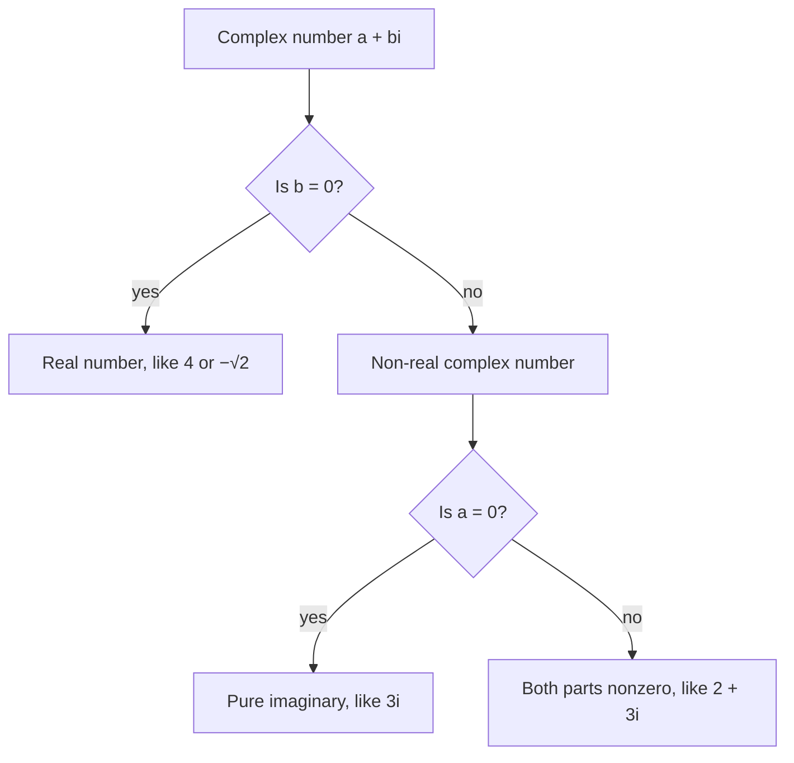

Some quadratic equations, like $x^2 + 1 = 0$, have no real solutions, because no real number squares to a negative. Mathematicians enlarged the number system by inventing a number whose square is $-1$. The result, the complex numbers, gives every quadratic equation solutions, and it's essential in later mathematics, physics and engineering. This lesson defines complex numbers and shows how to compute with them.

## The imaginary unit

The **imaginary unit** $i$ is defined by

$$i^2 = -1, \qquad \text{so } i = \sqrt{-1}.$$

With it, square roots of negative numbers make sense: for $b > 0$, $\sqrt{-b} = i\sqrt{b}$. So $\sqrt{-16} = 4i$ and $\sqrt{-12} = i\sqrt{12} = 2i\sqrt3$.

Always rewrite $\sqrt{-b}$ as $i\sqrt b$ before multiplying. The rule $\sqrt a\sqrt b = \sqrt{ab}$ is false when both are negative: $\sqrt{-4}\sqrt{-9} = (2i)(3i) = 6i^2 = -6$, not $\sqrt{36} = 6$.

## Complex numbers

A **complex number** has the form $a + bi$ with $a$ and $b$ real. Its **real part** is $a$ and its **imaginary part** is $b$ (the number $b$, not $bi$). If $b = 0$ it's a real number; if $a = 0$ and $b \ne 0$, it's a **pure imaginary number**, like $3i$. Two complex numbers are equal exactly when their real parts are equal and their imaginary parts are equal.

The chart sorts any complex number into one of these kinds by asking about $b$ first, then $a$.



Complex numbers can be pictured as points in the **complex plane**: $a + bi$ sits at $(a, b)$, with real parts along the horizontal axis and imaginary parts along the vertical axis.

```plot
{"x": [-5, 5], "y": [-4, 4], "equal": true, "xLabel": "real", "yLabel": "imaginary", "points": [{"at": [3, 2], "label": "3 + 2i"}, {"at": [3, -2], "label": "3 - 2i"}, {"at": [-2, 3], "label": "-2 + 3i"}, {"at": [0, -3], "label": "-3i"}, {"at": [4, 0], "label": "4"}], "segments": [{"from": [0, 0], "to": [3, 2], "arrow": true}, {"from": [0, 0], "to": [3, -2], "arrow": true, "dashed": true}], "caption": "The complex plane; a number and its conjugate are mirror images across the real axis"}
```

## Adding, subtracting and multiplying

Treat $i$ like a variable, then replace $i^2$ by $-1$.

- Add or subtract real parts and imaginary parts separately: $(3 + 2i) + (1 - 5i) = 4 - 3i$.
- Multiply with the distributive property (FOIL), then use $i^2 = -1$.

### Example 1

Compute $(2 + 3i)(4 - i)$.

1. FOIL: $8 - 2i + 12i - 3i^2$.
2. Replace $i^2$: $-3i^2 = -3(-1) = 3$.
3. Combine: $8 + 3 + 10i = 11 + 10i$.

## The conjugate and division

The **complex conjugate** of $a + bi$ is $a - bi$. Their product is always a nonnegative real number:

$$(a + bi)(a - bi) = a^2 - b^2i^2 = a^2 + b^2.$$

That's the key to division, which works like rationalizing a denominator: multiply top and bottom by the conjugate of the denominator.

### Example 2

Write $\dfrac{5 + i}{2 - 3i}$ in the form $a + bi$.

1. Multiply by $\dfrac{2 + 3i}{2 + 3i}$.
2. Numerator: $(5 + i)(2 + 3i) = 10 + 15i + 2i + 3i^2 = 7 + 17i$.
3. Denominator: $2^2 + 3^2 = 13$.
4. Result: $\dfrac{7}{13} + \dfrac{17}{13}i$.

## Powers of $i$

The powers of $i$ repeat in a cycle of four:

| $i^1$ | $i^2$ | $i^3$ | $i^4$ | $i^5$ | $i^6$ |
|---|---|---|---|---|---|
| $i$ | $-1$ | $-i$ | $1$ | $i$ | $-1$ |

Since $i^4 = 1$, divide the exponent by 4 and keep the remainder: $i^{n} = i^{r}$ where $r$ is the remainder of $n \div 4$ (with $i^0 = 1$). For example, $i^{43}$: $43 = 4 \cdot 10 + 3$, so $i^{43} = i^3 = -i$.

The picture shows the cycle on the complex plane. The four values $1$, $i$, $-1$, $-i$ sit on the axes, one unit from the origin, and each multiplication by $i$ moves to the next one, a quarter turn counterclockwise. (The honors lesson on the geometry of complex numbers explains why multiplying by $i$ is a rotation.)


## Complex solutions of quadratic equations

With complex numbers, the quadratic formula always gives two solutions (counting a double root twice). When the discriminant is negative, they are complex conjugates of each other. Here are a few first examples; the next lesson treats these quadratics in detail.

### Example 3

Solve $x^2 - 4x + 13 = 0$.

1. $D = 16 - 52 = -36$, so $\sqrt{D} = \sqrt{-36} = 6i$.
2. $x = \dfrac{4 \pm 6i}{2} = 2 \pm 3i$.
3. Check $x = 2 + 3i$: $(2 + 3i)^2 = 4 + 12i - 9 = -5 + 12i$. Then $-5 + 12i - 4(2 + 3i) + 13 = -5 + 12i - 8 - 12i + 13 = 0$.

### Example 4

Solve $(x + 1)^2 = -9$.

$x + 1 = \pm 3i$, so $x = -1 \pm 3i$. (With real numbers only, as in Algebra 1, this equation had no solution, since a square can't be negative; now it has two complex ones.)

This also completes a fact from Algebra 1: a sum of squares such as $x^2 + 9$ can't be factored using real numbers, but it does factor over the complex numbers: $x^2 + 9 = (x + 3i)(x - 3i)$.

### Example 5

Simplify $(2 - i)^2 + \dfrac{3 + 4i}{i}$.

1. Square: $(2 - i)^2 = 4 - 4i + i^2 = 3 - 4i$.
2. Divide by $i$: multiply top and bottom by $-i$ (the conjugate of $i$): $\dfrac{(3 + 4i)(-i)}{i(-i)} = \dfrac{-3i - 4i^2}{1} = 4 - 3i$.
3. Add: $(3 - 4i) + (4 - 3i) = 7 - 7i$.

The conjugate of $i = 0 + 1i$ is $-i$, and $i(-i) = -i^2 = 1$, which is why dividing by $i$ is the same as multiplying by $-i$.

## Common mistakes

- Writing $\sqrt{-4}\sqrt{-9} = \sqrt{36}$. Convert to $i$ first.
- Forgetting that $i^2 = -1$ after FOIL, leaving answers like $8 + 10i - 3i^2$.
- Multiplying by the conjugate of the numerator instead of the denominator when dividing.
- Calling the imaginary part of $4 - 7i$ "$-7i$"; it's $-7$.
- Thinking $-36$ has no square root at all. It has no real square root; its square roots are $\pm 6i$.

## Key points

- $i^2 = -1$; for $b > 0$, $\sqrt{-b} = i\sqrt b$.
- Complex numbers $a + bi$ add and multiply like binomials, with $i^2$ replaced by $-1$.
- $(a + bi)(a - bi) = a^2 + b^2$; divide by multiplying top and bottom by the denominator's conjugate.
- Powers of $i$ cycle with period 4: $i, -1, -i, 1$.
- A quadratic with negative discriminant has two complex conjugate solutions.
