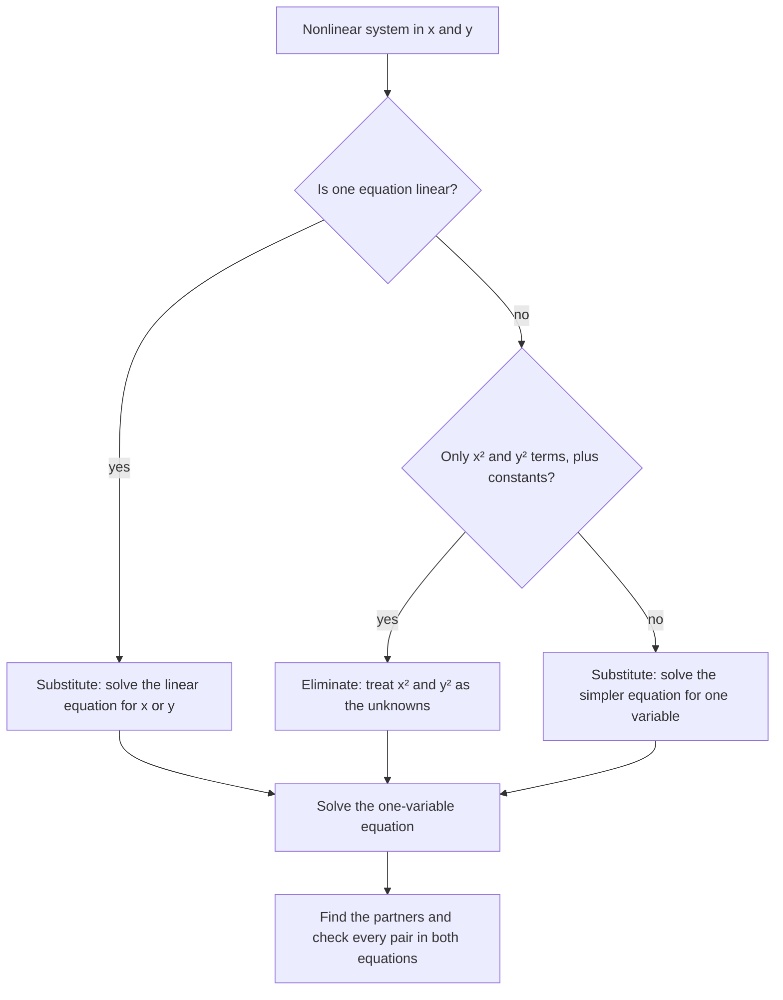

In Algebra 1 you solved systems of two linear equations. Two different lines meet at most once, so those systems had one solution, none, or (for the same line twice) infinitely many. Once a parabola or a circle is involved, the picture changes: a line can cross a parabola twice, touch it once, or miss it completely. This lesson solves such systems with the same two methods you already know, substitution and elimination, and uses the discriminant from the last lesson to predict how many solutions there are before you find them.

## What a nonlinear system is

A **nonlinear system** is a system of equations in which at least one equation is not linear: it has a squared variable, a product like $xy$, a variable in a denominator, and so on. A solution is still an ordered pair $(x, y)$ that makes every equation true, and graphically it is still a point where the graphs meet.

Two curves you'll see often:

- a parabola $y = ax^2 + bx + c$;
- a **circle**. The circle with center $(0, 0)$ and radius $r$ is $x^2 + y^2 = r^2$, because by the Pythagorean theorem a point $(x, y)$ is at distance $\sqrt{x^2 + y^2}$ from the origin. Moving the center to $(h, k)$ gives $(x - h)^2 + (y - k)^2 = r^2$.

The figure shows why the number of solutions varies. Each line meets the parabola $y = x^2$ a different number of times.

```plot
{"x": [-3, 4], "y": [-4, 9], "functions": [{"f": "x^2", "label": "y = x²"}, {"f": "x + 2", "label": "y = x + 2", "dashed": true}, {"f": "2*x - 1", "label": "y = 2x − 1"}, {"f": "x - 3", "label": "y = x − 3", "dashed": true}], "points": [{"at": [-1, 1], "label": "(−1, 1)"}, {"at": [2, 4], "label": "(2, 4)"}, {"at": [1, 1], "label": "(1, 1)"}], "caption": "y = x + 2 crosses twice, y = 2x − 1 touches once at (1, 1), y = x − 3 misses"}
```

## Substitution

Substitution is the workhorse, and it's the natural choice when one equation is linear.

1. Solve the linear equation (or the simpler equation) for one variable.
2. Substitute into the other equation. You get one equation in one variable, usually a quadratic.
3. Solve it. Each solution is the first coordinate of an intersection point.
4. Find the partner coordinate from the *linear* equation (or the one you solved in step 1).
5. Check each pair in both original equations.

Step 4 matters. If you go back to an equation with a square in it, such as $y^2 = 16$, you get $y = \pm 4$ and can't tell which sign belongs with which $x$. The linear equation gives exactly one partner for each $x$.

### Example 1

Solve $y = x^2 - 4x + 3$ and $y = x - 1$.

1. Both equations are already solved for $y$, so set the right sides equal: $x^2 - 4x + 3 = x - 1$.
2. Standard form: $x^2 - 5x + 4 = 0$, which factors as $(x - 1)(x - 4) = 0$. So $x = 1$ or $x = 4$.
3. Partners from the line $y = x - 1$: $x = 1$ gives $y = 0$; $x = 4$ gives $y = 3$.
4. Check in the parabola: $1 - 4 + 3 = 0$ and $16 - 16 + 3 = 3$. Both work.

The solutions are $(1, 0)$ and $(4, 3)$.

### Example 2

Solve $x^2 + y^2 = 25$ and $y = x + 1$.

1. Substitute $y = x + 1$ into the circle: $x^2 + (x + 1)^2 = 25$.
2. Expand carefully, using $(x + 1)^2 = x^2 + 2x + 1$: $2x^2 + 2x + 1 = 25$, so $2x^2 + 2x - 24 = 0$.
3. Divide by 2: $x^2 + x - 12 = 0$, so $(x + 4)(x - 3) = 0$ and $x = -4$ or $x = 3$.
4. Partners from $y = x + 1$: $(-4, -3)$ and $(3, 4)$.
5. Check in the circle: $16 + 9 = 25$ and $9 + 16 = 25$.

```plot
{"x": [-7, 7], "y": [-7, 7], "equal": true, "circles": [{"center": [0, 0], "r": 5}], "functions": [{"f": "x + 1", "label": "y = x + 1"}], "points": [{"at": [3, 4], "label": "(3, 4)"}, {"at": [-4, -3], "label": "(−4, −3)"}], "caption": "The line cuts the circle x² + y² = 25 at two points"}
```

## How many solutions? Use the discriminant

When substitution leaves a quadratic $ax^2 + bx + c = 0$, its discriminant $D = b^2 - 4ac$ counts the intersection points, because each real root gives one point:

| Discriminant | Real roots | Graphs |
|---|---|---|
| $D > 0$ | two | the line crosses the curve twice |
| $D = 0$ | one (a double root) | the line just touches the curve (it is tangent to it) |
| $D < 0$ | none (two complex roots) | the line misses the curve |

Complex roots are perfectly good solutions of the quadratic, but they don't give points you can plot, so a system with $D < 0$ has no real solution.

The same three cases happen for a line and a circle. Sliding the line away from the center, it first cuts the circle twice, then touches it once (a tangent line), then misses it.


### Example 3

For which values of $k$ does the line $y = 2x + k$ meet the parabola $y = x^2$?

1. Substitute: $x^2 = 2x + k$, so $x^2 - 2x - k = 0$.
2. The discriminant is $D = (-2)^2 - 4(1)(-k) = 4 + 4k$.
3. Two points when $4 + 4k > 0$, that is $k > -1$; one point when $k = -1$; none when $k < -1$.

With $k = -1$ the quadratic is $x^2 - 2x + 1 = (x - 1)^2 = 0$, so the line $y = 2x - 1$ touches the parabola only at $(1, 1)$, as in the first figure.

## Elimination

When both equations contain $x^2$ and $y^2$ (and no other $x$ or $y$ terms), add or subtract them to eliminate one squared variable, just as you would eliminate $x$ or $y$ in a linear system. Treat $x^2$ and $y^2$ as the unknowns.

### Example 4

Solve $x^2 + y^2 = 13$ and $x^2 - y^2 = 5$.

1. Add the equations: $2x^2 = 18$, so $x^2 = 9$.
2. Substitute into the first: $9 + y^2 = 13$, so $y^2 = 4$.
3. Now take square roots: $x = \pm 3$ and $y = \pm 2$. Here every combination works, because only $x^2$ and $y^2$ appear in the equations.

There are four solutions: $(3, 2)$, $(3, -2)$, $(-3, 2)$ and $(-3, -2)$. The second graph is a curve called a hyperbola (you'll meet it in precalculus); you don't need to know its shape to solve the system.

```plot
{"x": [-6, 6], "y": [-5, 5], "equal": true, "circles": [{"center": [0, 0], "r": 3.6056}], "curves": [{"x": "sqrt(5)*cosh(t)", "y": "sqrt(5)*sinh(t)", "t": [-1.6, 1.6], "color": "var(--fig-0)"}, {"x": "-sqrt(5)*cosh(t)", "y": "sqrt(5)*sinh(t)", "t": [-1.6, 1.6], "color": "var(--fig-0)"}], "labels": [{"at": [4.6, 1.2], "text": "x² − y² = 5"}, {"at": [2.2, 3.9], "text": "x² + y² = 13"}], "points": [{"at": [3, 2], "label": "(3, 2)"}, {"at": [3, -2], "label": "(3, −2)"}, {"at": [-3, 2], "label": "(−3, 2)"}, {"at": [-3, -2], "label": "(−3, −2)"}], "caption": "The circle x² + y² = 13 meets the hyperbola x² − y² = 5 at four points"}
```

Two quadratic curves can meet up to four times, so don't stop at two answers.

To decide between the two methods, look at the equations before you start:



## An application

### Example 5

A rectangular garden has a perimeter of 20 m and an area of 24 m². Find its dimensions.

1. Let the length be $L$ and the width $W$. Perimeter: $2L + 2W = 20$, so $L + W = 10$. Area: $LW = 24$. The second equation is nonlinear.
2. From the first, $W = 10 - L$. Substitute: $L(10 - L) = 24$, so $L^2 - 10L + 24 = 0$.
3. Factor: $(L - 4)(L - 6) = 0$, so $L = 4$ or $L = 6$, giving $W = 6$ or $W = 4$.

Both solutions describe the same garden: 6 m by 4 m. Check: $2(6) + 2(4) = 20$ and $6 \cdot 4 = 24$.

## Common mistakes

- Finding the partner $y$ from an equation with $y^2$ in it, then listing both signs. Use the linear equation, or check every pair.
- Squaring a binomial term by term: $(x + 1)^2$ is $x^2 + 2x + 1$, not $x^2 + 1$.
- Reporting only the $x$-values. A solution of a system is an ordered pair.
- Stopping at two solutions when elimination gives $x = \pm a$ and $y = \pm b$; all four sign combinations may work.
- Treating complex roots of the substituted quadratic as intersection points. They mean the graphs don't meet.

## Key points

- A nonlinear system has at least one nonlinear equation; its real solutions are the intersection points of the graphs.
- Substitution: solve the linear equation for one variable, substitute, solve the quadratic, and get partners from the linear equation.
- After substituting, the discriminant tells how many intersection points there are: two, one (tangent) or none.
- Elimination works when both equations have only $x^2$ and $y^2$ terms; take $\pm$ square roots at the end.
- A line meets a parabola or circle at most twice; two quadratic curves can meet up to four times.
