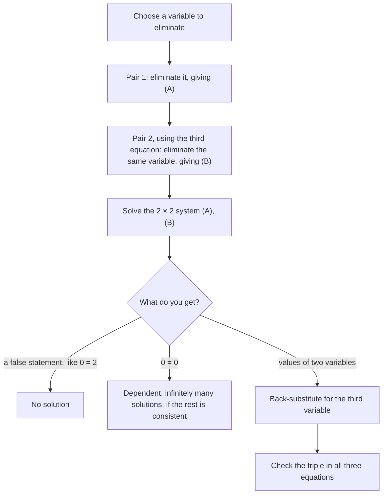

Some problems have three unknowns: three kinds of ticket, three investments, or the three coefficients of a parabola. Three unknowns need three equations. The elimination method from Algebra 1 extends naturally: use pairs of equations to knock out one variable, which leaves an ordinary two-variable system. The next lesson redoes the same work more efficiently with matrices.

## What a solution looks like

A **linear equation in three variables** has the form $ax + by + cz = d$. A solution of a three-variable system is an **ordered triple** $(x, y, z)$ satisfying all the equations.

Geometrically, each such equation describes a flat plane in three-dimensional space. Three planes can meet in a single point (one solution), have no point common to all three (no solution), or share a whole line or plane (infinitely many solutions). The algebra tells you which case you're in, just as with two lines.

The picture shows the main cases. "No solution" can happen in more than one way: the planes can be parallel, or each pair can meet in a line without all three ever sharing a point, like the three sides of a tent with no floor.


## The elimination strategy

1. Pick a variable to eliminate, preferably one with simple coefficients.
2. Use one pair of equations to eliminate it, producing equation (A) in the other two variables.
3. Use a different pair (it must include the third equation) to eliminate the same variable, producing equation (B).
4. Solve the two-variable system (A), (B).
5. Back-substitute into an original equation to find the third variable.
6. Check the triple in all three original equations.

The crucial point in step 3: eliminate the same variable both times. Otherwise (A) and (B) won't share the same two variables.

The flowchart shows the same strategy, including what to do when the variables vanish (the special cases below).



### Example 1

Solve
$$\begin{cases} x + y + z = 6 & (1) \\ 2x - y + z = 3 & (2) \\ x + 2y - z = 2 & (3) \end{cases}$$

1. Eliminate $z$, which has coefficients $\pm1$ everywhere.
2. Add (1) and (3): $2x + 3y = 8$. Call this (A).
3. Add (2) and (3): $3x + y = 5$. Call this (B).
4. Solve (A) and (B). From (B), $y = 5 - 3x$. Substitute into (A): $2x + 3(5 - 3x) = 8$, so $-7x = -7$ and $x = 1$. Then $y = 2$.
5. From (1): $1 + 2 + z = 6$, so $z = 3$.
6. Check: (2) gives $2 - 2 + 3 = 3$ and (3) gives $1 + 4 - 3 = 2$. The solution is $(1, 2, 3)$.

### Example 2

Solve
$$\begin{cases} 2x + 3y - z = 1 & (1) \\ x - 2y + 3z = 13 & (2) \\ 3x + y + 2z = 16 & (3) \end{cases}$$

1. Eliminate $x$, using (2), whose $x$-coefficient is 1.
2. (1) $- 2\times$(2): $(2x + 3y - z) - (2x - 4y + 6z) = 1 - 26$, so $7y - 7z = -25$. Call this (A).
3. (3) $- 3\times$(2): $(3x + y + 2z) - (3x - 6y + 9z) = 16 - 39$, so $7y - 7z = -23$. Call this (B).
4. (A) $-$ (B): $0 = -2$. False.

In fact, adding (1) and (2) gives $3x + y + 2z = 14$, which flatly contradicts (3). So this system has no solution: the three planes have no common point. This is the three-variable version of parallel lines. Not every system with "nice-looking" coefficients has a solution, and the elimination process reveals it.

## Special cases

As with two variables, watch what happens when variables vanish:

- a false statement such as $0 = 2$ means the system is **inconsistent**: no solution;
- a true statement such as $0 = 0$ means the equations are dependent, and (if the rest is consistent) there are infinitely many solutions.

For example, in $x + y + z = 3$, $x - y + 2z = 1$, $2x + 3z = 4$, the third equation is exactly the sum of the first two. It adds no new information, so we really have only two conditions on three unknowns, and infinitely many triples satisfy them.

## Fitting a parabola through three points

A classic use: any three points with different $x$-coordinates (not all on one line) lie on exactly one parabola $y = ax^2 + bx + c$. Substituting each point gives one linear equation in $a$, $b$, $c$.

### Example 3

Find the parabola through $(1, 2)$, $(2, 7)$ and $(-1, 4)$.

1. Substitute each point into $y = ax^2 + bx + c$:
$$\begin{cases} a + b + c = 2 & (1) \\ 4a + 2b + c = 7 & (2) \\ a - b + c = 4 & (3) \end{cases}$$
2. (1) $-$ (3): $2b = -2$, so $b = -1$.
3. (2) $-$ (1): $3a + b = 5$, so $3a = 6$ and $a = 2$.
4. From (1): $2 - 1 + c = 2$, so $c = 1$.
5. The parabola is $y = 2x^2 - x + 1$. Check $(2, 7)$: $8 - 2 + 1 = 7$.

```plot
{"x": [-3, 3], "y": [-1, 12], "functions": [{"f": "2*x^2 - x + 1", "label": "y = 2x² - x + 1", "from": -2.4, "to": 2.6}], "points": [{"at": [1, 2], "label": "(1, 2)"}, {"at": [2, 7], "label": "(2, 7)"}, {"at": [-1, 4], "label": "(-1, 4)"}], "caption": "Exactly one parabola passes through the three points"}
```

## An application

### Example 4

A café sold 120 drinks: coffees at $3, teas at $2 and smoothies at $5, taking in $380. It sold twice as many coffees as smoothies. How many of each?

1. Let $c$, $t$, $s$ be the numbers sold. Count: $c + t + s = 120$. Money: $3c + 2t + 5s = 380$. Ratio: $c = 2s$.
2. Substitute $c = 2s$ into the others: $t + 3s = 120$ and $2t + 11s = 380$.
3. From the first, $t = 120 - 3s$. Then $2(120 - 3s) + 11s = 380$, so $240 + 5s = 380$ and $s = 28$.
4. So $c = 56$ and $t = 120 - 84 = 36$. Check: $168 + 72 + 140 = 380$.

When one equation already gives one variable in terms of another, substitution can shortcut the elimination.

## Common mistakes

- Eliminating different variables from the two pairs, leaving (A) and (B) in different unknowns.
- Using the same pair of equations twice, which never brings in the third equation.
- Forgetting to multiply every term, including the constant, when scaling an equation.
- Stopping after two variables; the answer is an ordered triple.
- Checking in only one equation.

## Key points

- Three unknowns need three equations; a solution is an ordered triple $(x, y, z)$.
- Eliminate the same variable from two different pairs of equations, then solve the resulting $2 \times 2$ system.
- A contradiction means no solution; an equation that reduces to $0 = 0$ signals dependence.
- Three points determine a parabola $y = ax^2 + bx + c$ through a $3 \times 3$ system in $a$, $b$, $c$.
