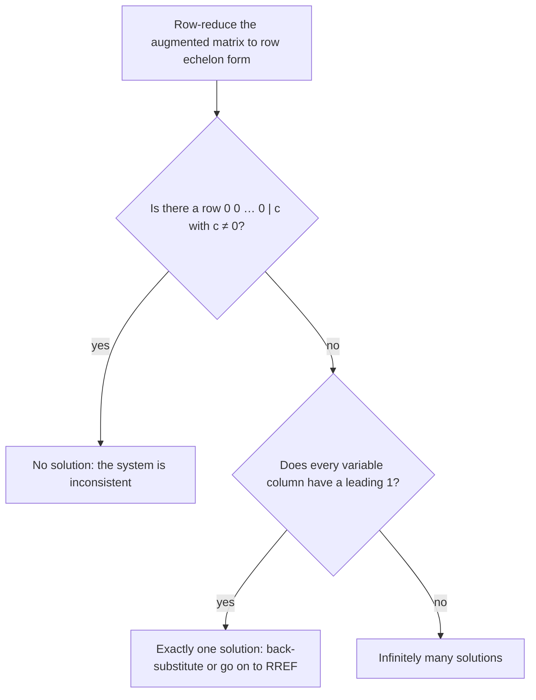

In the last lesson you solved three-variable systems by elimination, writing $x$, $y$ and $z$ over and over even though only the numbers were changing. A matrix keeps just the numbers. The moves of elimination become row operations on the matrix, and the bookkeeping becomes a routine that a calculator or computer can carry out for any number of variables. This lesson covers that routine, row reduction, and then briefly a second method that uses an inverse matrix.

## Matrices

A **matrix** is a rectangular array of numbers in rows and columns, written in brackets. Its **dimensions** are (number of rows) $\times$ (number of columns), always rows first:

$$A = \begin{bmatrix} 2 & -1 & 0 \\ 5 & 3 & 7 \end{bmatrix} \quad \text{is a } 2 \times 3 \text{ matrix.}$$

Each number is an **entry**. The entry in row $i$ and column $j$ is written $a_{ij}$; here $a_{12} = -1$ and $a_{23} = 7$.

## The augmented matrix of a system

To turn a linear system into a matrix, line up the variables in the same order in every equation and copy the coefficients, then the constants after a vertical bar. The result is the system's **augmented matrix**:

$$\begin{cases} x + 2y - z = 4 \\ 3x - y = 5 \\ y + 4z = -2 \end{cases} \quad\longrightarrow\quad \left[\begin{array}{ccc|c} 1 & 2 & -1 & 4 \\ 3 & -1 & 0 & 5 \\ 0 & 1 & 4 & -2 \end{array}\right]$$

Each row is one equation and each column left of the bar belongs to one variable. A missing variable gets a 0, as for $z$ in the second equation and $x$ in the third. The part left of the bar is the **coefficient matrix**.

The picture labels the parts of this augmented matrix.

## Row operations

Three moves change a system into an equivalent one (same solutions). On the matrix they are the **row operations**:

1. Swap two rows: $R_1 \leftrightarrow R_2$. (List the equations in a different order.)
2. Multiply a row by a nonzero number: $\tfrac13 R_2 \to R_2$. (Scale an equation.)
3. Add a multiple of one row to another row: $R_2 - 3R_1 \to R_2$. (The elimination step.)

Each move can be undone (swap back, divide by the same number, subtract the same multiple), so no solutions are gained or lost. That's why multiplying by 0 is not allowed: it can't be undone, and it would erase an equation.

## Row echelon form and back-substitution

The goal is a staircase shape called **row echelon form**:

- the first nonzero entry in each row is a 1 (a leading 1);
- each leading 1 is to the right of the leading 1 in the row above, so everything below a leading 1 is 0;
- any rows of all zeros are at the bottom.

$$\left[\begin{array}{ccc|c} 1 & * & * & * \\ 0 & 1 & * & * \\ 0 & 0 & 1 & * \end{array}\right]$$

The bottom row then gives the value of $z$, and you back-substitute upward. Working column by column, left to right: get a 1 at the top of the column, then use operation 3 to make every entry below it 0. This process is called **Gaussian elimination**.

### Example 1

Solve $x + 2y = 5$, $3x - y = 1$.

1. Write the augmented matrix and clear the 3 below the leading 1:
$$\left[\begin{array}{cc|c} 1 & 2 & 5 \\ 3 & -1 & 1 \end{array}\right] \xrightarrow{R_2 - 3R_1 \to R_2} \left[\begin{array}{cc|c} 1 & 2 & 5 \\ 0 & -7 & -14 \end{array}\right]$$
The new row 2 is $(3 - 3, -1 - 6, 1 - 15)$. The constant gets the same operation as every other entry.
2. Make the second leading entry 1:
$$\xrightarrow{-\frac17 R_2 \to R_2} \left[\begin{array}{cc|c} 1 & 2 & 5 \\ 0 & 1 & 2 \end{array}\right]$$
3. Row 2 says $y = 2$. Row 1 says $x + 2y = 5$, so $x = 1$.
4. Check in the original second equation: $3(1) - 2 = 1$. The solution is $(1, 2)$.

### Example 2

Solve the system from Example 1 of the last lesson:
$$\begin{cases} x + y + z = 6 \\ 2x - y + z = 3 \\ x + 2y - z = 2 \end{cases}$$

1. Clear column 1 below the leading 1:
$$\left[\begin{array}{ccc|c} 1 & 1 & 1 & 6 \\ 2 & -1 & 1 & 3 \\ 1 & 2 & -1 & 2 \end{array}\right] \xrightarrow[R_3 - R_1 \to R_3]{R_2 - 2R_1 \to R_2} \left[\begin{array}{ccc|c} 1 & 1 & 1 & 6 \\ 0 & -3 & -1 & -9 \\ 0 & 1 & -2 & -4 \end{array}\right]$$
2. Row 3 already has a 1 in column 2, so swap rows 2 and 3 to avoid fractions, then clear below it:
$$\xrightarrow{R_2 \leftrightarrow R_3} \left[\begin{array}{ccc|c} 1 & 1 & 1 & 6 \\ 0 & 1 & -2 & -4 \\ 0 & -3 & -1 & -9 \end{array}\right] \xrightarrow{R_3 + 3R_2 \to R_3} \left[\begin{array}{ccc|c} 1 & 1 & 1 & 6 \\ 0 & 1 & -2 & -4 \\ 0 & 0 & -7 & -21 \end{array}\right]$$
3. $-\tfrac17 R_3 \to R_3$ turns the last row into $[\,0 \;\; 0 \;\; 1 \mid 3\,]$, so $z = 3$.
4. Back-substitute. Row 2: $y - 2(3) = -4$, so $y = 2$. Row 1: $x + 2 + 3 = 6$, so $x = 1$.

The solution is $(1, 2, 3)$, the same as by elimination. You can also keep going instead of back-substituting: use each leading 1 to clear the entries *above* it as well. The result is **reduced row echelon form** (**RREF**), where the solution can be read straight off:
$$\left[\begin{array}{ccc|c} 1 & 0 & 0 & 1 \\ 0 & 1 & 0 & 2 \\ 0 & 0 & 1 & 3 \end{array}\right]$$
Graphing calculators have an `rref` command that does all of this in one step.

## No solution or infinitely many

Row reduction reveals the special cases from the last lesson.

- A row $[\,0 \;\; 0 \;\; 0 \mid c\,]$ with $c \ne 0$ says $0 = c$, which is false: the system is **inconsistent** (no solution).
- A row of all zeros, $[\,0 \;\; 0 \;\; 0 \mid 0\,]$, says $0 = 0$. If the system is consistent and there are fewer leading 1s than variables, it has infinitely many solutions.

### Example 3

The system $2x + 3y - z = 1$, $x - 2y + 3z = 13$, $3x + y + 2z = 16$ from the last lesson:
$$\xrightarrow{R_1 \leftrightarrow R_2} \left[\begin{array}{ccc|c} 1 & -2 & 3 & 13 \\ 2 & 3 & -1 & 1 \\ 3 & 1 & 2 & 16 \end{array}\right] \xrightarrow[R_3 - 3R_1 \to R_3]{R_2 - 2R_1 \to R_2} \left[\begin{array}{ccc|c} 1 & -2 & 3 & 13 \\ 0 & 7 & -7 & -25 \\ 0 & 7 & -7 & -23 \end{array}\right] \xrightarrow{R_3 - R_2 \to R_3} \left[\begin{array}{ccc|c} 1 & -2 & 3 & 13 \\ 0 & 7 & -7 & -25 \\ 0 & 0 & 0 & 2 \end{array}\right]$$
The last row reads $0 = 2$, so there is no solution.

Once a matrix is in row echelon form, two questions settle which case you're in:

## The inverse-matrix method (brief)

A system can also be written as one matrix equation. To multiply a matrix by a column, multiply each row of the matrix entry by entry with the column and add:
$$\begin{bmatrix} 2 & 1 \\ 5 & 3 \end{bmatrix}\begin{bmatrix} x \\ y \end{bmatrix} = \begin{bmatrix} 2x + y \\ 5x + 3y \end{bmatrix}.$$
So the system $2x + y = 7$, $5x + 3y = 18$ is $AX = B$, with coefficient matrix $A$, unknowns $X$ and constants $B$.

The **identity matrix** $I = \begin{bmatrix} 1 & 0 \\ 0 & 1 \end{bmatrix}$ acts like the number 1: $IX = X$. The **inverse matrix** $A^{-1}$ is the matrix with $A^{-1}A = I$, the matrix version of a reciprocal. Multiplying both sides of $AX = B$ on the left by $A^{-1}$ gives
$$X = A^{-1}B.$$
For a $2 \times 2$ matrix there is a formula. If $A = \begin{bmatrix} a & b \\ c & d \end{bmatrix}$, its **determinant** is $\det A = ad - bc$, and when $\det A \ne 0$,
$$A^{-1} = \frac{1}{ad - bc}\begin{bmatrix} d & -b \\ -c & a \end{bmatrix}:$$
swap the diagonal entries, change the signs of the other two, and divide by the determinant. If $\det A = 0$ there is no inverse, and the system does not have exactly one solution.

### Example 4

Solve $2x + y = 7$, $5x + 3y = 18$ with an inverse matrix.

1. $\det A = 2(3) - 1(5) = 1$, so $A^{-1} = \dfrac11\begin{bmatrix} 3 & -1 \\ -5 & 2 \end{bmatrix}$.
2. $X = A^{-1}B = \begin{bmatrix} 3 & -1 \\ -5 & 2 \end{bmatrix}\begin{bmatrix} 7 \\ 18 \end{bmatrix} = \begin{bmatrix} 21 - 18 \\ -35 + 36 \end{bmatrix} = \begin{bmatrix} 3 \\ 1 \end{bmatrix}$.
3. So $x = 3$, $y = 1$. Check: $6 + 1 = 7$ and $15 + 3 = 18$.

For $3 \times 3$ systems the inverse is found by calculator (enter $A$ and $B$, then compute $A^{-1}B$). The order matters: matrix multiplication is not commutative, and $BA^{-1}$ isn't even defined here.

## Common mistakes

- Doing a row operation on the coefficients but not on the constant after the bar.
- Forgetting the 0 for a missing variable, which shifts entries into the wrong columns.
- Multiplying a row by 0, or subtracting a row from itself, which destroys an equation.
- Reading $[\,0 \;\; 0 \mid 5\,]$ as "$y = 5$". It says $0 = 5$: no solution.
- In the $2 \times 2$ inverse, dividing by $ad + bc$, or forgetting to swap $a$ and $d$ or to negate $b$ and $c$.

## Key points

- An augmented matrix holds a system's coefficients and constants; each row is an equation, each column a variable.
- Row operations (swap, scale by a nonzero number, add a multiple of another row) produce equivalent systems.
- Reduce to row echelon form and back-substitute, or go on to RREF and read off the solution.
- A row $[\,0 \;\cdots\; 0 \mid c\,]$ with $c \ne 0$ means no solution; a zero row with fewer leading 1s than variables means infinitely many.
- In matrix form $AX = B$, so $X = A^{-1}B$ when $\det A \ne 0$; for $2 \times 2$, $A^{-1} = \dfrac{1}{ad - bc}\begin{bmatrix} d & -b \\ -c & a \end{bmatrix}$.
