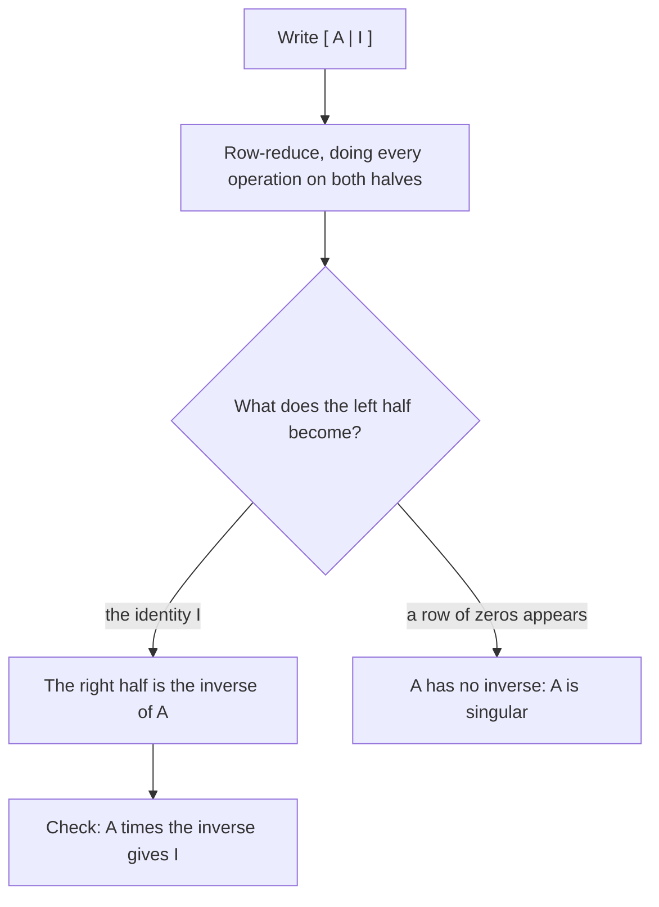

The matrices lesson used a matrix as a compact way to write a system of equations, and it multiplied a matrix by a single column to write the system as $AX = B$. Matrices are also objects you can calculate with in their own right: they can be added, scaled and multiplied, and some of them have inverses. This lesson builds that arithmetic, explains why matrix multiplication is defined the way it is, shows how to find any inverse by row reduction (the lesson on matrices left $3 \times 3$ inverses to the calculator), and uses an inverse to encode and decode a message.

## Adding and scaling

Two matrices can be added or subtracted only when they have the same dimensions. You add entry by entry: the entry in row $i$, column $j$ of $A + B$ is $a_{ij} + b_{ij}$.

**Scalar multiplication** multiplies every entry by the same number (in matrix language, a plain number is called a *scalar*):

$$3\begin{bmatrix} 2 & -1 \\ 0 & 4 \end{bmatrix} = \begin{bmatrix} 6 & -3 \\ 0 & 12 \end{bmatrix}.$$

These operations follow the familiar rules: $A + B = B + A$, $(A + B) + C = A + (B + C)$, and $k(A + B) = kA + kB$. A matrix of all zeros, the **zero matrix**, plays the role of 0.

### Example 1

A bakery's two shops record sales of bread, muffins and pies (columns) at shop 1 and shop 2 (rows):

$$M = \begin{bmatrix} 12 & 8 & 5 \\ 9 & 11 & 7 \end{bmatrix} \text{ (Monday)}, \qquad T = \begin{bmatrix} 10 & 9 & 6 \\ 14 & 7 & 3 \end{bmatrix} \text{ (Tuesday)}.$$

1. Total for the two days: $M + T = \begin{bmatrix} 22 & 17 & 11 \\ 23 & 18 & 10 \end{bmatrix}$. For example, shop 2 sold $11 + 7 = 18$ muffins.
2. Change from Monday to Tuesday: $T - M = \begin{bmatrix} -2 & 1 & 1 \\ 5 & -4 & -4 \end{bmatrix}$. Shop 2 sold 5 more loaves of bread but 4 fewer muffins and 4 fewer pies.
3. If both shops plan to bake twice Monday's numbers, the plan is $2M = \begin{bmatrix} 24 & 16 & 10 \\ 18 & 22 & 14 \end{bmatrix}$.

## Multiplying matrices

**Matrix multiplication** is *not* entry by entry. It extends the row-times-column rule from the matrices lesson: the entry in row $i$, column $j$ of $AB$ is row $i$ of $A$ times column $j$ of $B$, multiplying matching entries and adding.

$$\begin{bmatrix} 1 & 2 \\ 3 & 4 \end{bmatrix}\begin{bmatrix} 5 & 6 \\ 7 & 8 \end{bmatrix} = \begin{bmatrix} 1 \cdot 5 + 2 \cdot 7 & 1 \cdot 6 + 2 \cdot 8 \\ 3 \cdot 5 + 4 \cdot 7 & 3 \cdot 6 + 4 \cdot 8 \end{bmatrix} = \begin{bmatrix} 19 & 22 \\ 43 & 50 \end{bmatrix}.$$

For a row of $A$ to pair up with a column of $B$, they need the same number of entries. So:

$$\underset{m \times n}{A}\;\underset{n \times p}{B} = \underset{m \times p}{AB}.$$

The inner dimensions must match, and the outer dimensions give the size of the product. A $2 \times 3$ matrix times a $3 \times 4$ matrix is $2 \times 4$; a $2 \times 3$ matrix times a $2 \times 3$ matrix is not defined.

Why such a strange rule? Because it is exactly what combining tables of rates requires, as the next example shows. It is also what makes $AX = B$ represent a system of equations.

### Example 2

Ana and Ben buy notebooks, pens and folders. Their quantities $Q$ and the prices $P$ (in dollars) at two stores X and Y are

$$Q = \begin{bmatrix} 3 & 10 & 2 \\ 5 & 4 & 6 \end{bmatrix} \begin{matrix} \text{Ana} \\ \text{Ben} \end{matrix}, \qquad P = \begin{bmatrix} 2.50 & 2.90 \\ 0.40 & 0.30 \\ 1.20 & 1.00 \end{bmatrix} \begin{matrix} \text{notebook} \\ \text{pen} \\ \text{folder} \end{matrix}$$

with the columns of $P$ for stores X and Y. Who should shop where?

1. $Q$ is $2 \times 3$ and $P$ is $3 \times 2$; the inner 3s (the three items) match, so $QP$ is $2 \times 2$: people by stores.
2. Ana at X: $3(2.50) + 10(0.40) + 2(1.20) = 7.50 + 4.00 + 2.40 = 13.90$. Ana at Y: $3(2.90) + 10(0.30) + 2(1.00) = 8.70 + 3.00 + 2.00 = 13.70$.
3. Ben at X: $5(2.50) + 4(0.40) + 6(1.20) = 12.50 + 1.60 + 7.20 = 21.30$. Ben at Y: $5(2.90) + 4(0.30) + 6(1.00) = 14.50 + 1.20 + 6.00 = 21.70$.
4. $QP = \begin{bmatrix} 13.90 & 13.70 \\ 21.30 & 21.70 \end{bmatrix}$. Ana, who buys many pens, saves at Y; Ben saves at X.

Each entry of the product summed "quantity times price" over the items, which is why the items had to be the shared inner dimension.

## Order matters

For numbers, $ab = ba$. For matrices, usually $AB \ne BA$. Sometimes only one order is even defined ($QP$ above is $2 \times 2$, while $PQ$ is $3 \times 3$, a different table altogether). Even for two square matrices of the same size:

$$\begin{bmatrix} 1 & 2 \\ 0 & 1 \end{bmatrix}\begin{bmatrix} 1 & 0 \\ 3 & 1 \end{bmatrix} = \begin{bmatrix} 7 & 2 \\ 3 & 1 \end{bmatrix}, \qquad \begin{bmatrix} 1 & 0 \\ 3 & 1 \end{bmatrix}\begin{bmatrix} 1 & 2 \\ 0 & 1 \end{bmatrix} = \begin{bmatrix} 1 & 2 \\ 3 & 7 \end{bmatrix}.$$

Other rules survive: multiplication is associative, $(AB)C = A(BC)$, and it distributes over addition. A **square matrix** (as many rows as columns) can be multiplied by the identity matrix of its size, and $AI = IA = A$.

Because order matters, the inverse of a product reverses the order: $(AB)^{-1} = B^{-1}A^{-1}$. To check it, multiply and regroup: $(AB)(B^{-1}A^{-1}) = A(BB^{-1})A^{-1} = AIA^{-1} = AA^{-1} = I$. (Think of putting on socks and then shoes; to undo it, take off the shoes first.)

## Finding an inverse by row reduction

Only square matrices can have inverses. For a $2 \times 2$ matrix, the formula from the matrices lesson works. For larger ones, use row reduction.

Write $A$ and the identity side by side as $[\,A \mid I\,]$ and row-reduce the left half to $I$. Whatever the right half has become is $A^{-1}$:

$$[\,A \mid I\,] \;\longrightarrow\; [\,I \mid A^{-1}\,].$$

Why it works: the columns of $A^{-1}$ are the solutions of $AX = $ (column 1 of $I$), $AX = $ (column 2 of $I$), and so on, because $AA^{-1} = I$. Row-reducing $[\,A \mid I\,]$ solves all of those systems at once, since they share the same coefficient matrix.

### Example 3

Find the inverse of $A = \begin{bmatrix} 1 & 1 & 0 \\ 0 & 1 & 1 \\ 1 & 2 & 2 \end{bmatrix}$.

1. Clear column 1 below the leading 1, then clear column 2 below its leading 1:
$$\left[\begin{array}{ccc|ccc} 1 & 1 & 0 & 1 & 0 & 0 \\ 0 & 1 & 1 & 0 & 1 & 0 \\ 1 & 2 & 2 & 0 & 0 & 1 \end{array}\right] \xrightarrow{R_3 - R_1 \to R_3} \left[\begin{array}{ccc|ccc} 1 & 1 & 0 & 1 & 0 & 0 \\ 0 & 1 & 1 & 0 & 1 & 0 \\ 0 & 1 & 2 & -1 & 0 & 1 \end{array}\right] \xrightarrow{R_3 - R_2 \to R_3} \left[\begin{array}{ccc|ccc} 1 & 1 & 0 & 1 & 0 & 0 \\ 0 & 1 & 1 & 0 & 1 & 0 \\ 0 & 0 & 1 & -1 & -1 & 1 \end{array}\right]$$
2. Now clear *above* the leading 1s, working from the bottom up:
$$\xrightarrow{R_2 - R_3 \to R_2} \left[\begin{array}{ccc|ccc} 1 & 1 & 0 & 1 & 0 & 0 \\ 0 & 1 & 0 & 1 & 2 & -1 \\ 0 & 0 & 1 & -1 & -1 & 1 \end{array}\right] \xrightarrow{R_1 - R_2 \to R_1} \left[\begin{array}{ccc|ccc} 1 & 0 & 0 & 0 & -2 & 1 \\ 0 & 1 & 0 & 1 & 2 & -1 \\ 0 & 0 & 1 & -1 & -1 & 1 \end{array}\right]$$
3. So $A^{-1} = \begin{bmatrix} 0 & -2 & 1 \\ 1 & 2 & -1 \\ -1 & -1 & 1 \end{bmatrix}$.
4. Check one entry of $AA^{-1}$: row 3 of $A$ times column 3 of $A^{-1}$ is $1(1) + 2(-1) + 2(1) = 1$, as the identity requires. (The other eight entries check the same way.)

### Example 4

Solve $x + y = 3$, $y + z = 5$, $x + 2y + 2z = 9$, and then the same left sides with right sides $1$, $0$, $2$.

1. The coefficient matrix is the $A$ of Example 3, so $X = A^{-1}B$.
2. With $B = (3, 5, 9)$: $x = 0 - 10 + 9 = -1$, $y = 3 + 10 - 9 = 4$, $z = -3 - 5 + 9 = 1$. Check the third equation: $-1 + 8 + 2 = 9$.
3. With $B = (1, 0, 2)$: $x = 0 - 0 + 2 = 2$, $y = 1 + 0 - 2 = -1$, $z = -1 - 0 + 2 = 1$. Check: $2 - 1 = 1$, $-1 + 1 = 0$, $2 - 2 + 2 = 2$.

Once you have $A^{-1}$, each new right side costs only one multiplication. That's the advantage of the inverse when the same system is solved many times with different data.

## When there is no inverse

A square matrix with no inverse is called **singular**. Row reduction tells you: a row of zeros appears on the left side, so the left half can never become $I$. For example,

$$\left[\begin{array}{cc|cc} 1 & 2 & 1 & 0 \\ 2 & 4 & 0 & 1 \end{array}\right] \xrightarrow{R_2 - 2R_1 \to R_2} \left[\begin{array}{cc|cc} 1 & 2 & 1 & 0 \\ 0 & 0 & -2 & 1 \end{array}\right].$$

The second row of the coefficient matrix is twice the first, so the two equations of any system with this coefficient matrix describe parallel or identical lines. This matches the $2 \times 2$ test from the matrices lesson: $\det = 1(4) - 2(2) = 0$.

## An application: a simple matrix code

### Example 5

Number the letters $A = 1, B = 2, \ldots, Z = 26$. To encode the word MATH, write its numbers in pairs as the columns of a matrix and multiply on the left by the key $K = \begin{bmatrix} 2 & 1 \\ 1 & 1 \end{bmatrix}$.

1. M, A, T, H are 13, 1, 20, 8, so the message matrix is $\begin{bmatrix} 13 & 20 \\ 1 & 8 \end{bmatrix}$.
2. Encode: $K\begin{bmatrix} 13 & 20 \\ 1 & 8 \end{bmatrix} = \begin{bmatrix} 27 & 48 \\ 14 & 28 \end{bmatrix}$. The coded message is 27, 14, 48, 28.
3. To decode, the receiver needs $K^{-1}$. Here $\det K = 2 - 1 = 1$, so $K^{-1} = \begin{bmatrix} 1 & -1 \\ -1 & 2 \end{bmatrix}$.
4. Decode: $K^{-1}\begin{bmatrix} 27 & 48 \\ 14 & 28 \end{bmatrix} = \begin{bmatrix} 13 & 20 \\ 1 & 8 \end{bmatrix}$, which spells MATH again.

This is a simplified version of the Hill cipher, published by Lester Hill in 1929. The real cipher does its arithmetic modulo 26 so that coded numbers are letters too; neither version is secure by modern standards, but the idea that a key matrix must be invertible for decoding is central to it.

## Common mistakes

- Multiplying matrices entry by entry. The product uses rows of the first times columns of the second.
- Multiplying when the inner dimensions don't match, or giving the product the wrong size.
- Assuming $AB = BA$, or writing $(AB)^{-1} = A^{-1}B^{-1}$.
- Doing a row operation on only the left half of $[\,A \mid I\,]$.
- "Dividing" by a matrix. There is no matrix division; you multiply by an inverse, on the correct side.
- Adding matrices of different dimensions.

## Key points

- Add, subtract and scale matrices entry by entry (same dimensions needed for adding).
- $(AB)_{ij}$ = row $i$ of $A$ times column $j$ of $B$; an $m \times n$ matrix times an $n \times p$ matrix is $m \times p$.
- Matrix multiplication is associative but usually not commutative; $(AB)^{-1} = B^{-1}A^{-1}$.
- Row-reduce $[\,A \mid I\,]$ to $[\,I \mid A^{-1}\,]$; a zero row on the left means $A$ is singular.
- With $A^{-1}$ known, every system $AX = B$ is solved by one multiplication, $X = A^{-1}B$.
