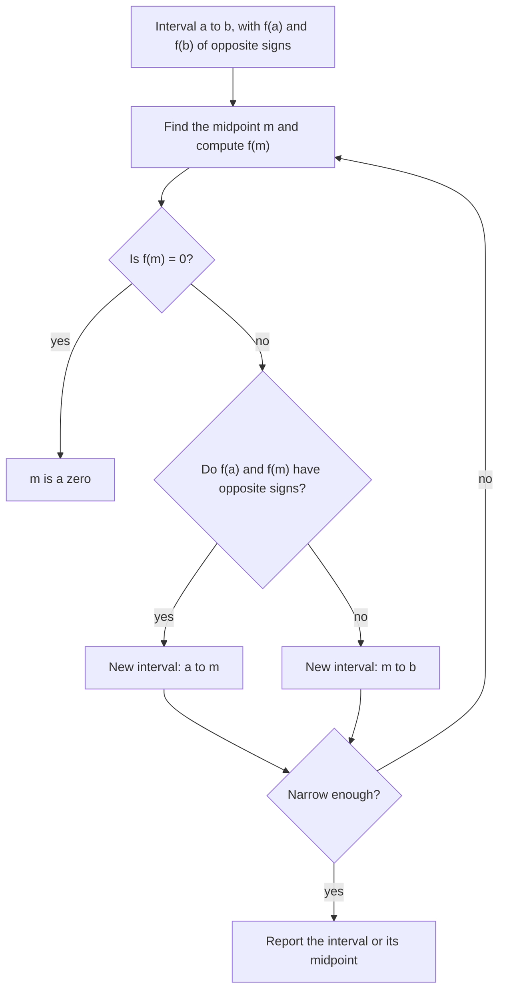

The rational root theorem lesson gave a strategy for finding zeros: list the candidates $\pm\tfrac pq$, test them, divide out each zero you find. That works well for small textbook polynomials, but it has two weak spots. The candidate list can be long (a constant term of 60 and a leading coefficient of 12 give 60 different candidates), and many zeros are irrational, so they never appear on the list at all.

This lesson adds three tools that work for any polynomial with real coefficients. **Descartes' rule of signs** predicts how many positive and negative real zeros there can be. The bound test tells you where you can stop looking. Bisection, built on the Intermediate Value Theorem from the polynomial functions lesson, pins down an irrational zero to as many decimal places as you like.

## Counting sign changes

Write $f(x)$ in standard form (highest power first) and read the signs of its coefficients from left to right, skipping any zero coefficients. Each place where the sign switches from $+$ to $-$ or from $-$ to $+$ is a **sign change**.

For $f(x) = 2x^5 - x^4 - 3x^3 + 5x^2 + x - 4$ the signs are

$$+\;\;-\;\;-\;\;+\;\;+\;\;-$$

with switches between the 1st and 2nd, the 3rd and 4th, and the 5th and 6th signs: 3 sign changes.

> **Descartes' rule of signs**: let $f$ have real coefficients and a nonzero constant term. The number of positive real zeros of $f$, counted with multiplicity, equals the number of sign changes in $f(x)$ or is less than it by an even number. The number of negative real zeros is found the same way from $f(-x)$.

Replacing $x$ by $-x$ flips the sign of every odd-power term and leaves the even-power terms alone. A negative zero $c$ of $f$ is a positive zero $-c$ of $f(-x)$, which is why $f(-x)$ counts the negative zeros.

If the constant term is 0, factor out the highest power of $x$ you can first. Then 0 is a zero of that multiplicity, and the rule applies to what's left. Zero is neither positive nor negative, so the rule never counts it.

René Descartes stated the rule in *La Géométrie* (1637) without proof; later mathematicians proved it. The "at most" part takes real work to prove, but the "less by an even number" part has a short explanation. Suppose the leading coefficient is positive. If the constant term is also positive, the graph starts at a positive height at $x = 0$ and ends up high as $x \to \infty$, so it must cross the positive $x$-axis an even number of times (a touch at a double zero counts twice). And when the first and last signs agree, the number of switches between them is even too. If the constant term is negative, both counts are odd. Either way they have the same parity, so they differ by an even number.

### Example 1

Use Descartes' rule to list the possible numbers of positive, negative and non-real zeros of $f(x) = 2x^5 - x^4 - 3x^3 + 5x^2 + x - 4$.

1. Positive zeros: $f(x)$ has 3 sign changes (above), so there are 3 or 1 positive zeros.
2. Negative zeros: flip the odd-power terms:
$$f(-x) = -2x^5 - x^4 + 3x^3 + 5x^2 - x - 4,$$
with signs $-\;-\;+\;+\;-\;-$, so 2 sign changes: 2 or 0 negative zeros.
3. The degree is 5, so there are 5 zeros in all. Whatever isn't real comes in conjugate pairs. The possibilities are:

| Positive | Negative | Non-real | Total |
|---|---|---|---|
| 3 | 2 | 0 | 5 |
| 3 | 0 | 2 | 5 |
| 1 | 2 | 2 | 5 |
| 1 | 0 | 4 | 5 |

In fact $f(1) = 0$ and $f(-1) = 0$; the zeros turn out to be $1$, $-1$, one more negative zero near $-1.23$, and a conjugate pair. That's the third row. Descartes' rule can't tell you which row is correct, but it rules out everything else, such as 4 positive zeros or 5 real negative ones.

### Example 2

How many positive real zeros does $g(x) = x^5 + 2x^2 - 7$ have?

The signs, skipping the missing powers, are $+\;+\;-$: exactly 1 sign change. Since $1 - 2$ is negative, "less by an even number" isn't possible here: $g$ has *exactly one* positive zero. For negative zeros, $g(-x) = -x^5 + 2x^2 - 7$ has signs $-\;+\;-$: 2 changes, so 2 or 0. (There are 0; the other four zeros are two conjugate pairs.)

An answer of exactly one positive zero is the most useful case of the rule: combined with the Intermediate Value Theorem, it tells you that once you've found a sign change for $x > 0$, you've found the only positive zero.

## Bounds: where to stop looking

A number $M$ is an **upper bound** for the real zeros of $f$ if no real zero is greater than $M$, and $m$ is a **lower bound** if no real zero is less than $m$. Synthetic division gives a quick test.

> **Bound test**: let $f$ have real coefficients and a positive leading coefficient, and divide $f(x)$ by $x - c$ synthetically.
> - If $c > 0$ and every number in the bottom row is $\ge 0$, then $c$ is an upper bound.
> - If $c < 0$ and the numbers in the bottom row alternate in sign, then $c$ is a lower bound. (A 0 in the row may be treated as either $+$ or $-$, whichever keeps the pattern going.)

If the leading coefficient is negative, multiply $f$ by $-1$ first; that doesn't change the zeros.

Why does the upper bound test work? The division algorithm says $f(x) = (x - c)\,q(x) + r$, where the bottom row holds the coefficients of $q$ followed by $r$. Take any $x > c$. Then $x - c > 0$. Every coefficient of $q$ is $\ge 0$ and its leading coefficient (the same as $f$'s) is positive, so $q(x) > 0$ for positive $x$. And $r \ge 0$. So $f(x) = (\text{positive})(\text{positive}) + (\text{something} \ge 0) > 0$, and $f$ can't be zero anywhere to the right of $c$. The lower bound test is the same argument applied to $f(-x)$.

The test works in one direction only. If the bottom row has a negative entry, that doesn't prove $c$ is too small; try a larger $c$. For $x^4 - 2x^3 - 7x^2 + 8x + 12$, whose largest zero is exactly 3, dividing by $x - 3$ gives the row $1, 1, -4, -4, 0$, which fails the test even though 3 really is an upper bound. Dividing by $x - 4$ gives $1, 2, 1, 12, 60$, which passes.

### Example 3

Find integer upper and lower bounds for the real zeros of $f(x) = x^4 - x^3 - 3x^2 + 2x - 6$, and then locate each real zero between consecutive integers.

1. Try $c = 2$: the bottom row is $1, 1, -1, 0, -6$. There are negative entries, so the test says nothing. Try $c = 3$:
$$\begin{array}{r|rrrrr} 3 & 1 & -1 & -3 & 2 & -6 \\ & & 3 & 6 & 9 & 33 \\ \hline & 1 & 2 & 3 & 11 & 27 \end{array}$$
All entries are positive, so 3 is an upper bound.
2. Try $c = -2$:
$$\begin{array}{r|rrrrr} -2 & 1 & -1 & -3 & 2 & -6 \\ & & -2 & 6 & -6 & 8 \\ \hline & 1 & -3 & 3 & -4 & 2 \end{array}$$
The signs $+\;-\;+\;-\;+$ alternate, so $-2$ is a lower bound. Every real zero lies between $-2$ and $3$.
3. Descartes: $f(x)$ has signs $+\;-\;-\;+\;-$ (3 changes), and $f(-x) = x^4 + x^3 - 3x^2 - 2x - 6$ has signs $+\;+\;-\;-\;-$ (1 change). So there is exactly one negative zero, and 3 or 1 positive zeros.
4. Evaluate at the integers in between: $f(-2) = 2$, $f(-1) = -9$, $f(0) = -6$, $f(1) = -7$, $f(2) = -6$, $f(3) = 27$. The signs change between $-2$ and $-1$ and between 2 and 3.

So the negative zero lies in $(-2, -1)$ and a positive zero lies in $(2, 3)$. None of the rational candidates ($\pm1, \pm2, \pm3, \pm6$) is inside either interval, so both zeros are irrational. (A graph shows only one positive zero, so the other two zeros are a conjugate pair.) Bisection can now find them to any accuracy.

## Bisection: closing in on a zero

The Intermediate Value Theorem says that if $f(a)$ and $f(b)$ have opposite signs, $f$ has a zero between $a$ and $b$. The **bisection method** uses that fact over and over:

1. Start with an interval $[a, b]$ where $f(a)$ and $f(b)$ have opposite signs.
2. Find the midpoint $m = \tfrac{a + b}{2}$ and compute $f(m)$. If $f(m) = 0$, you're done.
3. Otherwise $f(m)$ has the opposite sign from exactly one of $f(a)$ and $f(b)$. Keep the half with the sign change: replace $b$ by $m$ if $f(a)$ and $f(m)$ have opposite signs, and replace $a$ by $m$ otherwise.
4. Repeat until the interval is as narrow as you need.



Each step halves the interval, so after $n$ steps an interval of width $w$ has shrunk to $\tfrac{w}{2^n}$. The zero is somewhere inside, so its midpoint is within half that width of the zero. Bisection is slow but certain: as long as you start with a sign change, it can't fail to converge. Calculus gives a faster method (Newton's method), but it can wander off when you start it in a bad place.

### Example 4

The polynomial functions lesson showed that $f(x) = x^3 - x - 1$ has a zero between 1 and 2. Locate it to within 0.01.

Here $f(1) = -1 < 0$ and $f(2) = 5 > 0$. Values of $f(m)$ are rounded.

| Step | Interval | Midpoint $m$ | $f(m)$ | Keep |
|---|---|---|---|---|
| 1 | $[1, 2]$ | $1.5$ | $0.875$ | $[1, 1.5]$ |
| 2 | $[1, 1.5]$ | $1.25$ | $-0.297$ | $[1.25, 1.5]$ |
| 3 | $[1.25, 1.5]$ | $1.375$ | $0.225$ | $[1.25, 1.375]$ |
| 4 | $[1.25, 1.375]$ | $1.3125$ | $-0.052$ | $[1.3125, 1.375]$ |
| 5 | $[1.3125, 1.375]$ | $1.34375$ | $0.083$ | $[1.3125, 1.34375]$ |
| 6 | $[1.3125, 1.34375]$ | $1.328125$ | $0.015$ | $[1.3125, 1.328125]$ |
| 7 | $[1.3125, 1.328125]$ | $1.3203125$ | $-0.019$ | $[1.3203125, 1.328125]$ |

After 7 steps the interval has width $\tfrac{1}{2^7} = \tfrac{1}{128} \approx 0.0078$, less than 0.01. The zero is between 1.3203 and 1.3281, and the midpoint $1.3242$ is within 0.004 of it. (The true value is $1.3247$ to four decimal places.)

```plot
{"x": [0.9, 2.1], "y": [-2, 5.5], "functions": [{"f": "x^3 - x - 1", "label": "f(x) = x³ - x - 1"}], "segments": [{"from": [1, -0.5], "to": [2, -0.5], "label": "step 1"}, {"from": [1, -1], "to": [1.5, -1], "label": "step 2"}, {"from": [1.25, -1.5], "to": [1.5, -1.5], "label": "step 3"}], "points": [{"at": [1.3247, 0], "label": "zero ≈ 1.3247"}], "caption": "Each bisection step keeps the half of the interval where f changes sign"}
```

How many steps do you need in general? To get from width 1 to width at most 0.01 you need $2^n \ge 100$; since $2^6 = 64$ and $2^7 = 128$, that's 7 steps. Each extra decimal place costs about $3\tfrac13$ more steps, because $2^{10} = 1024 \approx 10^3$.

## Common mistakes

- Counting zero coefficients as a sign change. Skip them: $x^5 + 2x^2 - 7$ has signs $+\;+\;-$, one change.
- Reading the rule as "exactly as many zeros as sign changes." It gives a maximum, and the actual number can be smaller by 2, 4, …. The quadratic $x^2 - 2x + 5$ has 2 sign changes and no real zeros at all.
- Forgetting to apply the rule to $f(-x)$ for negative zeros, or flipping the signs of the even-power terms instead of the odd-power ones.
- Treating a failed bound test as proof that $c$ is too small. A failed test proves nothing; only a passed test is a conclusion.
- Using the bound test with a negative leading coefficient. Multiply by $-1$ first.
- In bisection, keeping the half without the sign change. Always compare $f(m)$ with an endpoint value.

## Key points

- Descartes' rule of signs: the number of positive real zeros is the number of sign changes in $f(x)$ or less by an even number; use $f(-x)$ for negative zeros. One sign change means exactly one zero.
- Upper bound test: $c > 0$ and a bottom row with no negative entries. Lower bound test: $c < 0$ and a bottom row that alternates in sign. The tests can prove a bound, never disprove one.
- Bisection halves an interval with a sign change at each step; after $n$ steps the width is $\tfrac{w}{2^n}$.
- Together with the rational root theorem: count the zeros, fence them in, test the rational candidates inside the fence, then approximate the irrational zeros.
