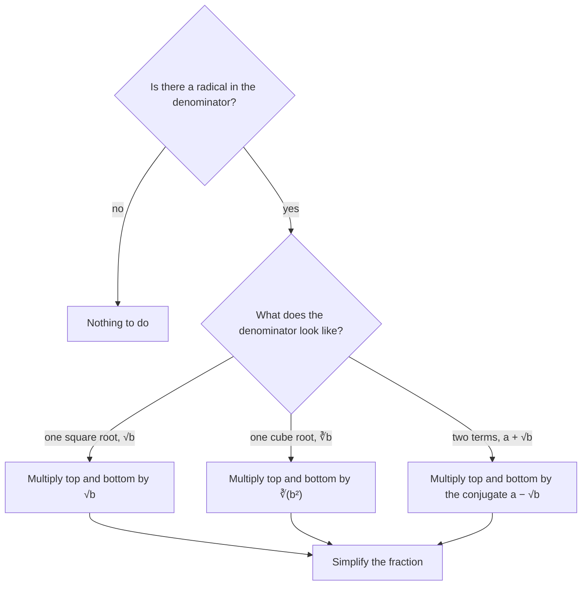

Square roots have already appeared in the quadratic formula. This lesson treats roots properly: what $\sqrt[n]{a}$ means, how to simplify radicals, how to add, multiply and divide them, and how roots connect to exponents. The punchline is that a root is just a fractional exponent, so the exponent rules from Algebra 1 cover radicals too.

## Roots

A **square root** of $a$ is a number whose square is $a$. Every positive number has two square roots, one positive and one negative; the symbol $\sqrt{a}$, called the **principal square root**, always means the nonnegative one. So $\sqrt{25} = 5$, while the solutions of $x^2 = 25$ are $\pm 5$.

More generally, the **nth root** $\sqrt[n]{a}$ is a number whose $n$th power is $a$. In $\sqrt[n]{a}$, $n$ is the **index** and $a$ is the **radicand**; the whole expression is a **radical**.

- For odd $n$, every real number has exactly one real $n$th root: $\sqrt[3]{-8} = -2$ since $(-2)^3 = -8$.
- For even $n$, negative numbers have no real $n$th root, and $\sqrt[n]{a}$ means the nonnegative root: $\sqrt[4]{81} = 3$.

A detail that matters later: $\sqrt{x^2} = |x|$, not $x$. For $x = -3$, $\sqrt{(-3)^2} = \sqrt9 = 3 = |-3|$.

## Simplifying radicals

Two properties let you split and combine radicals (for $a, b \ge 0$ when $n$ is even, and $b \ne 0$ in the quotient):

$$\sqrt[n]{ab} = \sqrt[n]{a}\,\sqrt[n]{b}, \qquad \sqrt[n]{\frac{a}{b}} = \frac{\sqrt[n]{a}}{\sqrt[n]{b}}.$$

They hold because $\left(\sqrt[n]{a}\sqrt[n]{b}\right)^n = ab$. A square root is in **simplest radical form** when the radicand has no perfect-square factor other than 1, there is no fraction under the root, and no root in a denominator.

To simplify $\sqrt{72}$, find the largest perfect-square factor: $72 = 36 \cdot 2$, so $\sqrt{72} = \sqrt{36}\sqrt2 = 6\sqrt2$. If you don't spot the largest, you can repeat: $\sqrt{72} = \sqrt{4}\sqrt{18} = 2\sqrt{18} = 2 \cdot 3\sqrt2 = 6\sqrt2$.

With variables (taken nonnegative), pull out pairs for square roots and triples for cube roots: $\sqrt{50x^5} = \sqrt{25x^4 \cdot 2x} = 5x^2\sqrt{2x}$, and $\sqrt[3]{54y^7} = \sqrt[3]{27y^6 \cdot 2y} = 3y^2\sqrt[3]{2y}$.

*Warning:* roots do not split over sums. $\sqrt{9 + 16} = \sqrt{25} = 5$, but $\sqrt9 + \sqrt{16} = 7$.

## Operations with radicals

*Adding and subtracting.* **Like radicals** have the same index and radicand, and combine like like terms: $3\sqrt5 + 4\sqrt5 = 7\sqrt5$. Simplify first; unlike-looking radicals may become alike: $\sqrt{12} + \sqrt{27} = 2\sqrt3 + 3\sqrt3 = 5\sqrt3$. But $\sqrt2 + \sqrt3$ can't be combined.

*Multiplying.* Use the product property and the distributive property: $\sqrt6 \cdot \sqrt{15} = \sqrt{90} = 3\sqrt{10}$, and $(2 + \sqrt3)(4 - \sqrt3) = 8 - 2\sqrt3 + 4\sqrt3 - 3 = 5 + 2\sqrt3$.

*Rationalizing the denominator.* By convention, simplified answers have no radical in a denominator, and removing one is called **rationalizing the denominator**. Multiply top and bottom by a factor that clears it:

- one term: $\dfrac{6}{\sqrt3} = \dfrac{6}{\sqrt3} \cdot \dfrac{\sqrt3}{\sqrt3} = \dfrac{6\sqrt3}{3} = 2\sqrt3$;
- two terms: multiply by the **conjugate**. The conjugate of $a + \sqrt b$ is $a - \sqrt b$, and their product $a^2 - b$ has no radical (a difference of squares).

For a single cube root, multiply by enough extra factors to make the radicand a perfect cube: $\sqrt[3]{2} \cdot \sqrt[3]{4} = \sqrt[3]{8} = 2$, so $\dfrac{5}{\sqrt[3]{2}} = \dfrac{5\sqrt[3]{4}}{\sqrt[3]{2}\,\sqrt[3]{4}} = \dfrac{5\sqrt[3]{4}}{2}$. This chart sums up which factor to use.



### Example 1

Rationalize $\dfrac{4}{3 - \sqrt5}$.

1. Multiply by the conjugate over itself: $\dfrac{4}{3 - \sqrt5} \cdot \dfrac{3 + \sqrt5}{3 + \sqrt5}$.
2. Denominator: $3^2 - (\sqrt5)^2 = 9 - 5 = 4$.
3. Result: $\dfrac{4(3 + \sqrt5)}{4} = 3 + \sqrt5$.
4. Check numerically: $\tfrac{4}{0.764} \approx 5.236$ and $3 + 2.236 = 5.236$.

## Rational exponents

How should $a^{1/n}$ be defined? If the power rule $(a^m)^n = a^{mn}$ is to keep working, then $\left(a^{1/n}\right)^n = a^1 = a$. So $a^{1/n}$ must be an $n$th root of $a$:

$$a^{1/n} = \sqrt[n]{a}, \qquad a^{m/n} = \left(\sqrt[n]{a}\right)^m = \sqrt[n]{a^m}.$$

A **rational exponent** $\tfrac{m}{n}$ means: the denominator is the root, the numerator is the power. It's usually easiest to take the root first, while the number is small: $8^{2/3} = \left(\sqrt[3]{8}\right)^2 = 2^2 = 4$. Negative rational exponents still mean reciprocals: $16^{-3/4} = \dfrac{1}{16^{3/4}} = \dfrac{1}{2^3} = \dfrac18$.

The picture names the parts of both notations side by side.


All the exponent rules from Algebra 1 apply to rational exponents (for positive bases).

### Example 2

Simplify $\dfrac{x^{2/3} \cdot x^{1/2}}{x^{1/6}}$ for $x > 0$.

1. Product rule: $x^{2/3 + 1/2} = x^{4/6 + 3/6} = x^{7/6}$.
2. Quotient rule: $x^{7/6 - 1/6} = x^{6/6} = x$.

### Example 3

Write $\sqrt[4]{x^3} \cdot \sqrt{x}$ as a single radical.

1. Convert: $x^{3/4} \cdot x^{1/2} = x^{3/4 + 2/4} = x^{5/4}$.
2. Back to radical form: $x^{5/4} = \sqrt[4]{x^5} = x\sqrt[4]{x}$.

Converting to exponents is the reliable way to combine radicals with different indexes.

## The square root function

The function $f(x) = \sqrt{x}$ has domain $[0, \infty)$ and range $[0, \infty)$. Its graph is half of a sideways parabola: it's the reflection of the right half of $y = x^2$ across the line $y = x$, because squaring and square-rooting undo each other for $x \ge 0$. The cube root function $\sqrt[3]{x}$ is defined for every real number.

```plot
{"x": [-3, 9], "y": [-3, 9], "equal": true, "functions": [{"f": "sqrt(x)", "label": "y = √x"}, {"f": "x^2", "from": 0, "to": 3, "dashed": true, "label": "y = x²"}, {"f": "x", "dashed": true, "label": "y = x"}, {"f": "cbrt(x)", "label": "y = ∛x", "from": -3, "to": 9}], "points": [{"at": [4, 2], "label": "(4, 2)"}, {"at": [2, 4], "label": "(2, 4)"}], "caption": "√x mirrors x² (for x ≥ 0) across y = x; ∛x is defined for all x"}
```

## Common mistakes

- Splitting a root over a sum: $\sqrt{a + b} \ne \sqrt a + \sqrt b$.
- Combining unlike radicals: $\sqrt2 + \sqrt3 \ne \sqrt5$.
- Reading $a^{2/3}$ as $\sqrt[2]{a^3}$: the denominator is the index.
- Treating a negative exponent as a negative number: $27^{-1/3} = \tfrac13$.
- Writing $\sqrt{x^2} = x$ when $x$ might be negative.

## Key points

- $\sqrt[n]{a}$ is the number whose $n$th power is $a$ (the nonnegative one when $n$ is even).
- $\sqrt[n]{ab} = \sqrt[n]{a}\sqrt[n]{b}$; simplify by pulling out perfect powers. Roots don't split over sums.
- Combine only like radicals; rationalize denominators, using the conjugate for two-term denominators.
- $a^{m/n} = \left(\sqrt[n]{a}\right)^m$; all exponent rules apply.
