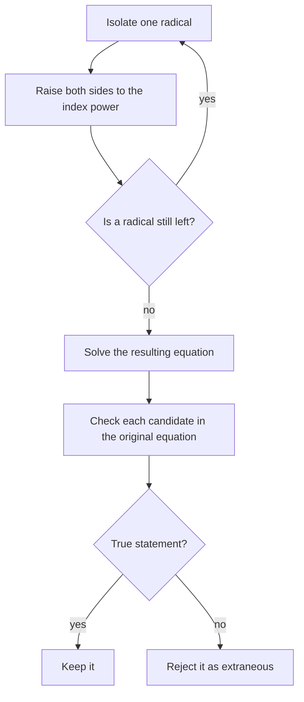

A **radical equation** has the variable inside a radical, like $\sqrt{2x + 3} = 5$. The natural way to remove a square root is to square both sides. That works, but it comes with a catch: squaring can create "solutions" that don't satisfy the original equation. This lesson shows the method and why checking is not optional.

## The method

1. Isolate a radical on one side.
2. Raise both sides to the power that matches the index (square for a square root, cube for a cube root).
3. Solve the resulting equation.
4. Check every candidate in the original equation and discard any that fail.

When an equation has two radicals, the first squaring leaves one behind, so the first two steps repeat, as the loop in this chart shows.



### Example 1

Solve $\sqrt{2x + 3} - 1 = 4$.

1. Isolate: $\sqrt{2x + 3} = 5$.
2. Square: $2x + 3 = 25$.
3. Solve: $x = 11$.
4. Check: $\sqrt{25} - 1 = 4$. True.

## Why extraneous solutions appear

If $a = b$, then $a^2 = b^2$. But the reverse fails: $a^2 = b^2$ only tells you $a = \pm b$. Squaring merges the equation $a = b$ with the different equation $a = -b$, so solutions of the second can sneak in. A candidate that solves the squared equation but not the original is an **extraneous solution**.

### Example 2

Solve $\sqrt{x + 7} = x + 1$.

1. The radical is isolated. Square both sides; the right side is a binomial, so use the special product: $x + 7 = x^2 + 2x + 1$.
2. Standard form: $x^2 + x - 6 = 0$, so $(x + 3)(x - 2) = 0$ and $x = -3$ or $x = 2$.
3. Check $x = 2$: $\sqrt9 = 3$ and $2 + 1 = 3$. True.
4. Check $x = -3$: $\sqrt4 = 2$ but $-3 + 1 = -2$. False. Reject it.

The only solution is $x = 2$. Notice that $x = -3$ solves $-\sqrt{x + 7} = x + 1$, the "other sign" equation that squaring mixed in.

```plot
{"x": [-8, 5], "y": [-4, 6], "functions": [{"f": "sqrt(x + 7)", "label": "y = √(x + 7)"}, {"f": "x + 1", "label": "y = x + 1", "dashed": true}], "points": [{"at": [2, 3], "label": "(2, 3)"}, {"at": [-3, -2], "open": true, "label": "x = -3 is not an intersection"}], "caption": "The graphs meet only at x = 2"}
```

The next picture adds the graph of $y = -\sqrt{x + 7}$, the lower half of the same sideways parabola $y^2 = x + 7$. Squaring can't tell the two halves apart, so it finds every point where the line meets *either* half: the true solution on the upper half and the extraneous value on the lower half.


A quick sign check can catch extraneous roots before you finish: a principal square root is never negative, so in $\sqrt{x + 7} = x + 1$ we need $x + 1 \ge 0$. That rules out $x = -3$ immediately.

A common error is squaring term by term: $(x + 1)^2$ is $x^2 + 2x + 1$, not $x^2 + 1$.

## Two radicals

If there are two square roots, isolate one, square, then isolate the remaining radical and square again.

### Example 3

Solve $\sqrt{x + 5} - \sqrt{x} = 1$.

1. Isolate one radical: $\sqrt{x + 5} = 1 + \sqrt x$.
2. Square: $x + 5 = 1 + 2\sqrt x + x$.
3. Simplify: $4 = 2\sqrt x$, so $\sqrt x = 2$.
4. Square again: $x = 4$.
5. Check: $\sqrt9 - \sqrt4 = 3 - 2 = 1$. True.

## Other roots and rational exponents

For a cube root, cube both sides. Cubing doesn't create extraneous solutions (since $a^3 = b^3$ does imply $a = b$ for real numbers), but checking is still good practice.

### Example 4

Solve $\sqrt[3]{2x - 5} = -3$.

Cube: $2x - 5 = -27$, so $x = -11$. Check: $\sqrt[3]{-27} = -3$. Note that a negative result is fine for a cube root.

### Example 5

Solve $(x - 2)^{3/2} = 8$.

1. Raise both sides to the reciprocal power $\tfrac23$: $x - 2 = 8^{2/3} = 4$.
2. So $x = 6$. Check: $4^{3/2} = (\sqrt4)^3 = 8$. True.

Watch the numerator of the exponent. When it is even, the power hides a square, and squares lose the sign, so both signs must be kept. For $x^{2/3} = 4$, write it as $\left(\sqrt[3]{x}\right)^2 = 4$: then $\sqrt[3]{x} = \pm 2$ and $x = \pm 8$. Both check, since $(-8)^{2/3} = \left(\sqrt[3]{-8}\right)^2 = (-2)^2 = 4$. Raising both sides to the $\tfrac32$ power alone would find only $x = 8$. When the numerator is odd, as in Example 5, there is just one candidate.

### Example 6

Solve $\sqrt{3x + 1} = -4$.

A principal square root can't equal a negative number, so there is no solution. (Squaring anyway gives $x = 5$, which fails the check: $\sqrt{16} = 4 \ne -4$.)

## An application

### Example 7

The time for a pendulum to complete one full back-and-forth swing (its period) is $T = 2\pi\sqrt{\dfrac{L}{9.8}}$ seconds, where $L$ is its length in meters. How long must a pendulum be to have a period of 2 seconds?

1. Isolate the root: $\sqrt{\dfrac{L}{9.8}} = \dfrac{2}{2\pi} = \dfrac{1}{\pi}$.
2. Square: $\dfrac{L}{9.8} = \dfrac{1}{\pi^2}$, so $L = \dfrac{9.8}{\pi^2} \approx 0.993$ m.

## Radicals in formulas

Radical equations also appear when a formula is solved for a variable under a root.

### Example 8

The speed of an object dropped from height $h$ (ignoring air resistance) is $v = \sqrt{2gh}$. Solve for $h$, then find the height that gives a speed of 14 m/s, using $g = 9.8$ m/s².

1. Square both sides: $v^2 = 2gh$. (Both sides are nonnegative here, so no extraneous solutions arise.)
2. Divide by $2g$: $h = \dfrac{v^2}{2g}$.
3. Substitute: $h = \dfrac{14^2}{2(9.8)} = \dfrac{196}{19.6} = 10$ m.

Notice that the formula shows doubling the speed requires four times the height, since $h$ grows with $v^2$.

## Common mistakes

- Squaring before isolating the radical, which leaves a radical in the cross term.
- Squaring a binomial as if it were two separate squares.
- Skipping the check and reporting extraneous solutions.
- Forgetting that $\sqrt{u} = (\text{negative number})$ has no solution.

## Key points

- Isolate the radical, raise both sides to the index power, solve, and check.
- Squaring can introduce extraneous solutions, because $a^2 = b^2$ allows $a = -b$.
- For two square roots, isolate and square twice.
- For $u^{m/n} = c$, raise both sides to the power $\tfrac{n}{m}$, taking $\pm$ when $m$ is even, and check.
