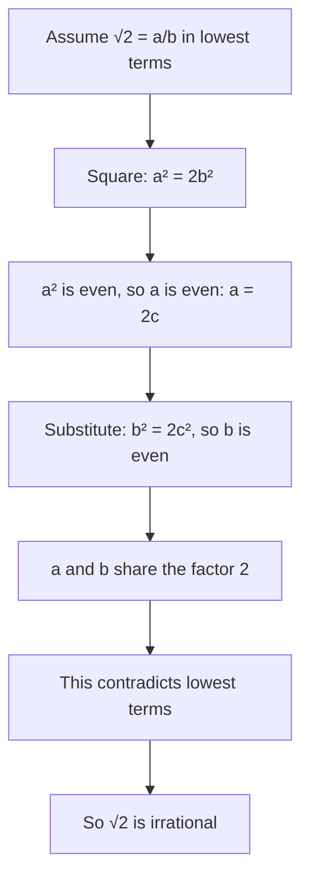

The radicals lesson left answers like $6\sqrt2$ and $3 + \sqrt5$ in exact form. Two questions hide behind that habit. First, why not just write $\sqrt2$ as a fraction? Because it can't be done, and this lesson proves it. Second, if $\sqrt2$ is not a fraction, how does a calculator get $1.41421356\ldots$? The answer is an averaging method written down nearly 2,000 years ago, whose idea lives on in the methods computers use today. Both halves use only the algebra of radicals you already know.

## Rational and irrational numbers

A **rational number** is one that can be written as a fraction $\tfrac{a}{b}$ of integers with $b \ne 0$. Integers, terminating decimals such as $0.375 = \tfrac38$, and repeating decimals such as $0.\overline{3} = \tfrac13$ are all rational. A real number that is not rational is an **irrational number**. Its decimal expansion neither ends nor falls into a repeating block.

A calculator can't settle which kind a number is. It shows $\sqrt2 \approx 1.414213562$, but ten digits that don't repeat say nothing about the next billion. The question needs a proof.

## Why $\sqrt2$ is irrational

The classic argument is a **proof by contradiction**: assume the opposite of what you want to prove, reason correctly, and arrive at something impossible. Then the assumption must have been false. A proof of this kind was known to Greek mathematicians by the time of Aristotle (4th century BCE), who mentions it. A popular story credits a Pythagorean named Hippasus with the discovery, but that story comes from much later writers and is a legend, not history.

One fact about whole numbers does the work: *if $a^2$ is even, then $a$ is even.* (If $a$ were odd, $a = 2k + 1$, then $a^2 = 4k^2 + 4k + 1$ would be odd.)

The proof:

1. Suppose $\sqrt2 = \tfrac{a}{b}$, a fraction in lowest terms (any fraction can be reduced, so this costs nothing).
2. Square and clear the denominator: $a^2 = 2b^2$. So $a^2$ is even, and therefore $a$ is even: $a = 2c$.
3. Substitute: $4c^2 = 2b^2$, so $b^2 = 2c^2$. Now $b^2$ is even, so $b$ is even.
4. Both $a$ and $b$ are even, so $\tfrac{a}{b}$ was *not* in lowest terms. Contradiction.

No such fraction exists, so $\sqrt2$ is irrational.

### Example 1

Prove that $\sqrt3$ is irrational, and see why the same steps fail for $\sqrt4$.

1. Suppose $\sqrt3 = \tfrac{a}{b}$ in lowest terms. Then $a^2 = 3b^2$, so 3 divides $a^2$.
2. Because 3 is prime, if 3 divides $a \cdot a$ it divides $a$. (A prime that divides a product divides one of the factors.) So $a = 3c$.
3. Then $9c^2 = 3b^2$, so $b^2 = 3c^2$, and 3 divides $b$ as well.
4. Both are multiples of 3: a contradiction, so $\sqrt3$ is irrational.

Try it with 4: $a^2 = 4b^2$ means $a = 2b$, which is perfectly possible ($a = 2$, $b = 1$). Step 2 breaks, because 4 is not prime: $4 \mid a^2$ does not force $4 \mid a$ (take $a = 2$). No contradiction appears, and indeed $\sqrt4 = 2$ is rational. A proof is only as good as each step.

## A general test from the rational root theorem

Proving each root separately gets tedious. The rational root theorem from the polynomial module does them all at once. The number $\sqrt[n]{k}$ (for a positive integer $k$) is a root of
$$x^n - k = 0.$$
The leading coefficient is 1, so any rational root must be an integer that divides $k$. So either $\sqrt[n]{k}$ is a whole number, or it is irrational. There is nothing in between:

> For positive integers $k$ and $n$, $\sqrt[n]{k}$ is rational exactly when $k$ is a perfect $n$th power.

So $\sqrt{12}$, $\sqrt[3]{2}$ and $\sqrt[4]{8}$ are irrational, while $\sqrt[3]{27} = 3$ and $\sqrt[5]{32} = 2$ are not.

### Example 2

Show that $\sqrt2 + \sqrt3$ is irrational.

1. Suppose $r = \sqrt2 + \sqrt3$ is rational.
2. Square it: $r^2 = 2 + 2\sqrt6 + 3 = 5 + 2\sqrt6$.
3. Solve for the radical: $\sqrt6 = \dfrac{r^2 - 5}{2}$. The right side is built from a rational number by squaring, subtracting and dividing, so it is rational.
4. But 6 is not a perfect square, so $\sqrt6$ is irrational by the test above. Contradiction: $\sqrt2 + \sqrt3$ is irrational.

The tool here is the same one used for radical equations: square to remove radicals, then isolate the one that remains. Also notice that "irrational plus irrational" is not automatically irrational: $\sqrt2 + (-\sqrt2) = 0$. Each sum needs its own argument.

## Approximating roots: Heron's method

If $\sqrt{n}$ has no exact decimal, the next best thing is a fast way to get as many digits as you want. Picture a rectangle of area $n$. If one side is $x$, the other is $\tfrac{n}{x}$. When $x$ is too big, $\tfrac{n}{x}$ is too small, and the square of area $n$ has a side, $\sqrt n$, between them. A good guess for that side is their average:

$$x_{\text{new}} = \frac12\left(x + \frac{n}{x}\right).$$

Repeat with the new guess, and the rectangle becomes more and more square. This is **Heron's method**, named for Heron of Alexandria (1st century CE), who described it with a worked example. It is also called the Babylonian method, since an Old Babylonian tablet (YBC 7289, about 1800–1600 BCE) records an approximation of $\sqrt2$ in base 60 that is equal to $1.41421296\ldots$, within a millionth of the true value. How the Babylonian scribes got it is not known for certain.

### Example 3

Heron's own example estimates $\sqrt{720}$. Start from $x = 27$, since $27^2 = 729$ is close.

1. $\tfrac{720}{27} = 26.666\ldots$, so the next guess is $\tfrac12(27 + 26.666\ldots) = 26.8333\ldots = 26\tfrac56$.
2. Again: $\tfrac{720}{26.8333} = 26.83230\ldots$, and the average is $26.832816\ldots$.
3. The calculator value is $\sqrt{720} = 26.8328157\ldots$, so two steps already give 7 correct digits.

## Why it works so fast

Two pieces of algebra explain the method.

*After the first step, every guess is too big (or exactly right).* Expand:
$$\left(\frac{x + \frac{n}{x}}{2}\right)^2 - n = \frac{x^2 + 2n + \frac{n^2}{x^2}}{4} - n = \frac{x^2 - 2n + \frac{n^2}{x^2}}{4} = \left(\frac{x - \frac{n}{x}}{2}\right)^2 \ge 0.$$
So the new guess squared is at least $n$, which means the new guess is at least $\sqrt n$.

*The error is squared at every step.* Let $e = x - \sqrt n$ be the error of the current guess. Then
$$x_{\text{new}} - \sqrt n = \frac{x^2 + n - 2x\sqrt n}{2x} = \frac{(x - \sqrt n)^2}{2x} = \frac{e^2}{2x}.$$
An error of $0.001$ becomes roughly $0.000001$ divided by $2x$. In practice the number of correct digits about doubles with each step once the guess is close.

### Example 4

Run Heron's method for $\sqrt2$ from $x = 1$, as exact fractions.

| Step | Guess | Decimal | Error |
|---|---|---|---|
| 0 | $1$ | $1$ | $-0.414$ |
| 1 | $\tfrac32$ | $1.5$ | $0.086$ |
| 2 | $\tfrac{17}{12}$ | $1.41667$ | $0.0025$ |
| 3 | $\tfrac{577}{408}$ | $1.4142157$ | $0.0000021$ |
| 4 | $\tfrac{665857}{470832}$ | $1.414213562375$ | $0.0000000000016$ |

The first guess was too small; every later one is slightly too big, as the algebra promised. Each guess is rational, of course: the method closes in on an irrational number through a sequence of fractions, which is the best any finite calculation can do.

## Cube roots and beyond

The same idea works for $\sqrt[3]{n}$ with a box instead of a rectangle. A box with volume $n$ and sides $x$, $x$ and $\tfrac{n}{x^2}$ becomes more like a cube if you replace $x$ by the average of its three sides:

$$x_{\text{new}} = \frac13\left(2x + \frac{n}{x^2}\right).$$

Both formulas are special cases of **Newton's method**, a general way to solve equations that you may meet in calculus. Many calculators and computer math libraries use methods in this family, though the exact algorithms vary.

### Example 5

Estimate $\sqrt[3]{10}$ starting from $x = 2$.

1. $\tfrac{10}{2^2} = 2.5$, so $x = \tfrac13(2 + 2 + 2.5) = \tfrac{6.5}{3} = 2.1667$ (to 4 decimal places).
2. $\tfrac{10}{2.16667^2} \approx 2.13017$, so $x = \tfrac13(2.16667 + 2.16667 + 2.13017) = 2.1545$.
3. Check: $\sqrt[3]{10} = 2.15443\ldots$, and $2.1545^3 \approx 10.0009$.

## Common mistakes

- Assuming a number is irrational because its decimal looks random on a calculator. Only a proof settles it.
- Running the evenness argument for a non-prime, like 4 or 6, as if $k \mid a^2$ always forced $k \mid a$.
- Concluding that a sum of irrationals must be irrational. Sometimes it is ($\sqrt2 + \sqrt3$), sometimes not ($\sqrt2 + (-\sqrt2)$).
- In Heron's method, averaging $x$ with $n$ instead of with $\tfrac{n}{x}$.
- For cube roots, using $\tfrac{n}{x}$ instead of $\tfrac{n}{x^2}$, or dividing by 2 instead of 3.

## Key points

- Rational numbers are fractions of integers; irrational numbers are real numbers that are not.
- $\sqrt2$ is irrational by contradiction: a lowest-terms fraction would have both parts even.
- $\sqrt[n]{k}$ for a positive integer $k$ is either a whole number or irrational (rational root theorem on $x^n - k = 0$).
- Heron's method $x \to \tfrac12\left(x + \tfrac{n}{x}\right)$ averages the sides of a rectangle of area $n$. The error is squared at each step, so correct digits roughly double.
- For cube roots, use $x \to \tfrac13\left(2x + \tfrac{n}{x^2}\right)$.
