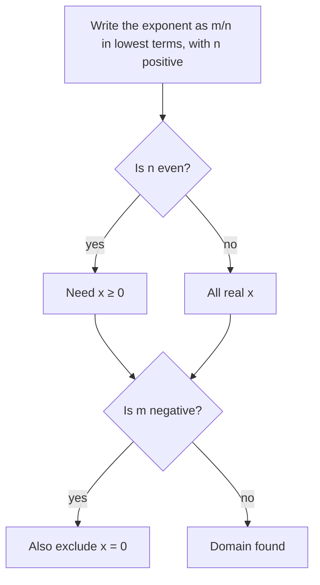

The radicals lesson showed that $a^{m/n}$ means "take the $n$th root, then the $m$th power", and the radical equations lesson undid such powers. This lesson puts the exponent on the variable and treats $x^{m/n}$ as a function. Rational exponents turn out to be the natural language for some famous laws of nature: how a planet's year depends on its distance from the Sun, why giant animals need thick legs, and how an animal's energy use grows with its mass. Along the way you'll see exactly where the exponent rules stop working, a point the core lesson only hinted at with $\sqrt{x^2} = |x|$.

## Power functions with rational exponents

A **power function** is a function of the form $f(x) = kx^p$, where $k$ and $p$ are constants. You already know the whole-number cases ($x^2$, $x^3$) and $p = -1$ (the reciprocal function). With $p = \tfrac{m}{n}$, the shape for $x > 0$ depends on the size of $p$:

- $0 < p < 1$ (like $x^{1/2}$ or $x^{2/3}$): the graph rises ever more slowly and bends downward.
- $p = 1$: a straight line.
- $p > 1$ (like $x^{3/2}$): the graph rises ever more quickly and bends upward.

Every power function $x^p$ with $p > 0$ passes through $(0, 0)$ and $(1, 1)$. Between 0 and 1, a bigger exponent gives a *smaller* value: $0.25^{1/2} = 0.5$ but $0.25^{3/2} = 0.125$.

```plot
{"x": [-4, 9], "y": [-2, 5], "functions": [{"f": "sqrt(x)", "from": 0, "to": 9, "label": "x^(1/2)"}, {"f": "cbrt(x)", "from": -4, "to": 9, "label": "x^(1/3)"}, {"f": "cbrt(x)^2", "from": -4, "to": 9, "label": "x^(2/3)", "dashed": true}, {"f": "sqrt(x)^3", "from": 0, "to": 2.9, "label": "x^(3/2)"}], "points": [{"at": [1, 1]}], "labels": [{"at": [2.1, 0.45], "text": "(1, 1)"}], "caption": "Rational powers: x^(1/2) and x^(3/2) exist only for x ≥ 0, while x^(1/3) and x^(2/3) are defined for all x"}
```

The domain comes from the denominator. Write the exponent as a fraction $\tfrac{m}{n}$ *in lowest terms* with $n > 0$. If $n$ is odd, the $n$th root of a negative number exists, so every real $x$ is allowed. If $n$ is even, $x$ must be nonnegative. A negative exponent means a reciprocal, so it also rules out $x = 0$.



## Where the exponent rules break

The rules $(a^r)^s = a^{rs}$ and $a^r b^r = (ab)^r$ were stated for positive bases, and that restriction is not fussiness. With a negative base they can give contradictions:

- $(-8)^{1/3} = -2$, since $(-2)^3 = -8$.
- But $\tfrac13 = \tfrac26$, and $(-8)^{2/6} = \left((-8)^2\right)^{1/6} = 64^{1/6} = 2$.

Equal exponents gave different answers. That's why, with a negative base $a$, this course (like most textbooks) uses $a^{m/n}$ only with $\tfrac{m}{n}$ in lowest terms. Calculators and programming languages disagree about these cases: some return $-2$ for $(-8)^{1/3}$, some return an error, and some return a complex number. With a negative base, rewrite the power as a radical before trusting a machine.

The same trouble explains $\sqrt{x^2} = |x|$. Using the power rule blindly, $(x^2)^{1/2} = x^{1}= x$, which is wrong for $x = -3$. The correct statement is $(x^2)^{1/2} = |x|$.

### Example 1

Simplify for all real $x$: (a) $(x^6)^{1/2}$, (b) $(x^4)^{1/2}$, (c) $(x^3)^{1/3}$.

1. (a) $x^6 = (x^3)^2$, so $(x^6)^{1/2} = \sqrt{(x^3)^2} = |x^3| = |x|^3$. The absolute value is needed: at $x = -1$, $\sqrt{1} = 1$, not $-1$.
2. (b) $(x^4)^{1/2} = \sqrt{(x^2)^2} = |x^2| = x^2$. No absolute value is needed because $x^2 \ge 0$ already.
3. (c) $(x^3)^{1/3} = \sqrt[3]{x^3} = x$ for every real $x$: odd roots keep the sign.

Rule of thumb: an even root of an even power needs an absolute value unless the result is already nonnegative.

## Power laws and scaling

When one quantity is a power function of another, $y = kx^p$, scientists call the relationship a **power law**. Its key property is how it responds to scaling the input:

$$k(cx)^p = c^p \cdot kx^p.$$

Multiplying $x$ by $c$ multiplies $y$ by $c^p$, *whatever* $x$ was. Exponential functions behave differently: they multiply the output by a fixed factor when you *add* a fixed amount to the input.

### Example 2: Kepler's third law

In 1619 Johannes Kepler published his third law of planetary motion. In modern form, for planets orbiting the Sun, the orbital period $T$ in years and the average distance $a$ from the Sun in **astronomical units** (AU; 1 AU is the average Earth–Sun distance, about 150 million km) satisfy $T^2 = a^3$ to good accuracy. Solving gives the power law
$$T = a^{3/2}.$$

1. Mars has $a = 1.524$ AU. Then $T = 1.524^{3/2} = \sqrt{1.524}^{\,3} \approx 1.881$ years, matching the observed Martian year of about 687 days.
2. Going the other way, raise both sides to the reciprocal power: $a = T^{2/3}$. Halley's comet returns about every 75 years, so its average distance is $a \approx 75^{2/3} \approx 17.8$ AU.
3. Scaling check: a planet 4 times as far out as another has a year $4^{3/2} = 8$ times as long.

```plot
{"x": [0, 6], "y": [0, 14], "xLabel": "average distance a (AU)", "yLabel": "period T (years)", "functions": [{"f": "sqrt(x)^3", "from": 0, "to": 5.8, "label": "T = a^(3/2)"}], "points": [[0.387, 0.241], [0.723, 0.615], [1, 1], [1.524, 1.881], [5.203, 11.86]], "labels": [{"at": [1.2, 4.6], "text": "Mercury, Venus, Earth"}, {"at": [2.15, 1.0], "text": "Mars"}, {"at": [5.55, 10.2], "text": "Jupiter"}], "segments": [{"from": [0.7, 4.0], "to": [0.7, 1.1], "arrow": true}], "caption": "Measured planetary periods lie on the curve T = a^(3/2)"}
```

## The square–cube law

Take any solid and scale every length by a factor $c$. Every area (surface, cross-section) is multiplied by $c^2$ and every volume, and so every weight, by $c^3$. This is the **square–cube law**. Galileo described its consequences for bones and beams in his *Two New Sciences* (1638). Because area grows as the square of length and volume as the cube, area grows as the $\tfrac23$ power of volume: $A \propto V^{2/3}$.


### Example 3

A movie wants a gorilla scaled up to 3 times normal height, with the same shape and the same kind of bone.

1. Weight grows with volume: $3^3 = 27$ times.
2. Bone strength grows with cross-sectional area: $3^2 = 9$ times.
3. The stress on the bones (weight per area of bone) grows by $\tfrac{27}{9} = 3$. A real giant ape would need proportionally much thicker legs, which is why large land animals such as elephants have stout limbs.

Area as a power of volume: a cube of volume $V$ has edge $V^{1/3}$ and surface area $6\left(V^{1/3}\right)^2 = 6V^{2/3}$. A cube with 8 times the volume has $8^{2/3} = 4$ times the surface area, so only half as much surface per unit of volume. That ratio is why small animals lose heat faster for their size than large ones.

## Finding the exponent

If you know how $y$ responds when $x$ is scaled, you can find $p$. When the scale factors are powers of the same number, use the rule that equal powers of the same base have equal exponents.

### Example 4

When $x$ is multiplied by 4, $y$ is multiplied by 8. Find $p$ in $y = kx^p$.

1. Scaling gives $4^p = 8$.
2. Write both sides as powers of 2: $2^{2p} = 2^3$.
3. So $2p = 3$ and $p = \tfrac32$. (Kepler's law: Jupiter is about $5.2$ times as far out as Earth, and its year is about $11.9 \approx 5.2^{1.5}$ years.)

For scale factors that aren't powers of a common base, you'll need logarithms (Module 6).

### Example 5: Kleiber's law

In the 1930s Max Kleiber found that across many mammals, resting energy use (metabolic rate) grows roughly like mass to the $\tfrac34$ power, a pattern now called **Kleiber's law**: $P \approx kM^{3/4}$. This is an empirical rule, not an exact law: the best exponent varies between groups of animals, and whether it is closer to $\tfrac34$ or $\tfrac23$ is still debated. Take it as an approximation.

An animal 16 times as massive as another uses about $16^{3/4} = \left(\sqrt[4]{16}\right)^3 = 2^3 = 8$ times as much energy, so per kilogram it uses $\tfrac{8}{16} = \tfrac12$ as much. Large animals are more energy-efficient per kilogram, one reason a mouse must eat a much larger fraction of its body weight each day than an elephant.

## Common mistakes

- Using an unreduced exponent with a negative base: $(-8)^{2/6}$ should be handled as $(-8)^{1/3}$.
- Writing $(x^2)^{1/2} = x$ for all $x$. It's $|x|$.
- Thinking a larger exponent always gives a larger value. For $0 < x < 1$ it's the reverse.
- In scaling problems, multiplying by $c \cdot p$ instead of raising to the power: tripling the length multiplies the volume by $3^3 = 27$, not $3 \cdot 3 = 9$.
- Solving $T = a^{3/2}$ for $a$ with the power $\tfrac32$ again instead of the reciprocal $\tfrac23$.

## Key points

- A power function is $f(x) = kx^p$. For $p = \tfrac mn$ in lowest terms, an even $n$ requires $x \ge 0$, and a negative $p$ excludes $x = 0$.
- The exponent rules hold for positive bases. With negative bases, reduce the exponent first, and remember $(x^2)^{1/2} = |x|$.
- In a power law $y = kx^p$, multiplying $x$ by $c$ multiplies $y$ by $c^p$.
- Kepler: $T = a^{3/2}$ (years, AU). Square–cube law: areas scale by $c^2$, volumes by $c^3$, so $A \propto V^{2/3}$. Kleiber (approximate): $P \propto M^{3/4}$.
- To find $p$ from scale factors, write both as powers of one base and match exponents.
