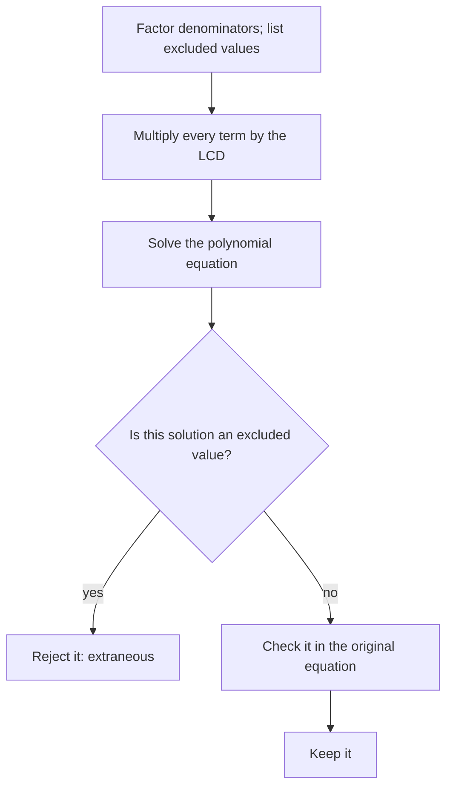

A **rational equation** contains rational expressions, such as $\dfrac{3}{x} + \dfrac{1}{2} = \dfrac{5}{x}$. The strategy is the one from Algebra 1 for equations with fractions: multiply everything by the LCD to clear the denominators. The new danger, like the extraneous solutions of radical equations, is that the cleared equation may have solutions that make an original denominator zero. This lesson covers the method and three classic applications: work, motion with a current, and proportions.

## The method

1. Factor the denominators and note the excluded values.
2. Multiply both sides (every term) by the LCD.
3. Solve the resulting polynomial equation.
4. Reject any solution that is an excluded value, and check the rest.

Step 4 is the one people skip, so the flowchart gives it its own decision:



### Example 1

Solve $\dfrac{3}{x} + \dfrac{1}{2} = \dfrac{5}{x}$.

1. Excluded: $x \ne 0$. LCD: $2x$.
2. Multiply every term by $2x$: $6 + x = 10$.
3. $x = 4$. Check: $\tfrac34 + \tfrac12 = \tfrac54$. True.

### Example 2

Solve $\dfrac{x}{x - 3} = \dfrac{3}{x - 3} + 2$.

1. Excluded: $x \ne 3$. LCD: $x - 3$.
2. Multiply: $x = 3 + 2(x - 3)$, so $x = 2x - 3$ and $x = 3$.
3. But 3 is excluded: both fractions would have a zero denominator. The equation has no solution.

The value $x = 3$ is an extraneous solution: it solves the cleared equation but not the original. Multiplying by $x - 3$, which is zero at $x = 3$, is what let it in.

The graphs show why there is no solution. The left side $\dfrac{x}{x - 3}$ and the right side $\dfrac{3}{x - 3} + 2$ are two curves that never meet: subtracting them gives $\dfrac{x - 3}{x - 3} - 2 = -1$ at every allowed $x$, so the left side is always exactly 1 below the right side. Both have the vertical asymptote $x = 3$, so the only "meeting point" the algebra finds is the one place where neither side exists.

```plot
{"x": [-6, 12], "y": [-6, 10], "functions": [{"f": "x/(x - 3)"}, {"f": "3/(x - 3) + 2", "dashed": true}], "labels": [{"at": [-2.5, 3.5], "text": "right side (dashed)"}, {"at": [-2.5, -3], "text": "left side (solid)"}], "segments": [{"from": [3, -6], "to": [3, 10], "dashed": true, "label": "x = 3"}], "caption": "The two sides of Example 2 never cross; the left side is always 1 below the right side"}
```

### Example 3

Solve $\dfrac{2}{x - 1} - \dfrac{1}{x + 1} = \dfrac{4}{x^2 - 1}$.

1. $x^2 - 1 = (x - 1)(x + 1)$. Excluded: $x \ne \pm 1$. LCD $(x - 1)(x + 1)$.
2. Multiply: $2(x + 1) - (x - 1) = 4$.
3. Simplify: $x + 3 = 4$, so $x = 1$.
4. $x = 1$ is excluded. No solution.

### Example 4

Solve $\dfrac{x}{x + 2} + \dfrac{3}{x - 2} = 1$.

1. Excluded: $x \ne \pm 2$. LCD $(x + 2)(x - 2)$.
2. Multiply: $x(x - 2) + 3(x + 2) = (x + 2)(x - 2)$.
3. Expand: $x^2 - 2x + 3x + 6 = x^2 - 4$, so $x + 6 = -4$ and $x = -10$.
4. Check: $\tfrac{-10}{-8} + \tfrac{3}{-12} = 1.25 - 0.25 = 1$. True.

## Proportions

A **proportion** is an equation of two ratios, $\dfrac{a}{b} = \dfrac{c}{d}$. Multiplying by $bd$ gives the **cross products** rule $ad = bc$ (still subject to excluded values).

## Work problems

If a job takes someone $t$ hours, they do $\tfrac1t$ of the job per hour. Rates of people working together add:

$$\frac{1}{t_1} + \frac{1}{t_2} = \frac{1}{T},$$

where $T$ is the time working together.

### Example 5

One pipe fills a tank in 6 hours; another fills it in 3 hours. How long do they take together?

1. Rates: $\tfrac16$ and $\tfrac13$ tank per hour.
2. $\dfrac16 + \dfrac13 = \dfrac1T$. Multiply by $6T$: $T + 2T = 6$, so $T = 2$ hours.

It makes sense that the answer is less than the faster pipe's time. Averaging the times (4.5 hours) is a common wrong answer.

### Example 6

Working together, Ana and Ben paint a fence in 4 hours. Alone, Ben takes 6 hours longer than Ana. How long does Ana take alone?

1. Let Ana's time be $a$, so Ben's is $a + 6$. Rates add: $\dfrac1a + \dfrac{1}{a + 6} = \dfrac14$.
2. Multiply by $4a(a + 6)$: $4(a + 6) + 4a = a(a + 6)$.
3. Simplify: $8a + 24 = a^2 + 6a$, so $a^2 - 2a - 24 = 0$ and $(a - 6)(a + 4) = 0$.
4. Reject $a = -4$. Ana takes 6 hours (and Ben 12). Check: $\tfrac16 + \tfrac1{12} = \tfrac{3}{12} = \tfrac14$.

## Motion problems

Since $t = \dfrac{d}{r}$, motion problems with equal times lead to rational equations.

### Example 7

A boat goes 30 km downstream in the same time it goes 18 km upstream. The current is 4 km/h. Find the boat's speed in still water.

1. Let $b$ be the boat's speed. Downstream speed $b + 4$, upstream $b - 4$.
2. Equal times: $\dfrac{30}{b + 4} = \dfrac{18}{b - 4}$.
3. Cross-multiply: $30(b - 4) = 18(b + 4)$, so $30b - 120 = 18b + 72$ and $12b = 192$.
4. $b = 16$ km/h. Check: $\tfrac{30}{20} = 1.5$ h and $\tfrac{18}{12} = 1.5$ h.

```plot
{"x": [0, 30], "y": [0, 6], "functions": [{"f": "30/(x + 4)", "from": 4.5, "to": 30}, {"f": "18/(x - 4)", "dashed": true, "from": 7, "to": 30}], "labels": [{"at": [13, 4.2], "text": "upstream 18/(b - 4), dashed"}, {"at": [23, 1.7], "text": "downstream 30/(b + 4), solid"}], "points": [{"at": [16, 1.5], "label": "b = 16"}], "xLabel": "boat speed b", "yLabel": "hours", "caption": "The two travel times are equal when b = 16"}
```

### Example 8

A cyclist rides 30 km out and then 30 km back, riding 5 km/h slower on the return. The whole trip takes 5 hours. How fast was she going on the way out?

1. Let $r$ be the outbound speed. Times: $\dfrac{30}{r}$ out and $\dfrac{30}{r - 5}$ back.
2. Total time: $\dfrac{30}{r} + \dfrac{30}{r - 5} = 5$, with $r \ne 0, 5$.
3. Multiply by $r(r - 5)$: $30(r - 5) + 30r = 5r(r - 5)$, so $60r - 150 = 5r^2 - 25r$.
4. Standard form: $5r^2 - 85r + 150 = 0$, or $r^2 - 17r + 30 = 0$, so $(r - 15)(r - 2) = 0$.
5. $r = 2$ would make the return speed $-3$ km/h, which is impossible, so $r = 15$ km/h. Check: $2 + 3 = 5$ hours.

## Common mistakes

- Multiplying only some terms by the LCD.
- Forgetting to reject solutions that make a denominator zero.
- Adding times instead of rates in work problems.
- Cross-multiplying when there's more than one term on a side; cross products only work for a single fraction on each side.
- Losing a negative when subtracting a fraction during clearing.

## Key points

- Note excluded values, multiply every term by the LCD, solve, and reject excluded values.
- A proportion $\tfrac ab = \tfrac cd$ gives $ad = bc$.
- Work: rates (jobs per unit time) add, $\tfrac1{t_1} + \tfrac1{t_2} = \tfrac1T$.
- Motion: $t = \tfrac dr$; equal times give a rational equation.
