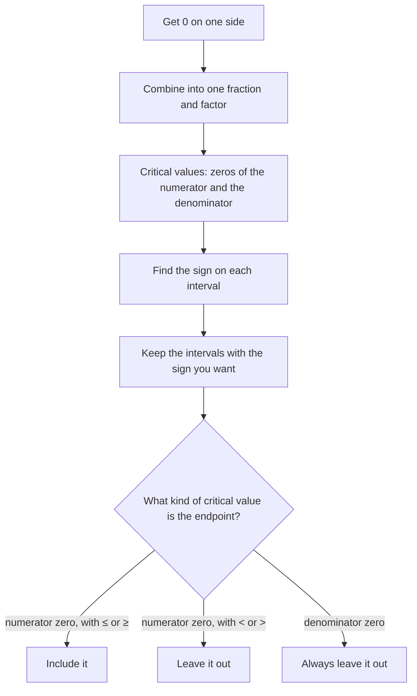

An equation like $f(x) = 0$ asks where a graph meets the $x$-axis. An inequality like $f(x) > 0$ asks where the graph is *above* the axis, and $f(x) < 0$ where it is below. Linear inequalities were solved by isolating $x$, but that doesn't work for $x^2 - x - 6 > 0$ or $\dfrac{x + 1}{x - 3} \le 0$. This lesson uses the zeros, factoring and asymptotes from Modules 3 and 5 to solve these inequalities with a sign chart.

## Where can the sign change?

A polynomial's graph is an unbroken curve, so it can't go from positive to negative without passing through 0 (that's the Intermediate Value Theorem from the polynomial functions lesson). A rational function can also change sign by jumping across a vertical asymptote, where it is undefined. So the sign of $f(x)$ can change only at

- zeros of the polynomial, or of the numerator of a rational function, and
- zeros of the denominator of a rational function.

These numbers are the **critical values**. They cut the number line into intervals, and on each interval the sign of $f$ stays the same. One test value per interval tells you the sign everywhere on it. A number line marked with the critical values and the sign on each interval is a **sign chart**.

## The method

1. Move everything to one side so the other side is 0. Combine a rational inequality into a single fraction.
2. Factor the numerator and denominator completely.
3. Find the critical values and mark them on a number line.
4. Find the sign on each interval, using a test value or the signs of the factors.
5. Choose the intervals whose sign matches the inequality. Include a zero of the numerator when the symbol is $\le$ or $\ge$ (unless it also makes the denominator 0); never include a zero of the denominator.
6. Write the answer in interval notation.

The last decision, which endpoints to include, is where most errors happen, so the flowchart spells it out:



A **polynomial inequality** is one like $p(x) > 0$ with $p$ a polynomial; a **rational inequality** has a variable in a denominator. The same six steps solve both.

### Example 1

Solve $x^2 - x - 6 > 0$.

1. Factor: $(x - 3)(x + 2) > 0$. Critical values: $-2$ and $3$.
2. Test a value in each interval. $x = -3$: $(-6)(-1) = 6 > 0$. $x = 0$: $(-3)(2) = -6 < 0$. $x = 4$: $(1)(6) = 6 > 0$.
3. The inequality wants positive, and the critical values themselves give 0, which is not $> 0$.

The solution is $(-\infty, -2) \cup (3, \infty)$: exactly where the parabola is above the axis.

```plot
{"x": [-5, 6], "y": [-8, 8], "functions": [{"f": "x^2 - x - 6", "label": "y = x² − x − 6"}], "points": [{"at": [-2, 0], "open": true, "label": "−2"}, {"at": [3, 0], "open": true, "label": "3"}], "caption": "The parabola is above the x-axis to the left of −2 and to the right of 3"}
```

```numberline
{"x": [-5, 6], "points": [{"at": [-2, 0], "open": true, "label": "−2"}, {"at": [3, 0], "open": true, "label": "3"}], "segments": [{"from": [-2, 0], "to": [-5, 0], "arrow": true}, {"from": [3, 0], "to": [6, 0], "arrow": true}], "labels": [{"at": [-3.5, 0.5], "text": "+"}, {"at": [0.5, 0.5], "text": "−"}, {"at": [4.5, 0.5], "text": "+"}], "caption": "Sign chart for (x − 3)(x + 2) > 0"}
```

## Using the signs of the factors

Instead of plugging in, you can track each factor. A factor $x - c$ is negative left of $c$ and positive right of it. Multiply the signs in each column.

### Example 2

Solve $x^3 - 4x \le 0$.

1. Factor: $x(x^2 - 4) = x(x + 2)(x - 2)$. Critical values: $-2$, $0$, $2$.
2. Sign table:

| Factor | $x < -2$ | $-2 < x < 0$ | $0 < x < 2$ | $x > 2$ |
|---|---|---|---|---|
| $x + 2$ | $-$ | $+$ | $+$ | $+$ |
| $x$ | $-$ | $-$ | $+$ | $+$ |
| $x - 2$ | $-$ | $-$ | $-$ | $+$ |
| Product | $-$ | $+$ | $-$ | $+$ |

3. We want $\le 0$: the negative intervals plus the zeros, which are all allowed because there's no denominator.

The solution is $(-\infty, -2] \cup [0, 2]$.

Notice that the signs alternate here. They don't always. A factor raised to an even power, like $(x - 1)^2$, is never negative, so the sign does *not* change at a zero of even multiplicity. For example, $(x - 1)^2(x + 3) > 0$ has the sign of $x + 3$ everywhere except at $x = 1$, where it equals 0. Its solution is $(-3, 1) \cup (1, \infty)$, with $x = 1$ left out because $0 > 0$ is false.

## Rational inequalities

The method is the same, with one extra rule: a zero of the denominator makes the expression undefined, so it is never part of the solution, even with $\le$ or $\ge$.

### Example 3

Solve $\dfrac{x + 1}{x - 3} \le 0$.

1. Critical values: $-1$ (numerator) and $3$ (denominator).
2. Test values: $x = -2$ gives $\dfrac{-1}{-5} > 0$; $x = 0$ gives $\dfrac{1}{-3} < 0$; $x = 4$ gives $\dfrac{5}{1} > 0$.
3. Keep the negative interval. Include $-1$ (the fraction equals 0 there) but not $3$ (undefined).

The solution is $[-1, 3)$.

The graph tells the same story: $y = \dfrac{x + 1}{x - 3}$ touches the $x$-axis at $x = -1$, stays below it until the vertical asymptote $x = 3$, and is above it everywhere else.

```plot
{"x": [-6, 9], "y": [-8, 8], "functions": [{"f": "(x + 1)/(x - 3)", "label": "y = (x + 1)/(x − 3)"}], "segments": [{"from": [3, -8], "to": [3, 8], "dashed": true, "label": "x = 3"}], "points": [{"at": [-1, 0], "label": "(−1, 0)"}], "caption": "Below the x-axis exactly for −1 < x < 3; equal to 0 at x = −1; undefined at x = 3"}
```

```numberline
{"x": [-4, 6], "points": [{"at": [-1, 0], "label": "−1"}, {"at": [3, 0], "open": true, "label": "3"}], "segments": [{"from": [-1, 0], "to": [3, 0]}], "labels": [{"at": [-2.5, 0.5], "text": "+"}, {"at": [1.5, 0.5], "text": "−"}, {"at": [4.5, 0.5], "text": "+"}], "caption": "[−1, 3): closed at the numerator's zero, open at the denominator's zero"}
```

### Example 4

Solve $\dfrac{x + 4}{x - 2} \ge 3$.

It's tempting to multiply both sides by $x - 2$, but you don't know whether $x - 2$ is positive or negative, so you don't know whether to flip the symbol. Get 0 on one side instead.

1. Subtract 3 and use the common denominator $x - 2$:
$$\frac{x + 4}{x - 2} - \frac{3(x - 2)}{x - 2} \ge 0 \quad\Longrightarrow\quad \frac{-2x + 10}{x - 2} \ge 0.$$
2. Critical values: $5$ (numerator) and $2$ (denominator).
3. Test values: $x = 0$ gives $\dfrac{10}{-2} < 0$; $x = 3$ gives $\dfrac{4}{1} > 0$; $x = 6$ gives $\dfrac{-2}{4} < 0$.
4. Keep the positive interval, include 5, exclude 2.

The solution is $(2, 5]$. Check: $x = 5$ gives $\tfrac93 = 3$, and $x = 3$ gives $\tfrac71 = 7 \ge 3$. Cross-multiplying would have given $x + 4 \ge 3x - 6$, or $x \le 5$, which wrongly includes values like $x = 0$, where the fraction is $-2$.

## An application

### Example 5

A ball is thrown upward, and its height after $t$ seconds is $h = -16t^2 + 64t$ feet. During what time interval is it at least 48 feet high?

1. Set up: $-16t^2 + 64t \ge 48$, so $-16t^2 + 64t - 48 \ge 0$.
2. Divide by $-16$ and flip the symbol: $t^2 - 4t + 3 \le 0$, so $(t - 1)(t - 3) \le 0$.
3. Between the critical values the product is negative (test $t = 2$: $(1)(-1) < 0$), and the endpoints give 0.

The ball is at least 48 feet up for $1 \le t \le 3$, a span of 2 seconds.

## Common mistakes

- Multiplying both sides by an expression with $x$ in it. Its sign is unknown, so you can't tell whether to flip the symbol.
- Including a zero of the denominator because the symbol is $\le$ or $\ge$. The expression is undefined there.
- Solving a factored inequality with something other than 0 on the right, like $(x - 1)(x + 2) > 4$, by setting each factor greater than 4. Only comparisons with 0 can be read from signs.
- Assuming the signs always alternate. They don't change at a zero of even multiplicity.
- Dividing by $x$ to simplify, which loses the critical value $x = 0$ and may need a flip.

## Key points

- Get 0 on one side, write the expression as a single factored fraction or product, and compare its sign with 0.
- Critical values are the zeros of the numerator and of the denominator; the sign is constant between them.
- Use one test value per interval, or a table of factor signs.
- Include numerator zeros only for $\le$ or $\ge$; never include denominator zeros.
- The sign changes at a zero of odd multiplicity and stays the same at a zero of even multiplicity.
