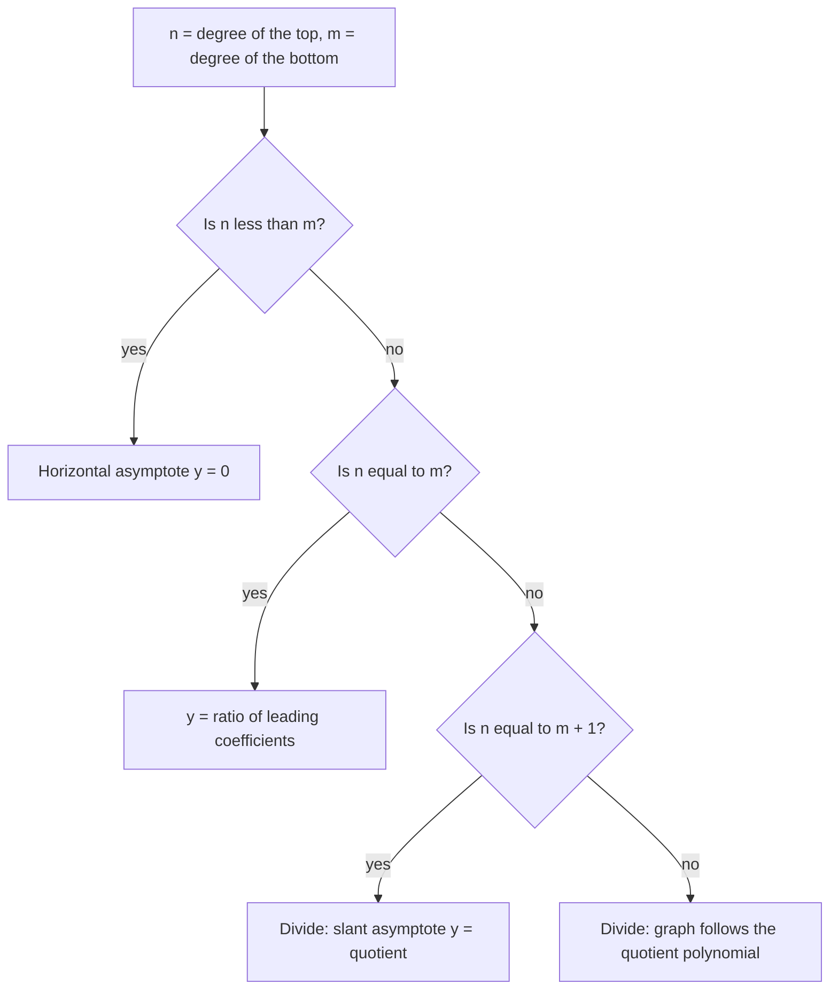

The graphing lesson compared degrees to find a horizontal asymptote, and its table had an unsatisfying last row: when the numerator's degree is bigger, there is "none". The graph still does something for large $|x|$; it just doesn't level off. This lesson finds out what it does, using the polynomial division from Module 3. One idea explains all three rows of that table at once, tells you which side of an asymptote the graph is on, and shows exactly where a graph crosses its horizontal or slant asymptote. The lesson ends with an application: the average cost of making something, and how to find its minimum without calculus.

## Proper and improper rational functions

A rational function $\dfrac{P(x)}{Q(x)}$ is a **proper rational function** when the degree of $P$ is less than the degree of $Q$, like $\dfrac{3x + 1}{x^2 - 4}$. It is an **improper rational function** when the degree of $P$ is greater than or equal to the degree of $Q$, like $\dfrac{x^2 - 4}{x - 1}$. The names copy the ones for numerical fractions: $\tfrac35$ is proper and $\tfrac73$ is improper.

An improper numerical fraction can be written as a whole number plus a proper fraction: $\tfrac73 = 2 + \tfrac13$. Polynomial division does the same for an improper rational function. The division algorithm from Module 3 says that dividing $P$ by $Q$ gives a quotient $q(x)$ and a remainder $r(x)$ with

$$P(x) = q(x)\,Q(x) + r(x), \qquad \deg r < \deg Q.$$

Dividing both sides by $Q(x)$:

$$\frac{P(x)}{Q(x)} = q(x) + \frac{r(x)}{Q(x)}.$$

The first piece is a polynomial; the second is proper.

## Why the quotient is the end behavior

A proper rational function goes to 0 as $|x|$ gets large. That is the first row of the degree table: when the bottom's degree is bigger, the horizontal asymptote is $y = 0$. So for large $|x|$, the proper piece $\dfrac{r(x)}{Q(x)}$ shrinks toward 0, and $f(x)$ gets as close as you like to the polynomial $q(x)$. The quotient describes the **end behavior** of $f$.

That one fact gives every case:

- Degree of top less than bottom: the quotient is 0, so the asymptote is $y = 0$.
- Equal degrees: the quotient is a constant, the ratio of the leading coefficients. That's the horizontal asymptote rule from the graphing lesson, now with a reason.
- Top degree exactly one more: the quotient is a linear polynomial $mx + b$ with $m \ne 0$, and the graph approaches the slanted line $y = mx + b$, called an **oblique asymptote** or slant asymptote.
- Top degree two or more higher: the quotient has degree 2 or more. There is no asymptote that is a line; the graph follows the curve $y = q(x)$. For example, $\dfrac{x^3 + 1}{x} = x^2 + \dfrac1x$ hugs the parabola $y = x^2$ for large $|x|$.



## Which side of the asymptote?

The proper piece also tells you where the graph is relative to its asymptote. Since $f(x) - q(x) = \dfrac{r(x)}{Q(x)}$:

- where $\dfrac{r(x)}{Q(x)} > 0$, the graph is above the asymptote;
- where $\dfrac{r(x)}{Q(x)} < 0$, it is below;
- where $r(x) = 0$ (and $Q(x) \ne 0$), the graph crosses the asymptote.

A nonzero polynomial $r$ has only finitely many zeros, so there are only finitely many crossings (if $r = 0$, the function is just the polynomial $q$, apart from any holes), and a sign chart for $\dfrac{r}{Q}$, the tool from the inequalities lesson, finds them all. A graph can never cross a vertical asymptote, since the function has no value there, but crossing a horizontal or slant asymptote in the middle of the graph is perfectly normal.

### Example 1

Find the asymptotes of $f(x) = \dfrac{x^2 - 4}{x - 1}$ and describe where the graph is relative to the slant asymptote.

1. Degrees 2 and 1: expect a slant asymptote. Divide, using synthetic division by $x - 1$ on the coefficients $1, 0, -4$: bring down 1; $1 \cdot 1 = 1$, $0 + 1 = 1$; $1 \cdot 1 = 1$, $-4 + 1 = -3$. Quotient $x + 1$, remainder $-3$.
2. So $f(x) = x + 1 - \dfrac{3}{x - 1}$. Slant asymptote: $y = x + 1$.
3. The denominator is 0 at $x = 1$ and the numerator there is $-3 \ne 0$: vertical asymptote $x = 1$.
4. The piece $-\dfrac{3}{x - 1}$ is negative for $x > 1$ and positive for $x < 1$. So the right branch is below the line and the left branch is above it. Check: $f(3) = \tfrac52 = 2.5$, below the line's value 4; $f(-1) = \tfrac{-3}{-2} = 1.5$, above the line's value 0.
5. Intercepts: $x = \pm 2$ and $f(0) = \tfrac{-4}{-1} = 4$.

```plot
{"x": [-8, 9], "y": [-8, 10], "functions": [{"f": "(x^2 - 4)/(x - 1)"}, {"f": "x + 1", "dashed": true}], "labels": [{"at": [-4.5, 8], "text": "f(x) = (x² − 4)/(x − 1)"}, {"at": [-3.5, -7.2], "text": "y = x + 1 (dashed)"}], "segments": [{"from": [1, -8], "to": [1, 10], "dashed": true, "label": "x = 1"}], "points": [{"at": [-2, 0], "label": "(−2, 0)"}, {"at": [2, 0], "label": "(2, 0)"}, {"at": [0, 4], "label": "(0, 4)"}], "caption": "The left branch stays above the slant asymptote y = x + 1 and the right branch stays below it"}
```

### Example 2

Find the slant asymptote of $h(x) = \dfrac{x^3 + 2x^2 + 1}{x^2 + 1}$ and the point where the graph crosses it.

1. The divisor is quadratic, so use long division. $x^3 \div x^2 = x$; subtract $x(x^2 + 1) = x^3 + x$ to leave $2x^2 - x + 1$. Then $2x^2 \div x^2 = 2$; subtract $2(x^2 + 1) = 2x^2 + 2$ to leave $-x - 1$.
2. So $h(x) = x + 2 - \dfrac{x + 1}{x^2 + 1}$. Slant asymptote: $y = x + 2$.
3. There is no vertical asymptote, because $x^2 + 1 > 0$ for every real $x$.
4. The graph meets the asymptote where the remainder $-(x + 1)$ is 0, at $x = -1$. Check: $h(-1) = \dfrac{-1 + 2 + 1}{2} = 1$, and the line gives $-1 + 2 = 1$.
5. Since $x^2 + 1 > 0$, the piece $-\dfrac{x + 1}{x^2 + 1}$ is negative for $x > -1$ and positive for $x < -1$: the graph is above the line on the far left, crosses at $(-1, 1)$, and stays below it after that.

### Example 3

Where does $g(x) = \dfrac{2x^2 + x - 3}{x^2 - 4}$ cross its horizontal asymptote, and how does it approach that asymptote at each end?

1. Equal degrees, leading coefficients 2 and 1: horizontal asymptote $y = 2$.
2. Subtract: $g(x) - 2 = \dfrac{2x^2 + x - 3 - 2(x^2 - 4)}{x^2 - 4} = \dfrac{x + 5}{x^2 - 4}$. This is the proper piece.
3. It is 0 at $x = -5$, so the graph crosses $y = 2$ at $(-5, 2)$. Check: $g(-5) = \tfrac{50 - 5 - 3}{21} = \tfrac{42}{21} = 2$.
4. Signs: for $x < -5$, the top is negative and the bottom positive, so the graph is below $y = 2$; for $x > 2$, both are positive, so it is above. So the graph comes in from below the asymptote on the far left, crosses it at $x = -5$, and rises toward the vertical asymptote $x = -2$. On the far right it comes down toward $y = 2$ from above.
5. The other features, from the graphing lesson: vertical asymptotes $x = \pm 2$ (the numerator is 3 at $x = -2$ and 7 at $x = 2$), $x$-intercepts $-\tfrac32$ and $1$ from $(2x + 3)(x - 1)$, and $y$-intercept $\tfrac34$.

```plot
{"x": [-14, 8], "y": [-6, 8], "functions": [{"f": "(2x^2 + x - 3)/(x^2 - 4)", "label": "g(x)"}], "segments": [{"from": [-14, 2], "to": [8, 2], "dashed": true}, {"from": [-2, -6], "to": [-2, 8], "dashed": true}, {"from": [2, -6], "to": [2, 8], "dashed": true}], "points": [{"at": [-5, 2]}], "labels": [{"at": [-8, 3], "text": "crosses y = 2 at (−5, 2)"}, {"at": [5, 1.2], "text": "y = 2"}], "caption": "g crosses its horizontal asymptote y = 2 once, at x = −5, then rises toward the vertical asymptote x = −2"}
```

## An application: average cost

A workshop's cost to make $x$ items in a week is $C(x) = 0.04x^2 + 6x + 900$ dollars: \$900 of fixed costs (rent, equipment), \$6 of materials per item, and a $0.04x^2$ term for overtime and crowding that grows faster than the output. The **average cost** per item is the total cost divided by the number of items:

$$A(x) = \frac{C(x)}{x} = \frac{0.04x^2 + 6x + 900}{x} = 0.04x + 6 + \frac{900}{x}.$$

This is an improper rational function, already split into quotient and remainder. Its slant asymptote $y = 0.04x + 6$ says that for large production the fixed cost spread over many items stops mattering and the average cost climbs along a line. The vertical asymptote $x = 0$ says that making very few items is very expensive per item, because the \$900 is shared by almost nothing. Somewhere in between, the average cost is smallest.

### The AM–GM inequality

Calculus finds that minimum with derivatives, but an older tool does it here. The **AM–GM inequality** says that for any numbers $a, b \ge 0$, the arithmetic mean is at least the geometric mean:

$$\frac{a + b}{2} \ge \sqrt{ab}, \quad\text{or}\quad a + b \ge 2\sqrt{ab},$$

with equality exactly when $a = b$. The proof is one line. A square is never negative, so $(\sqrt a - \sqrt b)^2 \ge 0$. Expanding gives $a - 2\sqrt{ab} + b \ge 0$, which rearranges to $a + b \ge 2\sqrt{ab}$. The square is 0 exactly when $\sqrt a = \sqrt b$, that is, when $a = b$.

### Example 4

Find the production level with the least average cost, and that cost.

1. For $x > 0$, apply AM–GM to the two terms that pull in opposite directions, $a = 0.04x$ and $b = \dfrac{900}{x}$. Their product is $0.04x \cdot \dfrac{900}{x} = 36$, which does not depend on $x$.
2. So $0.04x + \dfrac{900}{x} \ge 2\sqrt{36} = 12$, and $A(x) \ge 6 + 12 = 18$.
3. Equality holds when $0.04x = \dfrac{900}{x}$: $x^2 = 22{,}500$, so $x = 150$.
4. The least average cost is \$18 per item, at 150 items a week. Check: $A(150) = 6 + 6 + 6 = 18$, while $A(100) = 4 + 6 + 9 = 19$ and $A(225) = 9 + 6 + 4 = 19$.

The trick works whenever the function has the form $px + \dfrac{q}{x}$ with $p, q > 0$: the minimum on $x > 0$ is $2\sqrt{pq}$, at $x = \sqrt{q/p}$, where the two terms are equal. The model itself is a simplification: real costs don't follow an exact quadratic, but the shape (falling, a minimum, then rising toward a slant asymptote) shows up in many real cost curves.

```plot
{"x": [0, 400], "y": [0, 40], "functions": [{"f": "0.04x + 6 + 900/x"}, {"f": "0.04x + 6", "dashed": true}], "points": [{"at": [150, 18]}], "labels": [{"at": [260, 33], "text": "A(x) = 0.04x + 6 + 900/x"}, {"at": [150, 22.5], "text": "minimum (150, 18)"}, {"at": [250, 6], "text": "slant asymptote y = 0.04x + 6 (dashed)"}], "xLabel": "items per week", "yLabel": "dollars per item", "caption": "Average cost falls, bottoms out at $18 per item when 150 items are made, then rises along its slant asymptote"}
```

## Common mistakes

- Reading the slant asymptote from the leading terms alone. For $\dfrac{x^2 - 4}{x - 1}$, $\dfrac{x^2}{x} = x$ gives only the slope; the asymptote is $y = x + 1$, and only the full division finds the $+1$.
- Including the remainder in the asymptote. The asymptote is the quotient alone; the remainder piece is what fades away.
- Believing a graph can't cross a horizontal or slant asymptote. It can, at the zeros of the remainder; only vertical asymptotes are never crossed.
- Expecting a slant asymptote whenever the top degree is bigger. It takes a difference of exactly one; with a difference of two or more, the graph follows a polynomial curve.
- Using AM–GM with a negative term or with a product that still depends on $x$. It needs $a, b \ge 0$, and the bound $2\sqrt{ab}$ is useful only when $ab$ is constant.

## Key points

- Divide: $\dfrac{P}{Q} = q + \dfrac{r}{Q}$ with $\deg r < \deg Q$. The quotient $q$ is the end behavior.
- Quotient 0, a constant, or a line gives the horizontal asymptote $y = 0$, the horizontal asymptote at the ratio of leading coefficients, or a slant asymptote.
- The sign of $\dfrac{r}{Q}$ tells whether the graph is above or below its asymptote; the zeros of $r$ are where it crosses.
- Average cost $\dfrac{C(x)}{x}$ is a rational function; the AM–GM inequality $a + b \ge 2\sqrt{ab}$ finds the minimum of $px + \dfrac qx$, which is $2\sqrt{pq}$ at $x = \sqrt{q/p}$.
