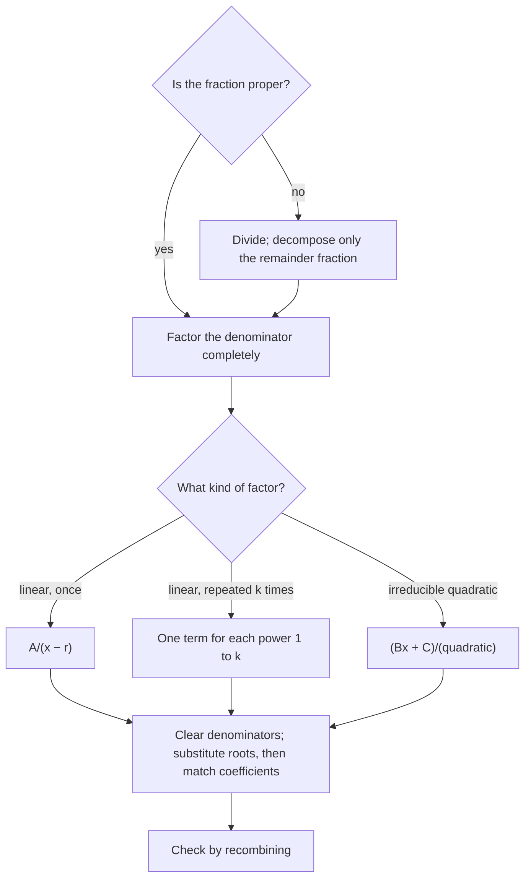

In the lesson on adding rational expressions, you combined $\dfrac{2}{x - 1} + \dfrac{3}{x + 2}$ into the single fraction $\dfrac{5x + 1}{(x - 1)(x + 2)}$. This lesson runs that process backward: given the single fraction, find the simple fractions it came from. The result is called a **partial fraction decomposition**. It looks like a puzzle, but it is a standard tool. Calculus students use it to integrate rational functions, engineers use it to take apart the transfer functions of circuits, and you will use it at the end of this lesson to add up 99 fractions in one line.

## The idea and the first case

Decomposition works on a proper rational function, one whose numerator has smaller degree than its denominator (the slant asymptotes lesson introduced the terms proper and improper). It goes in three steps:

1. Factor the denominator completely.
2. Write a sum of simpler fractions, one for each factor, with unknown numerators.
3. Find the unknowns.

When the denominator is a product of different linear factors, each factor $(x - r)$ gets one term $\dfrac{A}{x - r}$ with a constant $A$.

### Example 1

Decompose $\dfrac{5x + 1}{(x - 1)(x + 2)}$.

1. Set up: $\dfrac{5x + 1}{(x - 1)(x + 2)} = \dfrac{A}{x - 1} + \dfrac{B}{x + 2}$.
2. Multiply both sides by $(x - 1)(x + 2)$: $5x + 1 = A(x + 2) + B(x - 1)$.
3. Put $x = 1$: the $B$ term vanishes, and $6 = 3A$, so $A = 2$.
4. Put $x = -2$: the $A$ term vanishes, and $-9 = -3B$, so $B = 3$.
5. Result: $\dfrac{5x + 1}{(x - 1)(x + 2)} = \dfrac{2}{x - 1} + \dfrac{3}{x + 2}$. Check by recombining: $2(x + 2) + 3(x - 1) = 5x + 1$.

You may object that $x = 1$ and $x = -2$ are excluded values of the original fraction, so how can you substitute them? The answer is that the equation in step 2 has no fractions left. It is an equation between two polynomials that holds for every $x$ except possibly 1 and $-2$, and two polynomials that agree at infinitely many points are the same polynomial. So step 2 holds for every $x$, including 1 and $-2$.

There is a second way to find the unknowns, which always works: match coefficients. Expanding step 2 gives $5x + 1 = (A + B)x + (2A - B)$, so $A + B = 5$ and $2A - B = 1$. Adding the equations gives $3A = 6$, the same answer. Substitution is faster when it applies; matching coefficients is the backup, and it turns any decomposition into a linear system like the ones in Module 2.

### The cover-up method

Step 3 of Example 1 has a shortcut. To find the numerator over $(x - 1)$, cover up the factor $(x - 1)$ in the original fraction and evaluate what's left at $x = 1$:

$$A = \frac{5x + 1}{x + 2}\bigg|_{x = 1} = \frac{6}{3} = 2, \qquad B = \frac{5x + 1}{x - 1}\bigg|_{x = -2} = \frac{-9}{-3} = 3.$$

This **cover-up method**, often named after the English engineer Oliver Heaviside, is the substitution of step 3 done in your head. It finds the numerator over any linear factor that appears only once, and the numerator over the highest power of a repeated linear factor. It does not find the other numerators of a repeated factor, or the numerator over a quadratic factor.

## Why the terms look the way they do

How many unknowns should a decomposition have? The numerator of a proper fraction whose denominator has degree $n$ can be any polynomial of degree less than $n$, which has $n$ coefficients. So the decomposition needs exactly $n$ unknowns to be able to match every possible numerator. Each linear factor contributes one, which is why Example 1, with denominator degree 2, needed $A$ and $B$. The same count explains the two harder cases.

**Repeated linear factors.** A factor $(x - r)^k$ gets $k$ terms, one for each power:

$$\frac{A_1}{x - r} + \frac{A_2}{(x - r)^2} + \cdots + \frac{A_k}{(x - r)^k}.$$

A single term $\dfrac{A}{(x - r)^2}$ has only one unknown, but $(x - r)^2$ has degree 2. It can't produce $\dfrac{x}{(x - 1)^2}$, which equals $\dfrac{1}{x - 1} + \dfrac{1}{(x - 1)^2}$.

**Irreducible quadratic factors.** A quadratic with no real roots, like $x^2 + 1$ or $x^2 + 4x + 5$ (negative discriminant), can't be factored over the real numbers; it is called an **irreducible quadratic**. It gets one term with a linear numerator, $\dfrac{Bx + C}{x^2 + 1}$: two unknowns for a factor of degree 2.

A theorem of algebra, proved in more advanced courses, guarantees that with these terms every proper rational function (with real coefficients) has exactly one decomposition. That is why the systems you set up always have a solution, and only one.

### Example 2

Decompose $\dfrac{x^2 + 2x + 5}{x(x - 1)^2}$.

1. The factor $x$ appears once and $(x - 1)$ twice: $\dfrac{x^2 + 2x + 5}{x(x - 1)^2} = \dfrac{A}{x} + \dfrac{B}{x - 1} + \dfrac{C}{(x - 1)^2}$. Three unknowns for degree 3.
2. Multiply by $x(x - 1)^2$: $x^2 + 2x + 5 = A(x - 1)^2 + Bx(x - 1) + Cx$.
3. $x = 0$: $5 = A$. $x = 1$: $8 = C$.
4. No root is left to isolate $B$, so match a coefficient. The $x^2$ terms on the right are $Ax^2 + Bx^2$, so $A + B = 1$ and $B = -4$.
5. Result: $\dfrac{5}{x} - \dfrac{4}{x - 1} + \dfrac{8}{(x - 1)^2}$. Check at $x = 2$: the left side is $\tfrac{13}{2}$, and the right side is $\tfrac52 - 4 + 8 = \tfrac{13}{2}$.

### Example 3

Decompose $\dfrac{3x^2 + x + 4}{(x + 1)(x^2 + 1)}$.

1. $x^2 + 1$ is irreducible, so $\dfrac{3x^2 + x + 4}{(x + 1)(x^2 + 1)} = \dfrac{A}{x + 1} + \dfrac{Bx + C}{x^2 + 1}$.
2. Multiply: $3x^2 + x + 4 = A(x^2 + 1) + (Bx + C)(x + 1)$.
3. $x = -1$: $6 = 2A$, so $A = 3$.
4. Match coefficients. $x^2$: $3 = A + B$, so $B = 0$. Constants: $4 = A + C$, so $C = 1$. The $x$ terms give a check: $B + C = 1$, which matches.
5. Result: $\dfrac{3}{x + 1} + \dfrac{1}{x^2 + 1}$.

## Improper fractions: divide first

If the numerator's degree is not smaller, divide first, as in the slant asymptotes lesson, and decompose only the proper remainder piece.

### Example 4

Decompose $\dfrac{x^3 + x^2 - 4x + 1}{x^2 - 1}$.

1. Divide: $x^3 + x^2 - 4x + 1 = (x + 1)(x^2 - 1) + (-3x + 2)$. Check: $(x + 1)(x^2 - 1) = x^3 + x^2 - x - 1$, and adding $-3x + 2$ gives the numerator.
2. So the fraction is $x + 1 + \dfrac{-3x + 2}{(x - 1)(x + 1)}$.
3. Cover-up on the proper piece: over $(x - 1)$, $\dfrac{-3 + 2}{1 + 1} = -\tfrac12$; over $(x + 1)$, $\dfrac{3 + 2}{-1 - 1} = -\tfrac52$.
4. Result: $x + 1 - \dfrac{1}{2(x - 1)} - \dfrac{5}{2(x + 1)}$.

Skipping the division would be a real error, not just extra work: setting $\dfrac{x^3 + x^2 - 4x + 1}{x^2 - 1} = \dfrac{A}{x - 1} + \dfrac{B}{x + 1}$ has no solution, because the right side is proper and the left side is not.

## An application: telescoping sums

What is $\dfrac{1}{1 \cdot 2} + \dfrac{1}{2 \cdot 3} + \dfrac{1}{3 \cdot 4} + \cdots + \dfrac{1}{99 \cdot 100}$? Adding 99 fractions directly would be miserable. Decompose the general term instead.

### Example 5

1. By cover-up, $\dfrac{1}{k(k + 1)} = \dfrac{1}{k} - \dfrac{1}{k + 1}$.
2. Write out the sum with each term split: $\left(1 - \tfrac12\right) + \left(\tfrac12 - \tfrac13\right) + \left(\tfrac13 - \tfrac14\right) + \cdots + \left(\tfrac{1}{99} - \tfrac{1}{100}\right)$.
3. Every $-\tfrac1{k+1}$ cancels the $+\tfrac1{k+1}$ that starts the next bracket. Only the first and last pieces survive: $1 - \tfrac{1}{100} = \tfrac{99}{100}$.

A sum that collapses like this is a **telescoping sum**, named after a folding telescope whose sections slide into each other. In general $\displaystyle\sum_{k=1}^{n} \frac{1}{k(k + 1)} = 1 - \frac{1}{n + 1} = \frac{n}{n + 1}$. As $n$ grows, the sum gets as close to 1 as you like, so the infinite sum is 1, an idea the sequences and series module and calculus develop further.

Gaps can be wider. Since $\dfrac{2}{k(k + 2)} = \dfrac1k - \dfrac{1}{k + 2}$, each piece cancels the one two places later, and two pieces survive at each end: $\displaystyle\sum_{k=1}^{n} \frac{2}{k(k + 2)} = 1 + \frac12 - \frac{1}{n + 1} - \frac{1}{n + 2}$.

## Common mistakes

- Decomposing an improper fraction without dividing first.
- Giving a repeated factor only its highest power, such as writing just $\dfrac{C}{(x - 1)^2}$ for $(x - 1)^2$.
- Putting a constant over an irreducible quadratic. It needs $Bx + C$.
- Trying to split an irreducible quadratic like $x^2 + 4$ into linear factors. It has no real roots, so it has no real linear factors.
- Using cover-up for a numerator it can't find, such as $B$ in Example 2. Match coefficients instead.
- Forgetting to check. Recombining, or testing one value of $x$, catches almost every slip.

## Key points

- Partial fractions undo addition: a proper fraction becomes a sum of simple fractions, one group per factor of the denominator.
- Linear factor once: $\dfrac{A}{x - r}$. Repeated $(x - r)^k$: one term for each power up to $k$. Irreducible quadratic: $\dfrac{Bx + C}{\text{quadratic}}$.
- The number of unknowns equals the degree of the denominator.
- Clear denominators, substitute the roots (cover-up), then match coefficients for anything left.
- Divide first when the fraction is improper.
- Decomposing the general term turns some sums into telescoping sums: $\displaystyle\sum_{k=1}^{n} \frac{1}{k(k + 1)} = \frac{n}{n + 1}$.
