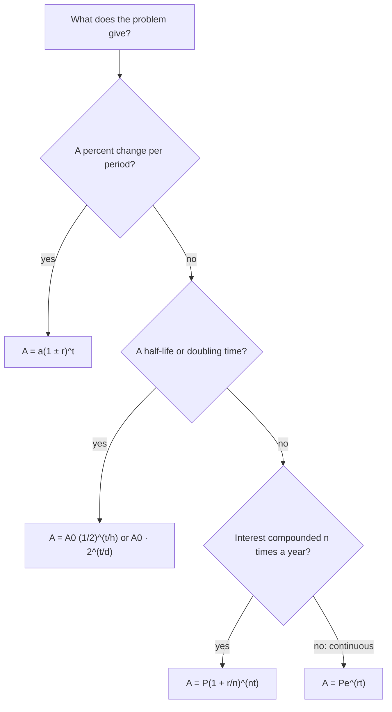

Linear functions add the same amount at each step. Exponential functions multiply by the same factor at each step, and that difference makes them the right model for populations, investments, radioactive decay and anything else that grows or shrinks in proportion to its size. This lesson defines exponential functions, describes their graphs, and applies them to growth, decay, and compound interest, including the natural base $e$.

## Exponential functions

An **exponential function** has the form

$$f(x) = a \cdot b^x, \qquad a \ne 0,\; b > 0,\; b \ne 1.$$

The variable is in the exponent. The number $b$ is the **base**, also called the **growth factor** (or decay factor), and $a = f(0)$ is the initial value. (The base must be positive so that $b^x$ is defined for every real $x$, and $b = 1$ would just give a constant.)

Compare $f(x) = 2x$ and $g(x) = 2^x$. For each step of 1 in $x$, $f$ adds 2 while $g$ doubles. At $x = 10$, $f = 20$ and $g = 1024$.

| $x$ | 0 | 1 | 2 | 3 | 4 |
|---|---|---|---|---|---|
| $2x$ (adds 2) | 0 | 2 | 4 | 6 | 8 |
| $2^x$ (doubles) | 1 | 2 | 4 | 8 | 16 |

The graph shows the same comparison. The two meet at $x = 1$ and $x = 2$ (and $2^x$ is even a little lower in between), but after that the exponential pulls away fast.

```plot
{"x": [0, 6], "y": [0, 40], "functions": [{"f": "2*x"}, {"f": "2^x", "label": "y = 2^x (doubles)", "from": 0, "to": 5.3}], "points": [{"at": [1, 2]}, {"at": [2, 4]}, {"at": [5, 32]}, {"at": [5, 10]}], "caption": "Linear growth adds a fixed amount; exponential growth multiplies by a fixed factor", "labels": [{"at": [0.75, 4], "text": "(1, 2)"}, {"at": [1.7, 7], "text": "(2, 4)"}, {"at": [5.6, 29], "text": "(5, 32)"}, {"at": [5.5, 7], "text": "(5, 10)"}, {"at": [4.5, 3.5], "text": "y = 2x (adds 2)"}]}
```

## Graphs

For $f(x) = b^x$:

- If $b > 1$, the function is increasing: **exponential growth**.
- If $0 < b < 1$, it's decreasing: **exponential decay**.
- Either way, the $y$-intercept is $(0, 1)$, the domain is all real numbers, the range is $(0, \infty)$, and the $x$-axis ($y = 0$) is a **horizontal asymptote**: the graph gets ever closer to it on one side but never reaches it, since $b^x$ is always positive.

```plot
{"x": [-4, 4], "y": [-1, 9], "functions": [{"f": "2^x", "label": "y = 2^x", "from": -4, "to": 3.15}, {"f": "0.5^x", "label": "y = (1/2)^x", "dashed": true, "from": -3.15, "to": 4}, {"f": "e^x", "label": "y = e^x", "from": -4, "to": 1.9}], "points": [{"at": [0, 1], "label": "(0, 1)"}], "caption": "Growth (b > 1) and decay (0 < b < 1); all pass through (0, 1) with asymptote y = 0"}
```

The graphs of $2^x$ and $\left(\tfrac12\right)^x = 2^{-x}$ are mirror images across the $y$-axis.

The picture below names the parts of these graphs. The staircase on $y = 2^x$ shows the defining pattern: each step of 1 to the right multiplies the height by the base, 2.


## Growth and decay models

If a quantity starts at $a$ and changes by a fixed percentage $r$ (as a decimal) per time period, then after $t$ periods

$$A(t) = a(1 + r)^t \quad \text{(growth)}, \qquad A(t) = a(1 - r)^t \quad \text{(decay)}.$$

Growing by 6% means multiplying by $1.06$ each period; decaying by 6% means multiplying by $0.94$.

### Example 1

A town of 12,000 people grows 3% per year. Find the population after 10 years.

$P(10) = 12000(1.03)^{10} \approx 12000(1.3439) \approx 16{,}127$ people.

Note that 3% per year for 10 years is more than a 30% increase, because each year's growth builds on the last.

### Example 2

A car bought for $28,000 loses 15% of its value each year. What is it worth after 5 years?

$V(5) = 28000(0.85)^5 \approx 28000(0.4437) \approx 12{,}424$ dollars.

### Half-life and doubling time

Radioactive substances decay so that a fixed fraction remains after each equal time interval. The **half-life** $h$ is the time for half to remain. Then

$$A(t) = A_0\left(\tfrac12\right)^{t/h}.$$

The exponent $\tfrac{t}{h}$ counts how many half-lives have passed. Similarly, with doubling time $d$, $A(t) = A_0 \cdot 2^{t/d}$.

### Example 3

Iodine-131 has a half-life of about 8 days. How much of a 200 mg sample remains after 20 days?

$A(20) = 200\left(\tfrac12\right)^{20/8} = 200\left(\tfrac12\right)^{2.5} \approx 200(0.1768) \approx 35.4$ mg.

## Compound interest

If a principal $P$ earns annual interest rate $r$, compounded $n$ times per year, then each period multiplies the balance by $1 + \tfrac{r}{n}$, and there are $nt$ periods in $t$ years:

$$A = P\left(1 + \frac{r}{n}\right)^{nt}.$$

### Example 4

Invest $5,000 at 4% annual interest for 6 years. Compare annual, monthly and daily compounding.

| Compounding | $n$ | $A = 5000\left(1 + \tfrac{0.04}{n}\right)^{6n}$ |
|---|---|---|
| annually | 1 | 6,326.60 |
| monthly | 12 | 6,353.71 |
| daily | 365 | 6,356.16 |

More frequent compounding earns more, but the gains shrink as $n$ grows. There's a limit.

## The number $e$ and continuous compounding

What happens to $\left(1 + \tfrac1n\right)^n$ as $n$ grows without bound? The values increase toward a specific number:

| $n$ | 1 | 10 | 100 | 10,000 | 1,000,000 |
|---|---|---|---|---|---|
| $\left(1 + \tfrac1n\right)^n$ | 2 | 2.5937 | 2.7048 | 2.7181 | 2.71828 |

The limit is the irrational number $e \approx 2.71828$, called the **natural base**. Compounding infinitely often, **continuous compounding**, gives

$$A = Pe^{rt}.$$

### Example 5

Invest $5,000 at 4% compounded continuously for 6 years.

$A = 5000e^{0.04 \cdot 6} = 5000e^{0.24} \approx 5000(1.27125) \approx 6{,}356.25$ dollars, just slightly more than daily compounding.

The function $f(x) = e^x$ is called the **natural exponential function**. It's the most important exponential function in calculus and science; models like $A = A_0e^{kt}$ (growth when $k > 0$, decay when $k < 0$) appear everywhere.

The chart below sums up which model to reach for, based on what a problem tells you.



## Common mistakes

- Confusing $2x$ with $2^x$, or linear with exponential growth.
- Using $1 + r$ with $r$ as a percent: 5% growth is $1.05$, not $6$ or $1.5$.
- Using $(1 - r)$ for growth or $(1 + r)$ for decay.
- In compound interest, forgetting to divide the rate by $n$ or to multiply the time by $n$.
- Thinking the graph of $b^x$ eventually crosses the $x$-axis; it never does.

## Key points

- $f(x) = ab^x$: $b > 1$ growth, $0 < b < 1$ decay; $y$-intercept $a$; asymptote $y = 0$.
- Percentage change: $A = a(1 \pm r)^t$. Half-life: $A = A_0\left(\tfrac12\right)^{t/h}$.
- Compound interest: $A = P\left(1 + \tfrac rn\right)^{nt}$; continuous: $A = Pe^{rt}$.
- $e \approx 2.71828$ is the limit of $\left(1 + \tfrac1n\right)^n$.
