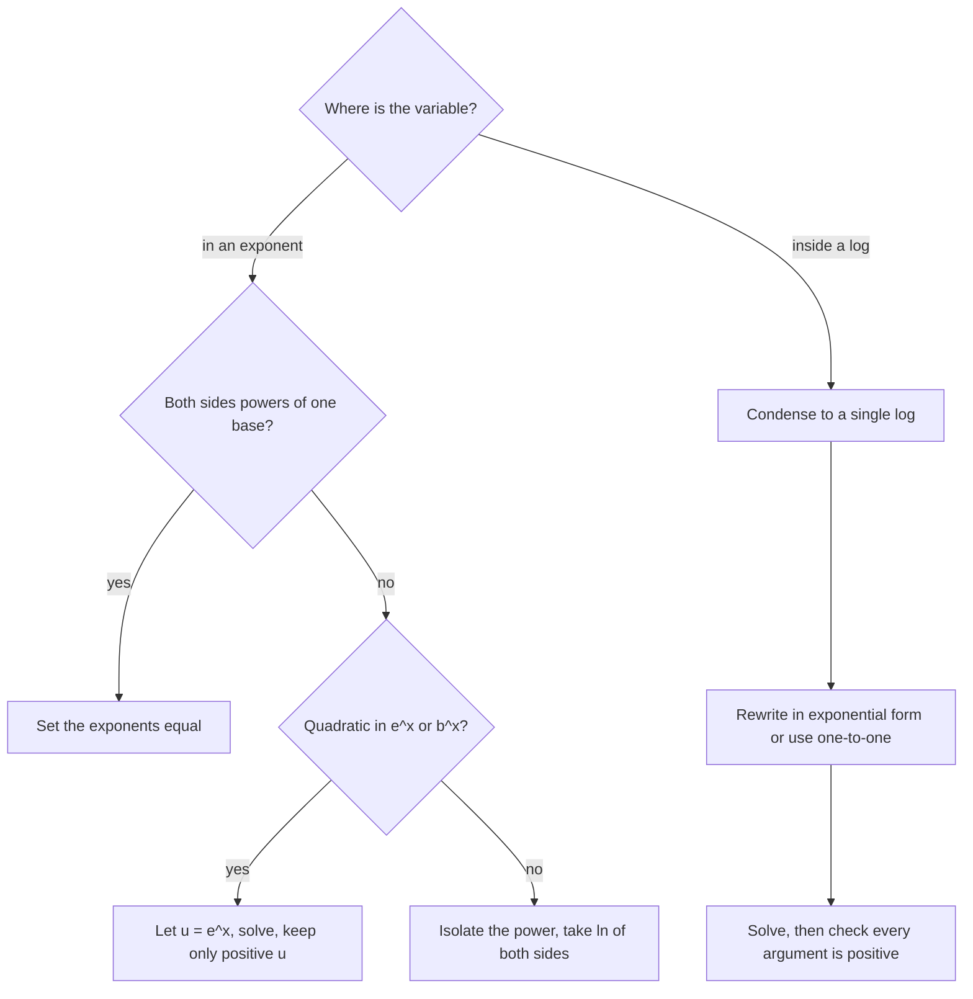

This lesson puts the last two together. An **exponential equation** has the variable in an exponent, like $3^{x} = 20$; a **logarithmic equation** has the variable inside a logarithm, like $\log_2(x + 1) = 5$. Each is solved by applying the inverse operation: take a logarithm to free an exponent, or rewrite in exponential form to free a logarithm's argument. The lesson ends with the classic applications: doubling time and solving for time in growth and decay models.

## Exponential equations with a common base

Exponential functions are one-to-one: if $b^m = b^n$, then $m = n$. So if both sides can be written as powers of the same base, set the exponents equal.

### Example 1

Solve $4^{x + 1} = 8^{x}$.

1. Write both as powers of 2: $(2^2)^{x + 1} = (2^3)^x$, so $2^{2x + 2} = 2^{3x}$.
2. Set exponents equal: $2x + 2 = 3x$, so $x = 2$.
3. Check: $4^3 = 64$ and $8^2 = 64$.

### Example 2

Solve $9^{x} = \dfrac{1}{27}$.

$3^{2x} = 3^{-3}$, so $2x = -3$ and $x = -\tfrac32$.

## Exponential equations with logarithms

When no common base exists, isolate the exponential expression, then take a logarithm (usually $\ln$ or $\log$) of both sides and use the power rule to bring the exponent down.

### Example 3

Solve $5 \cdot 3^{x} - 7 = 43$.

1. Isolate: $5 \cdot 3^x = 50$, so $3^x = 10$.
2. Take $\ln$: $\ln 3^x = \ln 10$, so $x\ln 3 = \ln 10$.
3. $x = \dfrac{\ln 10}{\ln 3} \approx \dfrac{2.3026}{1.0986} \approx 2.096$.
4. Check: $3^{2.096} \approx 10$, and $5(10) - 7 = 43$.

Equivalently, from $3^x = 10$ write $x = \log_3 10$ and use change of base.

A graph makes the answer believable: the solution of $3^x = 10$ is the $x$-coordinate where the curve $y = 3^x$ crosses the horizontal line $y = 10$.

```plot
{"x": [-1, 3], "y": [-1, 16], "functions": [{"f": "3^x", "label": "y = 3^x", "from": -1, "to": 2.5}, {"f": "10", "label": "y = 10", "dashed": true}], "points": [{"at": [2.096, 10], "label": "x ≈ 2.096"}], "segments": [{"from": [2.096, 0], "to": [2.096, 10], "dashed": true}], "caption": "3^x = 10 where the curve meets the line: x = ln 10 / ln 3 ≈ 2.096"}
```

Don't take the log before isolating: $\ln(5 \cdot 3^x - 7)$ can't be split, since there's no rule for the log of a difference.

### Example 4

Solve $2^{x + 3} = 5^{x}$.

1. Take $\ln$: $(x + 3)\ln 2 = x\ln 5$.
2. Distribute and collect $x$ terms: $x\ln 2 + 3\ln 2 = x\ln 5$, so $3\ln 2 = x(\ln 5 - \ln 2)$.
3. $x = \dfrac{3\ln 2}{\ln 5 - \ln 2} = \dfrac{3\ln 2}{\ln 2.5} \approx \dfrac{2.0794}{0.9163} \approx 2.269$.

This is the literal-equation technique from Algebra 1: the unknown appears twice, so collect and factor.

### Example 5

Solve $e^{2x} - 5e^{x} + 6 = 0$.

1. Let $u = e^x$. Since $e^{2x} = (e^x)^2$, this is $u^2 - 5u + 6 = 0$, so $(u - 2)(u - 3) = 0$.
2. $e^x = 2$ gives $x = \ln 2 \approx 0.693$; $e^x = 3$ gives $x = \ln 3 \approx 1.099$.

## Logarithmic equations

To solve a logarithmic equation:

1. Use the log laws to combine into a single logarithm on one side (or one log on each side).
2. If $\log_b(\text{stuff}) = c$, rewrite in exponential form: $\text{stuff} = b^c$. If $\log_b M = \log_b N$, conclude $M = N$.
3. Solve.
4. Check: every logarithm in the original equation must have a positive argument. Solutions that fail this are extraneous.

### Example 6

Solve $\log_2(3x - 1) = 4$.

Exponential form: $3x - 1 = 2^4 = 16$, so $x = \tfrac{17}{3}$. Check: $3 \cdot \tfrac{17}{3} - 1 = 16 > 0$.

### Example 7

Solve $\log_6 x + \log_6(x - 1) = 1$.

1. Product rule: $\log_6[x(x - 1)] = 1$.
2. Exponential form: $x^2 - x = 6$, so $(x - 3)(x + 2) = 0$.
3. Candidates $x = 3$ and $x = -2$.
4. Check $x = -2$: $\log_6(-2)$ is undefined, so it's extraneous. Check $x = 3$: $\log_6 3 + \log_6 2 = \log_6 6 = 1$. Solution: $x = 3$.

### Example 8

Solve $\ln(x + 4) = \ln(2x - 1)$.

Logs are one-to-one, so $x + 4 = 2x - 1$ and $x = 5$. Check: $\ln 9 = \ln 9$, with positive arguments.

## Applications: solving for time

### Example 9

How long does it take money to double at 5% interest compounded annually?

1. $2P = P(1.05)^t$, so $1.05^t = 2$.
2. $t = \dfrac{\ln 2}{\ln 1.05} \approx \dfrac{0.6931}{0.04879} \approx 14.2$ years.

The principal cancels: doubling time doesn't depend on how much you start with. The handy "rule of 72" estimate, $72 \div 5 \approx 14.4$ years, comes from this calculation.

### Example 10

A substance decays according to $A = A_0e^{-0.0231t}$ ($t$ in years). Find its half-life.

1. Half remains when $e^{-0.0231t} = \tfrac12$.
2. $-0.0231t = \ln \tfrac12 = -\ln 2$, so $t = \dfrac{\ln 2}{0.0231} \approx 30.0$ years.

```plot
{"x": [0, 100], "y": [0, 110], "functions": [{"f": "100*e^(-0.0231*x)", "label": "A = 100e^(-0.0231t)"}], "points": [{"at": [30, 50], "label": "half-life ≈ 30 yr"}, {"at": [60, 25], "label": "(60, 25)"}], "segments": [{"from": [0, 50], "to": [30, 50], "dashed": true}, {"from": [30, 0], "to": [30, 50], "dashed": true}], "xLabel": "t (years)", "yLabel": "amount", "caption": "Each half-life halves what is left"}
```

## Choosing a method

The chart sums up the whole lesson: first ask where the variable is, then pick the tool.



## Common mistakes

- Taking a log of both sides before isolating the exponential term.
- Writing $\dfrac{\ln 10}{\ln 3}$ as $\ln \dfrac{10}{3}$ or as $\ln 10 - \ln 3$.
- Converting $\log_2(3x - 1) = 4$ to $3x - 1 = 4^2$: the base is 2, so it's $2^4$.
- Forgetting to check that every log argument is positive.
- Dropping solutions: when you substitute $u = e^x$, a negative value of $u$ gives no solution, but a positive one does.

## Key points

- Common base: write both sides as powers of one base and equate exponents.
- Otherwise isolate $b^{(\ldots)}$, take $\ln$ of both sides, and use the power rule.
- For log equations, condense to one log, convert to exponential form (or use one-to-one), solve, and check positive arguments.
- Doubling time at rate $r$: $t = \dfrac{\ln 2}{\ln(1 + r)}$; half-life for $e^{-kt}$: $t = \dfrac{\ln 2}{k}$.
