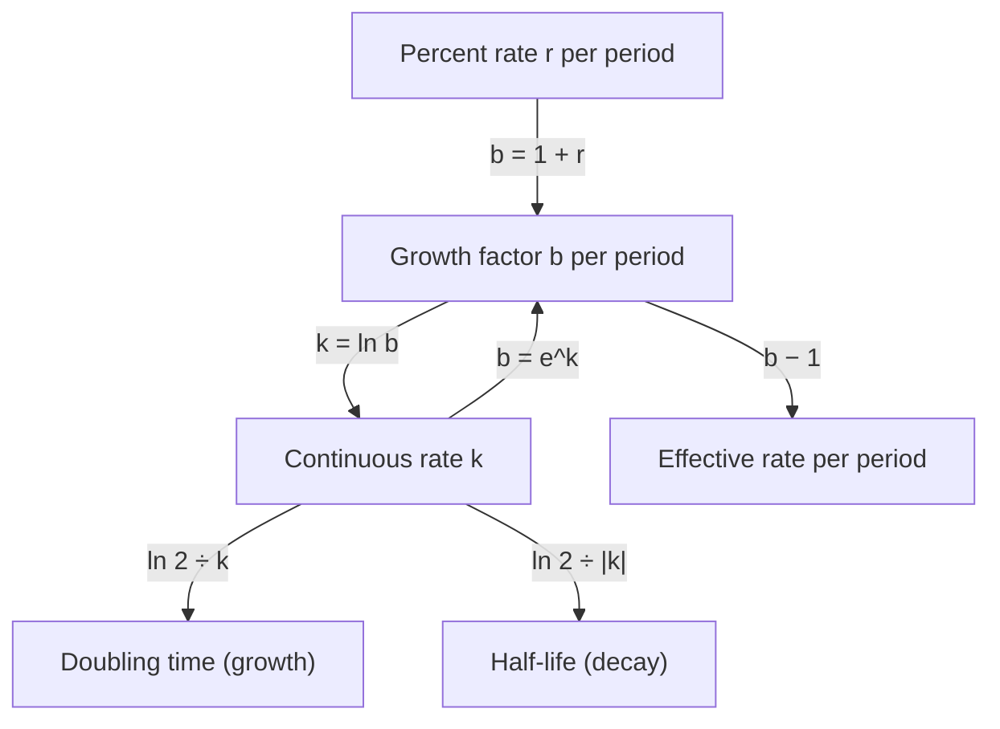

The exponential functions lesson described growth in several ways: a percent change per year, a half-life, compound interest $n$ times a year, and continuous compounding with $Pe^{rt}$. The logarithms lessons then gave you the tool to move between those descriptions. This honors lesson does exactly that. It shows that every exponential model can be written with base $e$, explains what the rate in $e^{kt}$ really means, shows why banks advertise an "annual percentage yield" that differs from the stated rate, and explains where the famous rule of 72 comes from and why it works. It ends with radiocarbon dating, a real use of all of it.

## One model, several descriptions

A model $A = a \cdot b^t$ multiplies by $b$ each period. Because $b = e^{\ln b}$ for any $b > 0$, the power rule for exponents gives

$$b^t = \left(e^{\ln b}\right)^t = e^{(\ln b)t}.$$

So the same model can be written $A = ae^{kt}$ with $k = \ln b$. The number $k$ is the **continuous growth rate** (a continuous decay rate if $k < 0$). Going the other way, $b = e^k$. The ordinary per-period percent rate is $r = b - 1$.

| Growth factor $b$ | Rate per period $r = b - 1$ | Continuous rate $k = \ln b$ |
|---|---|---|
| $1.05$ | 5% | $0.04879$ (4.879%) |
| $1.10$ | 10% | $0.09531$ (9.531%) |
| $2$ | 100% | $0.69315$ (69.3%) |
| $0.80$ | $-20\%$ | $-0.22314$ ($-22.3\%$) |

Notice that for growth the continuous rate is always a little smaller than $r$. That makes sense: a continuous rate compounds on itself all through the period, so it needs a smaller rate to produce the same growth over a whole period. For small rates the two are close, because $\ln(1 + r) \approx r$ when $r$ is near 0: $\ln 1.01 \approx 0.00995$, but $\ln 1.20 \approx 0.182$.

### Example 1

(a) A town grows 3.5% per year. Write its model with base $e$.

The growth factor is $b = 1.035$, so $k = \ln 1.035 \approx 0.0344$. The model $P = P_0(1.035)^t$ is the same as $P = P_0e^{0.0344t}$: a continuous rate of about 3.44% per year.

(b) A culture follows $N = 200e^{0.25t}$, with $t$ in hours. By what percent does it grow each hour?

The hourly growth factor is $b = e^{0.25} \approx 1.2840$, so the culture grows about 28.4% per hour, not 25%.

The diagram collects the conversions. Everything passes through the growth factor $b$ or the continuous rate $k$.



## Why compounding more often leads to $e$

The core lesson showed that $\left(1 + \tfrac1n\right)^n$ approaches $e \approx 2.71828$ as $n$ grows. Here is why the same number controls every interest rate. With rate $r$ compounded $n$ times a year, the growth over $t$ years is $\left(1 + \tfrac rn\right)^{nt}$. Let $m = \tfrac nr$, so that $\tfrac rn = \tfrac1m$ and $nt = mrt$:

$$\left(1 + \frac rn\right)^{nt} = \left[\left(1 + \frac1m\right)^m\right]^{rt}.$$

As $n$ grows without bound, so does $m$, and the bracket approaches $e$. The whole expression approaches $e^{rt}$, which is the continuous compounding formula.

```plot
{"x": [0, 50], "y": [1.8, 3], "functions": [{"f": "(1 + 1/x)^x", "label": "y = (1 + 1/n)^n", "from": 1, "to": 50}, {"f": "e", "label": "y = e ≈ 2.718", "dashed": true}], "points": [{"at": [1, 2], "label": "n = 1: 2"}, {"at": [10, 2.5937], "label": "n = 10: 2.594"}], "xLabel": "n", "caption": "(1 + 1/n)^n climbs toward e but never reaches it"}
```

Proving that this limit exists takes calculus. Calculus also gives a much faster way to compute $e$, previewed here without proof:

$$e = 1 + 1 + \frac1{2!} + \frac1{3!} + \frac1{4!} + \cdots$$

The first seven terms already give $2.71806$, and ten terms give $2.7182815$.

## Effective annual rate

A bank's stated yearly rate, before compounding, is the **nominal rate**. What you actually earn in a year is the **effective annual rate**, which banks in the United States must disclose for savings accounts as the **annual percentage yield** (APY), under the Truth in Savings Act. With nominal rate $r$:

$$\text{effective rate} = \left(1 + \frac rn\right)^n - 1 \quad (n \text{ times a year}), \qquad \text{effective rate} = e^r - 1 \quad (\text{continuous}).$$

Two accounts can only be compared fairly by their effective rates.

### Example 2

Which account earns the most in a year?

| Account | Nominal rate | Compounding | Effective annual rate |
|---|---|---|---|
| A | 4.80% | monthly | $\left(1 + \tfrac{0.048}{12}\right)^{12} - 1 \approx 4.907\%$ |
| B | 4.90% | annually | $1.049 - 1 = 4.900\%$ |
| C | 4.75% | continuously | $e^{0.0475} - 1 \approx 4.865\%$ |

Account A states a lower rate than B but earns the most, because monthly compounding adds about 0.107 percentage points. On $10,000, the difference between A and B over one year is only about 70 cents, but over decades such differences add up.

## Doubling time and the rule of 72

From $A = A_0e^{kt}$, the amount doubles when $e^{kt} = 2$, so $kt = \ln 2$ and

$$T_{\text{double}} = \frac{\ln 2}{k} \approx \frac{0.693}{k}.$$

With a per-period rate $r$ instead, $(1 + r)^t = 2$ gives $T = \dfrac{\ln 2}{\ln(1 + r)}$. Since $\ln(1 + r)$ is close to $r$ for small rates, $T \approx \dfrac{0.693}{r}$. Writing the rate as a percentage $R$ (so $r = R/100$), $T \approx \dfrac{69.3}{R}$.

The **rule of 72** says: money growing at $R$% per year doubles in about $72 \div R$ years. Why 72 and not 69.3? First, with yearly compounding, $\ln(1 + r)$ is a bit smaller than $r$, so the true doubling time is a bit longer than $69.3/R$; at 8% the exact value of $R \cdot T$ is about 72.05. Second, 72 divides evenly by 2, 3, 4, 6, 8, 9 and 12, which makes mental arithmetic easy. It is a rule of thumb, best for rates from about 4% to 12%. The rule is old: it is usually traced to Luca Pacioli's arithmetic book of 1494, which states it without explanation.

| Rate $R$ (% per year, compounded yearly) | Exact $\dfrac{\ln 2}{\ln(1 + r)}$ | Rule of 72 | $69.3/R$ |
|---|---|---|---|
| 2 | 35.0 | 36.0 | 34.7 |
| 6 | 11.9 | 12.0 | 11.6 |
| 8 | 9.01 | 9.0 | 8.66 |
| 12 | 6.12 | 6.0 | 5.78 |

For continuous growth, $\ln 2/k$ is exact, so $69.3/R$ is the better rule there.

## Decay constants and radiocarbon dating

Decay is often written $A = A_0e^{-\lambda t}$ with a positive **decay constant** $\lambda$ (the Greek letter lambda). The half-life $h$ solves $e^{-\lambda h} = \tfrac12$, so

$$h = \frac{\ln 2}{\lambda} \quad \text{and} \quad \lambda = \frac{\ln 2}{h}.$$

**Radiocarbon dating** uses carbon-14, which living things take in from the air and food. After death no new carbon-14 comes in, and what is there decays with a half-life of about 5,730 years. Comparing how much carbon-14 is left with how much a living sample has gives the time since death.

### Example 3

Charcoal from an ancient fire has 30% of the carbon-14 of living wood. About how old is it?

1. $\lambda = \dfrac{\ln 2}{5730} \approx 0.000121$ per year.
2. Solve $e^{-\lambda t} = 0.30$: $-\lambda t = \ln 0.30$, so $t = \dfrac{\ln 0.30}{-\lambda} = \dfrac{5730 \ln 0.30}{-\ln 2} \approx 9{,}950$ years.
3. Check by half-lives: 30% is between 50% (one half-life, 5,730 years) and 25% (two, 11,460 years), and closer to 25%.

This is a simplified version of the method. The amount of carbon-14 in the air has changed over time, so laboratories convert raw ages into calendar years with calibration curves built from tree rings and other records, and by convention they report raw "radiocarbon ages" using an older half-life of 5,568 years. After about 50,000 years (almost nine half-lives) less than 0.3% remains, which is about the limit of the method.

### Example 4

A town had 4,200 people in 2015 and 5,100 in 2022. Assuming exponential growth, find the continuous rate, the yearly percent rate, the doubling time and a prediction for 2030.

1. $5100 = 4200e^{7k}$, so $e^{7k} = \tfrac{5100}{4200}$ and $k = \dfrac{1}{7}\ln\dfrac{5100}{4200} \approx 0.0277$: about 2.77% per year, continuously.
2. Yearly factor $e^{0.0277} \approx 1.0281$: about 2.81% per year.
3. Doubling time $\dfrac{\ln 2}{0.0277} \approx 25.0$ years.
4. In 2030, 8 years after 2022: $5100e^{8k} \approx 6{,}367$ people. Two data points can't tell you whether growth is really exponential, so a prediction like this is only as good as that assumption.

## Common mistakes

- Treating $k$ and $r$ as the same: $e^{0.25t}$ grows 28.4% per period, not 25%.
- Converting with $k = \log b$ (base 10) instead of $k = \ln b$.
- Comparing nominal rates with different compounding instead of effective rates.
- Using the rule of 72 as exact, or applying it with $r$ as a decimal: at 6%, divide 72 by 6, not by 0.06.
- Using $\lambda = \tfrac{h}{\ln 2}$ instead of $\tfrac{\ln 2}{h}$; check that a longer half-life gives a smaller decay constant.

## Key points

- $ab^t = ae^{kt}$ with $k = \ln b$ and $b = e^k$; the per-period rate is $b - 1$.
- $\left(1 + \tfrac rn\right)^{nt} \to e^{rt}$ as $n \to \infty$.
- Effective annual rate (APY): $\left(1 + \tfrac rn\right)^n - 1$, or $e^r - 1$ for continuous compounding.
- Doubling time $\tfrac{\ln 2}{k}$; half-life $\tfrac{\ln 2}{\lambda}$; rule of 72: about $72 \div R$ years at $R$% per year.
- Two measurements determine $k$: $k = \dfrac{1}{t}\ln\dfrac{A(t)}{A_0}$.
