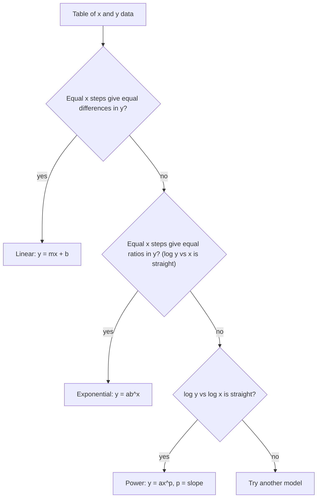

The logarithms lesson ended with pH: a scale on which each step of 1 is a factor of 10. That idea goes much further. Logarithms let one picture show numbers from 1 to a billion, they turn exponential curves into straight lines, and they let you discover the formula hiding in a table of data. This honors lesson covers logarithmic scales (decibels and earthquake magnitudes), semi-log graphs for exponential data, and log-log graphs for power laws, ending with how Kepler's third law of planetary motion shows up as a straight line.

## Logarithmic scales

On an ordinary number line, equal distances mean equal differences: 0 to 10 is as long as 10 to 20. On a **logarithmic scale**, a number $x$ is placed at a distance proportional to $\log x$, so equal distances mean equal *factors*: 1 to 10 is as long as 10 to 100 and as 100 to 1,000.


Within each section the marks bunch up toward the right, because $\log 2 \approx 0.301$, $\log 3 \approx 0.477$ and $\log 5 \approx 0.699$: the number 2 sits about 30% of the way from 1 to 10, and 5 sits about 70% of the way. The scale has no zero, since $\log 0$ is undefined; it can go on to the left forever, through 0.1, 0.01 and so on.

### Decibels

The ear responds to sound intensities from about $10^{-12}$ watts per square meter (the faintest sound people can hear) up to about $1$ W/m² (painful), a range of a trillion. The sound level in **decibels** (dB) is

$$L = 10\log\frac{I}{I_0}, \qquad I_0 = 10^{-12}\ \text{W/m}^2.$$

Each factor of 10 in intensity adds 10 dB, so the threshold of hearing is 0 dB and a sound with intensity $1$ W/m² is $10\log 10^{12} = 120$ dB.

### Example 1

(a) A vacuum cleaner produces an intensity of $3.2 \times 10^{-5}$ W/m² at the user's ear. What is its sound level?

$L = 10\log\dfrac{3.2 \times 10^{-5}}{10^{-12}} = 10\log(3.2 \times 10^{7}) = 10(\log 3.2 + 7) \approx 10(0.505 + 7) \approx 75.1$ dB.

(b) Two such vacuum cleaners run side by side. What is the combined level?

Intensities add, so $I$ doubles. By the product rule, $L$ goes up by $10\log 2 \approx 3.0$ dB, to about 78.1 dB, not 150 dB. Doubling the intensity always adds about 3 dB.

(c) How many times more intense is a 90 dB sound than a 60 dB one?

A 30 dB difference is three steps of 10 dB, so the ratio is $10^3 = 1000$.

### Earthquake magnitudes

Earthquake magnitudes are logarithmic too. Charles Richter's original 1935 scale was based on the logarithm of the largest swing of a standard seismograph, so each step of 1 meant 10 times the amplitude. Seismologists now use the moment magnitude scale, on which each step of 1 means about $10^{1.5} \approx 32$ times as much energy released, so two steps is $10^3 = 1000$ times. (Both statements are simplifications; the real relationships depend on distance, rock type and how a quake is measured.)

## Semi-log graphs: exponential data as a straight line

Take logarithms of an exponential model $y = ab^x$:

$$\log y = \log a + x\log b.$$

That is a linear equation in $x$, with slope $\log b$ and intercept $\log a$. So if you plot $\log y$ against $x$, which is called a **semi-log graph** (only one axis is logarithmic), exponential data fall on a straight line. To **linearize** data means to transform it like this so that a straight line fits. Lines are easy to recognize by eye and easy to fit, which is why scientists plot growth and decay this way.

### Example 2

A bacteria culture is counted every hour.

| Hour $t$ | 0 | 1 | 2 | 3 | 4 |
|---|---|---|---|---|---|
| Count $N$ | 500 | 760 | 1150 | 1730 | 2620 |
| $\log N$ | 2.699 | 2.881 | 3.061 | 3.238 | 3.418 |

1. The differences in $N$ grow (260, 390, 580, 890), so the data aren't linear. The ratios are nearly constant (1.52, 1.51, 1.50, 1.51), which suggests exponential growth.
2. The values of $\log N$ rise by about 0.18 each hour: the semi-log graph is close to a straight line.
3. Use the first and last points for the line: slope $m = \dfrac{3.418 - 2.699}{4} \approx 0.180$ and intercept $\log a = 2.699$.
4. Back-transform: $b = 10^{0.180} \approx 1.513$ and $a = 10^{2.699} \approx 500$. The model is $N \approx 500(1.513)^t$: about 51% growth per hour.
5. Predict hour 6: $500(1.513)^6 \approx 6{,}000$. Doubling time: $\dfrac{\ln 2}{\ln 1.513} \approx 1.67$ hours, about 1 hour 40 minutes.

```plot
{"x": [-0.5, 5], "y": [2.5, 3.6], "functions": [{"f": "2.699 + 0.1798*x", "label": "log N = 2.699 + 0.180t", "dashed": true}], "points": [{"at": [0, 2.699]}, {"at": [1, 2.881]}, {"at": [2, 3.061]}, {"at": [3, 3.238]}, {"at": [4, 3.418]}], "xLabel": "t (hours)", "yLabel": "log₁₀ N", "caption": "On a semi-log graph the bacteria counts lie close to a straight line"}
```

With more than two points, a calculator's exponential regression does the same thing more carefully: it fits the best line to $(x, \ln y)$ and transforms back. Using only two points is quicker but depends heavily on those two measurements.

For exact data, the two-point method gives exact parameters.

### Example 3

Find $y = ab^x$ through $(2, 18)$ and $(5, 486)$.

1. Divide the equations: $\dfrac{ab^5}{ab^2} = \dfrac{486}{18}$, so $b^3 = 27$ and $b = 3$.
2. Then $a \cdot 3^2 = 18$, so $a = 2$. The model is $y = 2 \cdot 3^x$.
3. Check: $2 \cdot 3^5 = 486$.

Dividing the two equations is the same as subtracting their logarithms: $3\log b = \log 486 - \log 18$.

## Log-log graphs: power laws

A power function has the form $y = ax^p$, where the variable is the base and the exponent $p$ is fixed. (The optional honors lesson on power laws in Module 4 studies them; it could only find $p$ when the numbers were powers of a common base. Logarithms remove that limit.) Taking logarithms:

$$\log y = \log a + p\log x.$$

Now $\log y$ is linear in $\log x$. On a **log-log graph** (both axes logarithmic), power-law data fall on a straight line, and the slope is the exponent $p$. From two points, $p = \dfrac{\log(y_2/y_1)}{\log(x_2/x_1)}$.

### Example 4: Kepler's third law

Suppose you didn't know the law and had only measurements. The table gives each planet's average distance from the Sun $a$ (in astronomical units, where Earth's distance is 1 AU) and its orbital period $T$ (in years).

| Planet | $a$ (AU) | $T$ (years) | $\log a$ | $\log T$ |
|---|---|---|---|---|
| Mercury | 0.387 | 0.241 | $-0.412$ | $-0.618$ |
| Venus | 0.723 | 0.615 | $-0.141$ | $-0.211$ |
| Earth | 1.000 | 1.000 | 0 | 0 |
| Mars | 1.524 | 1.881 | 0.183 | 0.274 |
| Jupiter | 5.203 | 11.86 | 0.716 | 1.074 |
| Saturn | 9.537 | 29.46 | 0.979 | 1.469 |

```plot
{"x": [-0.6, 1.2], "y": [-0.8, 1.7], "equal": true, "functions": [{"f": "1.5*x", "label": "log T = 1.5 log a", "dashed": true}], "points": [{"at": [-0.412, -0.618], "label": "Mercury"}, {"at": [-0.141, -0.211], "label": "Venus"}, {"at": [0, 0], "label": "Earth"}, {"at": [0.183, 0.274], "label": "Mars"}, {"at": [0.716, 1.074], "label": "Jupiter"}, {"at": [0.979, 1.469], "label": "Saturn"}], "xLabel": "log₁₀ a", "yLabel": "log₁₀ T", "caption": "Planets on a log-log graph: a straight line of slope 1.5 through the origin"}
```

1. The points lie on a line through $(0, 0)$. The intercept is the log of the coefficient in $T = (\text{coefficient}) \cdot a^p$, so the coefficient is $10^0 = 1$.
2. Slope from Earth to Saturn: $\dfrac{1.469 - 0}{0.979 - 0} \approx 1.50$.
3. So $T = a^{1.5}$, or $T^2 = a^3$. This is Kepler's third law, which Johannes Kepler published in 1619 after years of work with Tycho Brahe's observations. (In these units the constant is 1; in other units it isn't.)
4. Predict: Neptune is about 30.07 AU from the Sun, so $T \approx 30.07^{1.5} \approx 165$ years. The measured period is about 164.8 years.

Deciding which model fits a table comes down to which graph is straight.



## Common mistakes

- Adding decibels as if they were intensities: two 75 dB sources make about 78 dB, not 150 dB.
- Reading a logarithmic axis as if it were evenly spaced: halfway between 1 and 100 on a log scale is 10, not 50.
- Forgetting to back-transform: the slope of a semi-log line is $\log b$, not $b$.
- Confusing the two models: in $ab^x$ the variable is the exponent (semi-log is straight); in $ax^p$ the variable is the base (log-log is straight).
- Trusting a two-point fit without checking the other points; a straight-looking semi-log graph over a short range can still bend later.

## Key points

- On a logarithmic scale, equal distances are equal factors; there is no zero.
- Sound level: $L = 10\log\dfrac{I}{I_0}$; 10 dB is a factor of 10 in intensity, and about 3 dB is a factor of 2.
- $y = ab^x \iff \log y = \log a + x\log b$: exponential data are straight on a semi-log graph.
- $y = ax^p \iff \log y = \log a + p\log x$: power data are straight on a log-log graph, with slope $p$.
- Through two points: $b = \left(\dfrac{y_2}{y_1}\right)^{1/(x_2 - x_1)}$ for exponential models, $p = \dfrac{\log(y_2/y_1)}{\log(x_2/x_1)}$ for power models.
