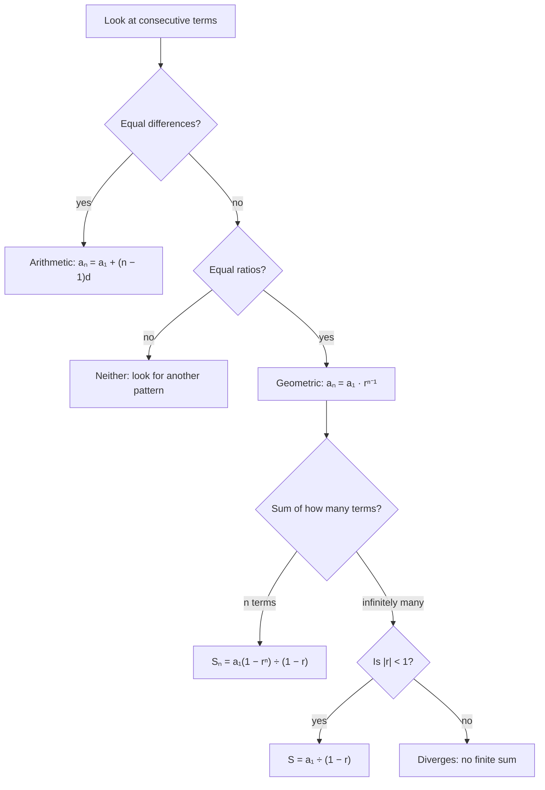

An arithmetic sequence adds the same number each time. A geometric sequence multiplies by the same number each time, which makes it the discrete version of an exponential function (Module 6). This lesson finds the $n$th term and the sum of a geometric sequence, and then asks a surprising question: can infinitely many numbers add up to a finite total?

## Geometric sequences

A **geometric sequence** multiplies each term by the same nonzero number, the **common ratio** $r$, to get the next:

$$a_n = r \cdot a_{n-1}.$$

Examples: $3, 6, 12, 24, \dots$ ($r = 2$); $80, 20, 5, \tfrac54, \dots$ ($r = \tfrac14$); $2, -6, 18, -54, \dots$ ($r = -3$, so the signs alternate). To test whether a sequence is geometric, divide each term by the one before; the ratios must all be equal.

Reaching the $n$th term takes $n - 1$ multiplications by $r$:

$$a_n = a_1 r^{n-1}.$$

### Example 1

Find the 10th term of $3, 6, 12, \dots$

$a_{10} = 3 \cdot 2^9 = 3 \cdot 512 = 1536$.

### Example 2

A geometric sequence has $a_2 = 12$ and $a_5 = 324$. Find $a_1$ and $r$.

1. From term 2 to term 5 is 3 multiplications: $r^3 = \tfrac{324}{12} = 27$, so $r = 3$.
2. $a_1 = \tfrac{a_2}{r} = 4$.

### Example 3

Is $5, 10, 20, 35, \dots$ arithmetic, geometric or neither?

Differences: 5, 10, 15 (not constant). Ratios: 2, 2, 1.75 (not constant). Neither.

## Arithmetic versus geometric

| | Arithmetic | Geometric |
|---|---|---|
| Rule | add $d$ | multiply by $r$ |
| $n$th term | $a_1 + (n - 1)d$ | $a_1 r^{n-1}$ |
| Like a | linear function | exponential function |
| Test | equal differences | equal ratios |

```plot
{"x": [0, 9], "y": [0, 140], "functions": [{"f": "2^(x - 1)", "label": "geometric 1, 2, 4, ...", "dashed": true, "color": "#c05621", "from": 1, "to": 8}, {"f": "10*x", "label": "arithmetic 10, 20, 30, ...", "dashed": true, "color": "#2b6cb0", "from": 1, "to": 8}], "points": [{"at": [1, 1], "color": "#c05621"}, {"at": [2, 2], "color": "#c05621"}, {"at": [3, 4], "color": "#c05621"}, {"at": [4, 8], "color": "#c05621"}, {"at": [5, 16], "color": "#c05621"}, {"at": [6, 32], "color": "#c05621"}, {"at": [7, 64], "color": "#c05621"}, {"at": [8, 128], "color": "#c05621"}, {"at": [1, 10], "color": "#2b6cb0"}, {"at": [2, 20], "color": "#2b6cb0"}, {"at": [3, 30], "color": "#2b6cb0"}, {"at": [4, 40], "color": "#2b6cb0"}, {"at": [5, 50], "color": "#2b6cb0"}, {"at": [6, 60], "color": "#2b6cb0"}, {"at": [7, 70], "color": "#2b6cb0"}, {"at": [8, 80], "color": "#2b6cb0"}], "xLabel": "n", "yLabel": "aₙ", "caption": "10, 20, 30, ... grows steadily; 1, 2, 4, ... starts slower but soon overtakes it"}
```

## The sum of a geometric series

Let $S_n = a_1 + a_1r + a_1r^2 + \cdots + a_1r^{n-1}$. Multiply by $r$:

$$rS_n = a_1r + a_1r^2 + \cdots + a_1r^{n-1} + a_1r^n.$$

Subtract the second line from the first. Almost everything cancels:

$$S_n - rS_n = a_1 - a_1r^n, \qquad\text{so}\qquad S_n = \frac{a_1(1 - r^n)}{1 - r} \quad (r \ne 1).$$

(If $r = 1$, every term is $a_1$ and $S_n = na_1$.)

### Example 4

Find the sum of the first 8 terms of $3, 6, 12, \dots$

$S_8 = \dfrac{3(1 - 2^8)}{1 - 2} = \dfrac{3(-255)}{-1} = 765$.

### Example 5

Evaluate $\displaystyle\sum_{k=1}^{6} 5\left(\tfrac12\right)^{k-1}$.

$a_1 = 5$, $r = \tfrac12$, $n = 6$: $S_6 = \dfrac{5\left(1 - \tfrac{1}{64}\right)}{1 - \tfrac12} = 10 \cdot \tfrac{63}{64} = \tfrac{315}{32} = 9.84375$.

### Example 6

You save 1 cent on day 1, 2 cents on day 2, 4 cents on day 3, doubling each day. How much have you saved after 30 days?

$S_{30} = \dfrac{1(1 - 2^{30})}{1 - 2} = 2^{30} - 1 = 1{,}073{,}741{,}823$ cents, over 10.7 million dollars. That's exponential growth at work.

## Infinite geometric series

What happens to $S_n$ as $n$ grows without bound? If $|r| < 1$, then $r^n$ shrinks toward 0 (for example $\left(\tfrac12\right)^{20} \approx 0.000001$), so

$$S_n = \frac{a_1(1 - r^n)}{1 - r} \to \frac{a_1}{1 - r}.$$

The **infinite geometric series** $a_1 + a_1r + a_1r^2 + \cdots$ has the sum

$$S = \frac{a_1}{1 - r} \quad \text{when } |r| < 1.$$

If $|r| \ge 1$, the terms don't shrink to 0 and the series has no finite sum; it **diverges**. When the sum exists, the series **converges**.

The partial sums of $1 + \tfrac12 + \tfrac14 + \tfrac18 + \cdots$ are $1, 1.5, 1.75, 1.875, \dots$, creeping toward $\dfrac{1}{1 - \frac12} = 2$. Picture walking halfway to a wall, then half the remaining distance, and so on: you cover a total of exactly the distance to the wall.

The same idea works with area. Cut a square of area 1 in half, then cut the leftover piece in half, and keep going. The pieces have areas $\tfrac12, \tfrac14, \tfrac18, \dots$, and together they fill the whole square, so $\tfrac12 + \tfrac14 + \tfrac18 + \cdots = 1$, which matches $\dfrac{a_1}{1 - r} = \dfrac{1/2}{1 - 1/2} = 1$.


```plot
{"x": [0, 9], "y": [0, 2.4], "points": [{"at": [1, 1]}, {"at": [2, 1.5]}, {"at": [3, 1.75]}, {"at": [4, 1.875]}, {"at": [5, 1.9375]}, {"at": [6, 1.96875]}, {"at": [7, 1.984375]}, {"at": [8, 1.9921875]}], "functions": [{"f": "2", "dashed": true, "label": "S = 2"}], "xLabel": "n", "yLabel": "Sₙ", "caption": "Partial sums of 1 + 1/2 + 1/4 + ... approach 2"}
```

### Example 7

Find the sum of $12 - 4 + \tfrac43 - \tfrac49 + \cdots$, if it exists.

$r = -\tfrac{4}{12} = -\tfrac13$, and $|r| < 1$, so it converges: $S = \dfrac{12}{1 - \left(-\frac13\right)} = \dfrac{12}{\frac43} = 9$.

### Example 8

Write the repeating decimal $0.\overline{36} = 0.363636\ldots$ as a fraction.

$0.36 + 0.0036 + 0.000036 + \cdots$ is geometric with $a_1 = 0.36$ and $r = 0.01$: $S = \dfrac{0.36}{0.99} = \dfrac{36}{99} = \dfrac{4}{11}$. This explains the fact from Algebra 1 that repeating decimals are rational.

## A financial application

Geometric series appear whenever money grows by a fixed percentage.

### Example 9

A job pays 40,000 dollars in the first year, with a 3% raise every year after that. What are the 10th-year salary and the total earned over 10 years?

1. The salaries form a geometric sequence with $a_1 = 40000$ and $r = 1.03$.
2. Tenth year: $a_{10} = 40000(1.03)^9 \approx 52{,}191$ dollars.
3. Total: $S_{10} = \dfrac{40000(1 - 1.03^{10})}{1 - 1.03} \approx 458{,}555$ dollars.

Compare a flat salary of 40,000 dollars for 10 years, which totals 400,000 dollars; the raises add almost 58,600 dollars.

## Choosing a formula

This chart sums up Lessons 23 and 24: test the sequence first, then pick the formula that fits the question.



## Common mistakes

- Using $a_1r^n$ instead of $a_1r^{n-1}$ for the $n$th term.
- Finding $r$ by subtracting instead of dividing.
- Losing the sign of a negative ratio, so the alternating signs disappear.
- Applying $\dfrac{a_1}{1 - r}$ when $|r| \ge 1$: such a series has no sum.
- Writing $(a_1r)^{n-1}$ instead of $a_1r^{n-1}$; only $r$ is raised to the power.

## Key points

- Geometric: constant ratio $r$; $a_n = a_1r^{n-1}$; behaves like an exponential function.
- Finite sum: $S_n = \dfrac{a_1(1 - r^n)}{1 - r}$ for $r \ne 1$.
- Infinite sum: $S = \dfrac{a_1}{1 - r}$ if $|r| < 1$; otherwise the series diverges.
- Repeating decimals are infinite geometric series, which is why they're rational.
