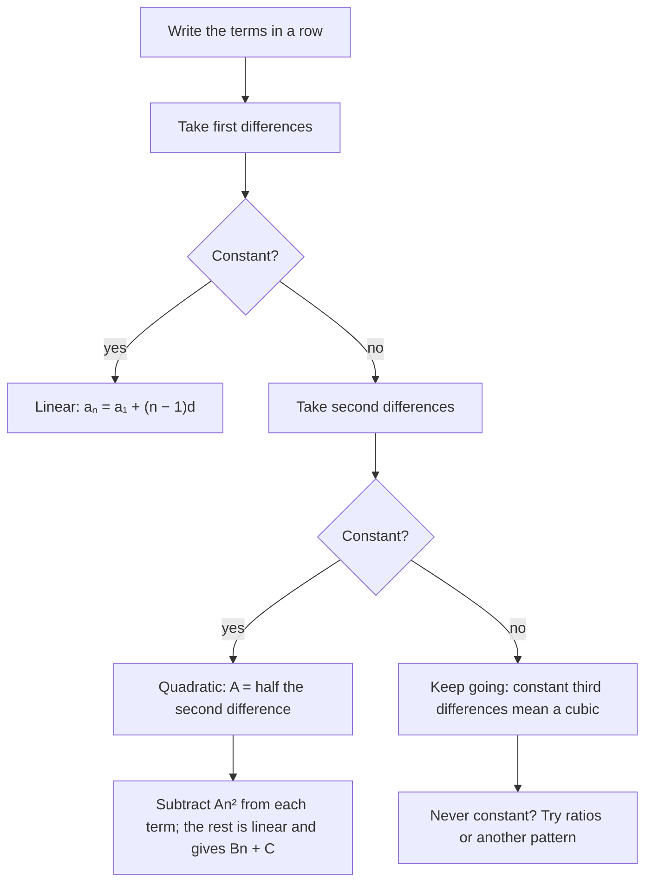

Lesson 23 tested a sequence for being arithmetic by subtracting consecutive terms: if every difference is the same, the sequence is arithmetic and its formula is linear. This honors lesson pushes that idea further. What if the differences are not constant, but the differences *of the differences* are? Then the formula is a quadratic, and the same subtraction trick finds it. The second half of the lesson uses a related trick, the telescoping sum, to find formulas for $1^2 + 2^2 + \cdots + n^2$ and other sums that the arithmetic and geometric formulas can't handle.

## Difference tables

Write a sequence in a row. Under each pair of neighbors, write the later term minus the earlier one. These are the **finite differences** of the sequence; the first row of them is the **first differences**. Repeat the process on the first differences to get the **second differences**, and so on. The whole layout is a **difference table**.

Here is the table for $a_n = n^2 + 2n$, whose terms are $3, 8, 15, 24, 35$:

| $n$ | 1 | 2 | 3 | 4 | 5 |
|---|---|---|---|---|---|
| $a_n$ | 3 | 8 | 15 | 24 | 35 |
| first differences | | 5 | 7 | 9 | 11 |
| second differences | | | 2 | 2 | 2 |

The first differences $5, 7, 9, 11$ form an arithmetic sequence, so the second differences are constant.

```plot
{"x": [0, 6], "y": [0, 40], "points": [{"at": [1, 3]}, {"at": [2, 8]}, {"at": [3, 15]}, {"at": [4, 24]}, {"at": [5, 35]}], "functions": [{"f": "x^2 + 2*x", "dashed": true, "label": "y = x² + 2x", "from": 0.5, "to": 5.6}], "xLabel": "n", "yLabel": "aₙ", "caption": "Constant second differences: the terms 3, 8, 15, 24, 35 lie on a parabola, not a line"}
```

## Why constant second differences mean a quadratic

Take any quadratic sequence $a_n = An^2 + Bn + C$. Its first difference is

$$a_{n+1} - a_n = A(n+1)^2 + B(n+1) + C - (An^2 + Bn + C) = 2An + (A + B).$$

That is linear in $n$, so the first differences form an arithmetic sequence with common difference $2A$. The second differences are therefore all equal to $2A$. The reverse is also true: if the second differences of a sequence are all equal to some number $k$, the sequence is given by a quadratic with $A = \tfrac{k}{2}$. (Add up the first differences, which are arithmetic, using the arithmetic series formula from Lesson 23, and a quadratic comes out.)

The same pattern continues. A cubic $An^3 + \cdots$ has constant third differences, equal to $6A$, and a polynomial of degree $m$ has constant $m$th differences, equal to $m! \cdot A$. A geometric sequence such as $1, 2, 4, 8, \dots$ never reaches constant differences at any level: its differences are $1, 2, 4, \dots$, the same sequence again.



### Example 1

Find a formula for $3, 7, 13, 21, 31, \dots$, assuming the pattern in the table continues.

1. First differences: $4, 6, 8, 10$. Second differences: $2, 2, 2$. Constant, so the sequence is quadratic with $A = \tfrac22 = 1$.
2. Subtract $n^2$ from each term: $3 - 1 = 2$, $7 - 4 = 3$, $13 - 9 = 4$, $21 - 16 = 5$. What is left, $2, 3, 4, 5$, is arithmetic and equals $n + 1$.
3. So $a_n = n^2 + n + 1$. Check: $a_5 = 25 + 5 + 1 = 31$. Correct.

### Example 2

At a meeting, everyone shakes hands once with everyone else. With $n = 1, 2, 3, 4, 5$ people there are $0, 1, 3, 6, 10$ handshakes. Find a formula.

1. First differences: $1, 2, 3, 4$ (the new person shakes hands with everyone already there). Second differences: $1, 1, 1$. So $A = \tfrac12$.
2. Subtract $\tfrac12 n^2$: $0 - \tfrac12 = -\tfrac12$, $1 - 2 = -1$, $3 - \tfrac92 = -\tfrac32$, $6 - 8 = -2$. This is arithmetic with difference $-\tfrac12$, equal to $-\tfrac12 n$.
3. So $h_n = \tfrac12 n^2 - \tfrac12 n = \dfrac{n(n - 1)}{2}$. Twenty people make $\tfrac{20 \cdot 19}{2} = 190$ handshakes.

### A warning: a few terms never prove a pattern

Finite differences find the *simplest polynomial* that fits the terms you have. They can't tell you the rule that actually produced them. A famous example: put $n$ points on a circle and join every pair with a chord, placing the points so that no three chords meet at one point inside. Count the regions inside the circle. For $n = 1, 2, 3, 4, 5$ points you get $1, 2, 4, 8, 16$ regions, and it looks like doubling. But six points give 31 regions, not 32. The true count is a degree-4 polynomial in $n$, and its fourth differences are constant. A formula found from a table is a conjecture until it is proved from the rule itself, as we did for $n^2 + 2n$ above. (Proof by mathematical induction, a standard tool for this, is taught in precalculus.)

## Sigma notation does arithmetic for you

Three rules let you split a complicated sum into pieces you know. For any sequences $a_k$ and $b_k$ and any constant $c$:

$$\sum_{k=1}^{n} (a_k + b_k) = \sum_{k=1}^{n} a_k + \sum_{k=1}^{n} b_k, \qquad \sum_{k=1}^{n} c\,a_k = c\sum_{k=1}^{n} a_k, \qquad \sum_{k=1}^{n} c = nc.$$

Each is just regrouping or factoring the same list of numbers. There is no such rule for products: $\sum a_k b_k$ is usually *not* $\left(\sum a_k\right)\left(\sum b_k\right)$, and $\sum k^2$ is not $\left(\sum k\right)^2$.

## Sums of powers

Lesson 23 found $1 + 2 + \cdots + n = \dfrac{n(n + 1)}{2}$. The sums of squares and cubes have formulas too:

$$\sum_{k=1}^{n} k^2 = \frac{n(n + 1)(2n + 1)}{6}, \qquad \sum_{k=1}^{n} k^3 = \left(\frac{n(n + 1)}{2}\right)^2.$$

The second says the sum of the first $n$ cubes is the *square* of the sum of the first $n$ whole numbers: $1 + 8 + 27 + 64 = 100 = 10^2$. (This identity is sometimes called Nicomachus's theorem.)

### Where the sum of squares comes from

The honors lesson on partial fractions in Module 5 introduced the **telescoping sum**: a sum in which each term cancels part of the next, so that almost everything collapses, like the sections of a folding telescope sliding together. The same trick finds the sum of squares. Start with this telescoping sum:

$$\sum_{k=1}^{n} \left[(k + 1)^3 - k^3\right] = (2^3 - 1^3) + (3^3 - 2^3) + \cdots + \left((n + 1)^3 - n^3\right) = (n + 1)^3 - 1.$$

Every cube except $(n + 1)^3$ and $1^3$ appears once with a plus sign and once with a minus sign. Now compute the same sum a second way. Expanding, $(k + 1)^3 - k^3 = 3k^2 + 3k + 1$, so by the sigma rules

$$\sum_{k=1}^{n} \left[(k + 1)^3 - k^3\right] = 3\sum_{k=1}^{n} k^2 + 3 \cdot \frac{n(n + 1)}{2} + n.$$

Set the two results equal and solve for the sum of squares, $S$:

$$3S = (n + 1)^3 - (n + 1) - \frac{3n(n + 1)}{2} = (n + 1)\left[n^2 + 2n - \frac{3n}{2}\right] = (n + 1) \cdot \frac{n(2n + 1)}{2}.$$

Dividing by 3 gives $S = \dfrac{n(n + 1)(2n + 1)}{6}$. The same idea with $(k + 1)^4 - k^4$ produces the sum of cubes.

### Example 3

A stack of oranges is a square pyramid: 1 orange on top, then a $2 \times 2$ layer, a $3 \times 3$ layer, and so on down to a $10 \times 10$ base. How many oranges are there?

$\displaystyle\sum_{k=1}^{10} k^2 = \frac{10 \cdot 11 \cdot 21}{6} = 385$ oranges.

### Example 4

Evaluate $\displaystyle\sum_{k=1}^{20} (3k^2 - 2k + 5)$.

1. Split it: $3\sum k^2 - 2\sum k + \sum 5$.
2. With $n = 20$: $\sum k^2 = \dfrac{20 \cdot 21 \cdot 41}{6} = 2870$, $\sum k = \dfrac{20 \cdot 21}{2} = 210$, and $\sum 5 = 20 \cdot 5 = 100$.
3. Total: $3(2870) - 2(210) + 100 = 8610 - 420 + 100 = 8290$.

### Example 5

Find $11^2 + 12^2 + \cdots + 20^2$.

This is the sum up to 20 minus the sum up to 10 (not 11, since $11^2$ must stay in): $2870 - 385 = 2485$.

## Telescoping a fraction sum

Telescoping also works on sums that are neither arithmetic nor geometric. (This is the sum you already collapsed in the honors lesson on partial fractions in Module 5; here it is again, with the splitting checked directly.) Because

$$\frac{1}{k} - \frac{1}{k + 1} = \frac{(k + 1) - k}{k(k + 1)} = \frac{1}{k(k + 1)},$$

the sum of the fractions $\dfrac{1}{k(k + 1)}$ collapses:

$$\sum_{k=1}^{n} \frac{1}{k(k + 1)} = \left(1 - \tfrac12\right) + \left(\tfrac12 - \tfrac13\right) + \cdots + \left(\tfrac1n - \tfrac{1}{n + 1}\right) = 1 - \frac{1}{n + 1} = \frac{n}{n + 1}.$$

### Example 6

Evaluate $\dfrac{1}{1 \cdot 2} + \dfrac{1}{2 \cdot 3} + \cdots + \dfrac{1}{99 \cdot 100}$.

Here $n = 99$, so the sum is $1 - \dfrac{1}{100} = \dfrac{99}{100}$.

As $n$ grows, $\dfrac{n}{n + 1}$ approaches 1, so the infinite series $\dfrac{1}{1 \cdot 2} + \dfrac{1}{2 \cdot 3} + \cdots$ converges to 1, even though it is not geometric (the ratio of neighboring terms, $\tfrac{k}{k + 2}$, changes from term to term). Lesson 24's formula $\tfrac{a_1}{1 - r}$ covers only geometric series; calculus courses develop tests for the rest.

## Common mistakes

- Stopping at the first differences: if they aren't constant, take the next level before deciding there is no pattern.
- Taking $A$ equal to the second difference. For a quadratic, the second difference is $2A$, so $A$ is half of it; for a cubic, the third difference is $6A$.
- Trusting a pattern from a few terms without proof (the circle regions go $1, 2, 4, 8, 16, 31$).
- Treating $\sum k^2$ as $\left(\sum k\right)^2$, or $\sum a_kb_k$ as $\left(\sum a_k\right)\left(\sum b_k\right)$.
- Forgetting that $\sum_{k=1}^{n} c$ is $nc$, not $c$.
- Subtracting the wrong partial sum: $\sum_{k=11}^{20}$ is the sum to 20 minus the sum to 10.

## Key points

- Constant first differences: linear (arithmetic). Constant second differences $k$: quadratic with $A = \tfrac{k}{2}$. Constant $m$th differences: degree $m$, with the $m$th difference equal to $m! \cdot A$.
- To find a quadratic formula, take $A$ from the second differences, subtract $An^2$, and read off the linear part.
- Sums split: $\sum(a_k + b_k) = \sum a_k + \sum b_k$, $\sum ca_k = c\sum a_k$, $\sum_{k=1}^{n} c = nc$.
- $\sum k = \dfrac{n(n + 1)}{2}$, $\sum k^2 = \dfrac{n(n + 1)(2n + 1)}{6}$, $\sum k^3 = \left(\dfrac{n(n + 1)}{2}\right)^2$.
- In a telescoping sum, neighboring terms cancel and only the ends survive: $\sum_{k=1}^{n} \dfrac{1}{k(k + 1)} = \dfrac{n}{n + 1}$.
