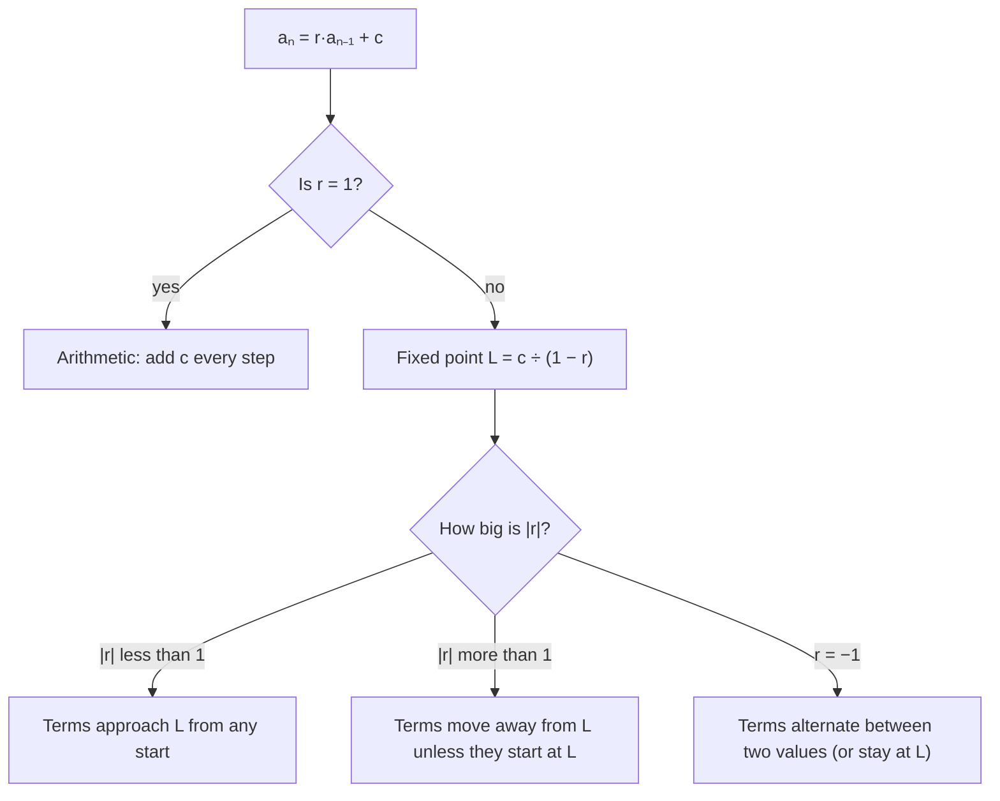

Lesson 23's arithmetic sequences add the same number each step, and Lesson 24's geometric sequences multiply by the same number. Many real processes do both at once. A savings account earns interest (multiply) and then receives a deposit (add). A loan balance grows by interest (multiply) and then shrinks by a payment (subtract). A patient's body clears part of a medicine (multiply) and then the next dose arrives (add). This honors lesson studies these "multiply, then add" rules, finds where they head in the long run, and uses the geometric series formula from Lesson 24 to derive the formulas banks use for savings plans and loan payments.

## Recurrences that multiply and add

A **recurrence relation** is a rule that gives each term of a sequence from earlier terms; it is the rule part of a recursive formula. This lesson uses the recurrence

$$a_n = r\,a_{n-1} + c,$$

where $r$ and $c$ are constants. With $c = 0$ it is geometric, and with $r = 1$ it is arithmetic. Anything else is new.

### The fixed point

Ask: is there a value that the rule leaves unchanged? Such a value $L$ is called a **fixed point** (or equilibrium) of the recurrence. It satisfies $L = rL + c$, so

$$L = \frac{c}{1 - r} \qquad (r \ne 1).$$

Now subtract $L = rL + c$ from $a_n = r a_{n-1} + c$. The $c$'s cancel:

$$a_n - L = r\,(a_{n-1} - L).$$

So the *distance from the fixed point* is a geometric sequence with ratio $r$. That gives the explicit formula

$$a_n = L + (a_1 - L)\,r^{n-1}.$$

This one equation tells the whole story:

- If $|r| < 1$, the distance shrinks toward 0, so $a_n \to L$ wherever the sequence starts. The fixed point attracts.
- If $|r| > 1$, the distance grows, so the sequence runs away from $L$ (unless it starts exactly at $L$). The fixed point repels.
- If $r$ is negative, the distance changes sign each step, so the terms land alternately above and below $L$. (When $r = -1$ exactly, the distance never changes size, and the terms bounce between the same two values forever.)



### Example 1: a daily medicine

A patient takes a 200 mg tablet every morning. By the next morning the body has removed 70% of the drug, so 30% remains. Let $a_n$ be the amount in the body just after the $n$th tablet. (This is a simplified model: real drug levels fall smoothly through the day, and the 30% figure is an assumption for the example.)

1. Each morning, 30% of yesterday's amount is left and 200 mg is added: $a_1 = 200$ and $a_n = 0.3\,a_{n-1} + 200$.
2. First few terms: $a_2 = 0.3(200) + 200 = 260$, $a_3 = 0.3(260) + 200 = 278$, $a_4 = 283.4$, $a_5 = 285.02$.
3. Fixed point: $L = \dfrac{200}{1 - 0.3} = \dfrac{200}{0.7} \approx 285.7$ mg. Since $|r| = 0.3 < 1$, the amount after each dose levels off near 285.7 mg, called the steady state.
4. Explicit formula: $a_n = 285.7 + (200 - 285.7)(0.3)^{n-1} \approx 285.7 - 85.7(0.3)^{n-1}$. After a week, $(0.3)^6 \approx 0.0007$, so $a_7$ is within 0.07 mg of the steady state.

```plot
{"x": [0, 9], "y": [0, 320], "points": [{"at": [1, 200]}, {"at": [2, 260]}, {"at": [3, 278]}, {"at": [4, 283.4]}, {"at": [5, 285.02]}, {"at": [6, 285.506]}, {"at": [7, 285.6518]}, {"at": [8, 285.69554]}], "functions": [{"f": "200/0.7", "dashed": true, "label": "L ≈ 285.7 mg"}], "xLabel": "dose number n", "yLabel": "mg just after dose", "caption": "The amount just after each dose climbs toward the fixed point L = 200/0.7 ≈ 285.7 mg"}
```

### Example 2: a fish pond with a harvest

A pond holds 2000 fish. Each year the population grows by 10%, and then 300 fish are caught. For problems that start at a time 0, it is natural to call the starting value $a_0$; then $a_n$ is the value after $n$ years and the explicit formula becomes $a_n = L + (a_0 - L)r^n$.

1. The rule is $a_n = 1.1\,a_{n-1} - 300$ with $a_0 = 2000$.
2. Fixed point: $L = \dfrac{-300}{1 - 1.1} = \dfrac{-300}{-0.1} = 3000$. At 3000 fish, growth (300) exactly matches the catch.
3. But $r = 1.1 > 1$, so the fixed point repels: $a_n = 3000 + (2000 - 3000)(1.1)^n = 3000 - 1000(1.1)^n$. The population falls faster and faster.
4. It reaches 0 when $(1.1)^n = 3$, so $n = \dfrac{\ln 3}{\ln 1.1} \approx 11.5$. After 11 years about 147 fish remain, and the pond is fished out during year 12. To sustain a catch of 300 a year, this model needs a population of at least 3000.

## Saving: the future value of an annuity

An **annuity** is a series of equal payments made at equal time intervals. Suppose you deposit $P$ dollars at the end of every period into an account that earns interest rate $i$ per period. (For a yearly rate compounded monthly, $i$ is the yearly rate divided by 12.) The balance follows $B_n = (1 + i)B_{n-1} + P$ with $B_0 = 0$.

To find a formula, follow each deposit separately. The last deposit has earned no interest yet, the one before it has grown once to $P(1 + i)$, and the first has grown $n - 1$ times. The **future value**, the total in the account right after the $n$th deposit, is

$$FV = P + P(1 + i) + P(1 + i)^2 + \cdots + P(1 + i)^{n-1}.$$

That is a geometric series with first term $P$ and ratio $1 + i$. By Lesson 24's formula,

$$FV = \frac{P\left(1 - (1 + i)^n\right)}{1 - (1 + i)} = P\cdot\frac{(1 + i)^n - 1}{i}.$$

### Example 3

You deposit 200 dollars at the end of each month into an account paying 6% a year, compounded monthly, for 30 years. How much is there at the end?

1. $i = \dfrac{0.06}{12} = 0.005$ and $n = 30 \cdot 12 = 360$ deposits.
2. $FV = 200 \cdot \dfrac{1.005^{360} - 1}{0.005} \approx 200 \cdot \dfrac{6.022575 - 1}{0.005} \approx 200{,}903$ dollars.
3. You deposited only $200 \cdot 360 = 72{,}000$ dollars. The other 128,903 dollars or so is interest, most of it earned in the last decade, when the balance is largest.

## Borrowing: the loan payment formula

An **amortized loan** is paid off by equal payments, each covering that period's interest plus part of the balance. Borrow $A_0$ dollars at rate $i$ per period and pay $M$ dollars at the end of each period. Each period the balance is multiplied by $1 + i$ and then reduced by $M$:

$$B_k = (1 + i)B_{k-1} - M, \qquad B_0 = A_0.$$

This is a multiply-then-add recurrence with $r = 1 + i$ and $c = -M$. Unrolling it as before, after $n$ payments

$$B_n = A_0(1 + i)^n - M\cdot\frac{(1 + i)^n - 1}{i}.$$

The first part is what the debt would grow to with no payments; the second is the future value of the payments. The loan is paid off when $B_n = 0$. Solving for $M$ and dividing the top and bottom by $(1 + i)^n$ gives the payment formula

$$M = \frac{A_0\, i}{1 - (1 + i)^{-n}}.$$

### Example 4

A car loan of 24,000 dollars at 6% a year (compounded monthly) is repaid over 5 years. Find the monthly payment and the total interest.

1. $i = 0.005$, $n = 60$.
2. $M = \dfrac{24000(0.005)}{1 - 1.005^{-60}} = \dfrac{120}{1 - 0.741372} \approx 463.99$ dollars a month.
3. Total paid: $60 \times 463.99 \approx 27{,}839$ dollars, so the interest is about 3,839 dollars. (Real lenders round each payment to the cent and adjust the last one, so the totals can differ by a few cents.)

The table shown by a lender, with each payment split into interest and principal, is called an **amortization schedule**. Here are its first three rows for Example 4:

| Month | Interest ($0.005 \times$ balance) | Principal (payment − interest) | New balance |
|---|---|---|---|
| 1 | 120.00 | 343.99 | 23,656.01 |
| 2 | 118.28 | 345.71 | 23,310.30 |
| 3 | 116.55 | 347.44 | 22,962.86 |

The interest shrinks every month because the balance shrinks, so more of each payment goes to principal. That is why the balance falls slowly at first and faster near the end.

```plot
{"x": [0, 60], "y": [0, 26000], "functions": [{"f": "24000*1.005^x - 463.987*(1.005^x - 1)/0.005", "from": 0, "to": 60}, {"f": "24000 - 400*x", "dashed": true, "from": 0, "to": 60}], "labels": [{"at": [44, 12500], "text": "loan balance (solid)"}, {"at": [15, 9500], "text": "straight line (dashed)"}], "xLabel": "months", "yLabel": "balance owed (dollars)", "caption": "The balance of the 24,000-dollar car loan bows above a straight line: early payments are mostly interest"}
```

### Example 5

How much is still owed on the car loan of Example 4 after 2 years?

$B_{24} = 24000(1.005)^{24} - 463.99 \cdot \dfrac{1.005^{24} - 1}{0.005} \approx 27{,}051.83 - 11{,}800.17 \approx 15{,}252$ dollars. After 40% of the payments, about 64% of the original loan is still owed.

## Common mistakes

- Using the yearly rate as $i$ or the number of years as $n$ when payments are monthly. Convert both: $i = \tfrac{\text{yearly rate}}{12}$, $n = 12 \times \text{years}$.
- Writing the fixed point as $\dfrac{c}{1 + r}$ or $\dfrac{c}{r - 1}$. Solve $L = rL + c$ again if unsure: $L = \dfrac{c}{1 - r}$.
- Expecting every recurrence to settle down. Only $|r| < 1$ guarantees that; with $r > 1$ a starting value below the fixed point runs away from it.
- Mixing up the two indexings. With a first term $a_1$, the explicit formula has $r^{n-1}$; with a starting value $a_0$, it has $r^n$.
- Assuming half the loan is repaid halfway through the term. Early payments are mostly interest, so the balance at the halfway point is more than half the loan.

## Key points

- A multiply-then-add recurrence $a_n = ra_{n-1} + c$ ($r \ne 1$) has fixed point $L = \dfrac{c}{1 - r}$, and $a_n - L$ is geometric: $a_n = L + (a_1 - L)r^{n-1}$.
- If $|r| < 1$, the terms approach $L$ from any start; if $|r| > 1$, they move away from $L$.
- Future value of $n$ end-of-period deposits of $P$ at rate $i$: $FV = P\cdot\dfrac{(1 + i)^n - 1}{i}$, a geometric series.
- Payment on an amortized loan of $A_0$: $M = \dfrac{A_0 i}{1 - (1 + i)^{-n}}$; the balance after $k$ payments is $A_0(1 + i)^k - M\cdot\dfrac{(1 + i)^k - 1}{i}$.
- Early payments go mostly to interest, so loan balances fall slowly at first.
