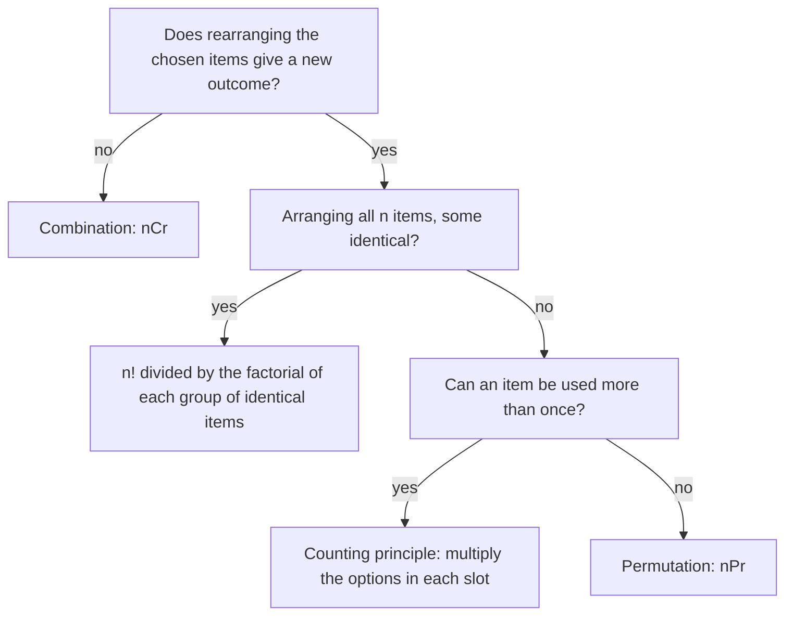

Probability questions usually come down to two counts: how many outcomes are possible, and how many of them are the ones you want. When there are only a handful of outcomes you can list them, but a lottery ticket or a 7-character password has millions. This lesson builds the counting tools that replace listing: the fundamental counting principle, factorials, permutations and combinations. The next lesson uses combinations to expand powers like $(a + b)^n$, and the lesson after that puts the counting tools to work in probability.

## The fundamental counting principle

Suppose you have 3 shirts and 2 pairs of pants. For each shirt you pick, you still have 2 choices of pants, so the number of outfits is $3 \cdot 2 = 6$. A **tree diagram** shows why: each shirt branches into 2 pants, and every path from the left end to the right end is one outfit.

```shape
{"x": [-0.5, 9.5], "y": [-1.2, 5.6], "segments": [{"from": [0, 2.2], "to": [3, 4.6]}, {"from": [0, 2.2], "to": [3, 2.2]}, {"from": [0, 2.2], "to": [3, -0.2]}, {"from": [3.9, 4.6], "to": [6.2, 5.2]}, {"from": [3.9, 4.6], "to": [6.2, 4.0]}, {"from": [3.9, 2.2], "to": [6.2, 2.8]}, {"from": [3.9, 2.2], "to": [6.2, 1.6]}, {"from": [3.9, -0.2], "to": [6.2, 0.4]}, {"from": [3.9, -0.2], "to": [6.2, -0.8]}], "labels": [{"at": [3.45, 4.6], "text": "S1"}, {"at": [3.45, 2.2], "text": "S2"}, {"at": [3.45, -0.2], "text": "S3"}, {"at": [6.7, 5.2], "text": "P1"}, {"at": [6.7, 4.0], "text": "P2"}, {"at": [6.7, 2.8], "text": "P1"}, {"at": [6.7, 1.6], "text": "P2"}, {"at": [6.7, 0.4], "text": "P1"}, {"at": [6.7, -0.8], "text": "P2"}, {"at": [8.4, 5.2], "text": "S1 P1"}, {"at": [8.4, 4.0], "text": "S1 P2"}, {"at": [8.4, 2.8], "text": "S2 P1"}, {"at": [8.4, 1.6], "text": "S2 P2"}, {"at": [8.4, 0.4], "text": "S3 P1"}, {"at": [8.4, -0.8], "text": "S3 P2"}], "caption": "3 shirts, each with 2 pants: 3 × 2 = 6 paths, so 6 outfits"}
```

The **fundamental counting principle** says this always works: if one choice can be made in $m$ ways and, after it, a second choice can be made in $n$ ways, the pair of choices can be made in $m \cdot n$ ways. It extends to any number of steps: multiply the number of options at each step.

The number of options at a later step may depend on what happened earlier (for example, a letter already used can't be used again), but the *count* of options has to be the same no matter which earlier choice was made.

### Example 1

A license plate has 3 letters followed by 4 digits. How many plates are possible? How many if no letter may repeat?

1. Seven slots. Each letter slot has 26 options and each digit slot has 10, and repeats are allowed:
$$26 \cdot 26 \cdot 26 \cdot 10 \cdot 10 \cdot 10 \cdot 10 = 26^3 \cdot 10^4 = 175{,}760{,}000.$$
2. With no repeated letters, the first letter has 26 options, the second only 25 (any letter but the first), the third 24:
$$26 \cdot 25 \cdot 24 \cdot 10^4 = 156{,}000{,}000.$$

The picture shows the seven slots for both versions. Write the number of options in each slot, then multiply across.


## Factorials

How many ways can 5 books be lined up on a shelf? The first spot has 5 choices, the next 4, then 3, 2 and 1, so there are $5 \cdot 4 \cdot 3 \cdot 2 \cdot 1 = 120$ orders. Products like this come up so often that they get a name. The **factorial** of a whole number $n$ is

$$n! = n(n - 1)(n - 2)\cdots 3 \cdot 2 \cdot 1,$$

so $n$ different objects can be arranged in a row in $n!$ ways. By definition $0! = 1$ (there is exactly one way to arrange nothing), which makes the formulas below work in every case. Factorials grow very fast: $10! = 3{,}628{,}800$.

When you divide factorials, cancel instead of multiplying everything out:

$$\frac{9!}{6!} = \frac{9 \cdot 8 \cdot 7 \cdot 6!}{6!} = 9 \cdot 8 \cdot 7 = 504.$$

## Permutations: order matters

A **permutation** is an arrangement of objects in which order matters. The number of permutations of $r$ objects chosen from $n$ different objects is written $_nP_r$ or $P(n, r)$. By the counting principle, the first position has $n$ options, the second $n - 1$, and so on for $r$ positions:

$$_nP_r = n(n - 1)\cdots(n - r + 1) = \frac{n!}{(n - r)!}.$$

The fraction form comes from writing the product as $n!$ with the unused tail $(n - r)!$ cancelled off.

### Example 2

Ten runners are in a race. In how many ways can gold, silver and bronze be awarded (no ties)?

The medals are different, so order matters: Ana-gold, Ben-silver is not the same result as Ben-gold, Ana-silver.

$$_{10}P_3 = \frac{10!}{7!} = 10 \cdot 9 \cdot 8 = 720.$$

### Arrangements with repeated objects

If some objects are identical, swapping them doesn't create a new arrangement, so divide out those swaps. The letters of BANANA (6 letters: three A's, two N's, one B) can be arranged in

$$\frac{6!}{3!\,2!} = \frac{720}{12} = 60$$

distinguishable ways. The $3!$ removes the reorderings of the A's among themselves and the $2!$ those of the N's.

## Combinations: order doesn't matter

A **combination** is a selection in which order does not matter: a committee, a hand of cards, the toppings on a pizza. The number of combinations of $r$ objects chosen from $n$ is written $_nC_r$, $C(n, r)$ or $\binom{n}{r}$ ("$n$ choose $r$").

To find it, start from the permutation count. Choosing 2 letters from A, B, C, D in order gives $_4P_2 = 12$ arrangements:

| AB | AC | AD | BC | BD | CD |
|---|---|---|---|---|---|
| BA | CA | DA | CB | DB | DC |

Each column is one group, listed in its $2! = 2$ orders. So there are $12 / 2 = 6$ groups. In general every group of $r$ objects shows up $r!$ times among the permutations, so

$$_nC_r = \frac{_nP_r}{r!} = \frac{n!}{r!\,(n - r)!}.$$

A useful symmetry: choosing the $r$ objects to take is the same as choosing the $n - r$ to leave behind, so $_nC_r = {}_nC_{n-r}$. For instance $_{20}C_{18} = {}_{20}C_2 = 190$.

### Example 3

A club has 10 members. (a) In how many ways can it choose a 3-person committee? (b) A president, vice president and treasurer?

1. (a) A committee is just a group; Ana-Ben-Cy is the same committee in any order.
$$_{10}C_3 = \frac{10!}{3!\,7!} = \frac{10 \cdot 9 \cdot 8}{3 \cdot 2 \cdot 1} = 120.$$
2. (b) The offices are different, so order matters: $_{10}P_3 = 720$.
3. Notice $720 = 120 \cdot 3!$: each committee can hand out its 3 offices in $3! = 6$ ways.

### Example 4

A committee of 2 juniors and 3 seniors is chosen from 6 juniors and 8 seniors. How many committees are possible?

1. Choose the juniors: $_6C_2 = 15$ ways.
2. Choose the seniors: $_8C_3 = \dfrac{8 \cdot 7 \cdot 6}{6} = 56$ ways.
3. Every junior pair can go with every senior trio, so by the counting principle multiply: $15 \cdot 56 = 840$ committees.

Adding the two counts (giving 71) would be wrong: you are making both choices, not one or the other. Multiply for "and then"; add only when you are counting separate cases that can't happen together.

## Does order matter?

The hardest part is usually deciding which tool to use. Ask: if I rearranged the chosen items, would I have a different outcome?

| Situation | Order matters? | Count |
|---|---|---|
| Finishing places in a race, officers with titles, a PIN or password | Yes | Counting principle or $_nP_r$ |
| A committee, a hand of cards, pizza toppings, a group of winners with equal prizes | No | $_nC_r$ |
| Several independent stages (plate letters then digits, a junior group then a senior group) | Each stage separately | Multiply the stage counts |

If repetition is allowed (a PIN can be 4-4-1-4), use the counting principle directly: $10^4$, not $_{10}P_4$.

The flowchart below puts these questions in order. For a problem with several stages, run each stage through it separately and multiply the results.



## Common mistakes

- Using permutations for a committee or a hand of cards. If the members have no roles, order doesn't matter: use $_nC_r$.
- Forgetting that $_nP_r$ and $_nC_r$ assume no repetition. A 4-digit code with repeats allowed has $10^4$ possibilities.
- Adding stage counts that should be multiplied ("2 juniors *and* 3 seniors" is $15 \cdot 56$, not $15 + 56$).
- Computing $_nC_r$ as $\dfrac{n!}{r!}$, forgetting the $(n - r)!$ in the denominator.
- Thinking $0! = 0$. It equals 1.

## Key points

- Fundamental counting principle: multiply the number of options at each step.
- $n! = n(n - 1)\cdots 1$, with $0! = 1$; $n$ different objects can be ordered in $n!$ ways.
- Order matters (permutations): $_nP_r = \dfrac{n!}{(n - r)!}$.
- Order doesn't matter (combinations): $_nC_r = \dfrac{n!}{r!\,(n - r)!} = \dfrac{_nP_r}{r!}$.
- Arrangements of $n$ objects with groups of identical ones: divide $n!$ by the factorial of each group's size.
