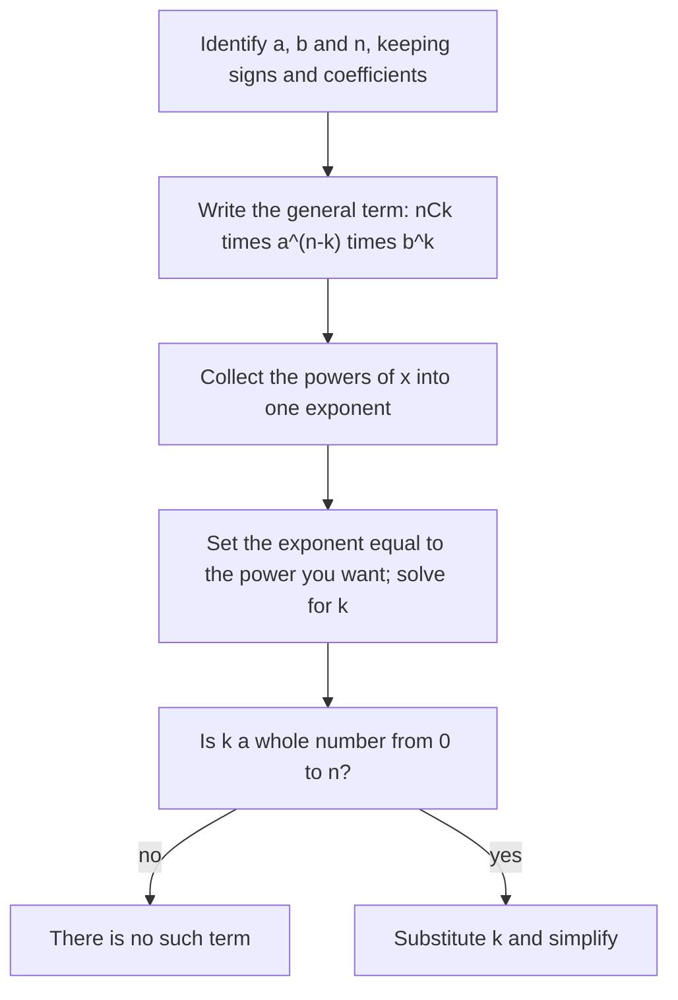

Multiplying out $(x + 2)^2$ is quick, but $(x + 2)^8$ by repeated multiplication is a page of algebra. This lesson shows a shortcut: the coefficients of $(a + b)^n$ follow a simple pattern, Pascal's triangle, and they turn out to be the combinations $_nC_k$ from the last lesson. The result, the binomial theorem, lets you write any power of a **binomial** (a sum of two terms) directly, or pick out a single term without expanding the rest. The same numbers come back in the next lesson when you count outcomes in probability.

## Looking for the pattern

Here are the first few powers, each found by multiplying the previous one by $(a + b)$:

$$\begin{aligned} (a + b)^0 &= 1 \\ (a + b)^1 &= a + b \\ (a + b)^2 &= a^2 + 2ab + b^2 \\ (a + b)^3 &= a^3 + 3a^2b + 3ab^2 + b^3 \\ (a + b)^4 &= a^4 + 4a^3b + 6a^2b^2 + 4ab^3 + b^4 \end{aligned}$$

Four things hold in every row:

- $(a + b)^n$ has $n + 1$ terms.
- The powers of $a$ count down from $n$ to 0 while the powers of $b$ count up from 0 to $n$.
- In each term the two exponents add to $n$.
- The coefficients read the same forward and backward: 1, 4, 6, 4, 1.

The writing out of a power as a sum like this is called a **binomial expansion**.

## Pascal's triangle

Stack the coefficients and you get **Pascal's triangle**. Each row starts and ends with 1, and every other entry is the sum of the two entries just above it. The top row, a single 1, is row 0, so row $n$ holds the coefficients of $(a + b)^n$.

```shape
{"x": [-5.4, 3.8], "y": [-5.8, 0.5], "labels": [{"at": [-4.6, 0.0], "text": "Row 0"}, {"at": [0.0, 0.0], "text": "1"}, {"at": [-4.6, -0.9], "text": "Row 1"}, {"at": [-0.5, -0.9], "text": "1"}, {"at": [0.5, -0.9], "text": "1"}, {"at": [-4.6, -1.8], "text": "Row 2"}, {"at": [-1.0, -1.8], "text": "1"}, {"at": [0.0, -1.8], "text": "2"}, {"at": [1.0, -1.8], "text": "1"}, {"at": [-4.6, -2.7], "text": "Row 3"}, {"at": [-1.5, -2.7], "text": "1"}, {"at": [-0.5, -2.7], "text": "3"}, {"at": [0.5, -2.7], "text": "3"}, {"at": [1.5, -2.7], "text": "1"}, {"at": [-4.6, -3.6], "text": "Row 4"}, {"at": [-2.0, -3.6], "text": "1"}, {"at": [-1.0, -3.6], "text": "4"}, {"at": [0.0, -3.6], "text": "6"}, {"at": [1.0, -3.6], "text": "4"}, {"at": [2.0, -3.6], "text": "1"}, {"at": [-4.6, -4.5], "text": "Row 5"}, {"at": [-2.5, -4.5], "text": "1"}, {"at": [-1.5, -4.5], "text": "5"}, {"at": [-0.5, -4.5], "text": "10"}, {"at": [0.5, -4.5], "text": "10"}, {"at": [1.5, -4.5], "text": "5"}, {"at": [2.5, -4.5], "text": "1"}, {"at": [-4.6, -5.4], "text": "Row 6"}, {"at": [-3.0, -5.4], "text": "1"}, {"at": [-2.0, -5.4], "text": "6"}, {"at": [-1.0, -5.4], "text": "15"}, {"at": [0.0, -5.4], "text": "20"}, {"at": [1.0, -5.4], "text": "15"}, {"at": [2.0, -5.4], "text": "6"}, {"at": [3.0, -5.4], "text": "1"}], "segments": [{"from": [-0.85, -3.75], "to": [-0.6, -4.15], "arrow": true}, {"from": [-0.15, -3.75], "to": [-0.4, -4.15], "arrow": true}], "caption": "Pascal’s triangle, rows 0 to 6. Each entry is the sum of the two above it, as in 4 + 6 = 10."}
```

Why does adding work? To get $(a + b)^5$, multiply $(a + b)^4$ by $(a + b)$. The $a^3b^2$ term of the result comes from two places: $a$ times the $6a^2b^2$ term, and $b$ times the $4a^3b$ term. So its coefficient is $6 + 4 = 10$. Every entry is built the same way from the two entries above it.

## Why the coefficients are combinations

Write $(a + b)^4 = (a + b)(a + b)(a + b)(a + b)$. Multiplying out means choosing either $a$ or $b$ from each of the four factors and multiplying the choices. A term $a^2b^2$ appears once for every way of choosing which 2 of the 4 factors supply a $b$. That's $_4C_2 = 6$ ways, which is exactly the coefficient of $a^2b^2$.

The picture shows the same idea for the smaller power $(a + b)^3$: list every way to pick $a$ or $b$ from the three factors, then group the picks by how many $b$'s they use.


In general, the coefficient of $a^{n-k}b^k$ in $(a + b)^n$ is the number of ways to choose the $k$ factors that supply $b$, which is $_nC_k$. Because of this, the numbers $_nC_k$, also written $\binom{n}{k}$, are called **binomial coefficients**, and entry $k$ of row $n$ of Pascal's triangle (counting from $k = 0$) is $_nC_k$. Row 6 is $_6C_0, {}_6C_1, \ldots, {}_6C_6 = 1, 6, 15, 20, 15, 6, 1$.

## The binomial theorem

Putting this together gives the **binomial theorem**: for any whole number $n$,

$$(a + b)^n = \sum_{k=0}^{n} {}_nC_k\, a^{n-k}b^k = {}_nC_0\,a^n + {}_nC_1\,a^{n-1}b + {}_nC_2\,a^{n-2}b^2 + \cdots + {}_nC_n\,b^n.$$

Use Pascal's triangle for small $n$ and the formula $_nC_k = \dfrac{n!}{k!\,(n - k)!}$ when $n$ is large or you need just one coefficient.

### Example 1

Expand $(x + 2)^4$.

1. Here $a = x$, $b = 2$, $n = 4$. Row 4 of the triangle: 1, 4, 6, 4, 1.
2. Write each term as coefficient $\times$ power of $x$ $\times$ power of 2:
$$1 \cdot x^4 + 4 \cdot x^3 \cdot 2 + 6 \cdot x^2 \cdot 2^2 + 4 \cdot x \cdot 2^3 + 1 \cdot 2^4.$$
3. Simplify: $x^4 + 8x^3 + 24x^2 + 32x + 16$.

Check with $x = 1$: $(1 + 2)^4 = 81$ and $1 + 8 + 24 + 32 + 16 = 81$.

### Example 2

Expand $(2x - 3)^3$.

1. Treat the subtraction as adding a negative: $a = 2x$ and $b = -3$. Row 3: 1, 3, 3, 1.
2. Keep each piece in parentheses, so the 2 and the minus sign are raised to the power too:
$$(2x)^3 + 3(2x)^2(-3) + 3(2x)(-3)^2 + (-3)^3.$$
3. Simplify each term: $8x^3 + 3(4x^2)(-3) + 3(2x)(9) - 27 = 8x^3 - 36x^2 + 54x - 27$.

The signs alternate because odd powers of $-3$ are negative and even powers are positive.

## Finding one term

You often need only one term. The term containing $b^k$ is

$$_nC_k\, a^{n-k}b^k,$$

and since $k$ starts at 0, it is the $(k + 1)$st term. The 1st term has $k = 0$, the 4th has $k = 3$.

### Example 3

Find the coefficient of $x^5$ in $(x - 2)^8$.

1. Here $a = x$, $b = -2$, $n = 8$. The power of $x$ is $8 - k$, so $x^5$ needs $k = 3$.
2. The term is $_8C_3\, x^5 (-2)^3$. Compute: $_8C_3 = \dfrac{8 \cdot 7 \cdot 6}{3 \cdot 2 \cdot 1} = 56$ and $(-2)^3 = -8$.
3. The term is $-448x^5$, so the coefficient is $-448$.

### Example 4

Find the 4th term of $(a + 3b)^6$.

1. The 4th term has $k = 3$.
2. It is $_6C_3\, a^3 (3b)^3 = 20 \cdot a^3 \cdot 27b^3 = 540a^3b^3$.

### Example 5

Find the constant term (the term with no $x$) in the expansion of $\left(x + \dfrac{2}{x}\right)^6$.

1. Here $a = x$ and $b = \dfrac2x = 2x^{-1}$, so the general term is
$$_6C_k\, x^{6-k}\left(2x^{-1}\right)^k = {}_6C_k\, 2^k\, x^{6-k}x^{-k} = {}_6C_k\, 2^k\, x^{6-2k}.$$
2. The term is constant when the power of $x$ is 0: $6 - 2k = 0$, so $k = 3$.
3. The constant term is $_6C_3 \cdot 2^3 = 20 \cdot 8 = 160$.

The method is always the same: write the general term, collect the powers of $x$ into one exponent, and choose $k$ to make that exponent what you want. If no whole number $k$ from 0 to $n$ works, there is no such term. For instance, $\left(x + \tfrac2x\right)^6$ has no $x^3$ term, because $6 - 2k = 3$ has no whole-number solution.

Here is the whole procedure as a flowchart. To find "the $r$th term" instead of a given power, skip to $k = r - 1$.



## A connection to counting and probability

Set $a = b = 1$ in the binomial theorem: $2^n = {}_nC_0 + {}_nC_1 + \cdots + {}_nC_n$. Each row of Pascal's triangle adds up to a power of 2 (row 4: $1 + 4 + 6 + 4 + 1 = 16$). Here's a counting reason. If you flip a coin 4 times there are $2^4 = 16$ equally likely sequences, and the number with exactly $k$ heads is $_4C_k$, the number of ways to choose which flips are heads. So the probability of exactly 2 heads is $\tfrac{6}{16} = \tfrac38$. The next lesson builds on ideas like this.

## Common mistakes

- Writing $(a + b)^n = a^n + b^n$. Already $(a + b)^2$ has the middle term $2ab$.
- Forgetting to raise a coefficient: $(2x)^3 = 8x^3$, not $2x^3$.
- Dropping the sign of a negative term. In $(x - 2)^8$, use $b = -2$, so odd powers of $b$ are negative.
- An off-by-one error: the $r$th term uses $k = r - 1$, because $k$ starts at 0.
- Starting Pascal's triangle at row 1. The single 1 at the top is row 0, so $(a + b)^4$ uses the row 1, 4, 6, 4, 1.

## Key points

- $(a + b)^n$ has $n + 1$ terms; the exponents of $a$ count down from $n$, those of $b$ count up from 0, and they always add to $n$.
- Pascal's triangle: each entry is the sum of the two above it; row $n$ gives the coefficients of $(a + b)^n$.
- Binomial theorem: $(a + b)^n = \sum_{k=0}^{n} {}_nC_k\, a^{n-k}b^k$.
- The term containing $b^k$ is $_nC_k\, a^{n-k}b^k$, the $(k + 1)$st term.
- Put negative and coefficient parts in parentheses before raising them to a power.
