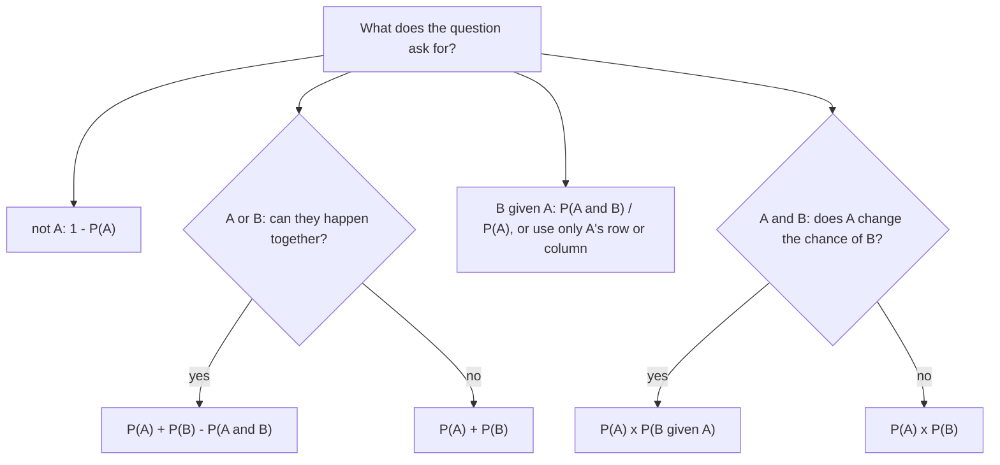

Probability measures how likely something is, on a scale from 0 (impossible) to 1 (certain). This lesson sets up the language of probability, then builds the rules for "not", "or" and "and", including what changes when one event affects another. The counting tools from the counting lesson come back at the end, when the outcomes are too many to list.

## Sample spaces and events

An experiment with uncertain results (rolling a die, drawing a card, surveying a person) has a **sample space**: the set of all possible **outcomes**. An **event** is any set of outcomes, such as "roll an even number" $= \{2, 4, 6\}$.

When every outcome is equally likely, the **theoretical probability** of an event $A$ is

$$P(A) = \frac{\text{number of outcomes in } A}{\text{number of outcomes in the sample space}}.$$

So $P(\text{even}) = \tfrac36 = \tfrac12$. An **experimental probability** instead comes from trials: if a thumbtack lands point-up 62 times in 100 tosses, the experimental probability is $0.62$. With more trials, experimental probabilities tend to settle near the true probability.

Every probability is between 0 and 1, and the probabilities of all the outcomes add to 1.

## Complements

The **complement** of $A$, written $A^c$ (or $A'$ or "not $A$"), is every outcome that is *not* in $A$. Since $A$ and $A^c$ together make up the whole sample space,

$$P(A^c) = 1 - P(A).$$

The complement is often the easy way in. Rolling two dice gives $6 \cdot 6 = 36$ equally likely outcomes, and 6 of them have a sum of 7: $(1,6), (2,5), \dots, (6,1)$. So $P(\text{sum is not } 7) = 1 - \tfrac{6}{36} = \tfrac56$.

## The addition rule ("or")

Draw one card from a standard 52-card deck. What is the probability it is a heart or a face card (jack, queen, king)? There are 13 hearts and 12 face cards, but $13 + 12$ counts the 3 heart face cards twice. Subtract the overlap once:

$$P(A \text{ or } B) = P(A) + P(B) - P(A \text{ and } B).$$

$$P(\text{heart or face}) = \frac{13}{52} + \frac{12}{52} - \frac{3}{52} = \frac{22}{52} = \frac{11}{26}.$$

A **Venn diagram** shows why. Each event is a circle inside a rectangle that stands for the whole sample space, and the overlap holds the outcomes in both events. Adding the two circles counts the overlap twice.


Reading the regions: heart or face is $10 + 3 + 9 = 22$ cards, and neither is the 30 cards outside both circles, so $P(\text{neither}) = \tfrac{30}{52}$, the complement of $\tfrac{22}{52}$.

Events that can't happen together are **mutually exclusive** (or disjoint), such as "roll a 2" and "roll a 5". Then $P(A \text{ and } B) = 0$ and the rule shrinks to $P(A \text{ or } B) = P(A) + P(B)$.

## Two-way tables and conditional probability

A **two-way table** counts data that is classified two ways. Here 200 students were asked whether they play a sport:

| | Plays a sport | No sport | Total |
|---|---|---|---|
| 10th grade | 54 | 46 | 100 |
| 11th grade | 36 | 64 | 100 |
| Total | 90 | 110 | 200 |

Picking one of these students at random, $P(\text{sport}) = \tfrac{90}{200} = 0.45$. But if you already know the student is in 11th grade, only the 11th-grade row matters. This is a **conditional probability**, written $P(B \mid A)$ and read "the probability of $B$ given $A$":

$$P(\text{sport} \mid \text{11th}) = \frac{36}{100} = 0.36.$$

Knowing the condition shrinks the sample space to the outcomes in $A$. In general,

$$P(B \mid A) = \frac{P(A \text{ and } B)}{P(A)}.$$

### Example 1

Using the table, find $P(\text{11th} \mid \text{sport})$ and compare it with $P(\text{sport} \mid \text{11th})$.

1. The condition is "plays a sport", so use only that column: 90 students.
2. Of those, 36 are in 11th grade: $P(\text{11th} \mid \text{sport}) = \tfrac{36}{90} = 0.40$.
3. That is not $0.36$. The order of the condition matters: $P(A \mid B)$ and $P(B \mid A)$ have different denominators.

## Independent events ("and")

Rearranging the conditional probability formula gives the **multiplication rule**:

$$P(A \text{ and } B) = P(A) \cdot P(B \mid A).$$

Two events are **independent** if knowing that one happened doesn't change the probability of the other: $P(B \mid A) = P(B)$. Then the rule becomes

$$P(A \text{ and } B) = P(A) \cdot P(B) \quad \text{(independent events only)}.$$

Coin flips, separate dice, and draws *with* replacement are independent. Draws *without* replacement are **dependent**: the first draw changes what is left.

In the student table, $P(\text{sport}) = 0.45$ but $P(\text{sport} \mid \text{11th}) = 0.36$, so grade and playing a sport are not independent for these students.

### Example 2

A bag has 3 red and 2 blue marbles. Two are drawn without replacement. Find the probability both are red, then the probability of exactly one red.

```shape
{"x": [-0.3, 10.8], "y": [-0.6, 8.6], "segments": [{"from": [0, 4], "to": [3, 6.5], "label": "3/5"}, {"from": [0, 4], "to": [3, 1.5], "label": "2/5"}, {"from": [3.8, 6.5], "to": [6.6, 7.8], "label": "2/4"}, {"from": [3.8, 6.5], "to": [6.6, 5.2], "label": "2/4"}, {"from": [3.8, 1.5], "to": [6.6, 2.8], "label": "3/4"}, {"from": [3.8, 1.5], "to": [6.6, 0.2], "label": "1/4"}], "labels": [{"at": [3.4, 6.5], "text": "R"}, {"at": [3.4, 1.5], "text": "B"}, {"at": [7, 7.8], "text": "R"}, {"at": [7, 5.2], "text": "B"}, {"at": [7, 2.8], "text": "R"}, {"at": [7, 0.2], "text": "B"}, {"at": [9.3, 7.8], "text": "RR: 6/20"}, {"at": [9.3, 5.2], "text": "RB: 6/20"}, {"at": [9.3, 2.8], "text": "BR: 6/20"}, {"at": [9.3, 0.2], "text": "BB: 2/20"}], "caption": "Tree for two draws without replacement; multiply along each path"}
```

1. First draw red: $\tfrac35$. With one red gone, 2 red and 2 blue remain, so second red given first red: $\tfrac24$.
2. $P(\text{RR}) = \tfrac35 \cdot \tfrac24 = \tfrac{6}{20} = \tfrac{3}{10}$.
3. Exactly one red happens two ways, RB or BR. These paths are mutually exclusive, so add them: $\tfrac{6}{20} + \tfrac{6}{20} = \tfrac{12}{20} = \tfrac35$.
4. Check: the four paths total $\tfrac{6 + 6 + 6 + 2}{20} = 1$.

### Example 3

A free-throw shooter makes 80% of her shots, and shots are independent. What is the probability she makes at least one of her next 3 shots?

1. "At least one" includes many cases (1, 2 or 3 makes). Its complement is a single case: she misses all three.
2. $P(\text{miss all 3}) = 0.2 \cdot 0.2 \cdot 0.2 = 0.008$, multiplying because the shots are independent.
3. $P(\text{at least one}) = 1 - 0.008 = 0.992$.

## Probability with counting

When outcomes are equally likely but too many to list, count them with permutations or combinations, and use the *same* kind of count on the top and bottom.

### Example 4

A 3-person committee is picked at random from 5 girls and 4 boys. What is the probability it is all girls? Exactly 2 girls?

1. Total committees: $_9C_3 = 84$.
2. All-girl committees: $_5C_3 = 10$. So $P(\text{all girls}) = \tfrac{10}{84} = \tfrac{5}{42} \approx 0.119$.
3. Exactly 2 girls means 2 girls *and* 1 boy: $_5C_2 \cdot {}_4C_1 = 10 \cdot 4 = 40$ committees.
4. $P(\text{exactly 2 girls}) = \tfrac{40}{84} = \tfrac{10}{21} \approx 0.476$.

As a check, the tree method gives the same all-girls answer: $\tfrac59 \cdot \tfrac48 \cdot \tfrac37 = \tfrac{60}{504} = \tfrac{5}{42}$.

## Which rule?

Most probability questions come down to one of four words. The chart sends each one to its rule.



## Common mistakes

- Adding $P(A) + P(B)$ for overlapping events without subtracting $P(A \text{ and } B)$.
- Multiplying $P(A) \cdot P(B)$ for dependent events, such as draws without replacement. Use $P(B \mid A)$ for the second factor.
- Mixing up $P(A \mid B)$ and $P(B \mid A)$. The event after the bar is the one you know happened; its total is the denominator.
- Confusing mutually exclusive with independent. Mutually exclusive events with nonzero probability are never independent: if one happens, the other can't.
- Working out "at least one" case by case instead of using $1 - P(\text{none})$.

## Key points

- Equally likely outcomes: $P(A) = \dfrac{\text{favorable}}{\text{total}}$; $P(A^c) = 1 - P(A)$.
- Or: $P(A \text{ or } B) = P(A) + P(B) - P(A \text{ and } B)$; drop the last term for mutually exclusive events.
- Given: $P(B \mid A) = \dfrac{P(A \text{ and } B)}{P(A)}$; in a two-way table, use only the row or column of the condition.
- And: $P(A \text{ and } B) = P(A)\,P(B \mid A)$, which is $P(A)\,P(B)$ when $A$ and $B$ are independent.
- With many equally likely outcomes, count favorable and total outcomes with $_nC_r$ or $_nP_r$.
