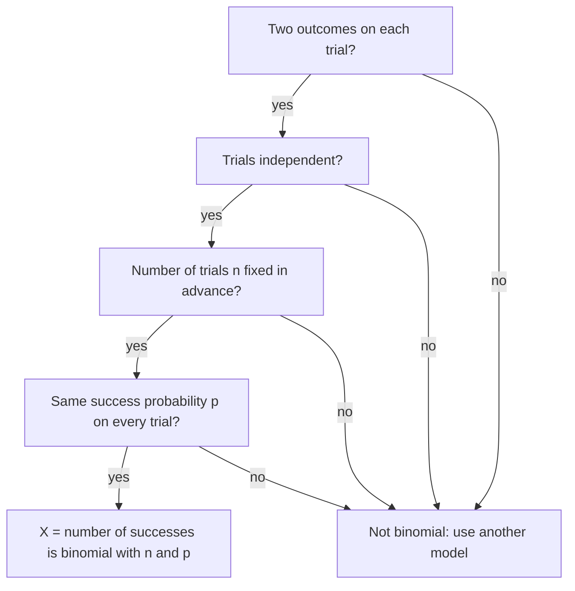

The binomial theorem lesson ended with a coin flipped 4 times: the number of ways to get exactly 2 heads is $_4C_2 = 6$, so the probability is $\tfrac{6}{16}$. That idea works far beyond coins. Whenever you repeat the same yes-or-no trial a fixed number of times, the number of "yes" results follows one pattern, the binomial distribution, and its formula is built from the counting, binomial theorem and probability lessons together. This lesson derives the formula, uses it for "exactly" and "at least" questions, finds its mean and standard deviation, and shows why its histogram starts to look like the normal curve.

## The binomial setting

A trial with exactly two outcomes, called success and failure, is a *Bernoulli trial* (after Jacob Bernoulli, whose book on probability appeared in 1713). "Success" just means the outcome you are counting; it can be a defective part or a missed shot. A situation is a **binomial setting** when all four of these hold:

- **Two outcomes:** each trial is a success or a failure.
- **Independent:** the result of one trial doesn't change the probabilities for another.
- **Fixed number:** the number of trials $n$ is decided in advance.
- **Same probability:** each trial has the same probability of success $p$.

The first letters spell BINS, a common memory aid. The random variable $X$ = the number of successes in the $n$ trials then has a **binomial distribution** with parameters $n$ and $p$.



Two common ways to break the setting: drawing *without replacement* from a small group (the trials are dependent), and counting how many trials it takes to get the first success (the number of trials isn't fixed).

## The binomial probability formula

Take a basketball player who makes 70% of her free throws, and assume her shots are independent. What is the probability she makes exactly 3 of 5?

One way to do it is make, make, make, miss, miss. Because the shots are independent, multiply: $(0.7)(0.7)(0.7)(0.3)(0.3) = 0.7^3(0.3)^2$. Any other order with 3 makes and 2 misses, such as miss, make, make, miss, make, has the same five factors in a different order, so the same probability. How many such orders are there? Choosing which 3 of the 5 shots are makes: $_5C_3 = 10$. These orders can't happen together, so add their probabilities:

$$P(X = 3) = {}_5C_3\,(0.7)^3(0.3)^2 = 10(0.343)(0.09) = 0.3087.$$

The same reasoning gives the general **binomial probability formula**: if $X$ is binomial with $n$ trials and success probability $p$, then for $k = 0, 1, \ldots, n$,

$$P(X = k) = {}_nC_k\,p^k(1 - p)^{n - k}.$$

The three pieces each have a job: $_nC_k$ counts the orders, $p^k$ is the chance of the $k$ successes, and $(1 - p)^{n - k}$ is the chance of the $n - k$ failures.

Notice that these are exactly the terms of the binomial theorem with $a = 1 - p$ and $b = p$:

$$\big((1 - p) + p\big)^n = \sum_{k=0}^{n} {}_nC_k\,p^k(1 - p)^{n - k}.$$

The left side is $1^n = 1$, so the probabilities add to 1, as every distribution's must. That is where the distribution gets its name.

### Example 1: The whole distribution

Find the distribution of the number of free throws made out of 5 (with $p = 0.7$).

| $k$ | 0 | 1 | 2 | 3 | 4 | 5 |
|---|---|---|---|---|---|---|
| $_5C_k$ | 1 | 5 | 10 | 10 | 5 | 1 |
| $P(X = k)$ | 0.00243 | 0.02835 | 0.13230 | 0.30870 | 0.36015 | 0.16807 |

For example, $P(X = 4) = 5(0.7)^4(0.3) = 5(0.2401)(0.3) = 0.36015$. (These values are exact; they add to 1.) The most likely number of makes is 4, and the histogram leans left (a long tail toward 0) because $p$ is above $\tfrac12$.

```plot
{"x": [-0.8, 5.8], "y": [0, 0.42], "xLabel": "free throws made (out of 5)", "yLabel": "probability", "bars": [{"x": 0, "height": 0.00243, "width": 0.7}, {"x": 1, "height": 0.02835, "width": 0.7}, {"x": 2, "height": 0.1323, "width": 0.7}, {"x": 3, "height": 0.3087, "width": 0.7}, {"x": 4, "height": 0.36015, "width": 0.7}, {"x": 5, "height": 0.16807, "width": 0.7}], "caption": "Binomial distribution with n = 5 and p = 0.7"}
```

## "At least" and "at most"

Questions with "at least" or "at most" add several values of the formula. The complement often saves work, just as it did in the probability lesson. Graphing calculators do these sums directly: `binompdf(n, p, k)` gives $P(X = k)$ and `binomcdf(n, p, k)` gives $P(X \le k)$.

### Example 2: Guessing on a quiz

A quiz has 10 multiple-choice questions with 4 choices each. A student guesses on every one. Find the probability of (a) exactly 2 right and (b) at least 6 right.

1. Each guess is a success with $p = \tfrac14 = 0.25$, the guesses are independent and $n = 10$: binomial.
2. (a) $P(X = 2) = {}_{10}C_2\,(0.25)^2(0.75)^8 = 45(0.0625)(0.10011) \approx 0.2816$.
3. (b) "At least 6" means $6, 7, 8, 9$ or $10$. Compute each and add:
$$P(X \ge 6) = \sum_{k=6}^{10} {}_{10}C_k\,(0.25)^k(0.75)^{10 - k} \approx 0.0162 + 0.0031 + 0.0004 + 0.0000 + 0.0000 \approx 0.0197.$$
On a calculator, $1 - $ `binomcdf(10, 0.25, 5)` $\approx 0.0197$. Passing a quiz by pure guessing happens only about 2% of the time.

Be careful with the words: "at least 6" includes 6, so its complement is "at most 5", not "at most 6".

## Mean and standard deviation

For a binomial random variable with $n$ trials and success probability $p$,

$$\mu = np, \qquad \sigma = \sqrt{np(1 - p)}.$$

The mean makes sense: if 70% of shots go in, then out of 5 shots you expect $5(0.7) = 3.5$ makes. Here is the reasoning behind it, using the expected-value lesson: $X$ is the sum of $n$ trial variables that are 1 for a success and 0 for a failure. Each has expected value $1 \cdot p + 0 \cdot (1 - p) = p$, and expected values add, so $E(X) = np$. The standard deviation formula comes from a related fact taught in statistics courses, that the *variances* (squared standard deviations) of independent random variables add; each trial has variance $p(1 - p)$. We state it here without the full proof.

### Example 3: Is the coin fair?

A coin is flipped 100 times and lands heads 62 times. Is that surprising for a fair coin?

1. For a fair coin, $X$ is binomial with $n = 100$, $p = 0.5$.
2. $\mu = 100(0.5) = 50$ and $\sigma = \sqrt{100(0.5)(0.5)} = \sqrt{25} = 5$.
3. 62 heads is $z = \tfrac{62 - 50}{5} = 2.4$ standard deviations above the mean. The exact binomial probability of 62 or more heads is about $0.0105$, roughly 1 in 95.
4. That's unusual. It doesn't prove the coin is unfair, but it is reasonable evidence worth a closer look (more flips, say). Statistics courses turn this kind of reasoning into formal significance tests.

## The shape of the distribution and the normal curve

When $p = 0.5$ the binomial histogram is symmetric. When $p$ is near 0 or 1 it is skewed, piled up near one end. As $n$ grows, the histogram becomes more and more bell shaped, centered at $np$ with spread $\sqrt{np(1 - p)}$:

```plot
{"x": [4, 26], "y": [0, 0.16], "xLabel": "number of heads in 30 flips", "yLabel": "probability", "functions": [{"f": "normpdf(x, 15, 2.7386)"}], "labels": [{"at": [22.5, 0.1], "text": "normal curve"}], "bars": [{"x": 6, "height": 0.0006, "width": 0.8}, {"x": 7, "height": 0.0019, "width": 0.8}, {"x": 8, "height": 0.0055, "width": 0.8}, {"x": 9, "height": 0.0133, "width": 0.8}, {"x": 10, "height": 0.028, "width": 0.8}, {"x": 11, "height": 0.0509, "width": 0.8}, {"x": 12, "height": 0.0806, "width": 0.8}, {"x": 13, "height": 0.1115, "width": 0.8}, {"x": 14, "height": 0.1354, "width": 0.8}, {"x": 15, "height": 0.1445, "width": 0.8}, {"x": 16, "height": 0.1354, "width": 0.8}, {"x": 17, "height": 0.1115, "width": 0.8}, {"x": 18, "height": 0.0806, "width": 0.8}, {"x": 19, "height": 0.0509, "width": 0.8}, {"x": 20, "height": 0.028, "width": 0.8}, {"x": 21, "height": 0.0133, "width": 0.8}, {"x": 22, "height": 0.0055, "width": 0.8}, {"x": 23, "height": 0.0019, "width": 0.8}, {"x": 24, "height": 0.0006, "width": 0.8}], "caption": "Binomial with n = 30, p = 0.5, with the normal curve of the same mean and SD drawn over it"}
```

This is the **normal approximation to the binomial**. A common rule of thumb says it works well when both $np \ge 10$ and $n(1 - p) \ge 10$, that is, when you expect at least 10 successes and 10 failures. (Some books use 5 instead of 10; it is a guideline, not a theorem.) It explains why the normal curve from the last core lesson fits so many counts, and it is the reason poll percentages vary in a bell shape, which is where the margin-of-error formula comes from.

One more practical point. Polls and inspections usually sample *without* replacement, which strictly speaking breaks independence. If the sample is a small part of the population (a common guideline is less than 10%), removing a few individuals barely changes $p$, so the binomial model is still a very good approximation.

## Common mistakes

- Leaving out $_nC_k$ and computing only $p^k(1 - p)^{n - k}$, the probability of one particular order.
- Swapping the exponents: $p$ goes with the number of successes $k$, and $1 - p$ with the number of failures $n - k$.
- Using the binomial formula when the number of trials isn't fixed or the trials aren't independent (such as drawing several cards from one small deck).
- Getting "at least" and "at most" boundaries wrong: $P(X \ge 6) = 1 - P(X \le 5)$.
- Forgetting the square root: $\sigma = \sqrt{np(1 - p)}$, not $np(1 - p)$.

## Key points

- Binomial setting (BINS): two outcomes, independent trials, fixed number $n$, same $p$.
- $P(X = k) = {}_nC_k\,p^k(1 - p)^{n - k}$; the probabilities are the terms of $\big((1 - p) + p\big)^n = 1$.
- For "at least" or "at most", add the needed terms or use the complement; `binomcdf` gives $P(X \le k)$.
- $\mu = np$ and $\sigma = \sqrt{np(1 - p)}$.
- When $np$ and $n(1 - p)$ are both at least about 10, the binomial distribution is close to normal.
