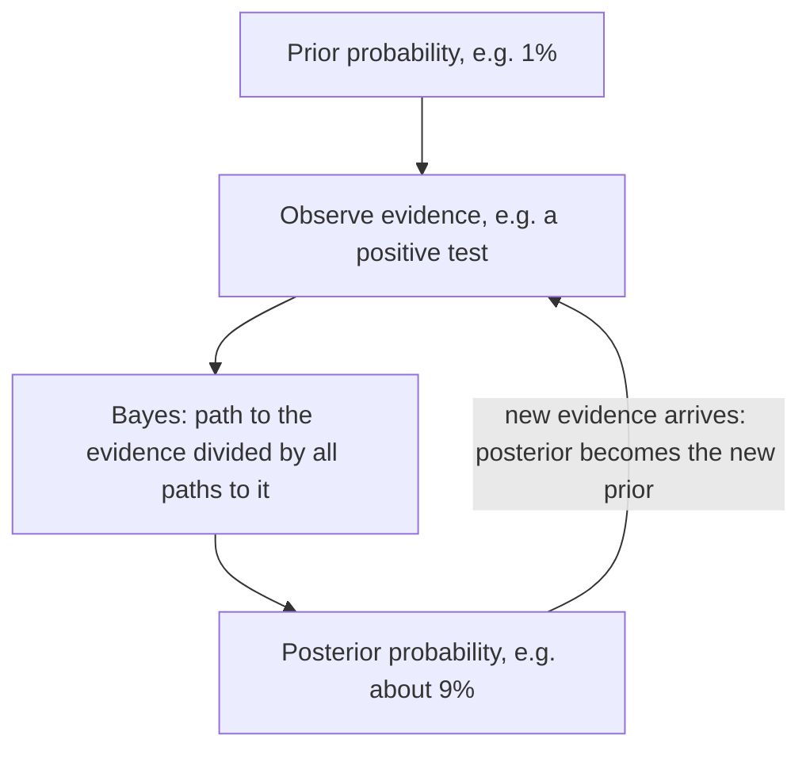

The probability lesson warned that $P(A \mid B)$ and $P(B \mid A)$ are different numbers: in its two-way table, $P(\text{sport} \mid \text{11th}) = 0.36$ but $P(\text{11th} \mid \text{sport}) = 0.40$. Often you know one direction and need the other. A medical test is described by how often it is positive *for people who have the disease*, but a patient with a positive result wants to know how likely it is that *they have the disease*. This lesson shows how to turn one conditional probability around, with a tree diagram, a table of counts, and a formula called Bayes' theorem, and why the answer can be very different from what intuition says.

## The law of total probability

Start with a tree. A factory has two machines. Machine A makes 60% of the parts and 2% of its parts are defective; machine B makes 40% and 5% of its parts are defective. What fraction of all parts are defective?

A defective part comes either from A or from B, and those two cases can't both happen. Multiply along each path (the multiplication rule) and add the paths:

$$P(D) = P(A)\,P(D \mid A) + P(B)\,P(D \mid B) = 0.60(0.02) + 0.40(0.05) = 0.012 + 0.020 = 0.032.$$

This is the **law of total probability**: if the events $A_1, A_2, \ldots$ are mutually exclusive and together cover every possibility, then

$$P(D) = P(A_1)\,P(D \mid A_1) + P(A_2)\,P(D \mid A_2) + \cdots.$$

## Bayes' theorem

The multiplication rule can be written two ways, depending on which event you condition on first:

$$P(A \text{ and } D) = P(A)\,P(D \mid A) \qquad \text{and} \qquad P(A \text{ and } D) = P(D)\,P(A \mid D).$$

Set them equal and divide by $P(D)$:

$$P(A \mid D) = \frac{P(A)\,P(D \mid A)}{P(D)}.$$

This is **Bayes' theorem**. The denominator is usually found with the law of total probability. In words: the probability of a cause given the evidence equals (that cause's path) divided by (all paths that lead to the evidence).

The rule is named for Thomas Bayes, an English minister who died in 1761; his essay on the problem was published after his death by his friend Richard Price, who presented it to the Royal Society in 1763. Pierre-Simon Laplace, working independently, stated the rule in general form in 1774 and used it widely.

### Example 1: Which machine?

A part is chosen at random and found to be defective. What is the probability it came from machine B?

1. The paths that lead to "defective": A then defective, $0.012$; B then defective, $0.020$. Total $P(D) = 0.032$.
2. Bayes: $P(B \mid D) = \dfrac{0.020}{0.032} = 0.625$.
3. Machine B makes only 40% of the parts but 62.5% of the defective ones, because its defect rate is higher. Before the inspection, $P(B) = 0.40$; after seeing a defect, $P(B \mid D) = 0.625$.

## Medical tests: sensitivity and specificity

A screening test is described by two numbers measured in studies:

- **Sensitivity** $= P(\text{positive} \mid \text{disease})$: how often the test catches the disease.
- **Specificity** $= P(\text{negative} \mid \text{no disease})$: how often it correctly clears a healthy person.

Every result falls into one of four groups. A **true positive** is a positive result for someone who has the disease, a **false negative** is a negative result for someone who has it, a **false positive** is a positive result for someone who doesn't, and a true negative is a negative result for someone who doesn't. The fraction of the population that has the disease is its **prevalence**, sometimes called the base rate.

### Example 2: A positive screening test

A disease affects 1% of a population. A test has sensitivity 90% and specificity 91%. A randomly chosen person tests positive. What is the probability they have the disease?

The cleanest way to see it is with **natural frequencies**: imagine 10,000 people and follow them through the tree.

1. 1% of 10,000 is 100 people with the disease; 9,900 without.
2. Of the 100 with the disease, 90% test positive: 90 true positives.
3. Of the 9,900 without it, $100\% - 91\% = 9\%$ test positive anyway: $0.09 \times 9900 = 891$ false positives.
4. Everyone who tests positive: $90 + 891 = 981$ people. Only 90 of them are sick:
$$P(\text{disease} \mid \text{positive}) = \frac{90}{981} \approx 0.092.$$

With the formula: $\dfrac{0.01(0.90)}{0.01(0.90) + 0.99(0.09)} = \dfrac{0.009}{0.0981} \approx 0.092$. Same number.

So a positive result means only about a 9% chance of disease, even though the test is "90% accurate". The reason is visible in the tree: the disease is rare, so the small error rate applied to the huge healthy group (891 people) swamps the true positives from the small sick group (90 people). This is not a flaw in the arithmetic; it is why a positive screening test is usually followed by a second, more specific test.

The probability before the evidence (here 1%) is called the **prior probability**; the updated probability after the evidence (about 9.2%) is the **posterior probability**.

### Example 3: A second positive test

The same person takes the test again and is positive again. Assume, as a simplification, that the two results are independent once you know whether the person is sick (real repeat tests often aren't). What is the probability now?

1. The posterior from the first test becomes the new prior. Work with the 981 people who were positive once.
2. Of the 90 who are sick, 90% test positive again: $81$.
3. Of the 891 who are healthy, 9% test positive again: $0.09 \times 891 = 80.19$ (a fraction of a person is fine; these are expected counts).
4. $P(\text{disease} \mid \text{two positives}) = \dfrac{81}{81 + 80.19} \approx 0.503$.

The second positive moved the probability from about 9% to about 50%. Each new piece of evidence updates the previous probability, which is the core idea of Bayesian reasoning:

## The base rate fallacy

Ignoring the prevalence and treating $P(\text{disease} \mid \text{positive})$ as if it were the sensitivity is called the **base rate fallacy**. It is common even among experts. In a 1978 study, 60 doctors and medical students were asked about a disease with prevalence 1 in 1,000 and a test with a 5% false positive rate. The most common answer was 95%; only 11 of the 60 gave the correct answer, about 2%. (Assuming the test catches every case, $\tfrac{0.001}{0.001 + 0.999(0.05)} \approx 0.0196$.)

The same mistake appears in courtrooms, where it is called the prosecutor's fallacy: "the chance an innocent person would match this evidence is 1 in 10,000" is $P(\text{match} \mid \text{innocent})$, which is not the chance that a person who matches is innocent. In a city of a million people, about 100 innocent people would also match.

## Two-way tables do the same job

You can also build a table of counts for 10,000 people and read the answer from a column, just as in the probability lesson:

| | Test positive | Test negative | Total |
|---|---|---|---|
| Disease | 90 | 10 | 100 |
| No disease | 891 | 9,009 | 9,900 |
| Total | 981 | 9,019 | 10,000 |

$P(\text{disease} \mid \text{positive})$ uses the "Test positive" column: $\tfrac{90}{981}$. Sensitivity uses the "Disease" row: $\tfrac{90}{100}$. Same numerator, different denominators, and that is the whole difference between the two directions.

## Common mistakes

- Confusing $P(\text{positive} \mid \text{disease})$ (sensitivity) with $P(\text{disease} \mid \text{positive})$.
- Ignoring the prior: the same test means very different things for a rare disease and a common one.
- Using only the true positives in the denominator. The denominator is *everyone* with the evidence: true positives plus false positives.
- Taking the false positive rate as the specificity. If specificity is 91%, the false positive rate is $1 - 0.91 = 9\%$.
- Assuming repeat tests are independent without saying so; in reality they often share causes of error.

## Key points

- Law of total probability: add the probability of every path that leads to the event.
- Bayes' theorem: $P(A \mid D) = \dfrac{P(A)\,P(D \mid A)}{P(D)}$; the probability of a cause given the evidence is its path over all paths to the evidence.
- Sensitivity is $P(+ \mid \text{disease})$; specificity is $P(- \mid \text{no disease})$.
- With a rare condition, most positives can be false positives; natural frequencies (imagine 10,000 people) make this easy to see.
- The posterior after one piece of evidence becomes the prior for the next.
