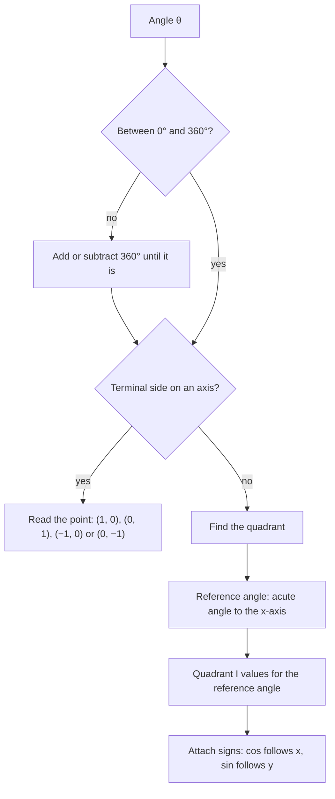

In geometry, sine and cosine are ratios of sides in a right triangle, so they only make sense for acute angles. To model things that go around and around (wheels, tides, sound waves, the seasons), we need sine and cosine of *any* angle, including 200° or −45° or several full turns. This lesson sets that up: angles measured by rotation, a new unit called the radian, and the unit circle, which defines sine and cosine for every angle. The next lesson graphs them.

## Angles in standard position

An angle in **standard position** has its vertex at the origin and its **initial side** along the positive $x$-axis. The angle is formed by rotating a ray from the initial side to the **terminal side**. Counterclockwise rotation gives a positive angle; clockwise gives a negative one. Rotations can go past 360°: 450° is one full turn plus another 90°.

```plot
{"x": [-1.6, 1.6], "y": [-1.25, 1.6], "equal": true, "grid": false, "segments": [{"from": [-1.5, 0], "to": [0, 0]}, {"from": [0, -1.2], "to": [0, 1.5]}, {"from": [0, 0], "to": [1.4, 0]}, {"from": [0, 0], "to": [-0.92, 0.92], "arrow": true}], "curves": [{"x": "0.35cos(t)", "y": "0.35sin(t)", "t": [0, 2.356]}], "labels": [{"at": [0.95, -0.14], "text": "initial side"}, {"at": [-1.05, 0.55], "text": "terminal side"}, {"at": [0.45, 0.45], "text": "135°"}, {"at": [1.2, 1.3], "text": "QI"}, {"at": [-1.3, 1.3], "text": "QII"}, {"at": [-1.3, -1], "text": "QIII"}, {"at": [1.2, -1], "text": "QIV"}], "caption": "A 135° angle in standard position; its terminal side lies in quadrant II"}
```

An angle is named by the quadrant its terminal side lands in. If the terminal side lies on an axis (0°, 90°, 180°, 270°, …), it is a **quadrantal angle** and isn't in any quadrant.

## Radians

Degrees split a full turn into 360 parts, a number chosen long ago for convenience. A more natural unit comes from the circle itself. A **radian** is the angle at the center of a circle that cuts off an arc exactly as long as the radius.

A circle's circumference is $2\pi r$, so a full turn contains $2\pi$ radius-lengths of arc: a full turn is $2\pi$ radians. Therefore

$$360^\circ = 2\pi \text{ radians}, \qquad 180^\circ = \pi \text{ radians}.$$

To convert, multiply by a form of 1 built from $\pi = 180^\circ$:

$$\text{degrees} \to \text{radians: multiply by } \frac{\pi}{180^\circ}, \qquad \text{radians} \to \text{degrees: multiply by } \frac{180^\circ}{\pi}.$$

| Degrees | 0° | 30° | 45° | 60° | 90° | 180° | 270° | 360° |
|---|---|---|---|---|---|---|---|---|
| Radians | $0$ | $\frac{\pi}{6}$ | $\frac{\pi}{4}$ | $\frac{\pi}{3}$ | $\frac{\pi}{2}$ | $\pi$ | $\frac{3\pi}{2}$ | $2\pi$ |

An angle written with no degree sign is in radians. One radian is about $57.3^\circ$.

Radians make arc length simple: on a circle of radius $r$, a central angle of $\theta$ radians cuts off an arc of length $s = r\theta$. (That's just the definition scaled up: $\theta$ radius-lengths of arc.)

### Example 1

Convert $150^\circ$ to radians, and $-\tfrac{3\pi}{4}$ and $2$ radians to degrees.

1. $150^\circ \cdot \dfrac{\pi}{180^\circ} = \dfrac{150\pi}{180} = \dfrac{5\pi}{6}$.
2. $-\dfrac{3\pi}{4} \cdot \dfrac{180^\circ}{\pi} = -\dfrac{3 \cdot 180^\circ}{4} = -135^\circ$. The $\pi$'s cancel.
3. $2 \cdot \dfrac{180^\circ}{\pi} = \dfrac{360^\circ}{\pi} \approx 114.6^\circ$.

## Coterminal and reference angles

Angles that share a terminal side are **coterminal angles**. Adding or subtracting full turns doesn't move the terminal side, so the angles coterminal with $\theta$ are

$$\theta + 360^\circ k \quad \text{or} \quad \theta + 2\pi k \qquad (k \text{ any integer}).$$

The **reference angle** of $\theta$ is the acute angle between its terminal side and the $x$-axis (never the $y$-axis). For $\theta$ between $0^\circ$ and $360^\circ$:

| Terminal side in | Reference angle |
|---|---|
| Quadrant I | $\theta$ |
| Quadrant II | $180^\circ - \theta$ |
| Quadrant III | $\theta - 180^\circ$ |
| Quadrant IV | $360^\circ - \theta$ |

For an angle outside $0^\circ$ to $360^\circ$, first find a coterminal angle inside that range.

### Example 2

Find the angle between $0^\circ$ and $360^\circ$ coterminal with $480^\circ$, and its reference angle. Then do the same for $-\tfrac{5\pi}{3}$ (between $0$ and $2\pi$).

1. $480^\circ - 360^\circ = 120^\circ$, in quadrant II. Reference angle: $180^\circ - 120^\circ = 60^\circ$.
2. $-\dfrac{5\pi}{3} + 2\pi = -\dfrac{5\pi}{3} + \dfrac{6\pi}{3} = \dfrac{\pi}{3}$, in quadrant I, so the reference angle is $\dfrac{\pi}{3}$ itself.

## The unit circle

The **unit circle** is the circle of radius 1 centered at the origin, $x^2 + y^2 = 1$. Put an angle $\theta$ in standard position and let $P = (x, y)$ be the point where its terminal side meets the unit circle. Define

$$\cos\theta = x, \qquad \sin\theta = y, \qquad \tan\theta = \frac{y}{x} = \frac{\sin\theta}{\cos\theta}.$$

Why these definitions? For an acute angle, drop a perpendicular from $P$ to the $x$-axis. You get a right triangle with hypotenuse 1, adjacent leg $x$ and opposite leg $y$, so the triangle ratios give $\cos\theta = \tfrac{x}{1}$ and $\sin\theta = \tfrac{y}{1}$. The new definitions agree with the old ones for acute angles and keep working for every other angle. In words: **cosine** is the $x$-coordinate and **sine** is the $y$-coordinate of the point on the unit circle.


The picture shows the triangle for an angle in quadrant I. For larger angles the same point $P$ still exists; only the signs of its coordinates change.

Because $P$ is on the circle, $x^2 + y^2 = 1$ gives the **Pythagorean identity**:

$$\sin^2\theta + \cos^2\theta = 1.$$

### Special angles

The 45-45-90 triangle with hypotenuse 1 has legs $\tfrac{\sqrt2}{2}$, and the 30-60-90 triangle with hypotenuse 1 has legs $\tfrac12$ (opposite 30°) and $\tfrac{\sqrt3}{2}$ (opposite 60°). These give the quadrant I points:

| $\theta$ | $0$ | $\frac{\pi}{6}$ (30°) | $\frac{\pi}{4}$ (45°) | $\frac{\pi}{3}$ (60°) | $\frac{\pi}{2}$ (90°) |
|---|---|---|---|---|---|
| $\cos\theta$ | $1$ | $\frac{\sqrt3}{2}$ | $\frac{\sqrt2}{2}$ | $\frac12$ | $0$ |
| $\sin\theta$ | $0$ | $\frac12$ | $\frac{\sqrt2}{2}$ | $\frac{\sqrt3}{2}$ | $1$ |

Sine climbs from 0 to 1 while cosine falls from 1 to 0. The other quadrants are mirror images of quadrant I, so their coordinates are the same numbers with signs that depend on the quadrant.

```plot
{"x": [-1.7, 1.7], "y": [-1.5, 1.5], "equal": true, "circles": [{"center": [0, 0], "r": 1}], "points": [{"at": [1, 0], "label": "(1, 0)"}, {"at": [0.866, 0.5], "label": "π/6: (√3/2, 1/2)"}, {"at": [0.7071, 0.7071], "label": "π/4"}, {"at": [0.5, 0.866], "label": "π/3: (1/2, √3/2)"}, {"at": [0, 1], "label": "(0, 1)"}, {"at": [-0.5, 0.866]}, {"at": [-0.7071, 0.7071]}, {"at": [-0.866, 0.5]}, {"at": [-1, 0], "label": "(−1, 0)"}, {"at": [-0.866, -0.5]}, {"at": [-0.7071, -0.7071]}, {"at": [-0.5, -0.866]}, {"at": [0, -1], "label": "(0, −1)"}, {"at": [0.5, -0.866]}, {"at": [0.7071, -0.7071]}, {"at": [0.866, -0.5]}], "labels": [{"at": [-1.25, 0.55], "text": "5π/6"}, {"at": [-1.25, -0.55], "text": "7π/6"}, {"at": [1.27, -0.55], "text": "11π/6"}], "caption": "The unit circle: each point is (cos θ, sin θ); the other quadrants mirror quadrant I"}
```

In quadrant I both coordinates are positive; in quadrant II $x < 0$, so cosine is negative and sine positive; in quadrant III both are negative; in quadrant IV cosine is positive and sine negative.


To evaluate sine or cosine of any special angle:

1. Find the reference angle and use its quadrant I values.
2. Attach the signs for the quadrant of the terminal side.

The flowchart puts the whole procedure together, including the first step of bringing the angle into the range $0^\circ$ to $360^\circ$ and the special case of an angle on an axis.



### Example 3

Find the exact values of $\sin 210^\circ$, $\cos 210^\circ$ and $\cos\tfrac{5\pi}{3}$.

1. $210^\circ$ is in quadrant III with reference angle $210^\circ - 180^\circ = 30^\circ$. In quadrant III both coordinates are negative.
2. So $\sin 210^\circ = -\tfrac12$ and $\cos 210^\circ = -\tfrac{\sqrt3}{2}$.
3. $\tfrac{5\pi}{3}$ is $300^\circ$, in quadrant IV with reference angle $\tfrac{\pi}{3}$ ($60^\circ$). Cosine is positive there: $\cos\tfrac{5\pi}{3} = \tfrac12$.

### Example 4

If $\sin\theta = \tfrac35$ and $\theta$ is in quadrant II, find $\cos\theta$ and $\tan\theta$.

1. Pythagorean identity: $\cos^2\theta = 1 - \left(\tfrac35\right)^2 = 1 - \tfrac{9}{25} = \tfrac{16}{25}$, so $\cos\theta = \pm\tfrac45$.
2. In quadrant II cosine is negative: $\cos\theta = -\tfrac45$.
3. $\tan\theta = \dfrac{\sin\theta}{\cos\theta} = \dfrac{3/5}{-4/5} = -\dfrac34$.

## Common mistakes

- Converting the wrong way: degrees to radians multiplies by $\tfrac{\pi}{180}$, not $\tfrac{180}{\pi}$.
- Measuring the reference angle to the $y$-axis. It is always measured to the $x$-axis.
- Swapping sine and cosine: cosine is the $x$-coordinate, sine is the $y$-coordinate.
- Forgetting the quadrant sign, for example writing $\cos 120^\circ = \tfrac12$ instead of $-\tfrac12$.
- Using a calculator in the wrong mode. $\sin 30 \approx -0.988$ in radian mode, but $\sin 30^\circ = 0.5$.

## Key points

- Standard position: vertex at the origin, initial side on the positive $x$-axis; counterclockwise is positive.
- $180^\circ = \pi$ radians; arc length $s = r\theta$ with $\theta$ in radians.
- Coterminal: add or subtract $360^\circ$ ($2\pi$). Reference angle: acute angle to the $x$-axis.
- On the unit circle, the point at angle $\theta$ is $(\cos\theta, \sin\theta)$, and $\sin^2\theta + \cos^2\theta = 1$.
- Special values come from the 30-60-90 and 45-45-90 triangles; the quadrant decides the signs.
