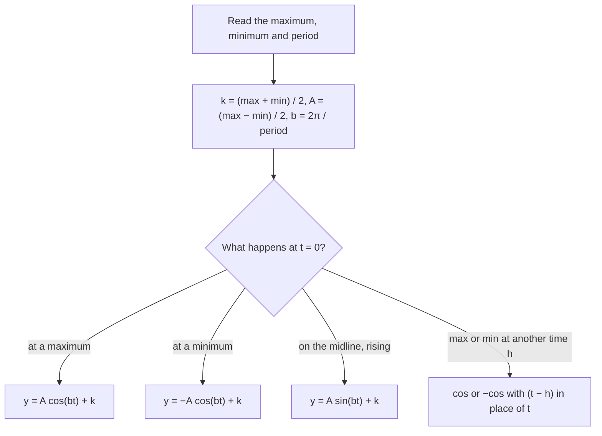

The last lesson defined $\sin\theta$ and $\cos\theta$ as the coordinates of a point moving around the unit circle. As the point goes around again and again, those coordinates rise and fall in a pattern that repeats forever. Graphing that pattern gives the wave shapes that model tides, daylight hours, sound and anything else that cycles. This lesson graphs sine and cosine, then stretches and shifts them using the same transformation ideas you used for other functions.

## The graphs of y = sin x and y = cos x

For graphing we use $x$ (in radians) for the angle. As $x$ goes from $0$ to $2\pi$, the point on the unit circle makes one full turn. Its $y$-coordinate, $\sin x$, starts at 0, rises to 1 at $\tfrac{\pi}{2}$, returns to 0 at $\pi$, falls to $-1$ at $\tfrac{3\pi}{2}$ and is back to 0 at $2\pi$. Then the point starts another lap and the values repeat.

```plot
{"x": [-0.5, 6.8], "y": [-1.6, 1.6], "functions": [{"f": "sin(x)", "label": "y = sin x"}, {"f": "cos(x)", "dashed": true, "label": "y = cos x"}], "points": [{"at": [0, 0]}, {"at": [1.5708, 1], "label": "(π/2, 1)"}, {"at": [3.1416, 0], "label": "(π, 0)"}, {"at": [4.7124, -1], "label": "(3π/2, −1)"}, {"at": [6.2832, 0]}], "labels": [{"at": [6.0, -0.25], "text": "2π"}], "caption": "One cycle of y = sin x (solid) and y = cos x (dashed) from 0 to 2π"}
```

A function whose values repeat at regular intervals is a **periodic function**. The length of the shortest interval that repeats is the **period**, and one copy of the repeating piece is a **cycle**. Both $\sin x$ and $\cos x$ have period $2\pi$, because adding $2\pi$ (a full turn) lands on the same point of the circle:

$$\sin(x + 2\pi) = \sin x, \qquad \cos(x + 2\pi) = \cos x.$$

Key facts about both graphs:

| | $y = \sin x$ | $y = \cos x$ |
|---|---|---|
| Starts a cycle at $x = 0$ | on the midline, going up: $(0, 0)$ | at a maximum: $(0, 1)$ |
| Maximum and minimum | $1$ and $-1$ | $1$ and $-1$ |
| Zeros | $0, \pi, 2\pi, \dots$ | $\tfrac{\pi}{2}, \tfrac{3\pi}{2}, \dots$ |
| Period | $2\pi$ | $2\pi$ |

The cosine graph is the sine graph shifted $\tfrac{\pi}{2}$ to the left. Each cycle splits into four equal quarters, and at each quarter mark the graph is at a maximum, the middle, or a minimum. Those five points (start, three quarter marks, end) are all you need to sketch one cycle.

## Amplitude, period and midline

A **sinusoid** is any graph with the shape of a sine wave. Its general form is

$$y = a\sin\big(b(x - h)\big) + k \qquad \text{or} \qquad y = a\cos\big(b(x - h)\big) + k \qquad (b > 0).$$

Each parameter is a transformation you have seen before:

- $|a|$ is the **amplitude**, the vertical distance from the middle of the wave to a maximum. It is half the distance from the maximum to the minimum. If $a < 0$ the graph is also reflected across its midline.
- $b$ squeezes or stretches the graph horizontally. One cycle needs $bx$ to run through $2\pi$, so it takes $x$ a length of $\dfrac{2\pi}{b}$. The period is $\dfrac{2\pi}{b}$. The **frequency**, the number of cycles per unit of $x$, is $\dfrac{b}{2\pi}$, the reciprocal of the period.
- $k$ shifts the graph up or down. The horizontal line $y = k$ through the middle of the wave is the **midline**. The maximum is $k + |a|$ and the minimum is $k - |a|$.
- $h$ shifts the graph left or right. This horizontal shift is called the **phase shift**: right if $h > 0$, left if $h < 0$.

The picture names the parts of a sinusoid. The amplitude is measured from the midline, not from the bottom, and the period can be measured between any two matching points, such as two maxima in a row.


### Example 1

Graph $y = 3\sin(2x) - 1$ for one cycle. State the amplitude, period, midline, maximum and minimum.

1. Amplitude $|a| = 3$. Period $\dfrac{2\pi}{2} = \pi$. Midline $y = -1$.
2. Maximum $-1 + 3 = 2$; minimum $-1 - 3 = -4$.
3. Quarter of a period: $\tfrac{\pi}{4}$. Sine starts on the midline going up, so the five key points are $(0, -1)$, $\left(\tfrac{\pi}{4}, 2\right)$, $\left(\tfrac{\pi}{2}, -1\right)$, $\left(\tfrac{3\pi}{4}, -4\right)$, $(\pi, -1)$.

```plot
{"x": [-0.4, 6.6], "y": [-5, 3], "functions": [{"f": "3sin(2x) - 1", "label": "y = 3 sin 2x − 1"}, {"f": "-1", "dashed": true, "label": "midline y = −1"}, {"f": "sin(x)", "dashed": true, "color": "#999999"}], "points": [{"at": [0, -1]}, {"at": [0.7854, 2], "label": "(π/4, 2)"}, {"at": [1.5708, -1]}, {"at": [2.3562, -4], "label": "(3π/4, −4)"}, {"at": [3.1416, -1], "label": "(π, −1)"}], "caption": "Amplitude 3, period π, midline y = −1; gray dashed: y = sin x for comparison"}
```

### Phase shift

In $y = \sin(x - \tfrac{\pi}{3})$ the graph of $\sin x$ moves $\tfrac{\pi}{3}$ to the right: the cycle that started at 0 now starts at $\tfrac{\pi}{3}$. Watch for a factored-out $b$. In $y = \sin(2x - \tfrac{\pi}{2})$, factor first: $\sin\big(2(x - \tfrac{\pi}{4})\big)$. The phase shift is $\tfrac{\pi}{4}$ right, not $\tfrac{\pi}{2}$. A quick check: a cycle starts where the inside equals 0, and $2x - \tfrac{\pi}{2} = 0$ at $x = \tfrac{\pi}{4}$.

### Example 2

Write an equation for the sinusoid in the graph.

```plot
{"x": [-1, 17], "y": [-2, 6], "functions": [{"f": "3cos(pi*x/4) + 2"}, {"f": "2", "dashed": true}], "points": [{"at": [0, 5], "label": "(0, 5)"}, {"at": [4, -1], "label": "(4, −1)"}, {"at": [8, 5], "label": "(8, 5)"}], "caption": "A sinusoid with a maximum at x = 0 and the next maximum at x = 8"}
```

1. Maximum 5, minimum $-1$. Midline halfway: $k = \dfrac{5 + (-1)}{2} = 2$. Amplitude: $\dfrac{5 - (-1)}{2} = 3$.
2. Maxima at $x = 0$ and $x = 8$, so the period is 8. Then $\dfrac{2\pi}{b} = 8$ gives $b = \dfrac{2\pi}{8} = \dfrac{\pi}{4}$.
3. The graph is at a maximum at $x = 0$, which is how cosine starts, so no phase shift is needed with cosine:
$$y = 3\cos\left(\frac{\pi}{4}x\right) + 2.$$
4. Check: at $x = 4$, $3\cos\pi + 2 = -3 + 2 = -1$, the minimum. (A sine version works too, with a phase shift: $y = 3\sin\big(\tfrac{\pi}{4}(x + 2)\big) + 2$.)

## Modeling periodic data

To fit a sinusoid to something that cycles, read three things from the situation:

1. Maximum and minimum. Midline $k = \dfrac{\max + \min}{2}$, amplitude $= \dfrac{\max - \min}{2}$.
2. Period $P$, the time for one cycle. Then $b = \dfrac{2\pi}{P}$.
3. A starting point. Cosine starts at a maximum, $-\cos$ at a minimum, sine on the midline going up. Shift by $h$ if the cycle starts somewhere other than $t = 0$.

The choice in step 3 is a small decision chart. Here $A$ stands for the amplitude, a positive number.



### Example 3

A Ferris wheel is 40 m across and its center is 25 m above the ground. It makes one revolution every 10 minutes, and you board at the bottom at $t = 0$. Write your height $h(t)$ and find it after 3 minutes.

1. Highest point $25 + 20 = 45$ m and lowest $25 - 20 = 5$ m, so amplitude 20 and midline 25.
2. Period 10 min: $b = \dfrac{2\pi}{10} = \dfrac{\pi}{5}$.
3. You start at the minimum, which is how $-\cos$ starts: $h(t) = -20\cos\left(\dfrac{\pi}{5}t\right) + 25$.
4. $h(3) = -20\cos(0.6\pi) + 25 \approx -20(-0.309) + 25 \approx 31.2$ m. (Calculator in radian mode.)

### Example 4

In a city, the average daily high temperature peaks at 88°F in July (month 7) and bottoms out at 44°F in January (month 1). Model it with a sinusoid and estimate the average high in May.

1. Midline $\dfrac{88 + 44}{2} = 66$; amplitude $\dfrac{88 - 44}{2} = 22$.
2. The pattern repeats yearly: period 12 months, so $b = \dfrac{2\pi}{12} = \dfrac{\pi}{6}$.
3. Use cosine, which starts at a maximum, and shift it to the July peak ($h = 7$): $T(m) = 22\cos\left(\dfrac{\pi}{6}(m - 7)\right) + 66$.
4. May is $m = 5$: $T(5) = 22\cos\left(-\dfrac{\pi}{3}\right) + 66 = 22\left(\tfrac12\right) + 66 = 77$°F.

## Common mistakes

- Taking $b$ itself as the period. The period is $\dfrac{2\pi}{b}$; $y = \sin 4x$ has period $\tfrac{\pi}{2}$, not 4.
- Calling the full height from maximum to minimum the amplitude. Amplitude is *half* of it.
- Reading the phase shift from $\sin(bx - c)$ as $c$. Factor out $b$ first: the shift is $\tfrac{c}{b}$.
- Getting the shift direction backward: $x - h$ moves the graph right by $h$.
- Evaluating a radian model with the calculator in degree mode.

## Key points

- $\sin x$ and $\cos x$ have period $2\pi$, range $[-1, 1]$; sine starts on the midline going up, cosine at a maximum.
- $y = a\sin\big(b(x - h)\big) + k$: amplitude $|a|$, period $\dfrac{2\pi}{b}$, midline $y = k$, phase shift $h$.
- From max and min: midline $= \dfrac{\max + \min}{2}$, amplitude $= \dfrac{\max - \min}{2}$.
- Sketch a cycle from five key points spaced a quarter period apart.
- To model data, find midline, amplitude, period and a starting point, then choose sine, cosine or $-\cos$.
