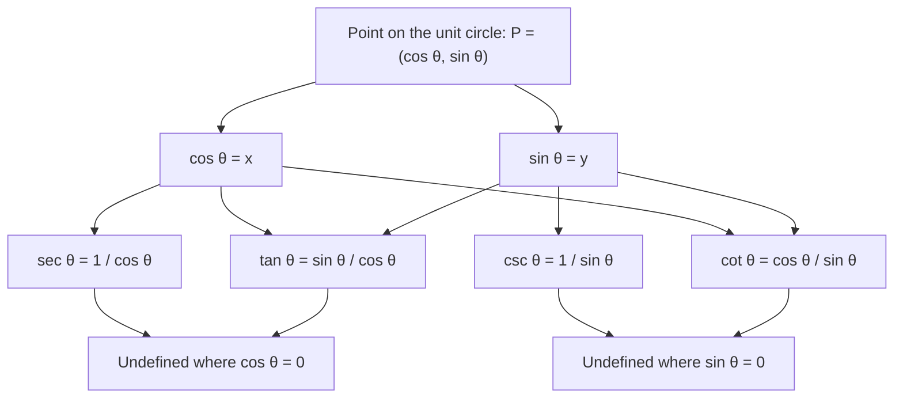

The unit circle lesson defined $\tan\theta = \dfrac{\sin\theta}{\cos\theta}$ in one line and then spent all its time on sine and cosine. The graphs lesson did the same. This honors lesson gives tangent its due. You will see where its name comes from, why its graph looks nothing like a wave, and how it measures the steepness of a line. Then you will meet the three remaining trig functions, **secant**, **cosecant** and **cotangent**, which are reciprocals of the ones you know, and two new identities that follow from $\sin^2\theta + \cos^2\theta = 1$. All of this is standard precalculus material, and calculus uses every piece of it.

## Tangent as a slope

Let $P = (\cos\theta, \sin\theta)$ be the point at angle $\theta$ on the unit circle. Then

$$\tan\theta = \frac{\sin\theta}{\cos\theta} = \frac{y}{x} = \frac{y - 0}{x - 0}.$$

That last fraction is the slope of the line through the origin and $P$. So *$\tan\theta$ is the slope of the terminal side.* This one sentence explains most facts about tangent:

- At $0^\circ$ the terminal side is flat, so $\tan 0^\circ = 0$. As the angle opens toward $90^\circ$ the side gets steeper and the slope grows without bound.
- At $90^\circ$ and $270^\circ$ the terminal side is vertical. A vertical line has no slope, and indeed $x = \cos\theta = 0$ there, so $\tan\theta$ is undefined.
- In quadrants I and III the terminal line rises to the right, so tangent is positive; in quadrants II and IV it falls, so tangent is negative. (Check with signs: in quadrant III, $\tfrac{-}{-}$ is positive.)

The special values come straight from the unit circle table: $\tan 30^\circ = \dfrac{1/2}{\sqrt3/2} = \dfrac{1}{\sqrt3} = \dfrac{\sqrt3}{3}$, $\tan 45^\circ = 1$, and $\tan 60^\circ = \dfrac{\sqrt3/2}{1/2} = \sqrt3$.

### Why it is called "tangent"

Draw the vertical line $x = 1$. It touches the unit circle only at $(1, 0)$, so it is a tangent line to the circle. Extend the terminal side until it meets that line at a point $T$. The small right triangle under $P$ and the big one under $T$ share the angle $\theta$, so they are similar:

$$\frac{\text{height of } T}{1} = \frac{\sin\theta}{\cos\theta} = \tan\theta.$$

So $T = (1, \tan\theta)$: the tangent of $\theta$ is literally the length of a piece of the tangent line, measured up from the $x$-axis (down when it is negative). For an angle in quadrant I, as in the picture, the same similar triangles give the length of $OT$ as $\dfrac{1}{\cos\theta}$; that segment cuts through the circle, and Latin *secare* means "to cut", which is where the name secant (below) comes from. The Danish mathematician Thomas Fincke introduced the words *tangens* and *secans* in a geometry book in 1583.


### Angle of inclination

The **angle of inclination** of a non-horizontal line is the angle from the positive $x$-direction up to the line, between $0^\circ$ and $180^\circ$ (a horizontal line has angle $0^\circ$). Since tangent is slope,

$$m = \tan\alpha,$$

where $\alpha$ is the angle of inclination. A line rising at $45^\circ$ has slope 1; a line at $150^\circ$ has slope $\tan 150^\circ = -\dfrac{\sqrt3}{3}$. This connects trigonometry to the slope you have used since Algebra 1, and it is how road and ramp angles are related to their grades.

## The graph of y = tan x

Tangent repeats faster than sine and cosine. The point at angle $\theta + \pi$ is the opposite point $(-x, -y)$, and $\dfrac{-y}{-x} = \dfrac{y}{x}$. Both points lie on the same line through the origin, which has the same slope. So

$$\tan(x + \pi) = \tan x,$$

and the period of tangent is $\pi$, not $2\pi$.

Within one period, from $-\tfrac{\pi}{2}$ to $\tfrac{\pi}{2}$, tangent rises from very negative values through $0$ (at $x = 0$) to very large values. Near $x = \tfrac{\pi}{2}$, $\cos x$ is a tiny positive number and $\sin x$ is close to 1, so the quotient blows up: the graph has a **vertical asymptote** at $x = \tfrac{\pi}{2}$, and at every $x = \tfrac{\pi}{2} + k\pi$.

```plot
{"x": [-4.8, 4.8], "y": [-4, 4], "functions": [{"f": "tan(x)", "label": "y = tan x"}], "segments": [{"from": [-4.7124, -4], "to": [-4.7124, 4], "dashed": true}, {"from": [-1.5708, -4], "to": [-1.5708, 4], "dashed": true}, {"from": [1.5708, -4], "to": [1.5708, 4], "dashed": true}, {"from": [4.7124, -4], "to": [4.7124, 4], "dashed": true}], "points": [{"at": [0, 0]}, {"at": [0.7854, 1], "label": "(π/4, 1)"}, {"at": [-0.7854, -1], "label": "(−π/4, −1)"}, {"at": [3.1416, 0], "label": "(π, 0)"}], "labels": [{"at": [2.5, -3.5], "text": "x = π/2"}, {"at": [-2.55, -3.5], "text": "x = −π/2"}], "caption": "y = tan x: period π, zeros at multiples of π, vertical asymptotes (dashed) at π/2 + kπ"}
```

| | $y = \tan x$ |
|---|---|
| Period | $\pi$ |
| Zeros | $x = k\pi$ |
| Vertical asymptotes | $x = \tfrac{\pi}{2} + k\pi$ |
| Domain | all $x$ except $\tfrac{\pi}{2} + k\pi$ |
| Range | all real numbers |

Tangent has no maximum or minimum, so it has no amplitude. For $y = a\tan(bx)$ with $b > 0$, one cycle needs $bx$ to run through a length of $\pi$, so the period is $\dfrac{\pi}{b}$. The number $a$ stretches the graph vertically: at a quarter period past a zero, $y = a\tan\tfrac{\pi}{4} = a$.

### Example 1

Find the period, the zeros and the asymptotes of $y = 3\tan(2x)$, and two points that help sketch one cycle.

1. Period: $\dfrac{\pi}{b} = \dfrac{\pi}{2}$.
2. Zeros where $2x = k\pi$: $x = \dfrac{k\pi}{2}$, so $0, \pm\tfrac{\pi}{2}, \pm\pi, \dots$
3. Asymptotes where $2x = \tfrac{\pi}{2} + k\pi$: $x = \dfrac{\pi}{4} + \dfrac{k\pi}{2}$, so $\pm\tfrac{\pi}{4}, \pm\tfrac{3\pi}{4}, \dots$ They sit halfway between the zeros.
4. Halfway from the zero at 0 to the asymptote at $\tfrac{\pi}{4}$: at $x = \tfrac{\pi}{8}$, $y = 3\tan\tfrac{\pi}{4} = 3$; at $x = -\tfrac{\pi}{8}$, $y = -3$.

The cycle runs from the asymptote $x = -\tfrac{\pi}{4}$ through $\left(-\tfrac{\pi}{8}, -3\right)$, $(0, 0)$, $\left(\tfrac{\pi}{8}, 3\right)$ up to the asymptote $x = \tfrac{\pi}{4}$.

## The reciprocal functions

Three more functions complete the set. Each is the reciprocal of one you know:

$$\sec\theta = \frac{1}{\cos\theta}, \qquad \csc\theta = \frac{1}{\sin\theta}, \qquad \cot\theta = \frac{1}{\tan\theta} = \frac{\cos\theta}{\sin\theta}.$$

Each one is undefined wherever its denominator is 0. Secant (and tangent) fail where $\cos\theta = 0$, at $90^\circ, 270^\circ, \dots$ Cosecant and cotangent fail where $\sin\theta = 0$, at $0^\circ, 180^\circ, \dots$ A handy memory aid: each "co" function pairs with a function without "co" (secant with cosine, cosecant with sine).



A reciprocal has the same sign as the original number, so secant has the sign of cosine, cosecant the sign of sine, and cotangent the sign of tangent. Because $|\cos\theta| \le 1$, its reciprocal satisfies $|\sec\theta| \ge 1$: secant and cosecant never take values strictly between $-1$ and $1$.

The graph of $y = \sec x$ shows this. Wherever cosine is at a maximum of 1, secant is also 1; as cosine shrinks toward 0, secant grows without bound; where cosine is 0, secant has a vertical asymptote. The result is a row of U-shaped branches, opening up above the arches of cosine and down below its valleys.

```plot
{"x": [-4.8, 4.8], "y": [-4, 4], "functions": [{"f": "1/cos(x)", "label": "y = sec x"}, {"f": "cos(x)", "dashed": true, "label": "y = cos x"}], "segments": [{"from": [-4.7124, -4], "to": [-4.7124, 4], "dashed": true}, {"from": [-1.5708, -4], "to": [-1.5708, 4], "dashed": true}, {"from": [1.5708, -4], "to": [1.5708, 4], "dashed": true}, {"from": [4.7124, -4], "to": [4.7124, 4], "dashed": true}], "points": [{"at": [0, 1], "label": "(0, 1)"}, {"at": [3.1416, -1], "label": "(π, −1)"}], "caption": "y = sec x (solid) with y = cos x (dashed): secant is 1 or −1 where cosine is, and has asymptotes where cosine is 0"}
```

The graph of cosecant looks the same, built on sine instead, so it is shifted $\tfrac{\pi}{2}$ to the right. Both have period $2\pi$ and range $(-\infty, -1] \cup [1, \infty)$. Cotangent, like tangent, has period $\pi$; it is decreasing between its asymptotes at $x = k\pi$.

### Example 2

Find the exact values of all six trig functions of $240^\circ$.

1. $240^\circ$ is in quadrant III, with reference angle $240^\circ - 180^\circ = 60^\circ$. Both coordinates are negative: $\cos 240^\circ = -\tfrac12$ and $\sin 240^\circ = -\tfrac{\sqrt3}{2}$.
2. $\tan 240^\circ = \dfrac{-\sqrt3/2}{-1/2} = \sqrt3$ (positive, as expected in quadrant III).
3. $\sec 240^\circ = \dfrac{1}{-1/2} = -2$.
4. $\csc 240^\circ = \dfrac{1}{-\sqrt3/2} = -\dfrac{2}{\sqrt3} = -\dfrac{2\sqrt3}{3}$ after rationalizing.
5. $\cot 240^\circ = \dfrac{1}{\sqrt3} = \dfrac{\sqrt3}{3}$.

## Two more Pythagorean identities

Start from $\sin^2\theta + \cos^2\theta = 1$ and divide every term by $\cos^2\theta$ (allowed wherever $\cos\theta \ne 0$):

$$\frac{\sin^2\theta}{\cos^2\theta} + \frac{\cos^2\theta}{\cos^2\theta} = \frac{1}{\cos^2\theta} \quad\Longrightarrow\quad \tan^2\theta + 1 = \sec^2\theta.$$

Dividing by $\sin^2\theta$ instead (wherever $\sin\theta \ne 0$) gives

$$1 + \cot^2\theta = \csc^2\theta.$$

These are not new facts: they are the equation of the unit circle in disguise. They let you go from tangent to secant (and so to cosine) without drawing anything, as long as you decide the sign from the quadrant.

### Example 3

If $\tan\theta = 2$ and $\theta$ is in quadrant III, find $\sec\theta$, $\cos\theta$ and $\sin\theta$.

1. $\sec^2\theta = 1 + \tan^2\theta = 1 + 4 = 5$, so $\sec\theta = \pm\sqrt5$.
2. In quadrant III cosine is negative, so secant is too: $\sec\theta = -\sqrt5$.
3. $\cos\theta = \dfrac{1}{\sec\theta} = -\dfrac{1}{\sqrt5} = -\dfrac{\sqrt5}{5}$.
4. $\sin\theta = \tan\theta \cdot \cos\theta = 2 \cdot \left(-\dfrac{\sqrt5}{5}\right) = -\dfrac{2\sqrt5}{5}$.
5. Check: $\sin^2\theta + \cos^2\theta = \tfrac{20}{25} + \tfrac{5}{25} = 1$. Both values are negative, as quadrant III requires.

### Example 4

A line passes through $(-1, 4)$ and $(2, 1)$. Find its angle of inclination.

1. Slope: $m = \dfrac{1 - 4}{2 - (-1)} = \dfrac{-3}{3} = -1$.
2. We need $\tan\alpha = -1$ with $0^\circ \le \alpha < 180^\circ$. Tangent is negative in quadrant II, and $\tan 45^\circ = 1$ gives the reference angle $45^\circ$.
3. $\alpha = 180^\circ - 45^\circ = 135^\circ$. The line falls to the right at the same steepness as a $45^\circ$ line rises.

## Common mistakes

- Giving tangent a period of $2\pi$. Its period is $\pi$, and $y = \tan(bx)$ has period $\dfrac{\pi}{b}$, not $\dfrac{2\pi}{b}$.
- Pairing the reciprocals wrongly: secant is $\dfrac{1}{\cos}$ and cosecant is $\dfrac{1}{\sin}$, not the other way around.
- Writing $\tan 90^\circ = 0$ or $\tan 90^\circ = 1$. It is undefined: the terminal side is vertical.
- Using $\tan^2\theta + 1 = \sec^2\theta$ and forgetting the $\pm$. The identity gives the size; the quadrant gives the sign.
- Reading $\sec\theta = 0.5$ as possible. Secant and cosecant are never strictly between $-1$ and $1$.
- Expecting tangent to have an amplitude. It has no maximum or minimum.

## Key points

- $\tan\theta = \dfrac{\sin\theta}{\cos\theta}$ is the slope of the terminal side, and $T = (1, \tan\theta)$ on the tangent line $x = 1$.
- The slope of a line is $\tan\alpha$, where $\alpha$ is its angle of inclination.
- $y = \tan x$ has period $\pi$, zeros at $k\pi$, vertical asymptotes at $\tfrac{\pi}{2} + k\pi$ and range all real numbers; $y = a\tan(bx)$ has period $\dfrac{\pi}{b}$.
- $\sec\theta = \dfrac{1}{\cos\theta}$, $\csc\theta = \dfrac{1}{\sin\theta}$, $\cot\theta = \dfrac{\cos\theta}{\sin\theta}$; each keeps the sign of the function it is built from.
- $\tan^2\theta + 1 = \sec^2\theta$ and $1 + \cot^2\theta = \csc^2\theta$ come from dividing $\sin^2\theta + \cos^2\theta = 1$.
