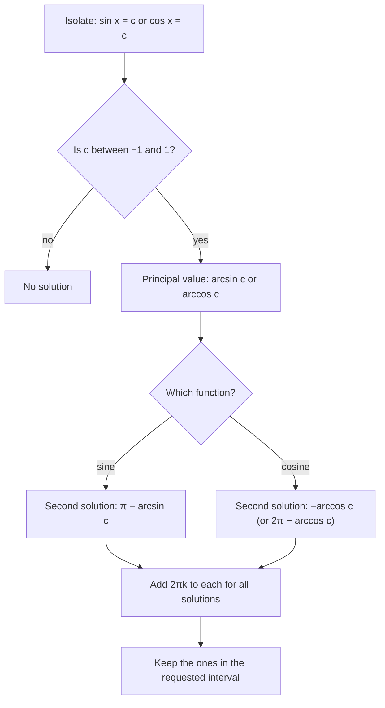

The sinusoid lesson answered questions like "how high is the rider after 3 minutes?" by plugging a time into a model. The reverse question is just as natural: *when* is the rider 35 m up? *When* does the tide first reach 12 feet? To answer it you have to undo a sine or cosine, and that needs inverse functions. In Module 1 you learned that only a one-to-one function has an inverse, and that a function that fails the horizontal line test can still get one if you restrict its domain. Sine, cosine and tangent are the most famous examples of that trick. This lesson builds their inverses and then uses them to solve trig equations, which usually have many solutions, not one.

## Undoing sine: restrict the domain

The equation $\sin x = \tfrac12$ has infinitely many solutions: $\tfrac{\pi}{6}$, $\tfrac{5\pi}{6}$, and every angle coterminal with one of them. On a graph, the line $y = \tfrac12$ crosses the sine wave twice in every cycle. Sine fails the horizontal line test badly, so it has no inverse as it stands.

The fix is to keep just one piece of the graph that is one-to-one and still reaches every output from $-1$ to $1$. The standard choice is $-\tfrac{\pi}{2} \le x \le \tfrac{\pi}{2}$, where sine rises steadily from $-1$ to $1$. On that piece every output comes from exactly one input, so it has an inverse, the **inverse sine** function:

$$y = \arcsin x \quad\text{means}\quad \sin y = x \ \text{ and } \ -\frac{\pi}{2} \le y \le \frac{\pi}{2}.$$

It is also written $\sin^{-1} x$. Read $\arcsin x$ as "the angle (arc) whose sine is $x$". Its domain is $[-1, 1]$, because sine never leaves that range, and its outputs lie in $\left[-\tfrac{\pi}{2}, \tfrac{\pi}{2}\right]$. As with every inverse, its graph is the reflection of the restricted sine graph across the line $y = x$.

```plot
{"x": [-2, 2], "y": [-2, 2], "equal": true, "functions": [{"f": "sin(x)", "from": -1.5708, "to": 1.5708, "label": "sine, restricted"}, {"f": "asin(x)", "from": -1, "to": 1, "label": "y = arcsin x"}, {"f": "x", "dashed": true, "color": "#999999"}], "points": [{"at": [1.5708, 1], "label": "(π/2, 1)"}, {"at": [1, 1.5708], "label": "(1, π/2)"}, {"at": [-1.5708, -1]}, {"at": [-1, -1.5708]}], "caption": "Sine restricted to [−π/2, π/2] and its inverse arcsin x, mirror images across y = x (gray dashed)"}
```

Warning about notation: the $-1$ in $\sin^{-1} x$ means "inverse function", not "reciprocal". The reciprocal of $\sin x$ is $(\sin x)^{-1} = \dfrac{1}{\sin x} = \csc x$, a different thing. This clash is a historical accident that every learner trips over once.

## Inverse cosine and inverse tangent

Cosine is not one-to-one on $\left[-\tfrac{\pi}{2}, \tfrac{\pi}{2}\right]$ (it goes up and then down there), so it gets a different piece: $0 \le x \le \pi$, where cosine falls steadily from 1 to $-1$. Its inverse is the **inverse cosine**, $\arccos x$ (or $\cos^{-1} x$). Tangent already takes every real value once between its asymptotes, so it keeps the open interval $\left(-\tfrac{\pi}{2}, \tfrac{\pi}{2}\right)$, and its inverse is the **inverse tangent**, $\arctan x$ (or $\tan^{-1} x$).

| Function | Inputs | Outputs (the **principal value**) |
|---|---|---|
| $\arcsin x$ | $-1 \le x \le 1$ | $-\tfrac{\pi}{2} \le y \le \tfrac{\pi}{2}$ (quadrants IV and I) |
| $\arccos x$ | $-1 \le x \le 1$ | $0 \le y \le \pi$ (quadrants I and II) |
| $\arctan x$ | all real $x$ | $-\tfrac{\pi}{2} < y < \tfrac{\pi}{2}$ (quadrants IV and I) |

The output of an inverse trig function is called the principal value: it is the one answer the function picks out of infinitely many. Calculators use exactly these ranges for their $\sin^{-1}$, $\cos^{-1}$ and $\tan^{-1}$ keys.

These choices are conventions (agreed on, not forced by mathematics), but they are the conventions everyone uses. One way to remember them: arcsin and arctan answer with angles from $-90^\circ$ to $90^\circ$, which is where a "signed" angle reads naturally, and arccos answers with angles from $0^\circ$ to $180^\circ$, the angles of a triangle.

### Example 1

Find the exact values of $\arcsin\left(-\tfrac12\right)$, $\arccos\left(-\tfrac12\right)$ and $\arctan\sqrt3$, and explain why $\arcsin 2$ has no value.

1. $\arcsin\left(-\tfrac12\right)$: we need an angle in $\left[-\tfrac{\pi}{2}, \tfrac{\pi}{2}\right]$ with sine $-\tfrac12$. The reference angle is $\tfrac{\pi}{6}$, and a negative sine in that range means quadrant IV, so the answer is $-\tfrac{\pi}{6}$. (Not $\tfrac{7\pi}{6}$ or $\tfrac{11\pi}{6}$: both have sine $-\tfrac12$, but they are outside the range.)
2. $\arccos\left(-\tfrac12\right)$: we need an angle in $[0, \pi]$ with cosine $-\tfrac12$. Negative cosine in that range means quadrant II, reference angle $\tfrac{\pi}{3}$: the answer is $\pi - \tfrac{\pi}{3} = \tfrac{2\pi}{3}$.
3. $\arctan\sqrt3$: $\tan\tfrac{\pi}{3} = \sqrt3$ and $\tfrac{\pi}{3}$ is in range, so the answer is $\tfrac{\pi}{3}$.
4. $\arcsin 2$: no angle has a sine of 2, since sine never exceeds 1. The value is undefined (a calculator gives an error).

## Solving sin x = c, cos x = c and tan x = c

The inverse function gives *one* solution. A trig equation usually wants all of them, or all of them in an interval such as $[0, 2\pi)$. The unit circle shows where the others are.

- **Sine** is the $y$-coordinate. The horizontal line $y = c$ (with $-1 < c < 1$) meets the circle at two points that are mirror images across the $y$-axis. If one is at angle $\alpha$, the other is at $\pi - \alpha$. So $\sin x = c$ has solutions
$$x = \arcsin c + 2\pi k \quad\text{and}\quad x = \pi - \arcsin c + 2\pi k.$$
- **Cosine** is the $x$-coordinate. The vertical line $x = c$ meets the circle at two points that are mirror images across the $x$-axis, at angles $\alpha$ and $-\alpha$:
$$x = \pm\arccos c + 2\pi k.$$
- **Tangent** has period $\pi$, and one solution per period:
$$x = \arctan c + \pi k.$$

Here $k$ is any integer. When $c = 1$ or $c = -1$, the two points merge into one and there is only one solution per cycle. When $|c| > 1$, sine and cosine equations have no solution at all.

```plot
{"x": [-0.5, 6.8], "y": [-1.6, 1.6], "functions": [{"f": "sin(x)", "label": "y = sin x"}, {"f": "0.5", "dashed": true}], "points": [{"at": [0.5236, 0.5], "label": "π/6"}, {"at": [2.618, 0.5], "label": "5π/6 = π − π/6"}], "caption": "The line y = 1/2 meets one cycle of y = sin x twice: at arcsin(1/2) = π/6 and at π − π/6"}
```



### Example 2

Solve $2\sin x + 1 = 0$ on $[0, 2\pi)$, then give all solutions.

1. Isolate the sine: $\sin x = -\tfrac12$.
2. Principal value: $\arcsin\left(-\tfrac12\right) = -\tfrac{\pi}{6}$. That is not in $[0, 2\pi)$, but adding $2\pi$ gives $\tfrac{11\pi}{6}$, which is.
3. Second solution: $\pi - \left(-\tfrac{\pi}{6}\right) = \tfrac{7\pi}{6}$.
4. On $[0, 2\pi)$: $x = \tfrac{7\pi}{6}$ or $x = \tfrac{11\pi}{6}$. Check: both are in quadrants III and IV, where sine is negative, with reference angle $\tfrac{\pi}{6}$.
5. All solutions: $x = \tfrac{7\pi}{6} + 2\pi k$ or $x = \tfrac{11\pi}{6} + 2\pi k$.

### Example 3

Solve $\cos x = 0.3$ on $[0, 2\pi)$, to 4 decimal places.

1. $0.3$ is not a special value, so use a calculator in radian mode: $\arccos 0.3 \approx 1.2661$.
2. The other solution is $-1.2661$, which is outside the interval; add $2\pi$: $2\pi - 1.2661 \approx 5.0171$.
3. Solutions: $x \approx 1.2661$ and $x \approx 5.0171$. Check: $\cos 5.0171 \approx 0.3000$.

### Example 4

Solve $\sin(2x) = \tfrac{\sqrt3}{2}$ on $[0, 2\pi)$.

1. Let $u = 2x$. As $x$ runs over $[0, 2\pi)$, $u$ runs over $[0, 4\pi)$: two full turns.
2. $\sin u = \tfrac{\sqrt3}{2}$ gives $u = \tfrac{\pi}{3}$ or $u = \pi - \tfrac{\pi}{3} = \tfrac{2\pi}{3}$ in the first turn, and $u = \tfrac{7\pi}{3}$ or $\tfrac{8\pi}{3}$ in the second (add $2\pi$).
3. Divide by 2: $x = \tfrac{\pi}{6}, \tfrac{\pi}{3}, \tfrac{7\pi}{6}, \tfrac{4\pi}{3}$.

Four solutions, not two: $\sin(2x)$ has period $\pi$, so it completes two cycles in $[0, 2\pi)$. Stopping at $u < 2\pi$ is the most common way to lose half the answers.

### Example 5

A Ferris wheel rider's height is $h(t) = -20\cos\left(\tfrac{\pi}{5}t\right) + 25$ meters, $t$ minutes after boarding (this is Example 3 of the graphs lesson). During the first revolution, when is the rider exactly 35 m up, and for how long is the rider above 35 m?

1. Set up: $-20\cos\left(\tfrac{\pi}{5}t\right) + 25 = 35$, so $\cos\left(\tfrac{\pi}{5}t\right) = -\tfrac12$.
2. One revolution is $0 \le t < 10$, so $u = \tfrac{\pi}{5}t$ runs over $[0, 2\pi)$. Cosine is $-\tfrac12$ at $u = \tfrac{2\pi}{3}$ and $u = 2\pi - \tfrac{2\pi}{3} = \tfrac{4\pi}{3}$.
3. Solve for $t = \tfrac{5u}{\pi}$: $t = \tfrac{10}{3} \approx 3.33$ min and $t = \tfrac{20}{3} \approx 6.67$ min.
4. The rider is above 35 m between those times (the top, at $t = 5$, is in between): $\tfrac{20}{3} - \tfrac{10}{3} = \tfrac{10}{3} \approx 3.33$ minutes, one third of each revolution.

## Equations that factor

Some trig equations are quadratics in disguise. In $2\sin^2 x - \sin x - 1 = 0$, let $s = \sin x$: $2s^2 - s - 1 = (2s + 1)(s - 1) = 0$, so $\sin x = -\tfrac12$ or $\sin x = 1$. On $[0, 2\pi)$ that gives $x = \tfrac{7\pi}{6}, \tfrac{11\pi}{6}$ (from Example 2) and $x = \tfrac{\pi}{2}$: three solutions. Factor rather than divide: dividing both sides of an equation like $\sin^2 x = \sin x$ by $\sin x$ throws away the solutions where $\sin x = 0$.

## Common mistakes

- Reading $\sin^{-1} x$ as $\dfrac{1}{\sin x}$. It is the inverse function; the reciprocal is $\csc x$.
- Stopping at the calculator's answer. $\arcsin c$ is one solution; $\pi - \arcsin c$ is the other one in each cycle.
- Answering with an angle outside the principal range: $\arccos\left(-\tfrac12\right)$ is $\tfrac{2\pi}{3}$, not $\tfrac{4\pi}{3}$ or $-\tfrac{2\pi}{3}$.
- Assuming $\arcsin(\sin x) = x$ always. It is true only for $x$ in $\left[-\tfrac{\pi}{2}, \tfrac{\pi}{2}\right]$; for example $\arcsin\left(\sin\tfrac{5\pi}{6}\right) = \arcsin\tfrac12 = \tfrac{\pi}{6}$.
- For $\sin(bx) = c$, solving only over one turn of $bx$ instead of over the stretched interval.
- Dividing by $\sin x$ or $\cos x$ and losing the solutions where it is 0.
- Using degree mode when the problem is in radians (or the reverse).

## Key points

- Sine, cosine and tangent get inverses by restricting their domains: $\arcsin$ and $\arctan$ give angles from $-\tfrac{\pi}{2}$ to $\tfrac{\pi}{2}$; $\arccos$ gives angles from $0$ to $\pi$.
- $\sin^{-1}$ means the inverse function, not the reciprocal.
- $\sin x = c$: $x = \arcsin c + 2\pi k$ or $\pi - \arcsin c + 2\pi k$. $\cos x = c$: $x = \pm\arccos c + 2\pi k$. $\tan x = c$: $x = \arctan c + \pi k$.
- For $|c| > 1$, $\sin x = c$ and $\cos x = c$ have no solution; for $c = \pm1$, one per cycle.
- With $\sin(bx)$ or $\cos(bx)$, solve for $u = bx$ over the stretched interval, then divide by $b$.
- To answer "when" questions about a sinusoid model, set the model equal to the target value and solve.
