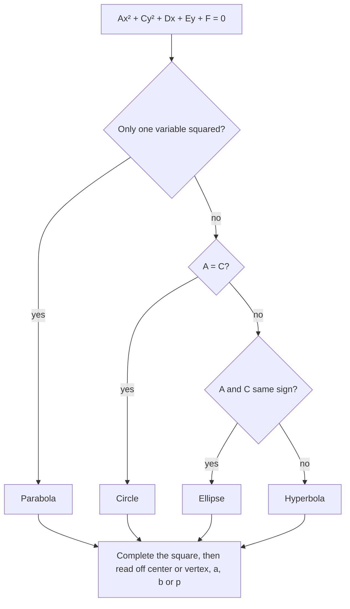

Two curves from this course have so far been met only in passing. The nonlinear systems lesson used the circle $(x - h)^2 + (y - k)^2 = r^2$, and its last example drew a curve, $x^2 - y^2 = 5$, called a hyperbola and promised you'd meet it later. This lesson is that meeting. Circles, parabolas, ellipses and hyperbolas belong to one family, the conic sections. They all come from slicing a cone, they all have equations of degree 2 in $x$ and $y$, and you can tell them apart, and find all their key features, with one tool you already know well: completing the square.

## Four curves from one cone

Take two identical cones placed tip to tip along a common axis (a double cone; each half is called a nappe) and slice them with a flat plane. The curve where the plane meets the cone is a **conic section**, or conic.

- Plane perpendicular to the axis: a circle.
- Plane tilted, but less steeply than the side of the cone: it cuts all the way around one nappe in a closed oval, an **ellipse**.
- Plane exactly parallel to a side of the cone: the curve never closes up, and you get a **parabola**.
- Plane steeper than the side: it cuts both nappes, giving a **hyperbola** with two separate branches.


If the plane passes through the tip itself, you get a single point, a single line or a pair of crossing lines. These leftovers are called **degenerate conics**. The Greek geometer Apollonius of Perga, around 200 BC, wrote an eight-book study of these curves and gave the ellipse, parabola and hyperbola their names.

Slicing cones is a good picture but a poor way to compute. For algebra, each conic has an equivalent definition in terms of distances, and those definitions lead straight to equations.

## The parabola: focus and directrix

A parabola is the set of points that are the same distance from a fixed point, the **focus**, and a fixed line, the **directrix**.

Put the focus at $(0, p)$ and the directrix at $y = -p$. A point $(x, y)$ is on the parabola when its distance to the focus equals its distance to the line:

$$\sqrt{x^2 + (y - p)^2} = |y + p|.$$

Square both sides and expand: $x^2 + y^2 - 2py + p^2 = y^2 + 2py + p^2$. The $y^2$ and $p^2$ cancel, leaving

$$x^2 = 4py.$$

So every parabola $y = ax^2$ from Algebra 1 has a focus: matching $y = \tfrac{1}{4p}x^2$ shows $a = \tfrac{1}{4p}$, or $p = \tfrac{1}{4a}$. The vertex sits halfway between the focus and the directrix, at a distance $|p|$ from each. If $p > 0$ the parabola opens up; if $p < 0$ it opens down. Swapping the roles of $x$ and $y$, $y^2 = 4px$ opens right ($p > 0$) or left ($p < 0$), with focus $(p, 0)$ and directrix $x = -p$.

### Example 1

Find the focus and directrix of $y = \tfrac18 x^2$, and check one point.

1. Rewrite as $x^2 = 8y$. Then $4p = 8$, so $p = 2$.
2. Focus $(0, 2)$; directrix $y = -2$. The vertex $(0, 0)$ is halfway between them.
3. Check the point $(4, 2)$, which is on the curve since $\tfrac18 \cdot 16 = 2$. Distance to the focus: $\sqrt{(4 - 0)^2 + (2 - 2)^2} = 4$. Distance to the directrix: $2 - (-2) = 4$. Equal, as promised.

```plot
{"x": [-10, 10], "y": [-4, 10], "equal": true, "functions": [{"f": "x^2/8", "label": "x² = 8y"}, {"f": "-2", "dashed": true, "label": "directrix y = −2"}], "points": [{"at": [0, 2], "label": "F"}, {"at": [4, 2], "label": "(4, 2)"}, {"at": [-8, 8], "label": "(−8, 8)"}], "segments": [{"from": [4, 2], "to": [0, 2]}, {"from": [4, 2], "to": [4, -2]}, {"from": [-8, 8], "to": [0, 2]}, {"from": [-8, 8], "to": [-8, -2]}], "labels": [{"at": [2, 1.1], "text": "4"}, {"at": [4.6, 0.2], "text": "4"}, {"at": [-3.4, 5.9], "text": "10"}, {"at": [-9.2, 3], "text": "10"}], "caption": "Every point on the parabola is as far from the focus F (0, 2) as from the directrix"}
```

The focus explains why satellite dishes and car headlight reflectors are parabolic. A parabolic mirror reflects every incoming ray parallel to its axis through the focus, and sends light from a bulb at the focus out in a parallel beam. (This reflection property is stated here without proof; it is usually proved with calculus.)

## The ellipse: a constant sum

An ellipse is the set of points whose distances to two fixed points, the two **foci** (plural of focus), add up to the same constant. You can draw one with two pins and a loop of string: keep the string tight with a pencil and move it around.

Centered at the origin with the foci on the $x$-axis at $(\pm c, 0)$, and with the constant sum called $2a$, the equation works out to

$$\frac{x^2}{a^2} + \frac{y^2}{b^2} = 1, \qquad \text{where } b^2 = a^2 - c^2 \;(a > b > 0).$$

The derivation squares twice, like a radical equation, and takes half a page; here is a quicker way to see where $b$ comes from. The ellipse crosses the $x$-axis at $(\pm a, 0)$, the vertices, and the $y$-axis at $(0, \pm b)$, the **co-vertices**. The segment between the vertices is the **major axis** (length $2a$), and the segment between the co-vertices is the **minor axis** (length $2b$). A co-vertex $(0, b)$ is the same distance from both foci, and its two distances must add to $2a$, so each is $a$. By the Pythagorean theorem in the right triangle with legs $b$ and $c$, $b^2 + c^2 = a^2$.


If the larger denominator is under $y^2$, the ellipse is tall instead of wide: the major axis and foci are on the $y$-axis. Either way, *$a$ is always the larger of the two square roots*, and $c^2 = a^2 - b^2$.

### Example 2

Find the vertices, co-vertices and foci of $9x^2 + 25y^2 = 225$.

1. Divide by 225 to get 1 on the right: $\dfrac{x^2}{25} + \dfrac{y^2}{9} = 1$.
2. The larger denominator, 25, is under $x^2$, so the major axis is horizontal with $a = 5$; $b = 3$.
3. $c^2 = 25 - 9 = 16$, so $c = 4$.
4. Vertices $(\pm 5, 0)$, co-vertices $(0, \pm 3)$, foci $(\pm 4, 0)$.

Check with the definition at the co-vertex $(0, 3)$: its distance to each focus is $\sqrt{16 + 9} = 5$, and $5 + 5 = 10 = 2a$.

How round an ellipse is is measured by its **eccentricity** $e = \tfrac{c}{a}$, which is between 0 and 1. When $e$ is near 0 the foci are close to the center and the ellipse is nearly a circle; as $e$ approaches 1 it gets long and thin. Johannes Kepler showed in 1609 that each planet moves on an ellipse with the Sun at one focus. Earth's orbit has $e \approx 0.017$, nearly circular, while Halley's comet has $e \approx 0.97$. A circle is the special case $a = b$, so $c = 0$ and both foci sit at the center.

## The hyperbola: a constant difference

A hyperbola is the set of points where the *difference* of the distances to two foci is constant (take the larger distance minus the smaller). With foci $(\pm c, 0)$ and constant difference $2a$:

$$\frac{x^2}{a^2} - \frac{y^2}{b^2} = 1, \qquad \text{where } b^2 = c^2 - a^2 \;(c > a > 0).$$

Note the sign changes from the ellipse: a minus sign in the equation, and now $c$ is the largest, with $c^2 = a^2 + b^2$. The vertices are $(\pm a, 0)$. There are no $y$-intercepts: $x = 0$ gives $-\tfrac{y^2}{b^2} = 1$, which has no real solution. Far from the center, each branch hugs one of two lines, the asymptotes of the hyperbola,

$$y = \pm \frac{b}{a}x.$$

To see why, solve for $y$: $y = \pm\tfrac{b}{a}\sqrt{x^2 - a^2}$, and when $x$ is large, $\sqrt{x^2 - a^2}$ is very close to $|x|$. If the $y^2$ term is the positive one, $\tfrac{y^2}{a^2} - \tfrac{x^2}{b^2} = 1$, the hyperbola opens up and down, the vertices are $(0, \pm a)$, and the asymptotes are $y = \pm\tfrac{a}{b}x$.

### Example 3

Find the vertices, foci and asymptotes of $9x^2 - 16y^2 = 144$.

1. Divide by 144: $\dfrac{x^2}{16} - \dfrac{y^2}{9} = 1$. The $x^2$ term is positive, so the branches open left and right; $a = 4$, $b = 3$.
2. $c^2 = 16 + 9 = 25$, so $c = 5$.
3. Vertices $(\pm 4, 0)$; foci $(\pm 5, 0)$; asymptotes $y = \pm\tfrac34 x$.

Check with the definition: $x = 5$ gives $\tfrac{y^2}{9} = \tfrac{25}{16} - 1 = \tfrac{9}{16}$, so $(5, \tfrac94)$ is on the curve. Its distances to the foci are $\tfrac94$ and $\sqrt{10^2 + (\tfrac94)^2} = \sqrt{\tfrac{1681}{16}} = \tfrac{41}{4}$, and $\tfrac{41}{4} - \tfrac94 = 8 = 2a$.

```plot
{"x": [-10, 10], "y": [-7, 7], "equal": true, "curves": [{"x": "4*cosh(t)", "y": "3*sinh(t)", "t": [-1.9, 1.9], "color": "var(--fig-0)"}, {"x": "-4*cosh(t)", "y": "3*sinh(t)", "t": [-1.9, 1.9], "color": "var(--fig-0)"}], "functions": [{"f": "0.75*x", "dashed": true, "label": "y = 3x/4"}, {"f": "-0.75*x", "dashed": true, "label": "y = −3x/4"}], "points": [{"at": [4, 0]}, {"at": [-4, 0]}, {"at": [5, 0]}, {"at": [-5, 0]}], "caption": "The hyperbola x²/16 − y²/9 = 1: vertices V at (±4, 0), foci F at (±5, 0), and the two asymptotes", "labels": [{"at": [3.3, 0.9], "text": "V"}, {"at": [-3.7, 0.9], "text": "V"}, {"at": [5.3, 0.9], "text": "F"}, {"at": [-5.7, 0.9], "text": "F"}]}
```

## Shifting the center and completing the square

Replacing $x$ by $x - h$ and $y$ by $y - k$ shifts any graph $h$ right and $k$ up (the transformations lesson). So $\dfrac{(x - h)^2}{a^2} + \dfrac{(y - k)^2}{b^2} = 1$ is an ellipse centered at $(h, k)$, and the same goes for the other conics. When the squares are multiplied out you get the **general form**

$$Ax^2 + Cy^2 + Dx + Ey + F = 0,$$

and the shape is hidden. Two things bring it back. First, the coefficients $A$ and $C$ of the squared terms already tell you the type:

| Squared terms | Conic |
|---|---|
| $A = C$ (same coefficient) | circle |
| $A$ and $C$ the same sign, $A \ne C$ | ellipse |
| $A$ and $C$ opposite signs | hyperbola |
| only one of $x^2$, $y^2$ appears | parabola |

Second, completing the square in $x$ and in $y$ gives the standard form, with the center (or vertex) and the numbers $a$, $b$ or $p$. One warning: the table names the type a non-degenerate graph would have. Occasionally the equation turns out to be degenerate (for instance, $x^2 + y^2 + 1 = 0$ has no points at all), and you only find out after completing the square.



### Example 4

Identify $4x^2 + 9y^2 - 16x + 18y - 11 = 0$ and find its center, vertices and foci.

1. $A = 4$ and $C = 9$ have the same sign and differ, so it should be an ellipse.
2. Group and factor out the coefficients: $4(x^2 - 4x) + 9(y^2 + 2y) = 11$.
3. Complete each square. Half of $-4$ is $-2$, and $(-2)^2 = 4$; half of $2$ is $1$, and $1^2 = 1$. Adding 4 inside the first parentheses adds $4 \cdot 4 = 16$ to the left side, and adding 1 inside the second adds $9 \cdot 1 = 9$, so add 16 and 9 on the right: $4(x - 2)^2 + 9(y + 1)^2 = 11 + 16 + 9 = 36$.
4. Divide by 36: $\dfrac{(x - 2)^2}{9} + \dfrac{(y + 1)^2}{4} = 1$.
5. Center $(2, -1)$; $a = 3$ (horizontal), $b = 2$, $c = \sqrt{9 - 4} = \sqrt5$.
6. Vertices $(2 \pm 3, -1)$, that is $(-1, -1)$ and $(5, -1)$. Foci $(2 \pm \sqrt5, -1)$, about $(-0.24, -1)$ and $(4.24, -1)$.

### Example 5

Identify $x^2 - 6x - 8y + 1 = 0$ and find its vertex, focus and directrix.

1. Only $x$ is squared, so it is a parabola.
2. Keep the $x$ terms on the left: $x^2 - 6x = 8y - 1$. Complete the square by adding 9 to both sides: $(x - 3)^2 = 8y + 8 = 8(y + 1)$.
3. This is $x^2 = 4py$ shifted to the vertex $(3, -1)$, with $4p = 8$, so $p = 2$ and it opens up.
4. Focus: 2 units above the vertex, $(3, 1)$. Directrix: 2 units below, $y = -3$.

## Common mistakes

- Taking $a$ from the $x^2$ term automatically. In an ellipse, $a$ goes with the larger denominator; in a hyperbola, with the positive term.
- Mixing up the two Pythagorean relations: ellipse $c^2 = a^2 - b^2$, hyperbola $c^2 = a^2 + b^2$. In an ellipse the foci are inside, so $c < a$; in a hyperbola they are outside the vertices, so $c > a$.
- Using $a^2$ as $a$: in $\tfrac{x^2}{25} + \tfrac{y^2}{9} = 1$ the vertices are at $\pm 5$, not $\pm 25$.
- Completing the square inside a factored group and adding only the inside number to the other side. In $4(x^2 - 4x + 4)$ you have added $16$, not $4$.
- Reading the sign of a shift backward: $(y + 1)^2$ means $k = -1$.
- Forgetting to make the right side equal 1 before reading off $a$ and $b$.

## Key points

- Conic sections come from slicing a double cone: circle, ellipse, parabola, hyperbola (plus degenerate cases).
- Parabola: equal distances to a focus and a directrix; $x^2 = 4py$ has focus $(0, p)$ and directrix $y = -p$.
- Ellipse: constant sum $2a$ of distances to two foci; $\tfrac{x^2}{a^2} + \tfrac{y^2}{b^2} = 1$, $c^2 = a^2 - b^2$, eccentricity $e = \tfrac{c}{a}$.
- Hyperbola: constant difference $2a$; $\tfrac{x^2}{a^2} - \tfrac{y^2}{b^2} = 1$, $c^2 = a^2 + b^2$, asymptotes $y = \pm\tfrac{b}{a}x$.
- In $Ax^2 + Cy^2 + Dx + Ey + F = 0$, the squared terms identify the conic; completing the square finds its center or vertex.
