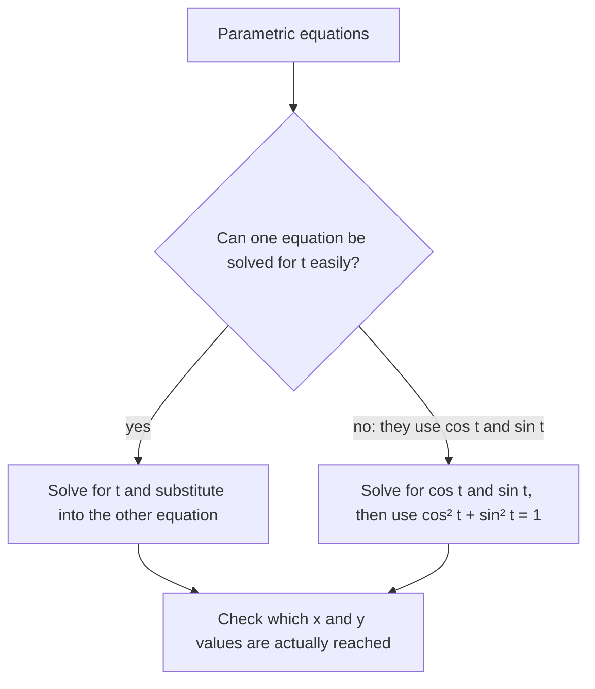

A graph like $y = x^2$ tells you *where* a curve is, but not how anything moves along it. A thrown ball, a car on a track or a point on a turning wheel has a position that changes with time, and its $x$- and $y$-coordinates often change in quite different ways. The conic sections lesson also ran into a limit of functions: a circle or an ellipse fails the vertical line test, so it can't be written as one function $y = f(x)$. Parametric equations solve both problems by writing $x$ and $y$ each as a function of a third variable. They use nearly everything in this course: linear and quadratic functions, the unit circle, and the conics from the last lesson.

## A third variable

**Parametric equations** give the coordinates of a point as functions of a third variable $t$, called the *parameter*:

$$x = f(t), \qquad y = g(t).$$

As $t$ runs through an interval, the point $(f(t), g(t))$ traces out a curve. Often $t$ stands for time, but it doesn't have to. The direction in which the point moves as $t$ increases is the curve's **orientation**; on a graph it is shown with arrows.

To graph parametric equations by hand, make a table with three columns: $t$, $x$ and $y$. Plot the $(x, y)$ points in order of increasing $t$ and join them.

### Example 1

Graph $x = 2t - 1$, $y = t^2 + 3$ for $-2 \le t \le 2$.

| $t$ | $-2$ | $-1$ | $0$ | $1$ | $2$ |
|---|---|---|---|---|---|
| $x = 2t - 1$ | $-5$ | $-3$ | $-1$ | $1$ | $3$ |
| $y = t^2 + 3$ | $7$ | $4$ | $3$ | $4$ | $7$ |

The points lie on a parabola with its lowest point at $(-1, 3)$, reached at $t = 0$. Since $x$ increases with $t$, the point moves from left to right.

```plot
{"x": [-6, 4], "y": [0, 8], "curves": [{"x": "2*t - 1", "y": "t^2 + 3", "t": [-2, 2]}], "points": [{"at": [-5, 7], "label": "t = −2"}, {"at": [-3, 4], "label": "t = −1"}, {"at": [-1, 3], "label": "t = 0"}, {"at": [1, 4], "label": "t = 1"}, {"at": [3, 7], "label": "t = 2"}], "segments": [{"from": [-4.1, 5.4], "to": [-3.9, 5.05], "arrow": true}, {"from": [1.9, 5.25], "to": [2.1, 5.6], "arrow": true}], "caption": "x = 2t − 1, y = t² + 3: the arrows show the orientation (left to right as t increases)"}
```

## Eliminating the parameter

To see which familiar curve a pair of parametric equations draws, **eliminate the parameter**: combine the two equations into one equation in $x$ and $y$ with no $t$. There are two standard ways.

*When one equation is easy to solve for $t$*, solve it and substitute into the other. In Example 1, $x = 2t - 1$ gives $t = \tfrac{x + 1}{2}$, so

$$y = \left(\frac{x + 1}{2}\right)^2 + 3 = \frac{(x + 1)^2}{4} + 3,$$

a parabola with vertex $(-1, 3)$, as the table showed. Because $t$ only ran from $-2$ to $2$, the parametric curve is just the piece with $-5 \le x \le 3$.

*When the equations involve $\cos t$ and $\sin t$*, solve for them and use the Pythagorean identity $\cos^2 t + \sin^2 t = 1$ from the unit circle lesson.

### Example 2

Eliminate the parameter from $x = 3\cos t$, $y = 2\sin t$, $0 \le t \le 2\pi$, and describe the motion.

1. Solve for the trig functions: $\cos t = \tfrac{x}{3}$ and $\sin t = \tfrac{y}{2}$.
2. Substitute into $\cos^2 t + \sin^2 t = 1$: $\dfrac{x^2}{9} + \dfrac{y^2}{4} = 1$.
3. That is an ellipse with $a = 3$ (horizontal) and $b = 2$.
4. Orientation: at $t = 0$ the point is at $(3, 0)$; at $t = \tfrac{\pi}{2}$ it is at $(0, 2)$. So it starts on the right and goes counterclockwise, once around as $t$ runs from $0$ to $2\pi$.

The same idea shows that $x = h + r\cos t$, $y = k + r\sin t$ traces the circle with center $(h, k)$ and radius $r$: it is the unit circle, stretched by $r$ and shifted to $(h, k)$.



The last step in the diagram matters. Eliminating the parameter can describe *more* points than the parametric curve visits. For example, $x = t^2$, $y = t^2 + 1$ gives $y = x + 1$, but since $x = t^2$ is never negative, the parametric curve is only the half-line with $x \ge 0$.

## Different parametrizations of one curve

A curve doesn't have just one parametric description. These all trace the unit circle $x^2 + y^2 = 1$:

| Equations | Interval | Motion |
|---|---|---|
| $x = \cos t$, $y = \sin t$ | $0 \le t \le 2\pi$ | once around, counterclockwise from $(1, 0)$ |
| $x = \cos t$, $y = -\sin t$ | $0 \le t \le 2\pi$ | once around, clockwise from $(1, 0)$ |
| $x = \cos 2t$, $y = \sin 2t$ | $0 \le t \le \pi$ | once around, counterclockwise, twice as fast |
| $x = \sin t$, $y = \cos t$ | $0 \le t \le 2\pi$ | once around, clockwise from $(0, 1)$ |

The picture in the $xy$-plane is the same; what changes is where the point starts, which way it goes and how fast. The parameter carries the information about motion that the $xy$-equation throws away.

## Lines and segments

The line through the point $(x_0, y_0)$ that moves $a$ units in $x$ and $b$ units in $y$ for each unit of $t$ is

$$x = x_0 + at, \qquad y = y_0 + bt.$$

To travel along the line segment from $P(x_1, y_1)$ to $Q(x_2, y_2)$, take $a = x_2 - x_1$ and $b = y_2 - y_1$ and let $t$ run from 0 to 1. At $t = 0$ you are at $P$, at $t = 1$ you are at $Q$, and at $t = \tfrac12$ you are at the midpoint.

### Example 3

Parametrize the segment from $P(1, 2)$ to $Q(7, -1)$, find the point one third of the way from $P$ to $Q$, and eliminate the parameter.

1. Changes: $a = 7 - 1 = 6$ and $b = -1 - 2 = -3$. So $x = 1 + 6t$, $y = 2 - 3t$, for $0 \le t \le 1$.
2. One third of the way: $t = \tfrac13$ gives $(1 + 2, 2 - 1) = (3, 1)$.
3. Eliminate: $t = \tfrac{x - 1}{6}$, so $y = 2 - 3 \cdot \tfrac{x - 1}{6} = 2 - \tfrac{x - 1}{2} = -\tfrac12 x + \tfrac52$, for $1 \le x \le 7$. The slope is $\tfrac{b}{a} = \tfrac{-3}{6} = -\tfrac12$, as it should be.

## Projectile motion

Parametric equations are the natural language for a thrown object, because its horizontal and vertical motions are independent. Ignoring air resistance, gravity only changes the vertical velocity. If an object is launched from height $h_0$ with speed $v_0$ at angle $\theta$ above the horizontal, then $t$ seconds later

$$x = (v_0\cos\theta)\,t, \qquad y = h_0 + (v_0\sin\theta)\,t - 16t^2 \quad \text{(feet)}.$$

The horizontal speed $v_0\cos\theta$ stays constant. The vertical part is the familiar falling-object model from Algebra 1; the $16$ is half of the acceleration due to gravity, about $32$ ft/s². In meters, use $4.9t^2$ instead of $16t^2$. Leaving out air resistance is a simplification: it is close for a heavy, slow object and poor for a fast, light one, such as a badminton shuttle.


### Example 4

A ball is thrown from 6 feet above the ground at 80 ft/s, at $30^\circ$ above the horizontal. Find its greatest height and how far away it lands.

1. Components: $v_0\cos 30^\circ = 80 \cdot \tfrac{\sqrt3}{2} = 40\sqrt3 \approx 69.28$ ft/s, and $v_0\sin 30^\circ = 80 \cdot \tfrac12 = 40$ ft/s.
2. Equations: $x = 40\sqrt3\,t$ and $y = 6 + 40t - 16t^2$.
3. Greatest height: $y$ is a downward parabola in $t$, with its vertex at $t = -\tfrac{40}{2(-16)} = 1.25$ s. Then $y = 6 + 50 - 25 = 31$ ft.
4. Landing: solve $6 + 40t - 16t^2 = 0$, or $8t^2 - 20t - 3 = 0$. The quadratic formula gives $t = \tfrac{20 \pm \sqrt{496}}{16}$; the positive root is $t \approx 2.64$ s (the negative root is before the throw).
5. Distance: $x \approx 69.28 \times 2.642 \approx 183$ ft.

Eliminating $t$ (with $t = \tfrac{x}{40\sqrt3}$) gives $y = 6 + \tfrac{x}{\sqrt3} - \tfrac{x^2}{300}$: the path is a parabola, which is why thrown objects (without air resistance) follow parabolic arcs.

## A curve that functions can't draw: the cycloid

Put a dot on the rim of a wheel of radius 1 and roll the wheel along the $x$-axis. The dot traces a **cycloid**:

$$x = t - \sin t, \qquad y = 1 - \cos t,$$

where $t$ is the angle the wheel has turned, in radians. The $t$ term is how far the wheel's center has rolled; the $\sin t$ and $\cos t$ terms describe the dot turning around the center. Each arch has width $2\pi$, the wheel's circumference, and the dot touches the ground with a sharp point (a cusp) once per turn.

```plot
{"x": [-0.5, 7], "y": [-0.5, 2.6], "equal": true, "curves": [{"x": "t - sin(t)", "y": "1 - cos(t)", "t": [0, 6.2832]}], "circles": [{"center": [3.1416, 1], "r": 1}], "points": [{"at": [3.1416, 2], "label": "t = π"}, {"at": [0, 0], "label": "t = 0"}, {"at": [6.2832, 0], "label": "t = 2π"}], "caption": "One arch of the cycloid x = t − sin t, y = 1 − cos t, with the rolling wheel drawn at t = π"}
```

## Common mistakes

- Forgetting the orientation. Two parametrizations can draw the same curve in opposite directions; check a couple of $t$-values.
- Eliminating the parameter and keeping points the curve never reaches. Check the range of $x$ and $y$ over the given $t$-interval.
- Solving $x = 3\cos t$ as $\cos t = 3x$. Divide: $\cos t = \tfrac{x}{3}$.
- Using the launch speed for both directions in projectile problems. Split it into $v_0\cos\theta$ (horizontal) and $v_0\sin\theta$ (vertical).
- Using $16t^2$ with meters or $4.9t^2$ with feet.
- Thinking a curve that fails the vertical line test can't be graphed parametrically. Parametric curves don't need to be functions of $x$.

## Key points

- Parametric equations $x = f(t)$, $y = g(t)$ describe a curve and how a point moves along it; the direction of motion is the orientation.
- Eliminate the parameter by solving for $t$ and substituting, or (for $\cos t$ and $\sin t$) by using $\cos^2 t + \sin^2 t = 1$; then check the range actually reached.
- $x = h + r\cos t$, $y = k + r\sin t$ is a circle; $x = a\cos t$, $y = b\sin t$ is an ellipse.
- The segment from $P$ to $Q$: $x = x_1 + (x_2 - x_1)t$, $y = y_1 + (y_2 - y_1)t$, $0 \le t \le 1$.
- Projectiles (no air resistance): $x = (v_0\cos\theta)t$, $y = h_0 + (v_0\sin\theta)t - 16t^2$ in feet.
