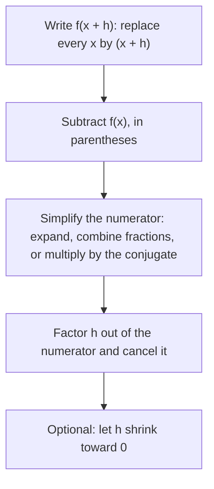

In Algebra 1, slope measured how fast a line rises: the same amount everywhere, $\tfrac{\Delta y}{\Delta x}$. Every other function in this course, from parabolas and polynomials to exponentials and rational functions, is steeper in some places than in others. How fast is a falling stone moving *at one instant*? How fast is a population growing *right now*? This last lesson of the course builds the tool for those questions out of algebra you already have: function notation, expanding, combining rational expressions and rationalizing with conjugates. The final step, letting a gap shrink to zero, is where calculus begins.

## Average rate of change

The **average rate of change** of $f$ from $x = a$ to $x = b$ is

$$\frac{\Delta y}{\Delta x} = \frac{f(b) - f(a)}{b - a}.$$

Geometrically, it is the slope of the **secant line**, the line through the two points $(a, f(a))$ and $(b, f(b))$ on the graph. Its units are units of $y$ per unit of $x$: feet per second, dollars per year, people per day.

### Example 1

A ball is thrown straight up from the ground at 64 ft/s, so its height after $t$ seconds is $h(t) = 64t - 16t^2$ feet. Find its average velocity (average rate of change of height) over $[0, 1]$, $[1, 2]$, $[2, 3]$ and $[0, 4]$.

1. Heights: $h(0) = 0$, $h(1) = 48$, $h(2) = 64$, $h(3) = 48$, $h(4) = 0$.
2. $[0, 1]$: $\dfrac{48 - 0}{1 - 0} = 48$ ft/s.
3. $[1, 2]$: $\dfrac{64 - 48}{1} = 16$ ft/s. Still rising, but slower.
4. $[2, 3]$: $\dfrac{48 - 64}{1} = -16$ ft/s. Negative: the ball is coming down.
5. $[0, 4]$: $\dfrac{0 - 0}{4} = 0$ ft/s. The ball went up 64 ft and came back, so its net change in height, and its average velocity, is zero.

The last answer is a warning: an average over a long interval can hide everything that happened inside it. To learn what happens at one moment we will need shorter and shorter intervals.

## How different families change

The pattern of average rates over equal steps is a fingerprint of each function family. Here are the rates over $[0, 1]$, $[1, 2]$, $[2, 3]$ and $[3, 4]$:

| Function | Rates of change | Pattern |
|---|---|---|
| $f(x) = 2x + 1$ (linear) | $2, 2, 2, 2$ | constant |
| $g(x) = x^2$ (quadratic) | $1, 3, 5, 7$ | the rates themselves grow by a constant 2 |
| $k(x) = 2^x$ (exponential) | $1, 2, 4, 8$ | the rates double each step |

So a line has one rate everywhere, a quadratic's rate changes at a steady pace (an arithmetic sequence of rates), and an exponential's rate grows in proportion to its own size (a geometric sequence of rates). This is one way to see why exponential growth eventually outpaces any quadratic.

## The difference quotient

To study the rate near any point $x$, not just between two fixed numbers, use a second point a small distance $h$ away, at $x + h$. The average rate of change from $x$ to $x + h$ is the **difference quotient**

$$\frac{f(x + h) - f(x)}{h}, \qquad h \ne 0.$$

It is the slope of the secant line through $(x, f(x))$ and $(x + h, f(x + h))$: the run is $h$ and the rise is $f(x + h) - f(x)$.


The goal is to simplify it until the $h$ in the denominator cancels. Here is the routine:



### Example 2

Simplify the difference quotient of $f(x) = 3x^2 - 5x + 1$.

1. Replace $x$ by $(x + h)$: $f(x + h) = 3(x + h)^2 - 5(x + h) + 1 = 3x^2 + 6xh + 3h^2 - 5x - 5h + 1$.
2. Subtract $f(x)$: the $3x^2$, $-5x$ and $1$ cancel, leaving $6xh + 3h^2 - 5h$.
3. Divide by $h$ (every term has a factor of $h$): $\dfrac{h(6x + 3h - 5)}{h} = 6x + 3h - 5$.

### Example 3

Simplify the difference quotient of $f(x) = \dfrac1x$.

1. Numerator: $\dfrac{1}{x + h} - \dfrac1x = \dfrac{x - (x + h)}{x(x + h)} = \dfrac{-h}{x(x + h)}$, combining over the common denominator as in the rational expressions lessons.
2. Divide by $h$ (multiply by $\tfrac1h$): $\dfrac{-h}{x(x + h)} \cdot \dfrac1h = -\dfrac{1}{x(x + h)}$.

### Example 4

Simplify the difference quotient of $f(x) = \sqrt x$.

1. The quotient is $\dfrac{\sqrt{x + h} - \sqrt x}{h}$. Nothing cancels yet.
2. Multiply top and bottom by the conjugate $\sqrt{x + h} + \sqrt x$. The numerator becomes a difference of squares: $(x + h) - x = h$.
3. So the quotient is $\dfrac{h}{h\left(\sqrt{x + h} + \sqrt x\right)} = \dfrac{1}{\sqrt{x + h} + \sqrt x}$.

This is rationalizing the *numerator*, the mirror image of the trick in the radicals lesson, and it's done for the same reason: to expose a factor that can cancel.

## Shrinking the interval

Now let $h$ get closer and closer to 0. For $f(x) = x^2$ at $x = 3$ the difference quotient simplifies to $2x + h = 6 + h$:

| $h$ | $1$ | $0.1$ | $0.01$ | $0.001$ | $-0.01$ | $-0.1$ |
|---|---|---|---|---|---|---|
| secant slope $6 + h$ | $7$ | $6.1$ | $6.01$ | $6.001$ | $5.99$ | $5.9$ |

From both sides the slopes close in on 6. We can't simply put $h = 0$ in the *original* quotient, because $\tfrac{0}{0}$ is undefined; that's why we simplify first. In the simplified form, $6 + h$ gets as close to 6 as we like when $h$ is near 0. That number, 6, is the **instantaneous rate of change** of $x^2$ at $x = 3$, and the line through $(3, 9)$ with slope 6, $y = 6x - 9$, is the **tangent line** there: the line that just grazes the curve at that point. The secant lines swing toward it as $h$ shrinks.

```plot
{"x": [0, 7], "y": [-2, 28], "functions": [{"f": "x^2"}, {"f": "8*x - 15", "dashed": true}, {"f": "7*x - 12", "dashed": true}, {"f": "6*x - 9"}], "points": [{"at": [3, 9]}, {"at": [5, 25]}, {"at": [4, 16]}], "labels": [{"at": [2.5, 10.5], "text": "A"}, {"at": [3.5, 17.5], "text": "B"}, {"at": [4.5, 26.5], "text": "C"}, {"at": [1.2, 3.5], "text": "y = x²"}], "caption": "Secant AC (h = 2, slope 8) and secant AB (h = 1, slope 7) swing toward the tangent at A = (3, 9) (solid line, slope 6) as h shrinks"}
```

The same process works for any $x$. For $x^2$, the instantaneous rate at $x$ is $2x$; for $3x^2 - 5x + 1$ (Example 2), letting $h \to 0$ in $6x + 3h - 5$ gives $6x - 5$; for $\tfrac1x$ (Example 3) it gives $-\tfrac{1}{x^2}$; for $\sqrt x$ (Example 4) it gives $\tfrac{1}{2\sqrt x}$.

### Example 5

Find the ball's instantaneous velocity at $t = 1$ and $t = 2$, using $h(t) = 64t - 16t^2$ from Example 1. (Call the small step $\Delta t$ here, since $h$ is already the height.)

1. Difference quotient: $\dfrac{h(t + \Delta t) - h(t)}{\Delta t} = \dfrac{64\Delta t - 32t\,\Delta t - 16(\Delta t)^2}{\Delta t} = 64 - 32t - 16\Delta t$.
2. Let $\Delta t$ shrink to 0: the velocity at time $t$ is $64 - 32t$ ft/s.
3. At $t = 1$: $64 - 32 = 32$ ft/s, upward. At $t = 2$: $0$ ft/s. The ball is momentarily still at the top of its flight, which matches the vertex of the parabola, $t = -\tfrac{64}{2(-16)} = 2$.

## Where this leads

The instantaneous rate of change, as a function of $x$, is called the **derivative** of $f$, written $f'(x)$. The phrase "let $h$ shrink toward 0" is made precise with limits, and the notation is

$$f'(x) = \lim_{h \to 0} \frac{f(x + h) - f(x)}{h}.$$

Isaac Newton and Gottfried Leibniz developed these ideas independently in the later 1600s, building on tangent methods of Pierre de Fermat and others. What you did here, informally and with algebra alone, is the first chapter of calculus, where limits make "shrinking $h$" rigorous.

## Common mistakes

- Writing $f(x + h)$ as $f(x) + h$. Replace every $x$ by $(x + h)$: for $x^2$ that gives $x^2 + 2xh + h^2$, not $x^2 + h$.
- Forgetting the parentheses when subtracting $f(x)$, so only its first term changes sign.
- Setting $h = 0$ before simplifying, which gives $\tfrac00$.
- Reversing the order: $\tfrac{f(a) - f(b)}{b - a}$ has the wrong sign. Keep the same order on top and bottom.
- Reading an average rate of zero as "nothing changed". It only means the net change was zero, like the ball that went up and came back.

## Key points

- Average rate of change from $a$ to $b$: $\tfrac{f(b) - f(a)}{b - a}$, the slope of the secant line, in units of $y$ per unit of $x$.
- Over equal steps, rates are constant for linear functions, change by a constant for quadratics, and grow by a constant factor for exponentials.
- Difference quotient: $\tfrac{f(x + h) - f(x)}{h}$; simplify by expanding, combining fractions or multiplying by a conjugate until $h$ cancels.
- Letting $h$ shrink toward 0 in the simplified quotient gives the instantaneous rate of change, the slope of the tangent line.
- That instantaneous rate is the derivative $f'(x)$, the starting point of calculus.
