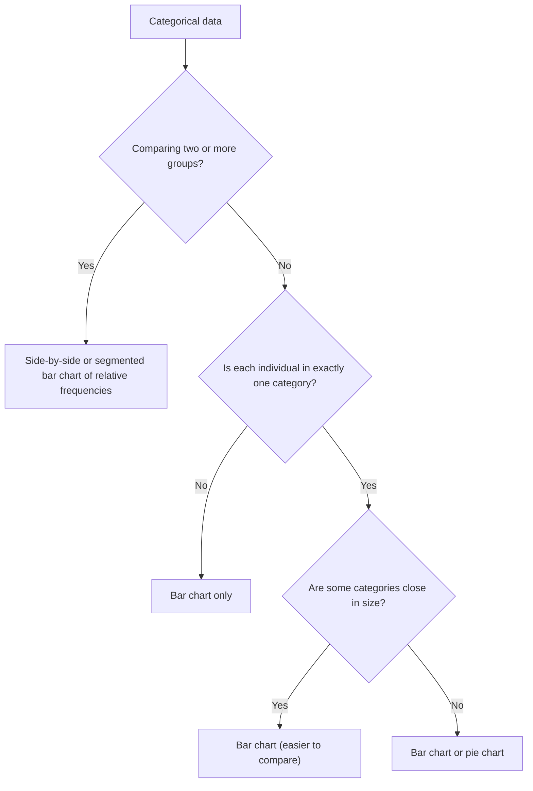

## From a list to a picture

The previous lesson sorted variables into categorical and quantitative. This lesson is
about the first kind. With categorical data, the only thing to describe is how the
individuals are split among the categories, so every display is built from a table of
counts. The goal is a picture that lets a reader compare categories at a glance — and
that doesn't mislead.

## Frequency tables

A **frequency table** lists each category with its count (frequency). Adding a column of
relative frequencies (count ÷ total) makes groups of different sizes comparable.

A transit agency surveyed 400 riders about how they reached the station.

| Mode | Frequency | Relative frequency |
|---|---|---|
| Walk | 152 | 0.38 |
| Bus | 96 | 0.24 |
| Car | 88 | 0.22 |
| Bike | 64 | 0.16 |
| Total | 400 | 1.00 |

The relative frequencies are the distribution of the variable "mode of arrival."

## Bar charts

A **bar chart** draws one bar per category with height equal to the count or the
relative frequency. The bars are separated by gaps, because the categories are separate
groups — there is no number line along the horizontal axis.

```plot
{"x": [-0.3, 4.6], "y": [-0.07, 0.42], "grid": false, "bars": [{"x": 1, "height": 0.38, "width": 0.7}, {"x": 2, "height": 0.24, "width": 0.7}, {"x": 3, "height": 0.22, "width": 0.7}, {"x": 4, "height": 0.16, "width": 0.7}], "segments": [{"from": [0.4, 0], "to": [4.6, 0]}, {"from": [0.4, 0], "to": [0.4, 0.4]}, {"from": [0.33, 0.1], "to": [0.4, 0.1]}, {"from": [0.33, 0.2], "to": [0.4, 0.2]}, {"from": [0.33, 0.3], "to": [0.4, 0.3]}, {"from": [0.33, 0.4], "to": [0.4, 0.4]}], "labels": [{"at": [1, -0.03], "text": "Walk"}, {"at": [2, -0.03], "text": "Bus"}, {"at": [3, -0.03], "text": "Car"}, {"at": [4, -0.03], "text": "Bike"}, {"at": [0.1, 0.094], "text": "0.1"}, {"at": [0.1, 0.194], "text": "0.2"}, {"at": [0.1, 0.294], "text": "0.3"}, {"at": [0.1, 0.394], "text": "0.4"}, {"at": [0.75, 0.415], "text": "rel. freq."}], "caption": "Bar chart of arrival mode (relative frequency)"}
```

Good habits for bar charts:

- Start the vertical axis at zero. Bar *length* is what the eye compares, so a
  truncated axis exaggerates differences.
- Order the bars sensibly: by size for nominal data (a **Pareto chart** sorts bars from
  tallest to shortest), or in the natural order for ordinal data ("poor, fair, good").
- Label the axis with what the height means (count or percent).

Because order doesn't matter for nominal categories, you can rearrange bars freely; the
shape of a bar chart for nominal data carries no meaning. Words like "skewed" belong to
quantitative distributions, not to bar charts of nominal data.

## Pie charts

A **pie chart** shows each category as a slice of a circle whose angle is proportional
to the category's share of the whole:

$$\text{angle} = \text{relative frequency} \times 360^\circ$$

For the walkers, $0.38 \times 360^\circ = 136.8^\circ$. The full pie chart of the 400 riders, with every angle worked out, is below.


 Pie charts only make sense when
the categories are parts of one whole — every individual in exactly one slice, slices
adding to 100%. If respondents could pick several modes, the percentages would add to
more than 100% and a pie chart would be wrong (a bar chart still works).

Pie charts are good at showing "this part is about half" but bad at comparing similar
slices: most people cannot tell 22% from 24% by angle, while they easily can by bar
height. Prefer bar charts for comparisons.

## Comparing groups: side-by-side and segmented bar charts

To compare the distribution of a categorical variable across groups — say, arrival mode
for weekday riders versus weekend riders — use relative frequencies within each group
(group sizes usually differ). A **side-by-side bar chart** puts each group's bars next to
each other; a **segmented bar chart** (stacked to 100%) draws one bar per group divided
into pieces for each category. These ideas return in the two-way tables lesson.

Suppose 300 of the 400 riders came on weekdays and 100 on weekends. The weekday counts were walk 120,
bus 84, car 54, bike 42; the weekend counts were walk 32, bus 12, car 34, bike 22. Raw counts would make
every weekday bar taller simply because there are three times as many weekday riders, so each bar below
is scaled to 100% of its own group. The picture shows at once that weekend riders drive and bike more
and take the bus much less.


The flowchart summarizes which display to choose.



## Misleading graphs

Graphs can mislead without any false number:

- **Truncated axis**: a bar chart starting at 40% makes 45% look twice as tall as 42.5%.
- **Pictograms**: if a picture of a bus is drawn twice as tall *and* twice as wide to
  represent twice as many riders, its area is four times larger, and the eye reads area.
- *3-D effects*: tilting a pie chart makes front slices look larger than back slices.
- *Missing context*: percentages without the total count hide how small a group is.

### Example 1

A school club survey of 250 students records favorite lunch: pizza 95, salad 40, tacos
70, sandwich 45. Find the relative frequency of tacos and the angle of its slice in a
pie chart.

1. Check the total: $95 + 40 + 70 + 45 = 250$. Good — every student is in exactly one
   category, so a pie chart is appropriate.
2. Relative frequency of tacos: $\tfrac{70}{250} = 0.28$.
3. Angle: $0.28 \times 360^\circ = 100.8^\circ$.

As a check, the four angles are $136.8^\circ, 57.6^\circ, 100.8^\circ, 64.8^\circ$, which
add to $360^\circ$.

### Example 2

A news graphic shows a bar chart of approval ratings: 52% for Plan A and 48% for Plan B.
The vertical axis runs from 46% to 54%. How many times taller does Plan A's bar look, and
how many times larger is A's rating really?

1. On the truncated axis, A's bar has height $52 - 46 = 6$ units and B's has
   $48 - 46 = 2$ units. A's bar looks $6 / 2 = 3$ times as tall.
2. The actual ratio is $52 / 48 \approx 1.08$: A is about 8% larger.
3. The graph exaggerates the difference by a factor of about three. Redraw with the
   axis starting at 0.

### Example 3

A pie chart is drawn with a slice of $72^\circ$ for "cyclists" from a survey of 300
commuters. How many commuters are cyclists?

The share is $72 / 360 = 0.2$, so $0.2 \times 300 = 60$ cyclists.

## Common mistakes

- Using a pie chart when categories overlap or don't make up a whole.
- Leaving gaps out of a bar chart (that makes it look like a histogram of a
  quantitative variable) or describing a nominal bar chart as "skewed."
- Comparing raw counts between groups of different sizes instead of relative
  frequencies.
- Forgetting that relative frequency × 360° gives the angle, not the count × 360°.

## Key points

- Categorical data are summarized by counts and relative frequencies in a frequency table.
- Bar charts compare categories by bar length (axis from zero); pie charts show parts of
  a whole (angle = relative frequency × 360°).
- To compare groups, use relative frequencies and side-by-side or segmented bar charts.
- Watch for truncated axes, area distortions and 3-D effects.
