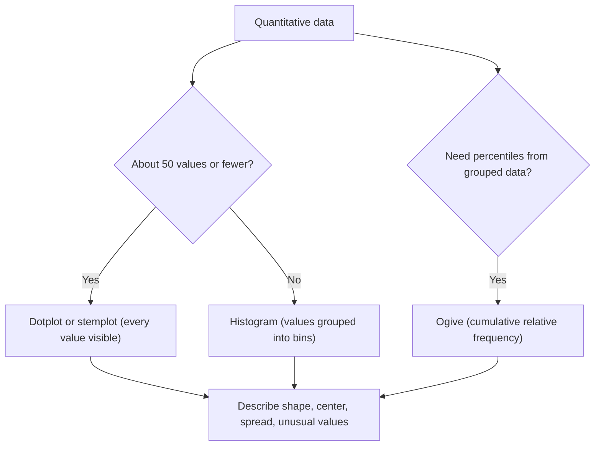

## Pictures of numbers

For a quantitative variable, values sit on a number line, so the display has to show
*where* the values fall and how they bunch up. This lesson covers the four standard
displays and the vocabulary for describing what they show: *shape, center, spread and
unusual values*. Always describe all four, in the context of the data.

## Dotplots

A **dotplot** puts a dot above a number line for each value, stacking repeats. It keeps
every data value visible and works well for small data sets (up to about 50 values).

Number of rail cars in 15 freight trains: 4, 5, 5, 6, 6, 6, 7, 7, 7, 7, 8, 8, 9, 12, 13.

```plot
{"x": [3, 14], "y": [-1, 3.5], "grid": false, "points": [{"at": [4, 0.5], "color": "#2c5e8f"}, {"at": [5, 0.5], "color": "#2c5e8f"}, {"at": [5, 1.2], "color": "#2c5e8f"}, {"at": [6, 0.5], "color": "#2c5e8f"}, {"at": [6, 1.2], "color": "#2c5e8f"}, {"at": [6, 1.9], "color": "#2c5e8f"}, {"at": [7, 0.5], "color": "#2c5e8f"}, {"at": [7, 1.2], "color": "#2c5e8f"}, {"at": [7, 1.9], "color": "#2c5e8f"}, {"at": [7, 2.6], "color": "#2c5e8f"}, {"at": [8, 0.5], "color": "#2c5e8f"}, {"at": [8, 1.2], "color": "#2c5e8f"}, {"at": [9, 0.5], "color": "#2c5e8f"}, {"at": [12, 0.5], "color": "#2c5e8f"}, {"at": [13, 0.5], "color": "#2c5e8f"}], "segments": [{"from": [3, 0], "to": [14, 0]}], "labels": [{"at": [4, -0.5], "text": "4"}, {"at": [6, -0.5], "text": "6"}, {"at": [8, -0.5], "text": "8"}, {"at": [10, -0.5], "text": "10"}, {"at": [12, -0.5], "text": "12"}, {"at": [14, -0.5], "text": "14"}], "caption": "Dotplot: cars per train"}
```

The plot shows a peak at 7, most trains between 4 and 9 cars, and two trains (12 and 13)
standing apart — possible outliers.

## Stemplots

A **stemplot** (stem-and-leaf plot) splits each value into a **stem** (all but the last
digit) and a **leaf** (the last digit). Stems go in a column; leaves are written in
order beside their stem. Test scores 58, 62, 67, 71, 73, 73, 78, 80, 84, 85, 91:

| Stem | Leaves |
|---|---|
| 5 | 8 |
| 6 | 2 7 |
| 7 | 1 3 3 8 |
| 8 | 0 4 5 |
| 9 | 1 |

Key: 7 | 3 means 73. Turned on its side, a stemplot is a histogram that still shows every
value. **Split stems** (each stem used twice, leaves 0–4 then 5–9) spread out data that
crowd onto few stems. A **back-to-back stemplot** shares one column of stems between two
groups for comparison.

## Histograms

A **histogram** groups values into equal-width intervals called classes or bins and
draws a bar for each bin, with height equal to the count (or relative frequency) in the
bin. Unlike a bar chart, the horizontal axis is a number line and the bars touch, since
the bins cover the line without gaps.

Commute times (minutes) for 40 workers, bins of width 10:

| Bin | 0–<10 | 10–<20 | 20–<30 | 30–<40 | 40–<50 | 50–<60 |
|---|---|---|---|---|---|---|
| Count | 6 | 13 | 10 | 6 | 3 | 2 |

```plot
{"x": [0, 60], "y": [0, 14], "xLabel": "minutes", "yLabel": "count", "bars": [{"x": 5, "height": 6, "width": 10}, {"x": 15, "height": 13, "width": 10}, {"x": 25, "height": 10, "width": 10}, {"x": 35, "height": 6, "width": 10}, {"x": 45, "height": 3, "width": 10}, {"x": 55, "height": 2, "width": 10}], "caption": "Histogram of commute times (skewed right)"}
```

A value on a boundary, like 20, goes in the bin that starts there (20–<30). Bin width
is a choice: too few bins hide the shape, too many make it ragged. About 5–15 bins is
typical. A histogram cannot tell you individual values — only how many fall in each bin.

Which display to use depends mostly on how many values there are and what you need to read off.



## Describing shape

- **Symmetric**: the left and right halves are rough mirror images.
- **Skewed right** (positively skewed): a long tail stretching toward large values,
  like the commute times above, incomes, or house prices.
- **Skewed left** (negatively skewed): a long tail toward small values, like scores on
  an easy test.
- **Unimodal** / **bimodal**: one clear peak or two. Two peaks often mean two groups mixed
  together (e.g., heights of adult men and women combined).
- **Uniform**: roughly flat; all bins about equally full.


The direction of skew is the direction of the *tail*, not of the peak. In a right-skewed
distribution the peak is on the left.

Besides shape, describe **center** (a typical value), **spread** (how variable the data
are) and **outliers** — values that fall well outside the overall pattern — along with
gaps and clusters.

## Cumulative frequency

A **cumulative frequency** table gives, for each bin, the number of values *at or below*
that bin's upper boundary: add the counts as you go. Dividing by the total gives
**cumulative relative frequency**.

| Upper boundary | 10 | 20 | 30 | 40 | 50 | 60 |
|---|---|---|---|---|---|---|
| Cumulative count | 6 | 19 | 29 | 35 | 38 | 40 |
| Cumulative rel. freq. | 0.15 | 0.475 | 0.725 | 0.875 | 0.95 | 1.00 |

The graph of cumulative relative frequency against the upper boundaries is an
**ogive**. It always rises from 0 to 1, and it is steepest where the data are densest.
Reading across from 0.5 to the curve and down gives an estimate of the median.

```plot
{"x": [0, 60], "y": [0, 1.05], "xLabel": "minutes", "yLabel": "cum. rel. freq.", "points": [[0, 0], [10, 0.15], [20, 0.475], [30, 0.725], [40, 0.875], [50, 0.95], [60, 1]], "segments": [{"from": [0, 0], "to": [10, 0.15]}, {"from": [10, 0.15], "to": [20, 0.475]}, {"from": [20, 0.475], "to": [30, 0.725]}, {"from": [30, 0.725], "to": [40, 0.875]}, {"from": [40, 0.875], "to": [50, 0.95]}, {"from": [50, 0.95], "to": [60, 1]}, {"from": [0, 0.5], "to": [21, 0.5], "dashed": true}, {"from": [21, 0.5], "to": [21, 0], "dashed": true}], "caption": "Ogive: the median is about 21 minutes"}
```

### Example 1

Use the commute table to find the percent of workers with commutes of at least 30
minutes, and estimate the median.

1. Count at least 30: $6 + 3 + 2 = 11$, so $11/40 = 27.5\%$. (Equivalently,
   $1 - 0.725 = 0.275$ from the cumulative table.)
2. The median is the 20th–21st value. 19 values are below 20 minutes and 29 below 30, so
   the median is in the 20–<30 bin, just above 20.
3. Interpolating: we need $20 - 19 = 1$ more value of the 10 in the bin, about $1/10$ of
   the way across, so roughly $20 + 1 = 21$ minutes. The ogive's dashed line agrees.

### Example 2

Describe the distribution of the cars-per-train dotplot.

*Shape:* roughly symmetric and unimodal for the main group, with a short right tail.
*Center:* around 7 cars (the 8th of 15 values is 7). *Spread:* main group from 4 to 9 cars.
*Unusual values:* trains with 12 and 13 cars stand apart after a gap from 9 to 12 — possible
outliers worth checking (maybe a different service type).

## Common mistakes

- Naming skew by where the peak is: a peak on the left with a tail to the right is
  *right*-skewed.
- Drawing gaps between histogram bars, or reading a histogram's bin as an exact value.
- Using a histogram with very few values (a dotplot or stemplot shows more).
- Forgetting the key on a stemplot, or leaving leaves unsorted.
- Describing shape only; a full description gives shape, center, spread and outliers in
  context.

## Key points

- Dotplots and stemplots keep the raw values; histograms group values into bins.
- Describe distributions by shape (symmetric, skewed, uni/bimodal), center, spread and
  unusual features — in context.
- Skew is named for the long tail.
- Cumulative frequency adds counts up to each boundary; the ogive estimates percentiles
  and the median.
