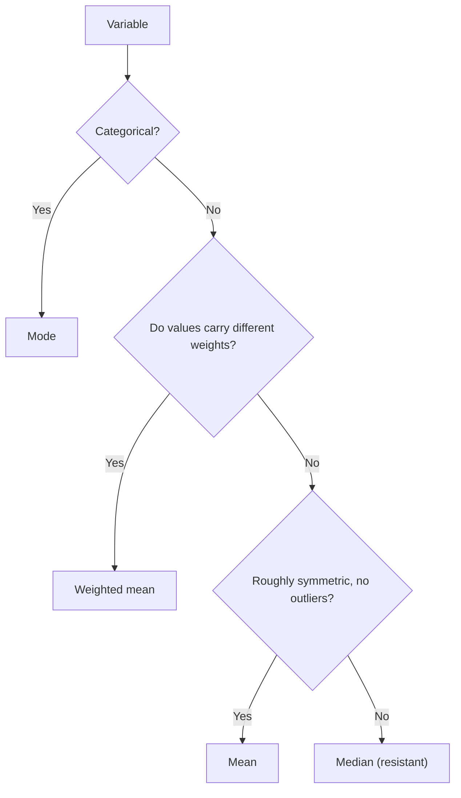

## What "typical" means

Graphs show a distribution; numbers summarize it. The first number people want is a
*typical* value — the center. There are three common measures, and they answer slightly
different questions. Choosing the right one depends on the shape you learned to read in
the last lesson.

## The mean

The **mean** is the arithmetic average: add the values and divide by how many there are.

$$\bar{x} = \frac{x_1 + x_2 + \cdots + x_n}{n} = \frac{\sum x_i}{n}$$

The symbol $\sum$ (capital sigma) means "add up." For a whole population the same
formula, written with $N$, gives the population mean $\mu$.

*Why it is a balance point*. Imagine the values as equal weights on a number line.
The mean is where the line balances: the total distance of the points above the mean
equals the total distance below it, because the deviations $x_i - \bar{x}$ always add to
zero:

$$\sum (x_i - \bar{x}) = \sum x_i - n\bar{x} = n\bar{x} - n\bar{x} = 0.$$

The picture uses the nine ridership counts from Example 1 below. Two far-out values on the right
move the balance point to 15, to the right of the median, 13.


The mean also has a "fair share" meaning: if the total were split equally among the
$n$ individuals, each would get $\bar{x}$. That makes it easy to find a missing value
from a known mean: the total must be $n\bar{x}$.

## The median

The **median** is the middle value of the ordered data: half the values are at or below
it, half at or above.

1. Sort the values.
2. If $n$ is odd, the median is the value in position $\tfrac{n+1}{2}$.
3. If $n$ is even, it is the average of the two middle values, in positions
   $\tfrac{n}{2}$ and $\tfrac{n}{2} + 1$.

The formula $\tfrac{n+1}{2}$ gives the *location*, not the value. With $n = 20$, the
location 10.5 means "halfway between the 10th and 11th values."

## The mode

The **mode** is the most frequent value. A data set can have one mode, several, or none
(all values distinct). The mode is the only measure of center that works for categorical
data ("the most common arrival mode is walking"). For quantitative data it is mostly
useful to describe peaks: the tallest bar of a histogram is the **modal class**.

## Resistance and the effect of skew

A statistic is **resistant** if extreme values have little effect on it. The median is
resistant; the mean is not. Change the largest of 9 salaries from $90,000 to $900,000
and the median doesn't move at all, while the mean jumps by $810{,}000/9 = 90{,}000$.

This is why the shape matters:

| Shape | Relationship | Better summary |
|---|---|---|
| Roughly symmetric | mean ≈ median | mean (uses all the data) |
| Skewed right | mean > median (pulled toward the long right tail) | median |
| Skewed left | mean < median | median |

Home prices and incomes are right-skewed, which is why news reports give *median*
home price. A **trimmed mean** (drop a fixed percent of the largest and smallest values,
then average) is a compromise that is more resistant than the mean.

```plot
{"x": [0, 10], "y": [-0.04, 0.27], "grid": false, "functions": [{"f": "x*exp(-x/1.6)/2.56"}], "segments": [{"from": [0, 0], "to": [10, 0]}, {"from": [2.69, 0], "to": [2.69, 0.196], "dashed": true}, {"from": [3.2, 0], "to": [3.2, 0.169], "dashed": true}], "labels": [{"at": [2.2, -0.025], "text": "median"}, {"at": [3.8, -0.025], "text": "mean"}], "caption": "In a right-skewed distribution the mean is pulled toward the tail"}
```

The mirror image shows left skew: the long tail is on the left, and the mean sits to the left of
the median.

```plot
{"x": [0, 10], "y": [-0.04, 0.27], "grid": false, "functions": [{"f": "(10-x)*exp(-(10-x)/1.6)/2.56"}], "segments": [{"from": [0, 0], "to": [10, 0]}, {"from": [7.31, 0], "to": [7.31, 0.196], "dashed": true}, {"from": [6.8, 0], "to": [6.8, 0.169], "dashed": true}], "labels": [{"at": [7.8, -0.025], "text": "median"}, {"at": [6.2, -0.025], "text": "mean"}], "caption": "In a left-skewed distribution the mean is pulled toward the left tail"}
```

Putting the shape, the type of variable and the weights together gives a quick way to choose.



## The weighted mean and grouped data

When values carry different weights $w_i$ (credit hours, frequencies, portfolio shares),
the **weighted mean** is

$$\bar{x}_w = \frac{\sum w_i x_i}{\sum w_i}.$$

An ordinary mean is the special case where every weight is 1. A frequency table is a
weighted mean in disguise: each value is weighted by how often it occurs. For a
histogram or grouped table where only bin counts are known, estimate the mean by using
each bin's **midpoint** as the value, weighted by the count.

### Example 1

Nine daily ridership counts (in hundreds) at a small station:
14, 9, 22, 11, 15, 9, 13, 30, 12. Find the mean, median and mode, and say which better
describes a typical day.

1. Sum: $14 + 9 + 22 + 11 + 15 + 9 + 13 + 30 + 12 = 135$. Mean $= 135/9 = 15$.
2. Sort: 9, 9, 11, 12, 13, 14, 15, 22, 30. With $n = 9$, the median is in position
   $(9+1)/2 = 5$: the median is 13.
3. Mode: 9 (appears twice).
4. The values 22 and 30 form a right tail that pulls the mean (15) above the median (13).
   The median better describes a typical day.

### Example 2

A student's semester grades: a 4-credit course at 3.7, a 3-credit course at 3.0, and a
1-credit lab at 4.0 (grade points). Find the GPA.

1. Weights are credits: $\sum w_i x_i = 4(3.7) + 3(3.0) + 1(4.0) = 14.8 + 9 + 4 = 27.8$.
2. $\sum w_i = 4 + 3 + 1 = 8$.
3. GPA $= 27.8 / 8 = 3.475$.

The unweighted mean $(3.7 + 3.0 + 4.0)/3 \approx 3.57$ would wrongly let the 1-credit
lab count as much as the 4-credit course.

### Example 3

Five quiz scores have a mean of 82. Four of them are 75, 90, 78 and 85. What is the
fifth?

The total must be $5 \times 82 = 410$. The four known scores add to 328, so the fifth is
$410 - 328 = 82$.

### Example 4

Estimate the mean commute from the grouped table: 0–<10: 6, 10–<20: 13, 20–<30: 10,
30–<40: 6, 40–<50: 3, 50–<60: 2.

Midpoints 5, 15, 25, 35, 45, 55:
$\sum w_i x_i = 6(5) + 13(15) + 10(25) + 6(35) + 3(45) + 2(55) = 30 + 195 + 250 + 210 + 135 + 110 = 930$.
Divide by 40: about 23.25 minutes. Compare the median estimate of about 21 from the
previous lesson: mean > median, consistent with right skew.

## Common mistakes

- Forgetting to sort before finding the median.
- Reporting the location $(n+1)/2$ as the median instead of the value at that location.
- Averaging averages: the mean of two class means is the overall mean only if the
  classes are the same size; otherwise weight by size.
- Saying the mean is "the middle value" — that's the median.

## Key points

- Mean $\bar{x} = \sum x_i / n$: the balance point; deviations from it sum to 0.
- Median: middle of the sorted data (position $(n+1)/2$); resistant to outliers.
- Mode: most frequent value; the only center for categorical data.
- Right skew: mean > median; left skew: mean < median. Use the median for skewed data.
- Weighted mean $\sum w_i x_i / \sum w_i$; for grouped data use bin midpoints.
