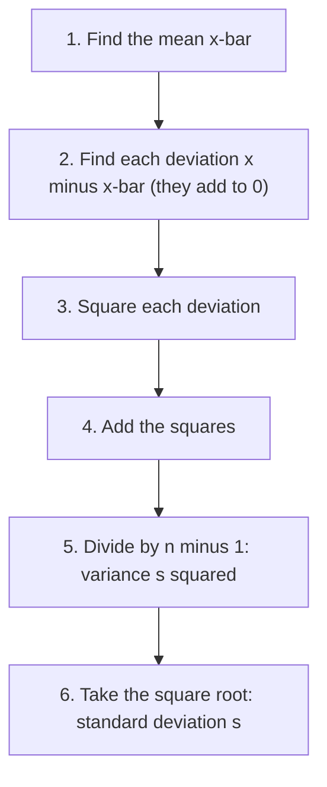

## Why center is not enough

Two rail lines can both average 2 minutes late, yet one is late by 1–3 minutes every day
while the other is either on time or 10 minutes late. Same center, very different
reliability. A measure of **spread** (also called variability or dispersion) says how
far values tend to fall from the center. Every later topic — z-scores, margins of error,
tests — is built on spread, especially the standard deviation.

## Range

The **range** is the simplest measure: maximum minus minimum. It is easy to compute but
depends on only two values, both of which are extreme, so one unusual value can change
it enormously. The range is *not* resistant.

## Quartiles and the interquartile range

The **quartiles** split the ordered data into four parts with about a quarter of the
values in each.

- $Q_1$ (first quartile) is the median of the lower half of the data.
- $Q_2$ is the median.
- $Q_3$ (third quartile) is the median of the upper half.

When $n$ is odd, leave the overall median out of both halves. (Software sometimes uses
slightly different rules that give slightly different quartiles; this course uses the
median-of-halves method, which is standard in introductory courses and on graphing
calculators.)

The **interquartile range** is $\text{IQR} = Q_3 - Q_1$: the spread of the middle half of
the data. Because it ignores the top and bottom quarters, the IQR is resistant — it
pairs naturally with the median.

## Variance and standard deviation

The **standard deviation** measures the typical distance of values from the mean. It is
built in four steps.

1. Find each **deviation** $x_i - \bar{x}$.
2. Square each deviation (squares are all positive, so the signs can't cancel —
   remember, the raw deviations always add to zero).
3. Add the squares and divide by $n - 1$. This is the sample **variance**:
   $$s^2 = \frac{\sum (x_i - \bar{x})^2}{n - 1}$$
4. Take the square root to return to the original units:
   $$s = \sqrt{\frac{\sum (x_i - \bar{x})^2}{n - 1}}$$

For a whole population, divide by $N$ and use the population mean:
$\sigma = \sqrt{\sum (x_i - \mu)^2 / N}$. Calculators label these $s_x$ (sample) and
$\sigma_x$ (population).

The same steps as a flowchart:



### Why divide by n − 1?

The deviations are measured from $\bar{x}$, which was computed from the same data and
sits as close to the data as possible — closer than the true $\mu$ usually is. So the
sum of squared deviations from $\bar{x}$ tends to be too small. Dividing by $n - 1$
instead of $n$ exactly corrects this on average, making $s^2$ an **unbiased estimator** of
$\sigma^2$. Another way to see it: once you know $n - 1$ deviations, the last is forced
(they sum to zero), so only $n - 1$ of them are free. That count is called the
**degrees of freedom**, a term that returns in inference.

### Properties of the standard deviation

- $s \ge 0$, and $s = 0$ only when all values are equal.
- $s$ has the same units as the data; variance has squared units.
- $s$ is *not* resistant: squaring makes far-away values count heavily.
- Use mean with standard deviation (symmetric data); median with IQR (skewed data or
  outliers).

### Example 1

Find the sample variance and standard deviation of 4, 7, 8, 10, 11.

1. Mean: $(4 + 7 + 8 + 10 + 11)/5 = 40/5 = 8$.
2. Deviations: $-4, -1, 0, 2, 3$ (check: they sum to 0).
3. Squares: $16, 1, 0, 4, 9$; sum $= 30$.
4. Variance: $s^2 = 30/(5 - 1) = 7.5$.
5. Standard deviation: $s = \sqrt{7.5} \approx 2.739$.

Interpretation: the values typically differ from the mean of 8 by about 2.7. If these
five values were an entire population, $\sigma = \sqrt{30/5} = \sqrt{6} \approx 2.449$.

The "squared" in "sum of squared deviations" is literal: draw a square on each deviation and the
sum of squares is their total area.


The square of side 4 alone is more than half the total, which is why the standard deviation is
so sensitive to values far from the mean.

### Example 2

Find the range and IQR of these 10 delivery times (minutes):
12, 15, 9, 22, 18, 14, 11, 30, 16, 13.

1. Sort: 9, 11, 12, 13, 14, 15, 16, 18, 22, 30.
2. Range $= 30 - 9 = 21$.
3. $n = 10$ is even, so the lower half is the first five values: 9, 11, 12, 13, 14.
   $Q_1 = 12$.
4. Upper half: 15, 16, 18, 22, 30. $Q_3 = 18$.
5. $\text{IQR} = 18 - 12 = 6$. The middle half of deliveries span 6 minutes, while the
   range of 21 is inflated by the single 30-minute delivery.

### Example 3

With an odd count: 3, 5, 6, 8, 9, 12, 20. The median is the 4th value, 8. Leave it out:
the lower half is 3, 5, 6 so $Q_1 = 5$; the upper half is 9, 12, 20 so $Q_3 = 12$.
$\text{IQR} = 7$.

## A shortcut formula

Expanding the square gives an equivalent formula that is handy with summary totals:

$$s^2 = \frac{\sum x_i^2 - n\bar{x}^2}{n - 1}.$$

For Example 1: $\sum x_i^2 = 16 + 49 + 64 + 100 + 121 = 350$, and
$350 - 5(64) = 30$, the same sum of squares. (Avoid it with long decimals, where
subtracting two large, nearly equal numbers loses accuracy.)

## Comparing spreads visually

```plot
{"x": [0, 20], "y": [-0.02, 0.42], "grid": false, "functions": [{"f": "normpdf(x, 10, 1)"}, {"f": "normpdf(x, 10, 3)"}], "segments": [{"from": [0, 0], "to": [20, 0]}], "labels": [{"at": [12.3, 0.3], "text": "SD 1"}, {"at": [15.5, 0.1], "text": "SD 3"}], "caption": "Same mean, different standard deviations"}
```

Both curves are centered at 10. The narrow, tall one has standard deviation 1; the wide,
flat one has standard deviation 3. Larger spread means values are less predictable.

## Common mistakes

- Dividing by $n$ for a sample (that's the population formula) or by $n - 1$ for a
  population.
- Forgetting the square root (reporting the variance as the standard deviation).
- Including the median in both halves when finding quartiles of an odd-sized data set.
- Thinking a large standard deviation means a large mean; spread and center are separate.
- Reporting IQR as the pair $(Q_1, Q_3)$ instead of the single difference.

## Key points

- Range = max − min (not resistant). IQR = $Q_3 - Q_1$ (resistant; middle 50%).
- Sample SD $s = \sqrt{\sum (x_i - \bar{x})^2/(n-1)}$; population $\sigma$ divides by $N$.
- $n - 1$ = degrees of freedom; it makes $s^2$ unbiased for $\sigma^2$.
- Pair mean with SD and median with IQR.
