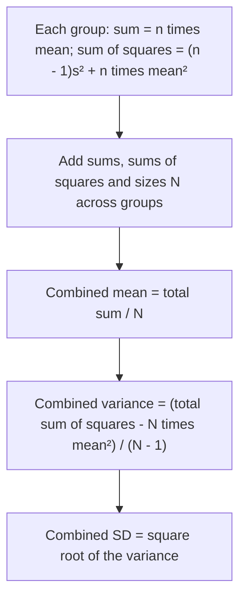

## When you don't have the raw data

Every formula in the core lessons started from a list of values. In practice you often get
something less: a frequency table, a table of counts in bins, or a report that gives only the
size, mean and standard deviation of each group. Two class sections, three factories or twelve
monthly reports have to be combined into one summary without going back to the raw numbers.
This honors lesson shows which summaries can be recovered *exactly* from such reports, which can
only be *estimated*, and which cannot be recovered at all. It ends with a way to update a mean
and standard deviation one value at a time, the way software and sensors do.

## Frequency tables: exact summaries

When a table lists every distinct value $x$ with its frequency $f$, nothing has been lost; the
table is just a compact way of writing the list. The number of values is $n = \sum f$, and

$$\bar{x} = \frac{\sum f x}{n}, \qquad s^2 = \frac{\sum f (x - \bar{x})^2}{n - 1}.$$

These are the ordinary formulas with each value counted $f$ times. The median is found by
counting through the cumulative frequencies to positions $n/2$ and $n/2 + 1$ (or $(n+1)/2$ when
$n$ is odd).

### Example 1

An inspector counts defects on 40 rail segments.

| Defects $x$ | 0 | 1 | 2 | 3 | 4 |
|---|---|---|---|---|---|
| Segments $f$ | 12 | 15 | 8 | 4 | 1 |

1. $n = 12 + 15 + 8 + 4 + 1 = 40$.
2. $\sum f x = 0 + 15 + 16 + 12 + 4 = 47$, so $\bar{x} = 47/40 = 1.175$ defects.
3. Squared deviations from 1.175, each times its frequency:
   $12(1.175)^2 + 15(0.175)^2 + 8(0.825)^2 + 4(1.825)^2 + 1(2.825)^2 \approx 16.568 + 0.459 + 5.445 + 13.323 + 7.981 = 43.775$.
4. $s^2 = 43.775/39 \approx 1.122$ and $s \approx 1.06$ defects.
5. Median: the 20th and 21st values. The cumulative counts are 12 (for 0) and 27 (through 1),
   so both are 1 and the median is 1 defect. The mean exceeds the median: the counts are skewed
   right.

## Grouped data: estimates

When values have been put into bins, the individual values are gone, and every summary becomes
an estimate. Data that are reported only as bin counts are called **grouped data**. The
standard assumption is that values are spread evenly within each bin (and, for the mean and
standard deviation, that each bin's values balance at its midpoint). The core lesson already
estimated the mean from midpoints $m$; the standard deviation works the same way:

$$\bar{x} \approx \frac{\sum f m}{n}, \qquad s^2 \approx \frac{\sum f (m - \bar{x})^2}{n - 1}.$$

For the median, use **linear interpolation** inside the bin that contains the middle position.
If that bin starts at $L$, has width $w$ and count $f$, and $F$ values lie below $L$, then

$$\text{median} \approx L + \frac{n/2 - F}{f} \cdot w.$$

The fraction says how far into the bin you must go to reach the $(n/2)$-th value. Replacing
$n/2$ with $n/4$ or $3n/4$ estimates $Q_1$ or $Q_3$. This is exactly what reading across an ogive
does, since an ogive joins its points with straight lines. (These grouped quartiles can differ a
little from the median-of-halves quartiles of the raw data; both are estimates of the same
idea.)

```plot
{"x": [0, 60], "y": [0, 1.05], "xLabel": "minutes", "yLabel": "cum. rel. freq.", "points": [[0, 0], [10, 0.15], [20, 0.475], [30, 0.725], [40, 0.875], [50, 0.95], [60, 1]], "segments": [{"from": [0, 0], "to": [10, 0.15]}, {"from": [10, 0.15], "to": [20, 0.475]}, {"from": [20, 0.475], "to": [30, 0.725]}, {"from": [30, 0.725], "to": [40, 0.875]}, {"from": [40, 0.875], "to": [50, 0.95]}, {"from": [50, 0.95], "to": [60, 1]}, {"from": [0, 0.25], "to": [13.08, 0.25], "dashed": true}, {"from": [13.08, 0.25], "to": [13.08, 0], "dashed": true}, {"from": [0, 0.75], "to": [31.67, 0.75], "dashed": true}, {"from": [31.67, 0.75], "to": [31.67, 0], "dashed": true}], "labels": [{"at": [16.5, 0.05], "text": "Q1 ≈ 13.1"}, {"at": [35.5, 0.05], "text": "Q3 ≈ 31.7"}], "caption": "Reading Q1 and Q3 from the commute-time ogive is linear interpolation"}
```

### Example 2

The commute times from the lesson on quantitative displays: bins 0–<10, 10–<20, …, 50–<60 with
counts 6, 13, 10, 6, 3, 2 ($n = 40$). Estimate the standard deviation, median and quartiles.

1. Mean from midpoints 5, 15, …, 55: $930/40 = 23.25$ minutes (as in the core lesson).
2. $\sum f (m - 23.25)^2 = 6(18.25)^2 + 13(8.25)^2 + 10(1.75)^2 + 6(11.75)^2 + 3(21.75)^2 + 2(31.75)^2 = 7177.5$.
3. $s^2 \approx 7177.5/39 \approx 184.0$, so $s \approx 13.6$ minutes.
4. Median: $n/2 = 20$. Below 20 minutes lie $F = 19$ values, and the 20–<30 bin has $f = 10$:
   median $\approx 20 + \frac{20 - 19}{10} \cdot 10 = 21$ minutes.
5. $Q_1$: $n/4 = 10$ falls in 10–<20 ($F = 6$, $f = 13$): $10 + \frac{10 - 6}{13} \cdot 10 \approx 13.1$.
   $Q_3$: $3n/4 = 30$ falls in 30–<40 ($F = 29$, $f = 6$): $30 + \frac{30 - 29}{6} \cdot 10 \approx 31.7$.

A side note for the curious: when the underlying distribution is smooth, grouping tends to make
the midpoint variance slightly too large, and a classical adjustment called Sheppard's correction
subtracts $w^2/12$. It relies on assumptions about the shape, so this course does not use it.

## Combining groups

Two class sections take the same test. Section A: $n_1 = 20$, $\bar{x}_1 = 72$, $s_1 = 8$.
Section B: $n_2 = 30$, $\bar{x}_2 = 80$, $s_2 = 10$. What are the mean and standard deviation of
all 50 scores?

The mean is a weighted mean, because each group's total is $n\bar{x}$:

$$\bar{x} = \frac{n_1\bar{x}_1 + n_2\bar{x}_2}{n_1 + n_2}.$$

The standard deviation is *not* a weighted average of $s_1$ and $s_2$. The way to see what it is:
from each group's report you can recover the two totals that the variance needs,

$$\sum x = n\bar{x}, \qquad \sum x^2 = (n - 1)s^2 + n\bar{x}^2$$

(the second comes from the shortcut formula $s^2 = \frac{\sum x^2 - n\bar{x}^2}{n-1}$ in the
spread lesson). Add the totals over the groups and apply the shortcut formula to the combined
data. Doing the algebra gives an illuminating form:

$$(N - 1)\,s^2 = \underbrace{\sum (n_j - 1)s_j^2}_{\text{within groups}} + \underbrace{\sum n_j(\bar{x}_j - \bar{x})^2}_{\text{between groups}}.$$

The spread of the combined data has two sources: **within-group variation** (how scattered each
group is around its own mean) and **between-group variation** (how far the group means are from
the overall mean). If the group means differ, the combined standard deviation can be larger than
every group's own standard deviation. This split is the seed of a method called analysis of
variance (ANOVA), taught in later statistics courses.



### Example 3

Combine the two sections above.

1. Combined mean: $(20 \times 72 + 30 \times 80)/50 = (1440 + 2400)/50 = 76.8$.
2. Within groups: $19 \times 8^2 + 29 \times 10^2 = 1216 + 2900 = 4116$.
3. Between groups: $20(72 - 76.8)^2 + 30(80 - 76.8)^2 = 20(23.04) + 30(10.24) = 460.8 + 307.2 = 768$.
4. $s^2 = (4116 + 768)/49 \approx 99.67$, so $s \approx 9.98$.
5. Check with totals: $\sum x^2 = (19 \cdot 64 + 20 \cdot 72^2) + (29 \cdot 100 + 30 \cdot 80^2) = 104{,}896 + 194{,}900 = 299{,}796$,
   and $(299{,}796 - 50 \times 76.8^2)/49 = (299{,}796 - 294{,}912)/49 \approx 99.67$. Same answer.

The combined $s \approx 9.98$ is close to the larger group SD, well above the simple average
$(8 + 10)/2 = 9$, because the 8-point gap between the section means adds spread.

**What cannot be combined:** medians and quartiles. Knowing that one group's median is 70 and
another's is 80 does not determine the median of the combined data; it depends on how the values
are arranged within each group. You need the raw data or at least a common set of bins.

## Updating one value at a time

A sensor reports a running mean after every reading. Recomputing from scratch each time is
wasteful, and the shortcut formula can lose accuracy when the numbers are large and close
together. If the mean of $n$ values is $\bar{x}_n$ and a new value $x$ arrives,

$$\bar{x}_{n+1} = \bar{x}_n + \frac{x - \bar{x}_n}{n + 1}.$$

The new value pulls the mean toward itself by $1/(n+1)$ of the gap. For the spread, keep the
sum of squared deviations $SS_n = (n - 1)s_n^2$ and update it with **Welford's algorithm**
(B. P. Welford, 1962):

$$SS_{n+1} = SS_n + (x - \bar{x}_n)(x - \bar{x}_{n+1}), \qquad s_{n+1}^2 = \frac{SS_{n+1}}{n}.$$

### Example 4

Ten readings have mean 50 and standard deviation 4. An eleventh reading is 62.

1. New mean: $50 + (62 - 50)/11 = 50 + 1.0909 \approx 51.09$.
2. $SS_{10} = 9 \times 4^2 = 144$.
3. $SS_{11} = 144 + (62 - 50)(62 - 51.0909) = 144 + 12 \times 10.9091 \approx 274.91$.
4. $s_{11}^2 = 274.91/10 \approx 27.49$, so $s_{11} \approx 5.24$. One reading 12 above the mean
   raised the standard deviation from 4 to about 5.2, another reminder that $s$ is not resistant.

## Common mistakes

- Averaging two group means without weighting by group size.
- Averaging two standard deviations (or two variances) to get the combined one. That ignores the
  between-group term and the different group sizes.
- Treating grouped-data results as exact. They are estimates that assume values spread evenly
  within each bin.
- Using $n/2$ as a *value* instead of a *position* in the interpolation formula.
- Trying to combine medians from summary reports. It can't be done without more information.

## Key points

- A frequency table loses nothing: $\bar{x} = \sum fx/n$, $s^2 = \sum f(x - \bar{x})^2/(n-1)$.
- Grouped data give estimates: midpoints for the mean and SD; median $\approx L + \frac{n/2 - F}{f}\,w$.
- Each group's report gives $\sum x = n\bar{x}$ and $\sum x^2 = (n-1)s^2 + n\bar{x}^2$; combine the
  totals. Combined variation = within groups + between groups.
- Medians cannot be combined from summaries.
- Updating: $\bar{x}_{n+1} = \bar{x}_n + (x - \bar{x}_n)/(n+1)$ and
  $SS_{n+1} = SS_n + (x - \bar{x}_n)(x - \bar{x}_{n+1})$.
