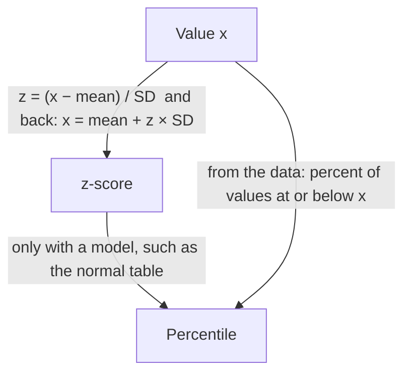

## Where does one value stand?

Module 1 described whole distributions. Often the question is about a single
individual: is a 2:58 marathon fast? Is a newborn's weight of 3.1 kg low? Is a score of
82 on one exam better than 75 on another? Answering requires locating the value
*relative to its distribution*. Two tools do this: percentiles, which use position in the
ordered data, and z-scores, which use the mean and standard deviation.

## Percentiles

The **percentile** of a value is the percent of the distribution that is *at or below*
it (some books say "below"; for large data sets the difference is negligible). A score
at the 90th percentile is higher than or equal to about 90% of all scores — it does
*not* mean 90% correct.

Familiar percentiles:

- $Q_1$ is about the 25th percentile, the median is the 50th, $Q_3$ the 75th.
- Growth charts for children report weight and height percentiles by age.

With $n$ values sorted, a value in position $k$ is at about the $\tfrac{k}{n} \times 100$th
percentile. Cumulative relative frequency graphs from Module 1 are percentile graphs:
read across from 0.80 to find the 80th percentile.

The graph below shows the commute times of a large group of workers. Reading across from
0.25, 0.50, 0.75 and 0.90 to the line, then down to the axis, gives $Q_1 \approx 18$, a
median of about 26, $Q_3 = 35$ and a 90th percentile of 45 minutes. Reading the other way,
up from 40 minutes and across, shows that a 40-minute commute is at the 85th percentile.

### Example 1

In a class of 25 students, Maya's score of 88 is the 21st lowest (20 students scored
lower, 4 higher). What is her percentile?

At or below 88: 21 students, and $21/25 = 0.84$. Maya is at about the 84th percentile.
(Using "strictly below": $20/25 = 80$th percentile. Either convention is acceptable if
stated.)

## z-scores

A **z-score** (standardized score) measures how many standard deviations a value lies
from the mean:

$$z = \frac{x - \text{mean}}{\text{standard deviation}} = \frac{x - \bar{x}}{s} \quad\text{or}\quad \frac{x - \mu}{\sigma}.$$

- $z > 0$: above the mean; $z < 0$: below the mean; $z = 0$: exactly at the mean.
- $|z|$ tells how far away, in units of standard deviations.
- z-scores have no units — the units cancel — so values from different variables can
  be compared.

Solving the formula for $x$ converts back:

$$x = \text{mean} + z \times \text{SD}.$$

Why does dividing by the SD make sense? A 10-point gap means a lot when scores typically
vary by 4 points and very little when they vary by 25. Dividing by the SD measures every
gap in the distribution's own natural unit.

### Example 2

A rail weld must withstand a load. Welds from Supplier A average 58 kN with standard
deviation 4 kN; welds from Supplier B average 61 kN with standard deviation 7 kN. A
particular A weld held 66 kN and a B weld held 72 kN. Which is more exceptional
relative to its own supplier?

1. A: $z = \dfrac{66 - 58}{4} = 2.0$.
2. B: $z = \dfrac{72 - 61}{7} \approx 1.57$.
3. The A weld is 2 standard deviations above its mean, the B weld about 1.6. Although
   72 > 66 in raw terms, the A weld is more exceptional relative to its supplier.

### Example 3

Scores on a certification exam have mean 500 and standard deviation 80. A scholarship
requires $z \ge 1.25$. What raw score is needed?

$x = 500 + 1.25(80) = 500 + 100 = 600$.

A z-score is a second ruler laid under the first. Each step of one SD (80 points) on the
score ruler is one unit on the z ruler, and the mean, 500, sits at 0:

### Example 4

A student's z-score on a test is $-0.6$; the class mean was 74 and the student scored 68.
What was the standard deviation?

From $z = (x - \text{mean})/\text{SD}$: $-0.6 = (68 - 74)/\text{SD} = -6/\text{SD}$, so
$\text{SD} = 6/0.6 = 10$.

## Properties of z-scores

If you convert *every* value in a data set to a z-score, the new data set has mean 0 and
standard deviation 1, and the same shape as the original. (The next lesson explains
why: standardizing is a shift followed by a rescaling.) This is what lets one table — the
standard normal table in the next lessons — serve every normal distribution.

Standardizing does *not* make data normal. A right-skewed distribution of incomes,
standardized, is still right-skewed — just centered at 0 with SD 1.

## Chebyshev's inequality

How unusual is a value with $|z| = 3$? For *any* distribution, at least
$1 - \dfrac{1}{k^2}$ of the values lie within $k$ standard deviations of the mean (for
$k > 1$). This is **Chebyshev's inequality**. So at least $1 - 1/4 = 75\%$ of values are
within 2 SDs and at least $1 - 1/9 \approx 88.9\%$ within 3 SDs — whatever the shape.
For normal distributions (lesson 9), the actual percentages are much higher (95% and
99.7%).

Why it's true, in one line: if more than $1/k^2$ of the values were farther than $k$ SDs
from the mean, their squared deviations alone would exceed $n \cdot \tfrac{1}{k^2} \cdot k^2\sigma^2 = n\sigma^2$,
which is the entire sum of squared deviations — impossible.

## Comparing percentiles and z-scores

| | Percentile | z-score |
|---|---|---|
| Based on | position in sorted data | mean and SD |
| Range | 0 to 100 | any real number (usually −3 to 3) |
| Affected by outliers | little | yes (mean and SD are not resistant) |
| Needs a shape assumption to convert to the other | — | yes: for normal data, z = 1 ↔ 84th percentile |

The diagram sums up the three ways to describe one value's position and how to move
between them.

## Common mistakes

- Reading "90th percentile" as "90% correct."
- Subtracting in the wrong order: $z = (x - \text{mean})/\text{SD}$, not $(\text{mean} - x)/\text{SD}$.
- Dividing by the variance instead of the standard deviation.
- Thinking a z-score of 2 is always at the 97.7th percentile — that's only true for normal
  distributions.
- Thinking standardizing makes a distribution normal.

## Key points

- A percentile is the percent of values at or below a given value.
- $z = (x - \text{mean})/\text{SD}$: the number of SDs above (+) or below (−) the mean;
  $x = \text{mean} + z \cdot \text{SD}$.
- z-scores are unitless, so they compare values across different distributions.
- Standardized data have mean 0, SD 1 and the same shape as the original.
- Chebyshev: at least $1 - 1/k^2$ of any distribution is within $k$ SDs of the mean.
